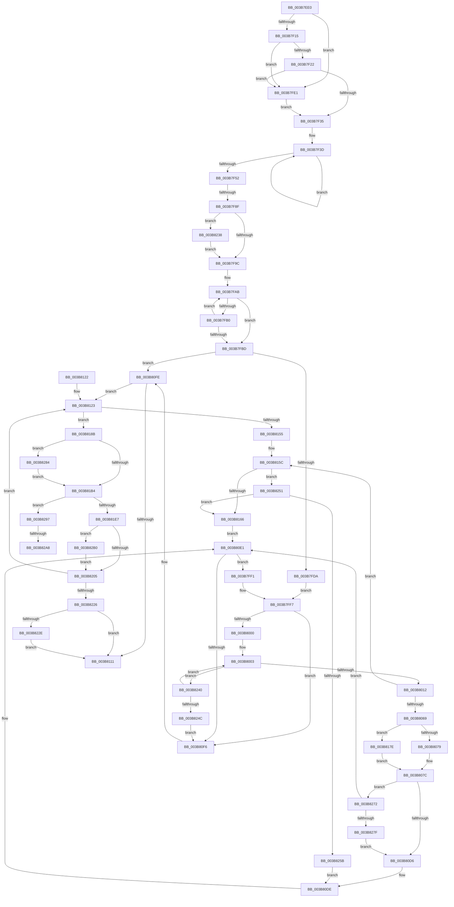

# MiGetFastLargePages

- RVA: `0x003B7EE0`–`0x003B82C8` (길이 `1,000` bytes)
- VA: `0x00000001403B7EE0`
- 실행 섹션: `.text`
- PDB 이름 있음: `예`; PDB Function 태그: `예`
- unwind 정보 RVA: `0x0008C8B0`
- 디코드: `249`개 명령, `1,000/1,000` bytes 표시
- 미해석 바이트: `0` (있으면 어셈블리에 `.byte`로 보존)

> 이 문서는 커널 이미지의 기계어와 PDB 기호를 분석해 생성했습니다. 4번과 5번은 함수 원형과 자료형을 바이너리 사용 방식에서 추정한 C 해석이며 원본 소스 복구 결과는 아닙니다.

## 1. Dependencies

- 직접 호출 지점: **6**; 고유 호출 대상: **5**
- 직접 호출자로 확인된 함수: **1**
- RIP 상대 이미지 참조: **1**

### Outgoing calls
- `0x003B7F55` → [MiProtectionToCacheAttribute](../2B/MiProtectionToCacheAttribute_function_002B8530.md) (function, `0x002B8530`)
- `0x003B8058` → [MiGetLargePageDemoteAsNeeded](MiGetLargePageDemoteAsNeeded_function_003B8440.md) (function, `0x003B8440`)
- `0x003B8084` → [MiGetPfnPageSizeIndex](../31/MiGetPfnPageSizeIndex_function_0031C710.md) (function, `0x0031C710`)
- `0x003B8129` → [MiGetPfnPageSizeIndex](../31/MiGetPfnPageSizeIndex_function_0031C710.md) (function, `0x0031C710`)
- `0x003B8215` → [MiUpdateLargePageBitMap](../37/MiUpdateLargePageBitMap_function_0037619C.md) (function, `0x0037619C`)
- `0x003B82B8` → [MiChangePageAttribute](../33/MiChangePageAttribute_function_00332ECC.md) (function, `0x00332ECC`)

### Direct callers
- [MiAllocateLargeZeroPages](MiAllocateLargeZeroPages_function_003B743C.md) at `0x003B755C`

### Static image references
- `0x003B7F5E` → RVA `0x00011C60` (`.rdata`; read)

## 2. Other-region calls and transfers

- 다른 실행 섹션으로 향하는 call: **0**
- call이 아닌 외부 분기/꼬리 이동: **3**
  - `0x003B7F89` → [sub_006E7724](../6E/Unknown_function_006E7724.md) (`tail-transfer`)
  - `0x003B82A2` → [sub_006E7724 + 0xDA](../6E/Unknown_function_006E7724.md) (`tail-transfer`)
  - `0x003B82AB` → [sub_006E7724 + 0xF4](../6E/Unknown_function_006E7724.md) (`tail-transfer`)

## 3. Assembly (complete function range)

```asm
003B7EE0  48 89 54 24 10                  mov qword ptr [rsp + 0x10], rdx
003B7EE5  53                              push rbx
003B7EE6  55                              push rbp
003B7EE7  56                              push rsi
003B7EE8  57                              push rdi
003B7EE9  41 54                           push r12
003B7EEB  41 55                           push r13
003B7EED  41 56                           push r14
003B7EEF  41 57                           push r15
003B7EF1  48 83 EC 58                     sub rsp, 0x58
003B7EF5  8B 01                           mov eax, dword ptr [rcx]
003B7EF7  45 33 FF                        xor r15d, r15d
003B7EFA  44 89 BC 24 B8 00 00 00         mov dword ptr [rsp + 0xb8], r15d
003B7F02  48 8B F9                        mov rdi, rcx
003B7F05  41 8D 6F 02                     lea ebp, [r15 + 2]
003B7F09  45 8D 57 01                     lea r10d, [r15 + 1]
003B7F0D  A8 10                           test al, 0x10
003B7F0F  0F 85 CC 00 00 00               jne 0x1403b7fe1
003B7F15  44 0F 20 C0                     mov rax, cr8
003B7F19  40 3A C5                        cmp al, bpl
003B7F1C  0F 83 BF 00 00 00               jae 0x1403b7fe1
003B7F22  65 8B 04 25 3C 3A 00 00         mov eax, dword ptr gs:[0x3a3c]
003B7F2A  A9 01 00 01 00                  test eax, 0x10001
003B7F2F  0F 85 AC 00 00 00               jne 0x1403b7fe1
003B7F35  48 8B C2                        mov rax, rdx
003B7F38  B9 04 00 00 00                  mov ecx, 4
003B7F3D  48 83 60 10 00                  and qword ptr [rax + 0x10], 0
003B7F42  48 89 40 08                     mov qword ptr [rax + 8], rax
003B7F46  48 89 00                        mov qword ptr [rax], rax
003B7F49  48 83 C0 18                     add rax, 0x18
003B7F4D  49 2B CA                        sub rcx, r10
003B7F50  75 EB                           jne 0x1403b7f3d
003B7F52  8B 4F 24                        mov ecx, dword ptr [rdi + 0x24]
003B7F55  E8 D6 05 F0 FF                  call 0x1402b8530
003B7F5A  48 8B 5F 10                     mov rbx, qword ptr [rdi + 0x10]
003B7F5E  4C 8D 1D FB 9C C5 FF            lea r11, [rip - 0x3a6305]
003B7F65  48 2B 5F 48                     sub rbx, qword ptr [rdi + 0x48]
003B7F69  33 F6                           xor esi, esi
003B7F6B  48 21 74 24 40                  and qword ptr [rsp + 0x40], rsi
003B7F70  44 8B C0                        mov r8d, eax
003B7F73  21 B4 24 B0 00 00 00            and dword ptr [rsp + 0xb0], esi
003B7F7A  4C 8B 4F 28                     mov r9, qword ptr [rdi + 0x28]
003B7F7E  89 84 24 A0 00 00 00            mov dword ptr [rsp + 0xa0], eax
003B7F85  49 83 F9 FF                     cmp r9, -1
003B7F89  0F 85 95 F7 32 00               jne 0x1406e7724
003B7F8F  8B 07                           mov eax, dword ptr [rdi]
003B7F91  41 8B DF                        mov ebx, r15d
003B7F94  A8 04                           test al, 4
003B7F96  0F 84 9C 02 00 00               je 0x1403b8238
003B7F9C  48 83 4F 28 FF                  or qword ptr [rdi + 0x28], 0xffffffffffffffff
003B7FA1  49 8B C3                        mov rax, r11
003B7FA4  48 8B 4F 18                     mov rcx, qword ptr [rdi + 0x18]
003B7FA8  45 33 E4                        xor r12d, r12d
003B7FAB  48 39 08                        cmp qword ptr [rax], rcx
003B7FAE  74 0D                           je 0x1403b7fbd
003B7FB0  45 03 E2                        add r12d, r10d
003B7FB3  48 83 C0 08                     add rax, 8
003B7FB7  41 83 FC 03                     cmp r12d, 3
003B7FBB  72 EE                           jb 0x1403b7fab
003B7FBD  48 8B 47 48                     mov rax, qword ptr [rdi + 0x48]
003B7FC1  33 C9                           xor ecx, ecx
003B7FC3  83 64 24 30 00                  and dword ptr [rsp + 0x30], 0
003B7FC8  48 8B 57 10                     mov rdx, qword ptr [rdi + 0x10]
003B7FCC  48 89 44 24 38                  mov qword ptr [rsp + 0x38], rax
003B7FD1  48 3B C2                        cmp rax, rdx
003B7FD4  0F 83 24 01 00 00               jae 0x1403b80fe
003B7FDA  44 8B 7C 24 30                  mov r15d, dword ptr [rsp + 0x30]
003B7FDF  EB 16                           jmp 0x1403b7ff7
003B7FE1  45 8B FA                        mov r15d, r10d
003B7FE4  44 89 94 24 B8 00 00 00         mov dword ptr [rsp + 0xb8], r10d
003B7FEC  E9 44 FF FF FF                  jmp 0x1403b7f35
003B7FF1  41 BA 01 00 00 00               mov r10d, 1
003B7FF7  41 3B CC                        cmp ecx, r12d
003B7FFA  0F 87 F6 00 00 00               ja 0x1403b80f6
003B8000  48 2B D0                        sub rdx, rax
003B8003  8B C1                           mov eax, ecx
003B8005  44 8B E9                        mov r13d, ecx
003B8008  49 39 14 C3                     cmp qword ptr [r11 + rax*8], rdx
003B800C  0F 87 2E 02 00 00               ja 0x1403b8240
003B8012  8B C1                           mov eax, ecx
003B8014  41 8B E8                        mov ebp, r8d
003B8017  48 8B 4F 08                     mov rcx, qword ptr [rdi + 8]
003B801B  83 E0 03                        and eax, 3
003B801E  83 E5 03                        and ebp, 3
003B8021  45 8B CC                        mov r9d, r12d
003B8024  C1 E5 02                        shl ebp, 2
003B8027  44 8B C3                        mov r8d, ebx
003B802A  0B E8                           or ebp, eax
003B802C  41 8B C7                        mov eax, r15d
003B802F  41 23 C2                        and eax, r10d
003B8032  03 ED                           add ebp, ebp
003B8034  0B E8                           or ebp, eax
003B8036  8B 47 20                        mov eax, dword ptr [rdi + 0x20]
003B8039  83 E0 3F                        and eax, 0x3f
003B803C  C1 E5 06                        shl ebp, 6
003B803F  0B E8                           or ebp, eax
003B8041  48 8B 47 40                     mov rax, qword ptr [rdi + 0x40]
003B8045  48 89 44 24 28                  mov qword ptr [rsp + 0x28], rax
003B804A  48 8B 47 38                     mov rax, qword ptr [rdi + 0x38]
003B804E  C1 E5 09                        shl ebp, 9
003B8051  8B D5                           mov edx, ebp
003B8053  48 89 44 24 20                  mov qword ptr [rsp + 0x20], rax
003B8058  E8 E3 03 00 00                  call 0x1403b8440
003B805D  4C 8B F0                        mov r14, rax
003B8060  48 85 C0                        test rax, rax
003B8063  0F 84 F3 00 00 00               je 0x1403b815c
003B8069  48 C7 00 00 00 00 00            mov qword ptr [rax], 0
003B8070  48 85 F6                        test rsi, rsi
003B8073  0F 85 05 01 00 00               jne 0x1403b817e
003B8079  48 8B F0                        mov rsi, rax
003B807C  49 8B CE                        mov rcx, r14
003B807F  4C 89 74 24 40                  mov qword ptr [rsp + 0x40], r14
003B8084  E8 87 46 F6 FF                  call 0x14031c710
003B8089  44 8B C0                        mov r8d, eax
003B808C  4C 8D 1D CD 9B C5 FF            lea r11, [rip - 0x3a6433]
003B8093  48 8B 44 24 38                  mov rax, qword ptr [rsp + 0x38]
003B8098  48 B9 00 00 00 00 00 DE FF FF   movabs rcx, 0xffffde0000000000
003B80A2  4B 8B 14 C3                     mov rdx, qword ptr [r11 + r8*8]
003B80A6  48 03 C2                        add rax, rdx
003B80A9  48 89 44 24 38                  mov qword ptr [rsp + 0x38], rax
003B80AE  48 8B C9                        mov rcx, rcx
003B80B1  4C 2B F1                        sub r14, rcx
003B80B4  48 B9 AB AA AA AA AA AA AA AA   movabs rcx, 0xaaaaaaaaaaaaaaab
003B80BE  49 C1 FE 04                     sar r14, 4
003B80C2  4C 0F AF F1                     imul r14, rcx
003B80C6  4C 03 F2                        add r14, rdx
003B80C9  49 81 FE 00 00 10 00            cmp r14, 0x100000
003B80D0  0F 83 9C 01 00 00               jae 0x1403b8272
003B80D6  44 89 47 30                     mov dword ptr [rdi + 0x30], r8d
003B80DA  4C 89 77 28                     mov qword ptr [rdi + 0x28], r14
003B80DE  41 8B CD                        mov ecx, r13d
003B80E1  48 8B 57 10                     mov rdx, qword ptr [rdi + 0x10]
003B80E5  44 8B 84 24 A0 00 00 00         mov r8d, dword ptr [rsp + 0xa0]
003B80ED  48 3B C2                        cmp rax, rdx
003B80F0  0F 82 FB FE FF FF               jb 0x1403b7ff1
003B80F6  44 8B BC 24 B8 00 00 00         mov r15d, dword ptr [rsp + 0xb8]
003B80FE  46 8D 2C 7D 02 00 00 00         lea r13d, [r15*2 + 2]
003B8106  33 ED                           xor ebp, ebp
003B8108  41 C1 E7 04                     shl r15d, 4
003B810C  48 85 F6                        test rsi, rsi
003B810F  75 12                           jne 0x1403b8123
003B8111  48 83 C4 58                     add rsp, 0x58
003B8115  41 5F                           pop r15
003B8117  41 5E                           pop r14
003B8119  41 5D                           pop r13
003B811B  41 5C                           pop r12
003B811D  5F                              pop rdi
003B811E  5E                              pop rsi
003B811F  5D                              pop rbp
003B8120  5B                              pop rbx
003B8121  C3                              ret
003B8122  CC                              int3
003B8123  4C 8B 26                        mov r12, qword ptr [rsi]
003B8126  48 8B CE                        mov rcx, rsi
003B8129  E8 E2 45 F6 FF                  call 0x14031c710
003B812E  44 8B C8                        mov r9d, eax
003B8131  4C 8D 1D 28 9B C5 FF            lea r11, [rip - 0x3a64d8]
003B8138  48 8B 84 24 A8 00 00 00         mov rax, qword ptr [rsp + 0xa8]
003B8140  4F 8B 34 CB                     mov r14, qword ptr [r11 + r9*8]
003B8144  4B 8D 0C 49                     lea rcx, [r9 + r9*2]
003B8148  48 8D 14 C8                     lea rdx, [rax + rcx*8]
003B814C  48 8B 4A 08                     mov rcx, qword ptr [rdx + 8]
003B8150  48 39 11                        cmp qword ptr [rcx], rdx
003B8153  74 36                           je 0x1403b818b
003B8155  B9 03 00 00 00                  mov ecx, 3
003B815A  CD 29                           int 0x29
003B815C  0F BA E5 0F                     bt ebp, 0xf
003B8160  0F 83 EB 00 00 00               jae 0x1403b8251
003B8166  48 8B 44 24 38                  mov rax, qword ptr [rsp + 0x38]
003B816B  41 8D 4D 01                     lea ecx, [r13 + 1]
003B816F  45 33 FF                        xor r15d, r15d
003B8172  4C 8D 1D E7 9A C5 FF            lea r11, [rip - 0x3a6519]
003B8179  E9 63 FF FF FF                  jmp 0x1403b80e1
003B817E  48 8B 44 24 40                  mov rax, qword ptr [rsp + 0x40]
003B8183  4C 89 30                        mov qword ptr [rax], r14
003B8186  E9 F1 FE FF FF                  jmp 0x1403b807c
003B818B  48 89 16                        mov qword ptr [rsi], rdx
003B818E  41 BA 01 00 00 00               mov r10d, 1
003B8194  48 89 4E 08                     mov qword ptr [rsi + 8], rcx
003B8198  48 89 31                        mov qword ptr [rcx], rsi
003B819B  48 89 72 08                     mov qword ptr [rdx + 8], rsi
003B819F  4C 01 52 10                     add qword ptr [rdx + 0x10], r10
003B81A3  4C 01 77 48                     add qword ptr [rdi + 0x48], r14
003B81A7  48 8B 57 38                     mov rdx, qword ptr [rdi + 0x38]
003B81AB  48 85 D2                        test rdx, rdx
003B81AE  0F 85 D0 00 00 00               jne 0x1403b8284
003B81B4  48 B8 00 00 00 00 00 DE FF FF   movabs rax, 0xffffde0000000000
003B81BE  48 8B C0                        mov rax, rax
003B81C1  48 8B DE                        mov rbx, rsi
003B81C4  48 2B D8                        sub rbx, rax
003B81C7  48 B8 AB AA AA AA AA AA AA AA   movabs rax, 0xaaaaaaaaaaaaaaab
003B81D1  48 C1 FB 04                     sar rbx, 4
003B81D5  48 0F AF D8                     imul rbx, rax
003B81D9  83 BC 24 B0 00 00 00 00         cmp dword ptr [rsp + 0xb0], 0
003B81E1  0F 85 B0 00 00 00               jne 0x1403b8297
003B81E7  8B 46 20                        mov eax, dword ptr [rsi + 0x20]
003B81EA  C1 E8 10                        shr eax, 0x10
003B81ED  44 0F B6 C8                     movzx r9d, al
003B81F1  8B 84 24 A0 00 00 00            mov eax, dword ptr [rsp + 0xa0]
003B81F8  41 C1 E9 06                     shr r9d, 6
003B81FC  44 3B C8                        cmp r9d, eax
003B81FF  0F 85 AB 00 00 00               jne 0x1403b82b0
003B8205  48 8B 4F 08                     mov rcx, qword ptr [rdi + 8]
003B8209  45 8B CD                        mov r9d, r13d
003B820C  45 0B CA                        or r9d, r10d
003B820F  4D 8B C6                        mov r8, r14
003B8212  48 8B D3                        mov rdx, rbx
003B8215  E8 82 DF FB FF                  call 0x14037619c
003B821A  49 8B F4                        mov rsi, r12
003B821D  4D 85 E4                        test r12, r12
003B8220  0F 85 FD FE FF FF               jne 0x1403b8123
003B8226  85 ED                           test ebp, ebp
003B8228  0F 84 E3 FE FF FF               je 0x1403b8111
003B822E  48 83 4F 28 FF                  or qword ptr [rdi + 0x28], 0xffffffffffffffff
003B8233  E9 D9 FE FF FF                  jmp 0x1403b8111
003B8238  83 CB 10                        or ebx, 0x10
003B823B  E9 5C FD FF FF                  jmp 0x1403b7f9c
003B8240  41 03 CA                        add ecx, r10d
003B8243  41 3B CC                        cmp ecx, r12d
003B8246  0F 86 B7 FD FF FF               jbe 0x1403b8003
003B824C  E9 A5 FE FF FF                  jmp 0x1403b80f6
003B8251  8B 07                           mov eax, dword ptr [rdi]
003B8253  A8 01                           test al, 1
003B8255  0F 85 0B FF FF FF               jne 0x1403b8166
003B825B  48 8B 44 24 38                  mov rax, qword ptr [rsp + 0x38]
003B8260  4C 8D 1D F9 99 C5 FF            lea r11, [rip - 0x3a6607]
003B8267  41 BF 01 00 00 00               mov r15d, 1
003B826D  E9 6C FE FF FF                  jmp 0x1403b80de
003B8272  41 8B CD                        mov ecx, r13d
003B8275  0F BA E5 0F                     bt ebp, 0xf
003B8279  0F 82 62 FE FF FF               jb 0x1403b80e1
003B827F  E9 52 FE FF FF                  jmp 0x1403b80d6
003B8284  49 8B C6                        mov rax, r14
003B8287  48 C1 E0 0C                     shl rax, 0xc
003B828B  48 03 D0                        add rdx, rax
003B828E  48 89 57 38                     mov qword ptr [rdi + 0x38], rdx
003B8292  E9 1D FF FF FF                  jmp 0x1403b81b4
003B8297  48 8B 47 28                     mov rax, qword ptr [rdi + 0x28]
003B829B  4E 8D 04 30                     lea r8, [rax + r14]
003B829F  4C 3B C0                        cmp r8, rax
003B82A2  0F 87 56 F5 32 00               ja 0x1406e77fe
003B82A8  41 8B EA                        mov ebp, r10d
003B82AB  E9 68 F5 32 00                  jmp 0x1406e7818
003B82B0  45 8B C7                        mov r8d, r15d
003B82B3  8B D0                           mov edx, eax
003B82B5  48 8B CE                        mov rcx, rsi
003B82B8  E8 0F AC F7 FF                  call 0x140332ecc
003B82BD  41 BA 01 00 00 00               mov r10d, 1
003B82C3  E9 3D FF FF FF                  jmp 0x1403b8205
```

## 4. C-style interpretation (structured pseudocode)

```c
__int64 __fastcall MiGetFastLargePages(__int64 a1, __int64 a2)
{
    __int64 result;
    __int64 v_r12;
    __int64 v_r14;
    __int64 v_r15;
    __int64 v_rbp;
    __int64 v_rbx;
    __int64 v_rsi;
    __int64 v_rsp;
    unsigned __int64 v_stack_m58;
    unsigned __int64 v_stack_m60;
    unsigned int v_stack_m68;
    unsigned __int64 v_stack_m70;
    unsigned __int64 v_stack_m78;
    unsigned __int64 v_stack_p10;
    unsigned int v_stack_p18;
    unsigned int v_stack_p20;
    unsigned __int64 v_stack_p38;
    unsigned __int64 v_stack_p40;
    unsigned int v_stack_p8;
    unsigned int v_stack_pA0;
    unsigned __int64 v_stack_pA8;
    unsigned int v_stack_pB0;

    v_stack_p10 = a2;
    v_rsp = (v_rsp) - (88);
    v_r15 = 0;
    v_stack_p20 = 0;
    if ((((unsigned __int8)((unsigned int)(*(unsigned int *)(a1)))) & (16)) != 0) goto loc_003B7FE1;
    if (((unsigned __int8)(v_cr8)) >= ((unsigned __int8)(v_r15 + 2))) goto loc_003B7FE1;
    if ((((unsigned int)((unsigned int)(*(unsigned int *)(gs_base + (0 + 14908))))) & (0x10001ULL)) != 0) goto loc_003B7FE1;
loc_003B7F35:
loc_003B7F3D:
    *(unsigned __int64 *)(a2 + 8) = a2;
    *(unsigned __int64 *)(a2) = a2;
    result = (a2) + (24);
    a1 = (4) - (v_r15 + 1);
    if (condition_is_not_equal) goto loc_003B7F3D;
    result = MiProtectionToCacheAttribute((unsigned int)(*(unsigned int *)(a1 + 36)), a2, a3, a4);
    v_rbx = (*(unsigned __int64 *)(a1 + 16)) - (*(unsigned __int64 *)(a1 + 72));
    v_rsi = 0;
    v_stack_p8 = (unsigned int)(result);
    if ((((unsigned __int8)((unsigned int)(*(unsigned int *)(a1)))) & (4)) == 0) goto loc_003B8238;
loc_003B7F9C:
    v_r12 = 0;
loc_003B7FAB:
    if ((*(unsigned __int64 *)(v_rip - 3826437)) == (*(unsigned __int64 *)(a1 + 24))) goto loc_003B7FBD;
    v_r12 = (unsigned int)((v_r12) + ((unsigned int)(v_r15 + 1)));
    result = (v_rip - 3826437) + (8);
    if (((unsigned int)(v_r12)) < 3) goto loc_003B7FAB;
loc_003B7FBD:
    a1 = 0;
    v_stack_m60 = *(unsigned __int64 *)(a1 + 72);
    if ((*(unsigned __int64 *)(a1 + 72)) >= (*(unsigned __int64 *)(a1 + 16))) goto loc_003B80FE;
    goto loc_003B7FF7;
loc_003B7FE1:
    v_stack_p20 = (unsigned int)(v_r15 + 1);
    goto loc_003B7F35;
loc_003B7FF1:
loc_003B7FF7:
    if (0 > ((unsigned int)(v_r12))) goto loc_003B80F6;
    a2 = (*(unsigned __int64 *)(a1 + 16)) - (*(unsigned __int64 *)(a1 + 72));
loc_003B8003:
    if ((*(unsigned __int64 *)(v_rip - 3826437 + 0 * 8)) > a2) goto loc_003B8240;
    result = (unsigned int)((0) & (3));
    v_rbp = (unsigned int)(((unsigned int)((unsigned int)((unsigned int)((unsigned int)(result))))) & (3));
    v_rbp = (unsigned int)((v_rbp) << (2));
    v_rbp = (unsigned int)((v_rbp) | ((unsigned int)(result)));
    result = (unsigned int)(((unsigned int)((unsigned int)((unsigned int)((unsigned int)(v_r15 + 1))))) & (1));
    v_rbp = (unsigned int)((v_rbp) + ((unsigned int)(v_rbp)));
    v_rbp = (unsigned int)((v_rbp) | ((unsigned int)(result)));
    result = (unsigned int)(((unsigned int)(*(unsigned int *)(a1 + 32))) & (63));
    v_rbp = (unsigned int)((v_rbp) << (6));
    v_rbp = (unsigned int)((v_rbp) | ((unsigned int)(result)));
    v_stack_m70 = *(unsigned __int64 *)(a1 + 64);
    v_rbp = (unsigned int)((v_rbp) << (9));
    v_stack_m78 = *(unsigned __int64 *)(a1 + 56);
    result = MiGetLargePageDemoteAsNeeded(*(unsigned __int64 *)(a1 + 8), (unsigned int)((unsigned int)(v_rbp)), 0, (unsigned int)((unsigned int)(v_r12)));
    if (result == 0) goto loc_003B815C;
    *(unsigned __int64 *)(result) = 0;
    if (0 != 0) goto loc_003B817E;
loc_003B807C:
    v_stack_m58 = result;
    result = MiGetPfnPageSizeIndex(result, (unsigned int)((unsigned int)(v_rbp)), 0, (unsigned int)((unsigned int)(v_r12)));
    result = (v_stack_m60) + (*(unsigned __int64 *)(v_rip - 3826739 + (unsigned int)((unsigned int)(result)) * 8));
    v_stack_m60 = result;
    v_r14 = (result) - (result);
    v_r14 = (v_r14) >> (4);
    v_r14 = (v_r14) * (result);
    v_r14 = (v_r14) + (*(unsigned __int64 *)(v_rip - 3826739 + (unsigned int)((unsigned int)(result)) * 8));
    if (v_r14 >= 0x100000ULL) goto loc_003B8272;
loc_003B80D6:
    *(unsigned int *)(a1 + 48) = (unsigned int)((unsigned int)((unsigned int)(result)));
    *(unsigned __int64 *)(a1 + 40) = v_r14;
loc_003B80DE:
loc_003B80E1:
    if (result < (*(unsigned __int64 *)(a1 + 16))) goto loc_003B7FF1;
loc_003B80F6:
loc_003B80FE:
    v_rbp = 0;
    v_r15 = (unsigned int)(((unsigned int)(v_stack_p20)) << (4));
    if (result != 0) goto loc_003B8123;
loc_003B8111:
    v_rsp = (v_rsp) + (88);
    return result;
loc_003B8123:
    result = MiGetPfnPageSizeIndex(result, *(unsigned __int64 *)(a1 + 16), (unsigned int)(v_stack_p8), (unsigned int)((unsigned int)(v_r12)));
    if ((*(unsigned __int64 *)(*(unsigned __int64 *)(v_stack_pA8 + (unsigned int)((unsigned int)(result)) + (unsigned int)((unsigned int)(result)) * 2 * 8 + 8))) == (v_stack_pA8 + (unsigned int)((unsigned int)(result)) + (unsigned int)((unsigned int)(result)) * 2 * 8)) goto loc_003B818B;
loc_003B815C:
    if ((*(unsigned __int64 *)(*(unsigned __int64 *)(v_stack_pA8 + (unsigned int)((unsigned int)(result)) + (unsigned int)((unsigned int)(result)) * 2 * 8 + 8))) >= (v_stack_pA8 + (unsigned int)((unsigned int)(result)) + (unsigned int)((unsigned int)(result)) * 2 * 8)) goto loc_003B8251;
loc_003B8166:
    v_r15 = 0;
    goto loc_003B80E1;
loc_003B817E:
    *(unsigned __int64 *)(v_stack_p40) = *(unsigned __int64 *)(v_rip - 3826904 + (unsigned int)((unsigned int)(result)) * 8);
    goto loc_003B807C;
loc_003B818B:
    *(unsigned __int64 *)(result) = v_stack_pA8 + (unsigned int)((unsigned int)(result)) + (unsigned int)((unsigned int)(result)) * 2 * 8;
    *(unsigned __int64 *)(result + 8) = (unsigned int)(v_stack_p20) * 2 + 2 + 1;
    *(unsigned __int64 *)((unsigned int)(v_stack_p20) * 2 + 2 + 1) = result;
    *(unsigned __int64 *)(v_stack_pA8 + (unsigned int)((unsigned int)(result)) + (unsigned int)((unsigned int)(result)) * 2 * 8 + 8) = result;
    if (*(unsigned __int64 *)(a1 + 56) != 0) goto loc_003B8284;
loc_003B81B4:
    v_rbx = (result) - (v_stack_p40);
    v_rbx = (v_rbx) >> (4);
    v_rbx = (v_rbx) * (v_stack_p40);
    if (v_stack_pB0 != 0) goto loc_003B8297;
    result = (unsigned int)(((unsigned int)(*(unsigned int *)(result + 32))) >> (16));
    a4 = (unsigned int)(((unsigned __int8)(result)) >> (6));
    if (((unsigned int)(a4)) != ((unsigned int)((unsigned int)(v_stack_pA0)))) goto loc_003B82B0;
loc_003B8205:
    a4 = (unsigned int)(((unsigned int)((unsigned int)((unsigned int)(v_stack_p20) * 2 + 2))) | (1));
    result = MiUpdateLargePageBitMap(*(unsigned __int64 *)(a1 + 8), v_rbx, *(unsigned __int64 *)(v_rip - 3826904 + (unsigned int)((unsigned int)(result)) * 8), a4);
    if (*(unsigned __int64 *)(result) != 0) goto loc_003B8123;
    if (0 == 0) goto loc_003B8111;
    goto loc_003B8111;
loc_003B8238:
    v_rbx = (unsigned int)((v_rbx) | (16));
    goto loc_003B7F9C;
loc_003B8240:
    a1 = (unsigned int)((*(unsigned __int64 *)(a1 + 8)) + (1));
    if (((unsigned int)(a1)) <= ((unsigned int)(*(unsigned __int64 *)(result)))) goto loc_003B8003;
    goto loc_003B80F6;
loc_003B8251:
    if ((((unsigned __int8)((unsigned int)(*(unsigned int *)(a1)))) & (1)) != 0) goto loc_003B8166;
    goto loc_003B80DE;
loc_003B8272:
    if (condition_is_below) goto loc_003B80E1;
    goto loc_003B80D6;
loc_003B8284:
    result = (*(unsigned __int64 *)(v_rip - 3826904 + (unsigned int)((unsigned int)(result)) * 8)) << (12);
    a2 = (v_rbx) + (result);
    *(unsigned __int64 *)(a1 + 56) = a2;
    goto loc_003B81B4;
loc_003B8297:
loc_003B82B0:
    result = MiChangePageAttribute(*(unsigned __int64 *)(result), (unsigned int)((unsigned int)(*(unsigned __int64 *)(a1 + 40))), 1, a4);
    goto loc_003B8205;
}
```

## 5. (Beta) C Style

```c
int64_t MiGetFastLargePages(void *Arg1, void *Arg2)
{
    uint8_t *arg1 = (uint8_t *)Arg1;
    uint8_t *arg2 = (uint8_t *)Arg2;

    int64_t result;
    int64_t local_r12;
    int64_t local_r14;
    int64_t local_r15;
    int64_t local_rbp;
    int64_t local_rbx;
    int64_t local_rsi;
    int64_t local_rsp;
    uint64_t v_stack_m58;
    uint64_t v_stack_m60;
    uint32_t v_stack_m68;
    uint64_t v_stack_m70;
    uint64_t v_stack_m78;
    uint64_t v_stack_p10;
    uint32_t v_stack_p18;
    uint32_t v_stack_p20;
    uint64_t v_stack_p38;
    uint64_t v_stack_p40;
    uint32_t v_stack_p8;
    uint32_t v_stack_pA0;
    uint64_t v_stack_pA8;
    uint32_t v_stack_pB0;

    v_stack_p10 = Arg2;
    local_rsp = (local_rsp) - (88);
    local_r15 = 0;
    v_stack_p20 = 0;
    if ((((uint8_t)((uint32_t)(*(uint32_t *)(arg1)))) & (16)) != 0) goto loc_003B7FE1;
    if (((uint8_t)(v_cr8)) >= ((uint8_t)(local_r15 + 2))) goto loc_003B7FE1;
    if ((((uint32_t)((uint32_t)(*(uint32_t *)(gs_base + (0 + 0x3A3C))))) & (0x10001ULL)) != 0) goto loc_003B7FE1;
loc_003B7F35:
loc_003B7F3D:
    *(void **)(arg2 + 0x8) = Arg2;
    *(void **)(arg2) = Arg2;
    result = (Arg2) + (24);
    Arg1 = (4) - (local_r15 + 1);
    if (condition_is_not_equal) goto loc_003B7F3D;
    result = MiProtectionToCacheAttribute((uint32_t)(*(uint32_t *)(arg1 + 0x24)), Arg2, a3, a4);
    local_rbx = (*(uint64_t *)(arg1 + 0x10)) - (*(uint64_t *)(arg1 + 0x48));
    local_rsi = 0;
    v_stack_p8 = (uint32_t)(result);
    if ((((uint8_t)((uint32_t)(*(uint32_t *)(arg1)))) & (4)) == 0) goto loc_003B8238;
loc_003B7F9C:
    local_r12 = 0;
loc_003B7FAB:
    if ((*(uint64_t *)(v_rip - 0x3A6305)) == (*(uint64_t *)(arg1 + 0x18))) goto loc_003B7FBD;
    local_r12 = (uint32_t)((local_r12) + ((uint32_t)(local_r15 + 1)));
    result = (v_rip - 3826437) + (8);
    if (((uint32_t)(local_r12)) < 3) goto loc_003B7FAB;
loc_003B7FBD:
    Arg1 = 0;
    v_stack_m60 = *(uint64_t *)(arg1 + 0x48);
    if ((*(uint64_t *)(arg1 + 0x48)) >= (*(uint64_t *)(arg1 + 0x10))) goto loc_003B80FE;
    goto loc_003B7FF7;
loc_003B7FE1:
    v_stack_p20 = (uint32_t)(local_r15 + 1);
    goto loc_003B7F35;
loc_003B7FF1:
loc_003B7FF7:
    if (0 > ((uint32_t)(local_r12))) goto loc_003B80F6;
    Arg2 = (*(uint64_t *)(arg1 + 0x10)) - (*(uint64_t *)(arg1 + 0x48));
loc_003B8003:
    if ((*(uint64_t *)(v_rip - 0x3A6305 + 0x0 * 8)) > Arg2) goto loc_003B8240;
    result = (uint32_t)((0) & (3));
    local_rbp = (uint32_t)(((uint32_t)((uint32_t)((uint32_t)((uint32_t)(result))))) & (3));
    local_rbp = (uint32_t)((local_rbp) << (2));
    local_rbp = (uint32_t)((local_rbp) | ((uint32_t)(result)));
    result = (uint32_t)(((uint32_t)((uint32_t)((uint32_t)((uint32_t)(local_r15 + 1))))) & (1));
    local_rbp = (uint32_t)((local_rbp) + ((uint32_t)(local_rbp)));
    local_rbp = (uint32_t)((local_rbp) | ((uint32_t)(result)));
    result = (uint32_t)(((uint32_t)(*(uint32_t *)(arg1 + 0x20))) & (63));
    local_rbp = (uint32_t)((local_rbp) << (6));
    local_rbp = (uint32_t)((local_rbp) | ((uint32_t)(result)));
    v_stack_m70 = *(uint64_t *)(arg1 + 0x40);
    local_rbp = (uint32_t)((local_rbp) << (9));
    v_stack_m78 = *(uint64_t *)(arg1 + 0x38);
    result = MiGetLargePageDemoteAsNeeded(*(uint64_t *)(arg1 + 0x8), (uint32_t)((uint32_t)(local_rbp)), 0, (uint32_t)((uint32_t)(local_r12)));
    if (result == 0) goto loc_003B815C;
    *(uint64_t *)(result) = 0;
    if (0 != 0) goto loc_003B817E;
loc_003B807C:
    v_stack_m58 = result;
    result = MiGetPfnPageSizeIndex(result, (uint32_t)((uint32_t)(local_rbp)), 0, (uint32_t)((uint32_t)(local_r12)));
    result = (v_stack_m60) + (*(uint64_t *)(v_rip - 0x3A6433 + (uint32_t)((uint32_t)(result)) * 8));
    v_stack_m60 = result;
    local_r14 = (result) - (result);
    local_r14 = (local_r14) >> (4);
    local_r14 = (local_r14) * (result);
    local_r14 = (local_r14) + (*(uint64_t *)(v_rip - 0x3A6433 + (uint32_t)((uint32_t)(result)) * 8));
    if (local_r14 >= 0x100000ULL) goto loc_003B8272;
loc_003B80D6:
    *(uint32_t *)(arg1 + 0x30) = (uint32_t)((uint32_t)((uint32_t)(result)));
    *(uint64_t *)(arg1 + 0x28) = local_r14;
loc_003B80DE:
loc_003B80E1:
    if (result < (*(uint64_t *)(arg1 + 0x10))) goto loc_003B7FF1;
loc_003B80F6:
loc_003B80FE:
    local_rbp = 0;
    local_r15 = (uint32_t)(((uint32_t)(v_stack_p20)) << (4));
    if (result != 0) goto loc_003B8123;
loc_003B8111:
    local_rsp = (local_rsp) + (88);
    return result;
loc_003B8123:
    result = MiGetPfnPageSizeIndex(result, *(uint64_t *)(arg1 + 0x10), (uint32_t)(v_stack_p8), (uint32_t)((uint32_t)(local_r12)));
    if ((*(uint64_t *)(*(uint64_t *)(v_stack_pA8 + (uint32_t)((uint32_t)(result)) + (uint32_t)((uint32_t)(result)) * 2 * 8 + 0x8))) == (v_stack_pA8 + (uint32_t)((uint32_t)(result)) + (uint32_t)((uint32_t)(result)) * 2 * 8)) goto loc_003B818B;
loc_003B815C:
    if ((*(uint64_t *)(*(uint64_t *)(v_stack_pA8 + (uint32_t)((uint32_t)(result)) + (uint32_t)((uint32_t)(result)) * 2 * 8 + 0x8))) >= (v_stack_pA8 + (uint32_t)((uint32_t)(result)) + (uint32_t)((uint32_t)(result)) * 2 * 8)) goto loc_003B8251;
loc_003B8166:
    local_r15 = 0;
    goto loc_003B80E1;
loc_003B817E:
    *(uint64_t *)(v_stack_p40) = *(uint64_t *)(v_rip - 0x3A64D8 + (uint32_t)((uint32_t)(result)) * 8);
    goto loc_003B807C;
loc_003B818B:
    *(uint64_t *)(result) = v_stack_pA8 + (uint32_t)((uint32_t)(result)) + (uint32_t)((uint32_t)(result)) * 2 * 8;
    *(uint64_t *)(result + 0x8) = (uint32_t)(v_stack_p20) * 2 + 2 + 1;
    *(uint64_t *)((uint32_t)(v_stack_p20) * 2 + 0x2 + 0x1) = result;
    *(uint64_t *)(v_stack_pA8 + (uint32_t)((uint32_t)(result)) + (uint32_t)((uint32_t)(result)) * 2 * 8 + 0x8) = result;
    if (*(uint64_t *)(arg1 + 0x38) != 0) goto loc_003B8284;
loc_003B81B4:
    local_rbx = (result) - (v_stack_p40);
    local_rbx = (local_rbx) >> (4);
    local_rbx = (local_rbx) * (v_stack_p40);
    if (v_stack_pB0 != 0) goto loc_003B8297;
    result = (uint32_t)(((uint32_t)(*(uint32_t *)(result + 0x20))) >> (16));
    a4 = (uint32_t)(((uint8_t)(result)) >> (6));
    if (((uint32_t)(a4)) != ((uint32_t)((uint32_t)(v_stack_pA0)))) goto loc_003B82B0;
loc_003B8205:
    a4 = (uint32_t)(((uint32_t)((uint32_t)((uint32_t)(v_stack_p20) * 2 + 2))) | (1));
    result = MiUpdateLargePageBitMap(*(uint64_t *)(arg1 + 0x8), local_rbx, *(uint64_t *)(v_rip - 0x3A64D8 + (uint32_t)((uint32_t)(result)) * 8), a4);
    if (*(uint64_t *)(result) != 0) goto loc_003B8123;
    if (0 == 0) goto loc_003B8111;
    goto loc_003B8111;
loc_003B8238:
    local_rbx = (uint32_t)((local_rbx) | (16));
    goto loc_003B7F9C;
loc_003B8240:
    Arg1 = (uint32_t)((*(uint64_t *)(arg1 + 0x8)) + (1));
    if (((uint32_t)(Arg1)) <= ((uint32_t)(*(uint64_t *)(result)))) goto loc_003B8003;
    goto loc_003B80F6;
loc_003B8251:
    if ((((uint8_t)((uint32_t)(*(uint32_t *)(arg1)))) & (1)) != 0) goto loc_003B8166;
    goto loc_003B80DE;
loc_003B8272:
    if (condition_is_below) goto loc_003B80E1;
    goto loc_003B80D6;
loc_003B8284:
    result = (*(uint64_t *)(v_rip - 0x3A64D8 + (uint32_t)((uint32_t)(result)) * 8)) << (12);
    Arg2 = (local_rbx) + (result);
    *(void **)(arg1 + 0x38) = Arg2;
    goto loc_003B81B4;
loc_003B8297:
loc_003B82B0:
    result = MiChangePageAttribute(*(uint64_t *)(result), (uint32_t)((uint32_t)(*(uint64_t *)(arg1 + 0x28))), 1, a4);
    goto loc_003B8205;
}
```

### 관측된 메모리 오프셋

구조체 형식이 확인되지 않은 접근은 인자 기준의 오프셋으로만 기록했습니다.

| 기준 인자 | 오프셋 표현 | 폭 (bit) | 접근 |
|---|---:|---:|---|
| `Arg1` | `+ 0x0` | `32` | `R` |
| `Arg1` | `+ 0x8` | `64` | `R` |
| `Arg1` | `+ 0x10` | `64` | `R` |
| `Arg1` | `+ 0x18` | `64` | `R` |
| `Arg1` | `+ 0x20` | `32` | `R` |
| `Arg1` | `+ 0x24` | `32` | `R` |
| `Arg1` | `+ 0x28` | `64` | `R` |
| `Arg1` | `+ 0x28` | `64` | `R/W` |
| `Arg1` | `+ 0x28` | `64` | `W` |
| `Arg1` | `+ 0x30` | `32` | `W` |
| `Arg1` | `+ 0x38` | `64` | `R` |
| `Arg1` | `+ 0x38` | `64` | `W` |
| `Arg1` | `+ 0x40` | `64` | `R` |
| `Arg1` | `+ 0x48` | `64` | `R` |
| `Arg1` | `+ 0x48` | `64` | `R/W` |
| `Arg2` | `+ 0x0` | `64` | `W` |
| `Arg2` | `+ 0x8` | `64` | `W` |
| `Arg2` | `+ 0x10` | `64` | `R/W` |

## 6. Execution-region graph

[열기: 2D/3D 그래프와 함수 탐색 컨트롤 패널](../../../control-panel.html?section=text&rva=0x003B7EE0&view=graph)

- 2D 그래프는 위에서 아래로 흐르고, 3D 그래프는 빈 공간을 드래그해 회전합니다. Shift+드래그는 이동, 휠은 확대·축소, 함수 노드 선택은 대상 보고서 이동입니다.

### Static fallback


