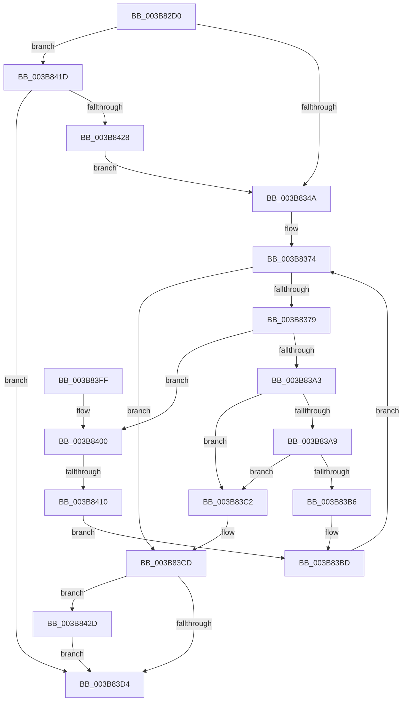

# MiGetLargePageChain

- RVA: `0x003B82D0`–`0x003B8439` (길이 `361` bytes)
- VA: `0x00000001403B82D0`
- 실행 섹션: `.text`
- PDB 이름 있음: `예`; PDB Function 태그: `예`
- unwind 정보 RVA: `0x0008C8DC`
- 디코드: `94`개 명령, `361/361` bytes 표시
- 미해석 바이트: `0` (있으면 어셈블리에 `.byte`로 보존)

> 이 문서는 커널 이미지의 기계어와 PDB 기호를 분석해 생성했습니다. 4번과 5번은 함수 원형과 자료형을 바이너리 사용 방식에서 추정한 C 해석이며 원본 소스 복구 결과는 아닙니다.

## 1. Dependencies

- 직접 호출 지점: **7**; 고유 호출 대상: **7**
- 직접 호출자로 확인된 함수: **1**
- RIP 상대 이미지 참조: **5**

### Outgoing calls
- `0x003B8319` → [memset](../6C/memset_function_006C6C40.md) (function, `0x006C6C40`)
- `0x003B8396` → [MiGetLargePageDemoteAsNeeded](MiGetLargePageDemoteAsNeeded_function_003B8440.md) (function, `0x003B8440`)
- `0x003B83C8` → [MiFreeLargePageChain](MiFreeLargePageChain_function_003B8CCC.md) (function, `0x003B8CCC`)
- `0x003B83DF` → [_security_check_cookie](../6A/_security_check_cookie_function_006AC640.md) (function, `0x006AC640`)
- `0x003B8403` → [MiIsFreeZeroPfnCold](../31/MiIsFreeZeroPfnCold_function_0031E5E4.md) (function, `0x0031E5E4`)
- `0x003B8416` → [MiInsertPageChainHead](../2A/MiInsertPageChainHead_function_002A24EC.md) (function, `0x002A24EC`)
- `0x003B8432` → [MiIssuePageHeatList](../44/MiIssuePageHeatList_function_0044615C.md) (function, `0x0044615C`)

### Direct callers
- [MiGetLargePoolPages](../32/MiGetLargePoolPages_function_00327FF8.md) at `0x00328075`

### Static image references
- `0x003B82E7` → RVA `0x00E0A740` (`.data`; read)
- `0x003B832B` → RVA `0x00E38D10` (`.data`; read)
- `0x003B837E` → RVA `0x00E38D00` (`.data`; read)
- `0x003B83A9` → RVA `0x00E3D548` (`.data`; read)
- `0x003B841D` → RVA `0x00FC6A88` (`ALMOSTRO`; read)

## 2. Other-region calls and transfers

- 다른 실행 섹션으로 향하는 call: **0**
- call이 아닌 외부 분기/꼬리 이동: **1**
  - `0x003B840A` → [sub_006E7822](../6E/Unknown_function_006E7822.md) (`tail-transfer`)

## 3. Assembly (complete function range)

```asm
003B82D0  48 89 5C 24 10                  mov qword ptr [rsp + 0x10], rbx
003B82D5  55                              push rbp
003B82D6  56                              push rsi
003B82D7  57                              push rdi
003B82D8  41 54                           push r12
003B82DA  41 55                           push r13
003B82DC  41 56                           push r14
003B82DE  41 57                           push r15
003B82E0  48 81 EC E0 00 00 00            sub rsp, 0xe0
003B82E7  48 8B 05 52 24 A5 00            mov rax, qword ptr [rip + 0xa52452]
003B82EE  48 33 C4                        xor rax, rsp
003B82F1  48 89 84 24 D0 00 00 00         mov qword ptr [rsp + 0xd0], rax
003B82F9  4C 8B B4 24 40 01 00 00         mov r14, qword ptr [rsp + 0x140]
003B8301  41 8A E8                        mov bpl, r8b
003B8304  4C 8B FA                        mov r15, rdx
003B8307  8B D9                           mov ebx, ecx
003B8309  33 D2                           xor edx, edx
003B830B  48 8D 4C 24 50                  lea rcx, [rsp + 0x50]
003B8310  41 B8 80 00 00 00               mov r8d, 0x80
003B8316  4D 8B E9                        mov r13, r9
003B8319  E8 22 E9 30 00                  call 0x1406c6c40
003B831E  33 C0                           xor eax, eax
003B8320  0F 57 C0                        xorps xmm0, xmm0
003B8323  41 0F 11 06                     movups xmmword ptr [r14], xmm0
003B8327  49 89 46 10                     mov qword ptr [r14 + 0x10], rax
003B832B  48 8B 05 DE 09 A8 00            mov rax, qword ptr [rip + 0xa809de]
003B8332  48 69 CB 80 DF 00 00            imul rcx, rbx, 0xdf80
003B8339  48 8B 8C 01 80 3A 00 00         mov rcx, qword ptr [rcx + rax + 0x3a80]
003B8341  48 85 C9                        test rcx, rcx
003B8344  0F 84 D3 00 00 00               je 0x1403b841d
003B834A  45 33 E4                        xor r12d, r12d
003B834D  49 C1 EF 09                     shr r15, 9
003B8351  40 80 FD 02                     cmp bpl, 2
003B8355  0F 11 44 24 40                  movups xmmword ptr [rsp + 0x40], xmm0
003B835A  41 0F 94 C4                     sete r12b
003B835E  C7 44 24 40 81 00 00 00         mov dword ptr [rsp + 0x40], 0x81
003B8366  83 E3 3F                        and ebx, 0x3f
003B8369  81 CB 80 02 00 00               or ebx, 0x280
003B836F  C1 E3 09                        shl ebx, 9
003B8372  33 F6                           xor esi, esi
003B8374  49 3B F7                        cmp rsi, r15
003B8377  73 54                           jae 0x1403b83cd
003B8379  4C 89 6C 24 28                  mov qword ptr [rsp + 0x28], r13
003B837E  48 8D 0D 7B 09 A8 00            lea rcx, [rip + 0xa8097b]
003B8385  48 83 64 24 20 00               and qword ptr [rsp + 0x20], 0
003B838B  41 B9 01 00 00 00               mov r9d, 1
003B8391  45 8B C4                        mov r8d, r12d
003B8394  8B D3                           mov edx, ebx
003B8396  E8 A5 00 00 00                  call 0x1403b8440
003B839B  48 8B F8                        mov rdi, rax
003B839E  48 85 C0                        test rax, rax
003B83A1  75 5D                           jne 0x1403b8400
003B83A3  0F BA E3 0F                     bt ebx, 0xf
003B83A7  72 19                           jb 0x1403b83c2
003B83A9  48 81 3D 94 51 A8 00 00 00 11 00  cmp qword ptr [rip + 0xa85194], 0x110000
003B83B4  77 0C                           ja 0x1403b83c2
003B83B6  0F BA EB 0F                     bts ebx, 0xf
003B83BA  48 FF CE                        dec rsi
003B83BD  48 FF C6                        inc rsi
003B83C0  EB B2                           jmp 0x1403b8374
003B83C2  40 8A D5                        mov dl, bpl
003B83C5  49 8B CE                        mov rcx, r14
003B83C8  E8 FF 08 00 00                  call 0x1403b8ccc
003B83CD  83 7C 24 44 00                  cmp dword ptr [rsp + 0x44], 0
003B83D2  75 59                           jne 0x1403b842d
003B83D4  48 8B 8C 24 D0 00 00 00         mov rcx, qword ptr [rsp + 0xd0]
003B83DC  48 33 CC                        xor rcx, rsp
003B83DF  E8 5C 42 2F 00                  call 0x1406ac640
003B83E4  48 8B 9C 24 28 01 00 00         mov rbx, qword ptr [rsp + 0x128]
003B83EC  48 81 C4 E0 00 00 00            add rsp, 0xe0
003B83F3  41 5F                           pop r15
003B83F5  41 5E                           pop r14
003B83F7  41 5D                           pop r13
003B83F9  41 5C                           pop r12
003B83FB  5F                              pop rdi
003B83FC  5E                              pop rsi
003B83FD  5D                              pop rbp
003B83FE  C3                              ret
003B83FF  CC                              int3
003B8400  48 8B CF                        mov rcx, rdi
003B8403  E8 DC 61 F6 FF                  call 0x14031e5e4
003B8408  85 C0                           test eax, eax
003B840A  0F 85 12 F4 32 00               jne 0x1406e7822
003B8410  48 8B D7                        mov rdx, rdi
003B8413  49 8B CE                        mov rcx, r14
003B8416  E8 D1 A0 EE FF                  call 0x1402a24ec
003B841B  EB A0                           jmp 0x1403b83bd
003B841D  48 8B 05 64 E6 C0 00            mov rax, qword ptr [rip + 0xc0e664]
003B8424  A8 30                           test al, 0x30
003B8426  75 AC                           jne 0x1403b83d4
003B8428  E9 1D FF FF FF                  jmp 0x1403b834a
003B842D  48 8D 4C 24 40                  lea rcx, [rsp + 0x40]
003B8432  E8 25 DD 08 00                  call 0x14044615c
003B8437  EB 9B                           jmp 0x1403b83d4
```

## 4. C-style interpretation (structured pseudocode)

```c
__int64 __fastcall MiGetLargePageChain(int a1, __int64 a2, unsigned __int8 a3, __int64 a4, __int64 a5)
{
    __int64 result;
    __int64 v_r12;
    __int64 v_r15;
    __int64 v_rbx;
    __int64 v_rsi;
    __int64 v_rsp;
    unsigned __int64 v_stack_m48;
    unsigned __int64 v_stack_mC8;
    unsigned int v_stack_mD4;
    unsigned __int64 v_stack_mD8;
    unsigned __int64 v_stack_mF0;
    unsigned __int64 v_stack_mF8;
    unsigned __int64 v_stack_p10;
    unsigned __int64 v_stack_p40;

    v_stack_p10 = v_rbx;
    v_rsp = (v_rsp) - (224);
    result = (*(unsigned __int64 *)(v_rip + 10822738)) ^ (v_rsp);
    v_stack_m48 = result;
    a2 = 0;
    result = memset(v_stack_mC8, a2, 128, a4);
    result = 0;
    *(unsigned __int64 *)(a5) = v_xmm0;
    *(unsigned __int64 *)(a5 + 16) = 0;
    a1 = (v_stack_mC8) * ((unsigned int)(a1));
    if (*(unsigned __int64 *)(a1 + *(unsigned __int64 *)(v_rip + 11012574) * 1 + 14976) == 0) goto loc_003B841D;
loc_003B834A:
    v_r12 = 0;
    v_r15 = (a2) >> (9);
    v_stack_mD8 = v_xmm0;
    v_r12 = (a3 == 2) ? 1 : 0;
    v_stack_mD8 = 129;
    v_rbx = (unsigned int)(((unsigned int)(a1)) & (63));
    v_rbx = (unsigned int)((v_rbx) | (640));
    v_rbx = (unsigned int)((v_rbx) << (9));
    v_rsi = 0;
loc_003B8374:
    if (0 >= v_r15) goto loc_003B83CD;
    v_stack_mF0 = a4;
    result = MiGetLargePageDemoteAsNeeded(v_rip + 11012475, (unsigned int)((unsigned int)(v_rbx)), (unsigned int)((unsigned int)(v_r12)), 1);
    if (result != 0) goto loc_003B8400;
    if (condition_is_below) goto loc_003B83C2;
    if ((*(unsigned __int64 *)(v_rip + 11030932)) > 0x110000ULL) goto loc_003B83C2;
    v_rsi = (v_rsi) - 1;
loc_003B83BD:
    v_rsi = (v_rsi) + 1;
    goto loc_003B8374;
loc_003B83C2:
    result = MiFreeLargePageChain(a5, a3, (unsigned int)((unsigned int)(v_r12)), 1);
loc_003B83CD:
    if (v_stack_mD4 != 0) goto loc_003B842D;
loc_003B83D4:
    a1 = (v_stack_m48) ^ (v_rsp);
    result = _security_check_cookie(a1, a3, (unsigned int)((unsigned int)(v_r12)), 1);
    v_rsp = (v_rsp) + (224);
    return result;
loc_003B8400:
    result = MiIsFreeZeroPfnCold(result, a3, (unsigned int)((unsigned int)(v_r12)), 1);
    result = MiInsertPageChainHead(a5, result, (unsigned int)((unsigned int)(v_r12)), 1);
    goto loc_003B83BD;
loc_003B841D:
    if ((((unsigned __int8)(*(unsigned __int64 *)(v_rip + 12641892))) & (48)) != 0) goto loc_003B83D4;
    goto loc_003B834A;
loc_003B842D:
    result = MiIssuePageHeatList(v_stack_p40, result, (unsigned int)((unsigned int)(v_r12)), 1);
    goto loc_003B83D4;
}
```

## 5. (Beta) C Style

```c
int64_t MiGetLargePageChain(int32_t Arg1, int64_t Arg2, uint8_t Arg3, int64_t Arg4, void *Arg5)
{
    uint8_t *arg5 = (uint8_t *)Arg5;

    int64_t result;
    int64_t local_r12;
    int64_t local_r15;
    int64_t local_rbx;
    int64_t local_rsi;
    int64_t local_rsp;
    uint64_t v_stack_m48;
    uint64_t v_stack_mC8;
    uint32_t v_stack_mD4;
    uint64_t v_stack_mD8;
    uint64_t v_stack_mF0;
    uint64_t v_stack_mF8;
    uint64_t v_stack_p10;
    uint64_t v_stack_p40;

    v_stack_p10 = local_rbx;
    local_rsp = (local_rsp) - (224);
    result = (*(uint64_t *)(v_rip + 0xA52452)) ^ (local_rsp);
    v_stack_m48 = result;
    Arg2 = 0;
    result = memset(v_stack_mC8, Arg2, 128, Arg4);
    result = 0;
    *(uint64_t *)(arg5) = v_xmm0;
    *(uint64_t *)(arg5 + 0x10) = 0;
    Arg1 = (v_stack_mC8) * ((uint32_t)(Arg1));
    if (*(uint64_t *)(Arg1 + *(uint64_t *)(v_rip + 0xA809DE) * 1 + 0x3A80) == 0) goto loc_003B841D;
loc_003B834A:
    local_r12 = 0;
    local_r15 = (Arg2) >> (9);
    v_stack_mD8 = v_xmm0;
    local_r12 = (Arg3 == 2) ? 1 : 0;
    v_stack_mD8 = 129;
    local_rbx = (uint32_t)(((uint32_t)(Arg1)) & (63));
    local_rbx = (uint32_t)((local_rbx) | (640));
    local_rbx = (uint32_t)((local_rbx) << (9));
    local_rsi = 0;
loc_003B8374:
    if (0 >= local_r15) goto loc_003B83CD;
    v_stack_mF0 = Arg4;
    result = MiGetLargePageDemoteAsNeeded(v_rip + 11012475, (uint32_t)((uint32_t)(local_rbx)), (uint32_t)((uint32_t)(local_r12)), 1);
    if (result != 0) goto loc_003B8400;
    if (condition_is_below) goto loc_003B83C2;
    if ((*(uint64_t *)(v_rip + 0xA85194)) > 0x110000ULL) goto loc_003B83C2;
    local_rsi = (local_rsi) - 1;
loc_003B83BD:
    local_rsi = (local_rsi) + 1;
    goto loc_003B8374;
loc_003B83C2:
    result = MiFreeLargePageChain(Arg5, Arg3, (uint32_t)((uint32_t)(local_r12)), 1);
loc_003B83CD:
    if (v_stack_mD4 != 0) goto loc_003B842D;
loc_003B83D4:
    Arg1 = (v_stack_m48) ^ (local_rsp);
    result = _security_check_cookie(Arg1, Arg3, (uint32_t)((uint32_t)(local_r12)), 1);
    local_rsp = (local_rsp) + (224);
    return result;
loc_003B8400:
    result = MiIsFreeZeroPfnCold(result, Arg3, (uint32_t)((uint32_t)(local_r12)), 1);
    result = MiInsertPageChainHead(Arg5, result, (uint32_t)((uint32_t)(local_r12)), 1);
    goto loc_003B83BD;
loc_003B841D:
    if ((((uint8_t)(*(uint64_t *)(v_rip + 0xC0E664))) & (48)) != 0) goto loc_003B83D4;
    goto loc_003B834A;
loc_003B842D:
    result = MiIssuePageHeatList(v_stack_p40, result, (uint32_t)((uint32_t)(local_r12)), 1);
    goto loc_003B83D4;
}
```

### 관측된 메모리 오프셋

구조체 형식이 확인되지 않은 접근은 인자 기준의 오프셋으로만 기록했습니다.

| 기준 인자 | 오프셋 표현 | 폭 (bit) | 접근 |
|---|---:|---:|---|
| `Arg5` | `+ 0x0` | `128` | `R` |
| `Arg5` | `+ 0x10` | `64` | `W` |

## 6. Execution-region graph

[열기: 2D/3D 그래프와 함수 탐색 컨트롤 패널](../../../control-panel.html?section=text&rva=0x003B82D0&view=graph)

- 2D 그래프는 위에서 아래로 흐르고, 3D 그래프는 빈 공간을 드래그해 회전합니다. Shift+드래그는 이동, 휠은 확대·축소, 함수 노드 선택은 대상 보고서 이동입니다.

### Static fallback


