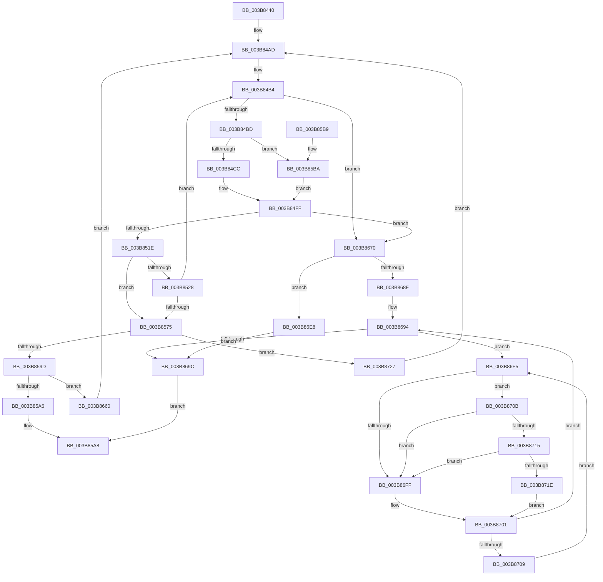

# MiGetLargePageDemoteAsNeeded

- RVA: `0x003B8440`–`0x003B872F` (길이 `751` bytes)
- VA: `0x00000001403B8440`
- 실행 섹션: `.text`
- PDB 이름 있음: `예`; PDB Function 태그: `아니요`
- unwind 정보 RVA: `0x0008C914`
- 디코드: `187`개 명령, `751/751` bytes 표시
- 미해석 바이트: `0` (있으면 어셈블리에 `.byte`로 보존)

> 이 문서는 커널 이미지의 기계어와 PDB 기호를 분석해 생성했습니다. 4번과 5번은 함수 원형과 자료형을 바이너리 사용 방식에서 추정한 C 해석이며 원본 소스 복구 결과는 아닙니다.

## 1. Dependencies

- 직접 호출 지점: **10**; 고유 호출 대상: **10**
- 직접 호출자로 확인된 함수: **3**
- RIP 상대 이미지 참조: **3**

### Outgoing calls
- `0x003B849D` → [MiPageIndexToMoveInProgress](MiPageIndexToMoveInProgress_function_003B8CB0.md) (function, `0x003B8CB0`)
- `0x003B850C` → [MiGetPage](../28/MiGetPage_function_002884C0.md) (function, `0x002884C0`)
- `0x003B8559` → [MiPerformOnDemandLargePageCoalesce](../37/MiPerformOnDemandLargePageCoalesce_function_00379678.md) (function, `0x00379678`)
- `0x003B857D` → [MiWaitForPageMoveComplete](MiWaitForPageMoveComplete_function_003B8C30.md) (function, `0x003B8C30`)
- `0x003B85CE` → [MiInitializePageColorBase](../32/MiInitializePageColorBase_function_00320410.md) (function, `0x00320410`)
- `0x003B8600` → [MiAssignDefaultChannel](../31/MiAssignDefaultChannel_function_0031E5B0.md) (function, `0x0031E5B0`)
- `0x003B86DB` → [MiUnlockPage](../31/MiUnlockPage_function_0031A3E0.md) (function, `0x0031A3E0`)
- `0x003B86EB` → [MiLockPageInline](../31/MiLockPageInline_function_0031A340.md) (function, `0x0031A340`)
- `0x003B8715` → [KiCheckVpBackingLongSpinWaitHypercall](../30/KiCheckVpBackingLongSpinWaitHypercall_function_0030F490.md) (function, `0x0030F490`)
- `0x003B8720` → [HvlNotifyLongSpinWait](../30/HvlNotifyLongSpinWait_function_0030F460.md) (function, `0x0030F460`)

### Direct callers
- [MiGetFastLargePages](MiGetFastLargePages_function_003B7EE0.md) at `0x003B8058`
- [MiGetLargePageChain](MiGetLargePageChain_function_003B82D0.md) at `0x003B8396`
- [MiFindLargeNodePage](../4D/MiFindLargeNodePage_function_004DB7E8.md) at `0x004DB8BC`

### Static image references
- `0x003B84AD` → RVA `0x00000000` (`image boundary/outside`; read)
- `0x003B86F7` → RVA `0x00FC52AC` (`ALMOSTRO`; reference)
- `0x003B870B` → RVA `0x00FC6AB8` (`ALMOSTRO`; read)

## 2. Other-region calls and transfers

- 다른 실행 섹션으로 향하는 call: **0**
- 별도 외부 분기/꼬리 이동을 확인하지 못했습니다.

## 3. Assembly (complete function range)

```asm
003B8440  44 89 4C 24 20                  mov dword ptr [rsp + 0x20], r9d
003B8445  48 89 4C 24 08                  mov qword ptr [rsp + 8], rcx
003B844A  53                              push rbx
003B844B  55                              push rbp
003B844C  56                              push rsi
003B844D  57                              push rdi
003B844E  41 54                           push r12
003B8450  41 55                           push r13
003B8452  41 56                           push r14
003B8454  41 57                           push r15
003B8456  48 83 EC 48                     sub rsp, 0x48
003B845A  83 A4 24 98 00 00 00 00         and dword ptr [rsp + 0x98], 0
003B8462  8B FA                           mov edi, edx
003B8464  C1 EF 09                        shr edi, 9
003B8467  44 8B FA                        mov r15d, edx
003B846A  83 E7 3F                        and edi, 0x3f
003B846D  41 C1 EF 10                     shr r15d, 0x10
003B8471  8B C7                           mov eax, edi
003B8473  41 8B F0                        mov esi, r8d
003B8476  4C 69 E8 80 DF 00 00            imul r13, rax, 0xdf80
003B847D  8B DA                           mov ebx, edx
003B847F  89 94 24 A0 00 00 00            mov dword ptr [rsp + 0xa0], edx
003B8486  4C 03 69 10                     add r13, qword ptr [rcx + 0x10]
003B848A  33 D2                           xor edx, edx
003B848C  41 83 E7 03                     and r15d, 3
003B8490  49 83 CC FF                     or r12, 0xffffffffffffffff
003B8494  81 CE 00 34 03 00               or esi, 0x33400
003B849A  8D 4A 01                        lea ecx, [rdx + 1]
003B849D  E8 0E 08 00 00                  call 0x1403b8cb0
003B84A2  48 63 E8                        movsxd rbp, eax
003B84A5  49 8B AC ED 58 3B 00 00         mov rbp, qword ptr [r13 + rbp*8 + 0x3b58]
003B84AD  4C 8D 05 4C 7B C4 FF            lea r8, [rip - 0x3b84b4]
003B84B4  45 3B F9                        cmp r15d, r9d
003B84B7  0F 87 B3 01 00 00               ja 0x1403b8670
003B84BD  48 83 BC 24 B0 00 00 00 00      cmp qword ptr [rsp + 0xb0], 0
003B84C6  0F 84 EE 00 00 00               je 0x1403b85ba
003B84CC  4B 8B 8C F8 60 1C 01 00         mov rcx, qword ptr [r8 + r15*8 + 0x11c60]
003B84D4  33 D2                           xor edx, edx
003B84D6  48 8B 84 24 B0 00 00 00         mov rax, qword ptr [rsp + 0xb0]
003B84DE  48 C1 E1 0C                     shl rcx, 0xc
003B84E2  48 F7 F1                        div rcx
003B84E5  33 D2                           xor edx, edx
003B84E7  8B CB                           mov ecx, ebx
003B84E9  48 C1 E9 10                     shr rcx, 0x10
003B84ED  83 E1 03                        and ecx, 3
003B84F0  41 F7 B4 88 C0 DC E2 00         div dword ptr [r8 + rcx*4 + 0xe2dcc0]
003B84F8  33 D3                           xor edx, ebx
003B84FA  0F B6 C2                        movzx eax, dl
003B84FD  33 D8                           xor ebx, eax
003B84FF  48 8B 8C 24 90 00 00 00         mov rcx, qword ptr [rsp + 0x90]
003B8507  44 8B C6                        mov r8d, esi
003B850A  8B D3                           mov edx, ebx
003B850C  E8 AF FF EC FF                  call 0x1402884c0
003B8511  4C 8B E0                        mov r12, rax
003B8514  48 83 F8 FF                     cmp rax, -1
003B8518  0F 85 52 01 00 00               jne 0x1403b8670
003B851E  83 BC 24 98 00 00 00 00         cmp dword ptr [rsp + 0x98], 0
003B8526  75 4D                           jne 0x1403b8575
003B8528  48 8B 84 24 B8 00 00 00         mov rax, qword ptr [rsp + 0xb8]
003B8530  44 8B CB                        mov r9d, ebx
003B8533  48 8B 8C 24 90 00 00 00         mov rcx, qword ptr [rsp + 0x90]
003B853B  44 8B C7                        mov r8d, edi
003B853E  41 C1 E9 0F                     shr r9d, 0xf
003B8542  41 8B D7                        mov edx, r15d
003B8545  41 83 E1 01                     and r9d, 1
003B8549  C7 84 24 98 00 00 00 01 00 00 00  mov dword ptr [rsp + 0x98], 1
003B8554  48 89 44 24 20                  mov qword ptr [rsp + 0x20], rax
003B8559  E8 1A 11 FC FF                  call 0x140379678
003B855E  44 8B 8C 24 A8 00 00 00         mov r9d, dword ptr [rsp + 0xa8]
003B8566  4C 8D 05 93 7A C4 FF            lea r8, [rip - 0x3b856d]
003B856D  85 C0                           test eax, eax
003B856F  0F 85 3F FF FF FF               jne 0x1403b84b4
003B8575  BA 01 00 00 00                  mov edx, 1
003B857A  49 8B CD                        mov rcx, r13
003B857D  E8 AE 06 00 00                  call 0x1403b8c30
003B8582  44 8B 8C 24 A8 00 00 00         mov r9d, dword ptr [rsp + 0xa8]
003B858A  48 8B CD                        mov rcx, rbp
003B858D  48 33 C8                        xor rcx, rax
003B8590  48 F7 C1 00 00 FF FF            test rcx, -0x10000
003B8597  0F 85 8A 01 00 00               jne 0x1403b8727
003B859D  45 3B F9                        cmp r15d, r9d
003B85A0  0F 85 BA 00 00 00               jne 0x1403b8660
003B85A6  33 C0                           xor eax, eax
003B85A8  48 83 C4 48                     add rsp, 0x48
003B85AC  41 5F                           pop r15
003B85AE  41 5E                           pop r14
003B85B0  41 5D                           pop r13
003B85B2  41 5C                           pop r12
003B85B4  5F                              pop rdi
003B85B5  5E                              pop rsi
003B85B6  5D                              pop rbp
003B85B7  5B                              pop rbx
003B85B8  C3                              ret
003B85B9  CC                              int3
003B85BA  48 83 64 24 38 00               and qword ptr [rsp + 0x38], 0
003B85C0  4C 8D 4C 24 30                  lea r9, [rsp + 0x30]
003B85C5  44 8D 47 01                     lea r8d, [rdi + 1]
003B85C9  41 8B D7                        mov edx, r15d
003B85CC  33 C9                           xor ecx, ecx
003B85CE  E8 3D 7E F6 FF                  call 0x140320410
003B85D3  8B 44 24 38                     mov eax, dword ptr [rsp + 0x38]
003B85D7  81 E3 00 80 00 00               and ebx, 0x8000
003B85DD  44 8B 8C 24 A0 00 00 00         mov r9d, dword ptr [rsp + 0xa0]
003B85E5  25 FF 7F F3 FF                  and eax, 0xfff37fff
003B85EA  41 81 E1 00 00 0C 00            and r9d, 0xc0000
003B85F1  44 0B C8                        or r9d, eax
003B85F4  44 0B CB                        or r9d, ebx
003B85F7  41 8B C9                        mov ecx, r9d
003B85FA  C1 E9 09                        shr ecx, 9
003B85FD  83 E1 3F                        and ecx, 0x3f
003B8600  E8 AB 5F F6 FF                  call 0x14031e5b0
003B8605  0F B6 D0                        movzx edx, al
003B8608  4B 8D 0C BF                     lea rcx, [r15 + r15*4]
003B860C  C1 E2 08                        shl edx, 8
003B860F  B8 01 00 00 00                  mov eax, 1
003B8614  41 33 D1                        xor edx, r9d
003B8617  48 C1 E1 08                     shl rcx, 8
003B861B  81 E2 00 01 00 00               and edx, 0x100
003B8621  41 33 D1                        xor edx, r9d
003B8624  49 03 CD                        add rcx, r13
003B8627  89 54 24 38                     mov dword ptr [rsp + 0x38], edx
003B862B  48 89 4C 24 30                  mov qword ptr [rsp + 0x30], rcx
003B8630  44 8B C2                        mov r8d, edx
003B8633  F0 0F C1 01                     lock xadd dword ptr [rcx], eax
003B8637  33 D2                           xor edx, edx
003B8639  4C 8D 0D C0 79 C4 FF            lea r9, [rip - 0x3b8640]
003B8640  41 8B C8                        mov ecx, r8d
003B8643  48 C1 E9 10                     shr rcx, 0x10
003B8647  83 E1 03                        and ecx, 3
003B864A  41 F7 B4 89 C0 DC E2 00         div dword ptr [r9 + rcx*4 + 0xe2dcc0]
003B8652  41 33 D0                        xor edx, r8d
003B8655  0F B6 DA                        movzx ebx, dl
003B8658  41 33 D8                        xor ebx, r8d
003B865B  E9 9F FE FF FF                  jmp 0x1403b84ff
003B8660  41 FF C7                        inc r15d
003B8663  83 A4 24 98 00 00 00 00         and dword ptr [rsp + 0x98], 0
003B866B  E9 3D FE FF FF                  jmp 0x1403b84ad
003B8670  4B 8D 1C 64                     lea rbx, [r12 + r12*2]
003B8674  48 C1 E3 04                     shl rbx, 4
003B8678  48 B8 00 00 00 00 00 DE FF FF   movabs rax, 0xffffde0000000000
003B8682  48 03 D8                        add rbx, rax
003B8685  48 8D 7B 18                     lea rdi, [rbx + 0x18]
003B8689  40 F6 C6 01                     test sil, 1
003B868D  74 59                           je 0x1403b86e8
003B868F  40 B5 11                        mov bpl, 0x11
003B8692  33 F6                           xor esi, esi
003B8694  F0 48 0F BA 2F 3F               lock bts qword ptr [rdi], 0x3f
003B869A  72 59                           jb 0x1403b86f5
003B869C  48 8B 0F                        mov rcx, qword ptr [rdi]
003B869F  48 B8 01 00 00 00 00 00 00 C0   movabs rax, 0xc000000000000001
003B86A9  48 23 C8                        and rcx, rax
003B86AC  40 8A D5                        mov dl, bpl
003B86AF  48 83 C9 01                     or rcx, 1
003B86B3  B8 02 00 00 00                  mov eax, 2
003B86B8  48 89 4B 18                     mov qword ptr [rbx + 0x18], rcx
003B86BC  8B 4B 20                        mov ecx, dword ptr [rbx + 0x20]
003B86BF  89 8C 24 A8 00 00 00            mov dword ptr [rsp + 0xa8], ecx
003B86C6  66 89 84 24 A8 00 00 00         mov word ptr [rsp + 0xa8], ax
003B86CE  8B 8C 24 A8 00 00 00            mov ecx, dword ptr [rsp + 0xa8]
003B86D5  89 4B 20                        mov dword ptr [rbx + 0x20], ecx
003B86D8  48 8B CB                        mov rcx, rbx
003B86DB  E8 00 1D F6 FF                  call 0x14031a3e0
003B86E0  48 8B C3                        mov rax, rbx
003B86E3  E9 C0 FE FF FF                  jmp 0x1403b85a8
003B86E8  48 8B CB                        mov rcx, rbx
003B86EB  E8 50 1C F6 FF                  call 0x14031a340
003B86F0  40 8A E8                        mov bpl, al
003B86F3  EB A7                           jmp 0x1403b869c
003B86F5  FF C6                           inc esi
003B86F7  85 35 AF CB C0 00               test dword ptr [rip + 0xc0cbaf], esi
003B86FD  74 0C                           je 0x1403b870b
003B86FF  F3 90                           pause
003B8701  48 8B 07                        mov rax, qword ptr [rdi]
003B8704  48 85 C0                        test rax, rax
003B8707  79 8B                           jns 0x1403b8694
003B8709  EB EA                           jmp 0x1403b86f5
003B870B  8B 05 A7 E3 C0 00               mov eax, dword ptr [rip + 0xc0e3a7]
003B8711  A8 40                           test al, 0x40
003B8713  74 EA                           je 0x1403b86ff
003B8715  E8 76 6D F5 FF                  call 0x14030f490
003B871A  84 C0                           test al, al
003B871C  74 E1                           je 0x1403b86ff
003B871E  8B CE                           mov ecx, esi
003B8720  E8 3B 6D F5 FF                  call 0x14030f460
003B8725  EB DA                           jmp 0x1403b8701
003B8727  48 8B E8                        mov rbp, rax
003B872A  E9 7E FD FF FF                  jmp 0x1403b84ad
```

## 4. C-style interpretation (structured pseudocode)

```c
__int64 __fastcall MiGetLargePageDemoteAsNeeded(__int64 a1, int a2, int a3, int a4, __int64 a5, __int64 a6)
{
    __int64 result;
    __int64 v_r12;
    __int64 v_r13;
    __int64 v_r15;
    __int64 v_rbx;
    __int64 v_rdi;
    __int64 v_rsi;
    __int64 v_rsp;
    unsigned __int64 v_stack_m68;
    unsigned int v_stack_p10;
    unsigned int v_stack_p18;
    unsigned int v_stack_p20;
    unsigned __int64 v_stack_p30;
    unsigned __int64 v_stack_p38;
    unsigned __int64 v_stack_p8;
    unsigned int v_stack_p98;
    unsigned int v_stack_pA0;
    unsigned int v_stack_pA8;

    v_stack_p20 = a4;
    v_stack_p8 = a1;
    v_rsp = (v_rsp) - (72);
    v_rdi = (unsigned int)(((unsigned int)(a2)) >> (9));
    v_rdi = (unsigned int)((v_rdi) & (63));
    v_r15 = (unsigned int)(((unsigned int)(a2)) >> (16));
    v_r13 = (v_r13) * ((unsigned int)((unsigned int)(v_rdi)));
    v_stack_p18 = a2;
    v_r13 = (v_r13) + (*(unsigned __int64 *)(a1 + 16));
    a2 = 0;
    v_r15 = (unsigned int)((v_r15) & (3));
    v_r12 = (v_r12) | (-1);
    v_rsi = (unsigned int)(((unsigned int)(a3)) | (0x33400ULL));
    result = MiPageIndexToMoveInProgress(a2 + 1, a2, a3, a4);
loc_003B84AD:
loc_003B84B4:
    if (((unsigned int)(v_r15)) > a4) goto loc_003B8670;
    if (a5 == 0) goto loc_003B85BA;
    a2 = 0;
    a1 = (*(unsigned __int64 *)(v_rip - 3900596 + v_r15 * 8 + 72800)) << (12);
    a2 = 0;
    a1 = ((unsigned int)((unsigned int)((unsigned int)(a2)))) >> (16);
    a1 = (unsigned int)((a1) & (3));
    a2 = (unsigned int)((a2) ^ ((unsigned int)((unsigned int)(a2))));
    v_rbx = (unsigned int)(((unsigned int)(a2)) ^ ((unsigned int)((unsigned __int8)(a2))));
loc_003B84FF:
    result = MiGetPage(v_stack_p8, (unsigned int)((unsigned int)(v_rbx)), (unsigned int)((unsigned int)(v_rsi)), a4);
    if (result != -1) goto loc_003B8670;
    if (v_stack_p10 != 0) goto loc_003B8575;
    a4 = (unsigned int)(((unsigned int)((unsigned int)(v_rbx))) >> (15));
    a4 = (unsigned int)((a4) & (1));
    v_stack_p10 = 1;
    v_stack_m68 = a6;
    result = MiPerformOnDemandLargePageCoalesce(v_stack_p8, (unsigned int)((unsigned int)(v_r15)), (unsigned int)((unsigned int)(v_rdi)), a4);
    if ((unsigned int)(result) != 0) goto loc_003B84B4;
loc_003B8575:
    result = MiWaitForPageMoveComplete(v_r13, 1, v_rip - 3900781, (unsigned int)(v_stack_p20));
    a1 = (*(unsigned __int64 *)(v_r13 + (int)((unsigned int)(result)) * 8 + 15192)) ^ (result);
    if (((a1) & (0xFFFFFFFFFFFF0000ULL)) != 0) goto loc_003B8727;
    if (((unsigned int)(v_r15)) != ((unsigned int)((unsigned int)(v_stack_p20)))) goto loc_003B8660;
    result = 0;
loc_003B85A8:
    v_rsp = (v_rsp) + (72);
    return result;
loc_003B85BA:
    a1 = 0;
    result = MiInitializePageColorBase(a1, (unsigned int)((unsigned int)(v_r15)), v_rdi + 1, v_stack_p30);
    v_rbx = (unsigned int)((v_rbx) & (0x8000ULL));
    result = (unsigned int)(((unsigned int)(v_stack_p38)) & (0xFFF37FFFULL));
    a4 = (unsigned int)(((unsigned int)(v_stack_pA0)) & (0xC0000ULL));
    a4 = (unsigned int)((a4) | ((unsigned int)(result)));
    a4 = (unsigned int)((a4) | ((unsigned int)(v_rbx)));
    a1 = (unsigned int)(((unsigned int)(a4)) >> (9));
    a1 = (unsigned int)((a1) & (63));
    result = MiAssignDefaultChannel(a1, (unsigned int)((unsigned int)(v_r15)), v_rdi + 1, a4);
    a2 = (unsigned int)(((unsigned __int8)(result)) << (8));
    a2 = (unsigned int)((a2) ^ (a4));
    a1 = (v_r15 + v_r15 * 4) << (8);
    a2 = (unsigned int)((a2) & (256));
    a2 = (unsigned int)((a2) ^ (a4));
    a1 = (a1) + (v_r13);
    v_stack_p38 = a2;
    v_stack_p30 = a1;
    a2 = 0;
    a1 = ((unsigned int)((unsigned int)((unsigned int)(a2)))) >> (16);
    a1 = (unsigned int)((a1) & (3));
    a2 = (unsigned int)((a2) ^ ((unsigned int)((unsigned int)(a2))));
    v_rbx = (unsigned int)(((unsigned __int8)(a2)) ^ ((unsigned int)((unsigned int)(a2))));
    goto loc_003B84FF;
loc_003B8660:
    v_r15 = (unsigned int)((v_r15) + 1);
    goto loc_003B84AD;
loc_003B8670:
    v_rbx = (result + result * 2) << (4);
    v_rbx = (v_rbx) + (1);
    if ((((unsigned __int8)(v_rsi)) & (1)) == 0) goto loc_003B86E8;
    v_rsi = 0;
loc_003B8694:
    if (condition_is_below) goto loc_003B86F5;
loc_003B869C:
    a1 = (*(unsigned __int64 *)(v_rbx + 24)) & (1);
    a1 = (a1) | (1);
    *(unsigned __int64 *)(v_rbx + 24) = a1;
    v_stack_pA8 = (unsigned int)((unsigned int)(*(unsigned int *)(v_rbx + 32)));
    v_stack_pA8 = 2;
    *(unsigned int *)(v_rbx + 32) = (unsigned int)((unsigned int)(v_stack_pA8));
    result = MiUnlockPage(v_rbx, 17, (unsigned int)(a2), v_rip - 3900992);
    goto loc_003B85A8;
loc_003B86E8:
    result = MiLockPageInline(v_rbx, 17, (unsigned int)(a2), v_rip - 3900992);
    goto loc_003B869C;
loc_003B86F5:
    v_rsi = (unsigned int)((v_rsi) + 1);
    if (((*(unsigned int *)(v_rip + 12635055)) & ((unsigned int)(v_rsi))) == 0) goto loc_003B870B;
loc_003B86FF:
loc_003B8701:
    if (!sign_flag) goto loc_003B8694;
    goto loc_003B86F5;
loc_003B870B:
    if ((((unsigned __int8)((unsigned int)(*(unsigned int *)(v_rip + 12641191)))) & (64)) == 0) goto loc_003B86FF;
    result = KiCheckVpBackingLongSpinWaitHypercall(v_rbx, 17, (unsigned int)(a2), v_rip - 3900992);
    if ((unsigned __int8)(result) == 0) goto loc_003B86FF;
    result = HvlNotifyLongSpinWait((unsigned int)((unsigned int)(v_rsi)), 17, (unsigned int)(a2), v_rip - 3900992);
    goto loc_003B8701;
loc_003B8727:
    goto loc_003B84AD;
}
```

## 5. (Beta) C Style

```c
int64_t MiGetLargePageDemoteAsNeeded(void *Arg1, int32_t Arg2, int32_t Arg3, int32_t Arg4, int64_t Arg5, int64_t Arg6)
{
    uint8_t *arg1 = (uint8_t *)Arg1;

    int64_t result;
    int64_t local_r12;
    int64_t local_r13;
    int64_t local_r15;
    int64_t local_rbx;
    int64_t local_rdi;
    int64_t local_rsi;
    int64_t local_rsp;
    uint64_t v_stack_m68;
    uint32_t v_stack_p10;
    uint32_t v_stack_p18;
    uint32_t v_stack_p20;
    uint64_t v_stack_p30;
    uint64_t v_stack_p38;
    uint64_t v_stack_p8;
    uint32_t v_stack_p98;
    uint32_t v_stack_pA0;
    uint32_t v_stack_pA8;

    v_stack_p20 = Arg4;
    v_stack_p8 = Arg1;
    local_rsp = (local_rsp) - (72);
    local_rdi = (uint32_t)(((uint32_t)(Arg2)) >> (9));
    local_rdi = (uint32_t)((local_rdi) & (63));
    local_r15 = (uint32_t)(((uint32_t)(Arg2)) >> (16));
    local_r13 = (local_r13) * ((uint32_t)((uint32_t)(local_rdi)));
    v_stack_p18 = Arg2;
    local_r13 = (local_r13) + (*(uint64_t *)(arg1 + 0x10));
    Arg2 = 0;
    local_r15 = (uint32_t)((local_r15) & (3));
    local_r12 = (local_r12) | (-1);
    local_rsi = (uint32_t)(((uint32_t)(Arg3)) | (0x33400ULL));
    result = MiPageIndexToMoveInProgress(Arg2 + 1, Arg2, Arg3, Arg4);
loc_003B84AD:
loc_003B84B4:
    if (((uint32_t)(local_r15)) > Arg4) goto loc_003B8670;
    if (Arg5 == 0) goto loc_003B85BA;
    Arg2 = 0;
    Arg1 = (*(uint64_t *)(v_rip - 0x3B84B4 + local_r15 * 8 + 0x11C60)) << (12);
    Arg2 = 0;
    Arg1 = ((uint32_t)((uint32_t)((uint32_t)(Arg2)))) >> (16);
    Arg1 = (uint32_t)((Arg1) & (3));
    Arg2 = (uint32_t)((Arg2) ^ ((uint32_t)((uint32_t)(Arg2))));
    local_rbx = (uint32_t)(((uint32_t)(Arg2)) ^ ((uint32_t)((uint8_t)(Arg2))));
loc_003B84FF:
    result = MiGetPage(v_stack_p8, (uint32_t)((uint32_t)(local_rbx)), (uint32_t)((uint32_t)(local_rsi)), Arg4);
    if (result != -1) goto loc_003B8670;
    if (v_stack_p10 != 0) goto loc_003B8575;
    Arg4 = (uint32_t)(((uint32_t)((uint32_t)(local_rbx))) >> (15));
    Arg4 = (uint32_t)((Arg4) & (1));
    v_stack_p10 = 1;
    v_stack_m68 = Arg6;
    result = MiPerformOnDemandLargePageCoalesce(v_stack_p8, (uint32_t)((uint32_t)(local_r15)), (uint32_t)((uint32_t)(local_rdi)), Arg4);
    if ((uint32_t)(result) != 0) goto loc_003B84B4;
loc_003B8575:
    result = MiWaitForPageMoveComplete(local_r13, 1, v_rip - 3900781, (uint32_t)(v_stack_p20));
    Arg1 = (*(uint64_t *)(local_r13 + (int32_t)((uint32_t)(result)) * 8 + 0x3B58)) ^ (result);
    if (((Arg1) & (0xFFFFFFFFFFFF0000ULL)) != 0) goto loc_003B8727;
    if (((uint32_t)(local_r15)) != ((uint32_t)((uint32_t)(v_stack_p20)))) goto loc_003B8660;
    result = 0;
loc_003B85A8:
    local_rsp = (local_rsp) + (72);
    return result;
loc_003B85BA:
    Arg1 = 0;
    result = MiInitializePageColorBase(Arg1, (uint32_t)((uint32_t)(local_r15)), local_rdi + 1, v_stack_p30);
    local_rbx = (uint32_t)((local_rbx) & (0x8000ULL));
    result = (uint32_t)(((uint32_t)(v_stack_p38)) & (0xFFF37FFFULL));
    Arg4 = (uint32_t)(((uint32_t)(v_stack_pA0)) & (0xC0000ULL));
    Arg4 = (uint32_t)((Arg4) | ((uint32_t)(result)));
    Arg4 = (uint32_t)((Arg4) | ((uint32_t)(local_rbx)));
    Arg1 = (uint32_t)(((uint32_t)(Arg4)) >> (9));
    Arg1 = (uint32_t)((Arg1) & (63));
    result = MiAssignDefaultChannel(Arg1, (uint32_t)((uint32_t)(local_r15)), local_rdi + 1, Arg4);
    Arg2 = (uint32_t)(((uint8_t)(result)) << (8));
    Arg2 = (uint32_t)((Arg2) ^ (Arg4));
    Arg1 = (local_r15 + local_r15 * 4) << (8);
    Arg2 = (uint32_t)((Arg2) & (256));
    Arg2 = (uint32_t)((Arg2) ^ (Arg4));
    Arg1 = (Arg1) + (local_r13);
    v_stack_p38 = Arg2;
    v_stack_p30 = Arg1;
    Arg2 = 0;
    Arg1 = ((uint32_t)((uint32_t)((uint32_t)(Arg2)))) >> (16);
    Arg1 = (uint32_t)((Arg1) & (3));
    Arg2 = (uint32_t)((Arg2) ^ ((uint32_t)((uint32_t)(Arg2))));
    local_rbx = (uint32_t)(((uint8_t)(Arg2)) ^ ((uint32_t)((uint32_t)(Arg2))));
    goto loc_003B84FF;
loc_003B8660:
    local_r15 = (uint32_t)((local_r15) + 1);
    goto loc_003B84AD;
loc_003B8670:
    local_rbx = (result + result * 2) << (4);
    local_rbx = (local_rbx) + (1);
    if ((((uint8_t)(local_rsi)) & (1)) == 0) goto loc_003B86E8;
    local_rsi = 0;
loc_003B8694:
    if (condition_is_below) goto loc_003B86F5;
loc_003B869C:
    Arg1 = (*(uint64_t *)(local_rbx + 0x18)) & (1);
    Arg1 = (Arg1) | (1);
    *(void **)(local_rbx + 0x18) = Arg1;
    v_stack_pA8 = (uint32_t)((uint32_t)(*(uint32_t *)(local_rbx + 0x20)));
    v_stack_pA8 = 2;
    *(uint32_t *)(local_rbx + 0x20) = (uint32_t)((uint32_t)(v_stack_pA8));
    result = MiUnlockPage(local_rbx, 17, (uint32_t)(Arg2), v_rip - 3900992);
    goto loc_003B85A8;
loc_003B86E8:
    result = MiLockPageInline(local_rbx, 17, (uint32_t)(Arg2), v_rip - 3900992);
    goto loc_003B869C;
loc_003B86F5:
    local_rsi = (uint32_t)((local_rsi) + 1);
    if (((*(uint32_t *)(v_rip + 0xC0CBAF)) & ((uint32_t)(local_rsi))) == 0) goto loc_003B870B;
loc_003B86FF:
loc_003B8701:
    if (!sign_flag) goto loc_003B8694;
    goto loc_003B86F5;
loc_003B870B:
    if ((((uint8_t)((uint32_t)(*(uint32_t *)(v_rip + 0xC0E3A7)))) & (64)) == 0) goto loc_003B86FF;
    result = KiCheckVpBackingLongSpinWaitHypercall(local_rbx, 17, (uint32_t)(Arg2), v_rip - 3900992);
    if ((uint8_t)(result) == 0) goto loc_003B86FF;
    result = HvlNotifyLongSpinWait((uint32_t)((uint32_t)(local_rsi)), 17, (uint32_t)(Arg2), v_rip - 3900992);
    goto loc_003B8701;
loc_003B8727:
    goto loc_003B84AD;
}
```

### 관측된 메모리 오프셋

구조체 형식이 확인되지 않은 접근은 인자 기준의 오프셋으로만 기록했습니다.

| 기준 인자 | 오프셋 표현 | 폭 (bit) | 접근 |
|---|---:|---:|---|
| `Arg1` | `+ 0x10` | `64` | `R` |

## 6. Execution-region graph

[열기: 2D/3D 그래프와 함수 탐색 컨트롤 패널](../../../control-panel.html?section=text&rva=0x003B8440&view=graph)

- 2D 그래프는 위에서 아래로 흐르고, 3D 그래프는 빈 공간을 드래그해 회전합니다. Shift+드래그는 이동, 휠은 확대·축소, 함수 노드 선택은 대상 보고서 이동입니다.

### Static fallback


