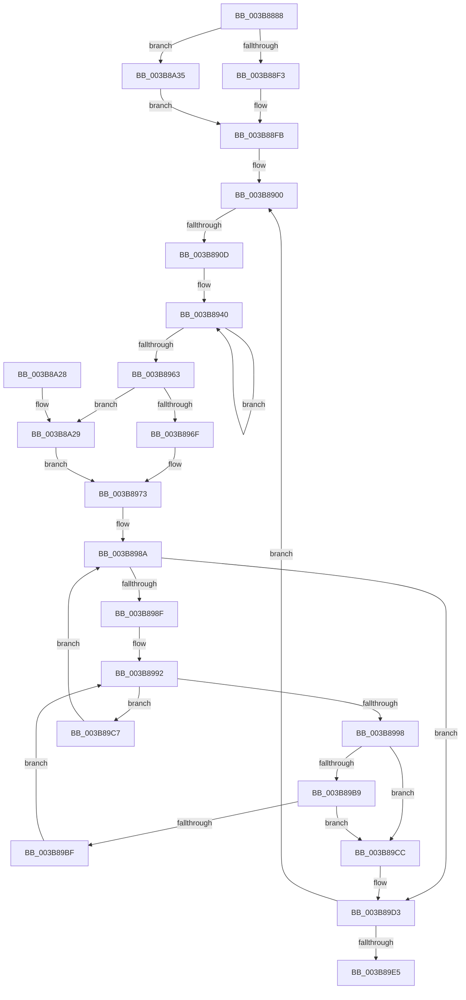

# MiGetNodeChannelPageCounts

- RVA: `0x003B8888`–`0x003B8A41` (길이 `441` bytes)
- VA: `0x00000001403B8888`
- 실행 섹션: `.text`
- PDB 이름 있음: `예`; PDB Function 태그: `예`
- unwind 정보 RVA: `0x0008C95C`
- 디코드: `113`개 명령, `441/441` bytes 표시
- 미해석 바이트: `0` (있으면 어셈블리에 `.byte`로 보존)

> 이 문서는 커널 이미지의 기계어와 PDB 기호를 분석해 생성했습니다. 4번과 5번은 함수 원형과 자료형을 바이너리 사용 방식에서 추정한 C 해석이며 원본 소스 복구 결과는 아닙니다.

## 1. Dependencies

- 직접 호출 지점: **3**; 고유 호출 대상: **3**
- 직접 호출자로 확인된 함수: **1**
- RIP 상대 이미지 참조: **3**

### Outgoing calls
- `0x003B8918` → [memset](../6C/memset_function_006C6C40.md) (function, `0x006C6C40`)
- `0x003B892B` → [MiGetPartitionNodePageCounts](MiGetPartitionNodePageCounts_function_003B8B0C.md) (function, `0x003B8B0C`)
- `0x003B8A08` → [_security_check_cookie](../6A/_security_check_cookie_function_006AC640.md) (function, `0x006AC640`)

### Direct callers
- [MiGetChannelInformation](MiGetChannelInformation_function_003B8738.md) at `0x003B8805`

### Static image references
- `0x003B889F` → RVA `0x00E0A740` (`.data`; read)
- `0x003B8900` → RVA `0x00FC5002` (`ALMOSTRO`; read)
- `0x003B8935` → RVA `0x00011C60` (`.rdata`; read)

## 2. Other-region calls and transfers

- 다른 실행 섹션으로 향하는 call: **0**
- call이 아닌 외부 분기/꼬리 이동: **1**
  - `0x003B8907` → [sub_006E78E8](../6E/Unknown_function_006E78E8.md) (`tail-transfer`)

## 3. Assembly (complete function range)

```asm
003B8888  48 89 5C 24 18                  mov qword ptr [rsp + 0x18], rbx
003B888D  55                              push rbp
003B888E  56                              push rsi
003B888F  57                              push rdi
003B8890  41 54                           push r12
003B8892  41 55                           push r13
003B8894  41 56                           push r14
003B8896  41 57                           push r15
003B8898  48 81 EC A0 00 00 00            sub rsp, 0xa0
003B889F  48 8B 05 9A 1E A5 00            mov rax, qword ptr [rip + 0xa51e9a]
003B88A6  48 33 C4                        xor rax, rsp
003B88A9  48 89 84 24 90 00 00 00         mov qword ptr [rsp + 0x90], rax
003B88B1  48 8B 84 24 00 01 00 00         mov rax, qword ptr [rsp + 0x100]
003B88B9  4C 8B F9                        mov r15, rcx
003B88BC  8B DA                           mov ebx, edx
003B88BE  4C 69 F3 80 DF 00 00            imul r14, rbx, 0xdf80
003B88C5  41 0F B6 F8                     movzx edi, r8b
003B88C9  4C 03 71 10                     add r14, qword ptr [rcx + 0x10]
003B88CD  48 89 44 24 30                  mov qword ptr [rsp + 0x30], rax
003B88D2  48 8B 84 24 08 01 00 00         mov rax, qword ptr [rsp + 0x108]
003B88DA  4C 89 4C 24 38                  mov qword ptr [rsp + 0x38], r9
003B88DF  48 89 4C 24 28                  mov qword ptr [rsp + 0x28], rcx
003B88E4  48 89 44 24 40                  mov qword ptr [rsp + 0x40], rax
003B88E9  40 80 FF 02                     cmp dil, 2
003B88ED  0F 84 42 01 00 00               je 0x1403b8a35
003B88F3  49 8B 84 FE 70 3A 00 00         mov rax, qword ptr [r14 + rdi*8 + 0x3a70]
003B88FB  48 89 44 24 20                  mov qword ptr [rsp + 0x20], rax
003B8900  80 3D FB C6 C0 00 01            cmp byte ptr [rip + 0xc0c6fb], 1
003B8907  0F 85 DB EF 32 00               jne 0x1406e78e8
003B890D  33 D2                           xor edx, edx
003B890F  48 8D 4C 24 50                  lea rcx, [rsp + 0x50]
003B8914  44 8D 42 40                     lea r8d, [rdx + 0x40]
003B8918  E8 23 E3 30 00                  call 0x1406c6c40
003B891D  4C 8D 44 24 50                  lea r8, [rsp + 0x50]
003B8922  8B D3                           mov edx, ebx
003B8924  49 8B CF                        mov rcx, r15
003B8927  33 ED                           xor ebp, ebp
003B8929  33 F6                           xor esi, esi
003B892B  E8 DC 01 00 00                  call 0x1403b8b0c
003B8930  48 8D 54 24 58                  lea rdx, [rsp + 0x58]
003B8935  4C 8D 05 24 93 C5 FF            lea r8, [rip - 0x3a6cdc]
003B893C  44 8D 4D 04                     lea r9d, [rbp + 4]
003B8940  49 8B 08                        mov rcx, qword ptr [r8]
003B8943  4D 8D 40 08                     lea r8, [r8 + 8]
003B8947  48 8B C1                        mov rax, rcx
003B894A  48 0F AF 42 F8                  imul rax, qword ptr [rdx - 8]
003B894F  48 0F AF 0A                     imul rcx, qword ptr [rdx]
003B8953  48 03 F0                        add rsi, rax
003B8956  48 8D 52 10                     lea rdx, [rdx + 0x10]
003B895A  48 03 E9                        add rbp, rcx
003B895D  49 83 E9 01                     sub r9, 1
003B8961  75 DD                           jne 0x1403b8940
003B8963  33 D2                           xor edx, edx
003B8965  40 80 FF 02                     cmp dil, 2
003B8969  0F 84 BA 00 00 00               je 0x1403b8a29
003B896F  44 8D 47 01                     lea r8d, [rdi + 1]
003B8973  33 C9                           xor ecx, ecx
003B8975  40 0F B6 C7                     movzx eax, dil
003B8979  40 80 FF 02                     cmp dil, 2
003B897D  45 0F B6 D0                     movzx r10d, r8b
003B8981  0F 45 C8                        cmovne ecx, eax
003B8984  0F B6 F9                        movzx edi, cl
003B8987  44 8B CF                        mov r9d, edi
003B898A  45 3B CA                        cmp r9d, r10d
003B898D  74 44                           je 0x1403b89d3
003B898F  45 33 C0                        xor r8d, r8d
003B8992  41 83 F8 08                     cmp r8d, 8
003B8996  73 2F                           jae 0x1403b89c7
003B8998  41 8B C0                        mov eax, r8d
003B899B  41 8B C9                        mov ecx, r9d
003B899E  48 8D 0C CD 3B 00 00 00         lea rcx, [rcx*8 + 0x3b]
003B89A6  48 03 C8                        add rcx, rax
003B89A9  48 6B C1 58                     imul rax, rcx, 0x58
003B89AD  4A 8B 0C 30                     mov rcx, qword ptr [rax + r14]
003B89B1  48 03 CA                        add rcx, rdx
003B89B4  48 3B CA                        cmp rcx, rdx
003B89B7  72 13                           jb 0x1403b89cc
003B89B9  48 83 F9 FF                     cmp rcx, -1
003B89BD  74 0D                           je 0x1403b89cc
003B89BF  48 8B D1                        mov rdx, rcx
003B89C2  41 FF C0                        inc r8d
003B89C5  EB CB                           jmp 0x1403b8992
003B89C7  41 FF C1                        inc r9d
003B89CA  EB BE                           jmp 0x1403b898a
003B89CC  48 C7 C2 FE FF FF FF            mov rdx, 0xfffffffffffffffe
003B89D3  48 8D 04 32                     lea rax, [rdx + rsi]
003B89D7  48 03 C5                        add rax, rbp
003B89DA  48 3B 44 24 20                  cmp rax, qword ptr [rsp + 0x20]
003B89DF  0F 87 1B FF FF FF               ja 0x1403b8900
003B89E5  48 8B 44 24 30                  mov rax, qword ptr [rsp + 0x30]
003B89EA  48 89 28                        mov qword ptr [rax], rbp
003B89ED  48 8B 44 24 38                  mov rax, qword ptr [rsp + 0x38]
003B89F2  48 89 30                        mov qword ptr [rax], rsi
003B89F5  48 8B 44 24 40                  mov rax, qword ptr [rsp + 0x40]
003B89FA  48 89 10                        mov qword ptr [rax], rdx
003B89FD  48 8B 8C 24 90 00 00 00         mov rcx, qword ptr [rsp + 0x90]
003B8A05  48 33 CC                        xor rcx, rsp
003B8A08  E8 33 3C 2F 00                  call 0x1406ac640
003B8A0D  48 8B 9C 24 F0 00 00 00         mov rbx, qword ptr [rsp + 0xf0]
003B8A15  48 81 C4 A0 00 00 00            add rsp, 0xa0
003B8A1C  41 5F                           pop r15
003B8A1E  41 5E                           pop r14
003B8A20  41 5D                           pop r13
003B8A22  41 5C                           pop r12
003B8A24  5F                              pop rdi
003B8A25  5E                              pop rsi
003B8A26  5D                              pop rbp
003B8A27  C3                              ret
003B8A28  CC                              int3
003B8A29  44 8A 05 D2 C5 C0 00            mov r8b, byte ptr [rip + 0xc0c5d2]
003B8A30  E9 3E FF FF FF                  jmp 0x1403b8973
003B8A35  49 8B 86 80 3A 00 00            mov rax, qword ptr [r14 + 0x3a80]
003B8A3C  E9 BA FE FF FF                  jmp 0x1403b88fb
```

## 4. C-style interpretation (structured pseudocode)

```c
__int64 __fastcall MiGetNodeChannelPageCounts(__int64 a1, int a2, unsigned __int8 a3, __int64 a4, __int64 a5, __int64 a6)
{
    __int64 result;
    __int64 v_r14;
    __int64 v_rbp;
    __int64 v_rsi;
    __int64 v_rsp;
    unsigned __int64 v_stack_m48;
    unsigned __int64 v_stack_m80;
    unsigned __int64 v_stack_m88;
    unsigned __int64 v_stack_m98;
    unsigned __int64 v_stack_mA0;
    unsigned __int64 v_stack_mA8;
    unsigned __int64 v_stack_mB0;
    unsigned __int64 v_stack_mB8;
    unsigned __int64 v_stack_p18;

    v_stack_p18 = v_rbx;
    v_rsp = (v_rsp) - (160);
    result = (*(unsigned __int64 *)(v_rip + 10821274)) ^ (v_rsp);
    v_stack_m48 = result;
    v_r14 = (v_r14) * ((unsigned int)(a2));
    v_r14 = (v_r14) + (*(unsigned __int64 *)(a1 + 16));
    v_stack_mA8 = a5;
    v_stack_mA0 = a4;
    v_stack_mB0 = a1;
    v_stack_m98 = a6;
    if (a3 == 2) goto loc_003B8A35;
loc_003B88FB:
    v_stack_mB8 = *(unsigned __int64 *)(v_r14 + a3 * 8 + 14960);
loc_003B8900:
    a2 = 0;
    result = memset(v_stack_m88, a2, a2 + 64, a4);
    v_rbp = 0;
    v_rsi = 0;
    result = MiGetPartitionNodePageCounts(a1, (unsigned int)((unsigned int)((unsigned int)(a2))), v_stack_m88, a4);
loc_003B8940:
    result = (*(unsigned __int64 *)(v_rip - 3828956)) * (*(unsigned __int64 *)(v_stack_m80 - 8));
    a1 = (*(unsigned __int64 *)(v_rip - 3828956)) * (*(unsigned __int64 *)(v_stack_m80));
    v_rsi = (v_rsi) + (result);
    v_rbp = (v_rbp) + (a1);
    a4 = (v_rbp + 4) - (1);
    if (condition_is_not_equal) goto loc_003B8940;
    a2 = 0;
    if (a3 == 2) goto loc_003B8A29;
loc_003B8973:
    a1 = 0;
    if (a3 != 2) { a1 = a3; }
loc_003B898A:
    if (((unsigned int)((unsigned int)((unsigned int)((unsigned __int8)(a1))))) == ((unsigned int)((unsigned __int8)(a3 + 1)))) goto loc_003B89D3;
    a3 = 0;
loc_003B8992:
    if (0 >= 8) goto loc_003B89C7;
    a1 = ((unsigned int)((unsigned int)((unsigned int)((unsigned int)((unsigned __int8)(a1))))) * 8 + 59) + (0);
    result = (0) * (a1);
    a1 = (*(unsigned __int64 *)(result + v_r14 * 1)) + (0);
    if (a1 < 0) goto loc_003B89CC;
    if (a1 == -1) goto loc_003B89CC;
    a3 = (unsigned int)((a3) + 1);
    goto loc_003B8992;
loc_003B89C7:
    a4 = (unsigned int)(((unsigned int)((unsigned int)((unsigned __int8)(a1)))) + 1);
    goto loc_003B898A;
loc_003B89CC:
loc_003B89D3:
    result = (-2 + v_rsi * 1) + (v_rbp);
    if (result > v_stack_mB8) goto loc_003B8900;
    *(unsigned __int64 *)(v_stack_mA8) = v_rbp;
    *(unsigned __int64 *)(v_stack_mA0) = v_rsi;
    *(unsigned __int64 *)(v_stack_m98) = -2;
    a1 = (v_stack_m48) ^ (v_rsp);
    result = _security_check_cookie(a1, -2, a3, a4);
    v_rsp = (v_rsp) + (160);
    return result;
loc_003B8A29:
    goto loc_003B8973;
loc_003B8A35:
    goto loc_003B88FB;
}
```

## 5. (Beta) C Style

```c
int64_t MiGetNodeChannelPageCounts(void *Arg1, int32_t Arg2, uint8_t Arg3, int64_t Arg4, int64_t Arg5, int64_t Arg6)
{
    uint8_t *arg1 = (uint8_t *)Arg1;

    int64_t result;
    int64_t local_r14;
    int64_t local_rbp;
    int64_t local_rsi;
    int64_t local_rsp;
    uint64_t v_stack_m48;
    uint64_t v_stack_m80;
    uint64_t v_stack_m88;
    uint64_t v_stack_m98;
    uint64_t v_stack_mA0;
    uint64_t v_stack_mA8;
    uint64_t v_stack_mB0;
    uint64_t v_stack_mB8;
    uint64_t v_stack_p18;

    v_stack_p18 = local_rbx;
    local_rsp = (local_rsp) - (160);
    result = (*(uint64_t *)(v_rip + 0xA51E9A)) ^ (local_rsp);
    v_stack_m48 = result;
    local_r14 = (local_r14) * ((uint32_t)(Arg2));
    local_r14 = (local_r14) + (*(uint64_t *)(arg1 + 0x10));
    v_stack_mA8 = Arg5;
    v_stack_mA0 = Arg4;
    v_stack_mB0 = Arg1;
    v_stack_m98 = Arg6;
    if (Arg3 == 2) goto loc_003B8A35;
loc_003B88FB:
    v_stack_mB8 = *(uint64_t *)(local_r14 + Arg3 * 8 + 0x3A70);
loc_003B8900:
    Arg2 = 0;
    result = memset(v_stack_m88, Arg2, Arg2 + 64, Arg4);
    local_rbp = 0;
    local_rsi = 0;
    result = MiGetPartitionNodePageCounts(Arg1, (uint32_t)((uint32_t)((uint32_t)(Arg2))), v_stack_m88, Arg4);
loc_003B8940:
    result = (*(uint64_t *)(v_rip - 0x3A6CDC)) * (*(uint64_t *)(v_stack_m80 - 0x8));
    Arg1 = (*(uint64_t *)(v_rip - 0x3A6CDC)) * (*(uint64_t *)(v_stack_m80));
    local_rsi = (local_rsi) + (result);
    local_rbp = (local_rbp) + (Arg1);
    Arg4 = (local_rbp + 4) - (1);
    if (condition_is_not_equal) goto loc_003B8940;
    Arg2 = 0;
    if (Arg3 == 2) goto loc_003B8A29;
loc_003B8973:
    Arg1 = 0;
    if (Arg3 != 2) { Arg1 = Arg3; }
loc_003B898A:
    if (((uint32_t)((uint32_t)((uint32_t)((uint8_t)(Arg1))))) == ((uint32_t)((uint8_t)(Arg3 + 1)))) goto loc_003B89D3;
    Arg3 = 0;
loc_003B8992:
    if (0 >= 8) goto loc_003B89C7;
    Arg1 = ((uint32_t)((uint32_t)((uint32_t)((uint32_t)((uint8_t)(Arg1))))) * 8 + 59) + (0);
    result = (0) * (Arg1);
    Arg1 = (*(uint64_t *)(result + local_r14 * 1)) + (0);
    if (Arg1 < 0) goto loc_003B89CC;
    if (Arg1 == -1) goto loc_003B89CC;
    Arg3 = (uint32_t)((Arg3) + 1);
    goto loc_003B8992;
loc_003B89C7:
    Arg4 = (uint32_t)(((uint32_t)((uint32_t)((uint8_t)(Arg1)))) + 1);
    goto loc_003B898A;
loc_003B89CC:
loc_003B89D3:
    result = (-2 + local_rsi * 1) + (local_rbp);
    if (result > v_stack_mB8) goto loc_003B8900;
    *(uint64_t *)(v_stack_mA8) = local_rbp;
    *(uint64_t *)(v_stack_mA0) = local_rsi;
    *(uint64_t *)(v_stack_m98) = -2;
    Arg1 = (v_stack_m48) ^ (local_rsp);
    result = _security_check_cookie(Arg1, -2, Arg3, Arg4);
    local_rsp = (local_rsp) + (160);
    return result;
loc_003B8A29:
    goto loc_003B8973;
loc_003B8A35:
    goto loc_003B88FB;
}
```

### 관측된 메모리 오프셋

구조체 형식이 확인되지 않은 접근은 인자 기준의 오프셋으로만 기록했습니다.

| 기준 인자 | 오프셋 표현 | 폭 (bit) | 접근 |
|---|---:|---:|---|
| `Arg1` | `+ 0x10` | `64` | `R` |

## 6. Execution-region graph

[열기: 2D/3D 그래프와 함수 탐색 컨트롤 패널](../../../control-panel.html?section=text&rva=0x003B8888&view=graph)

- 2D 그래프는 위에서 아래로 흐르고, 3D 그래프는 빈 공간을 드래그해 회전합니다. Shift+드래그는 이동, 휠은 확대·축소, 함수 노드 선택은 대상 보고서 이동입니다.

### Static fallback


