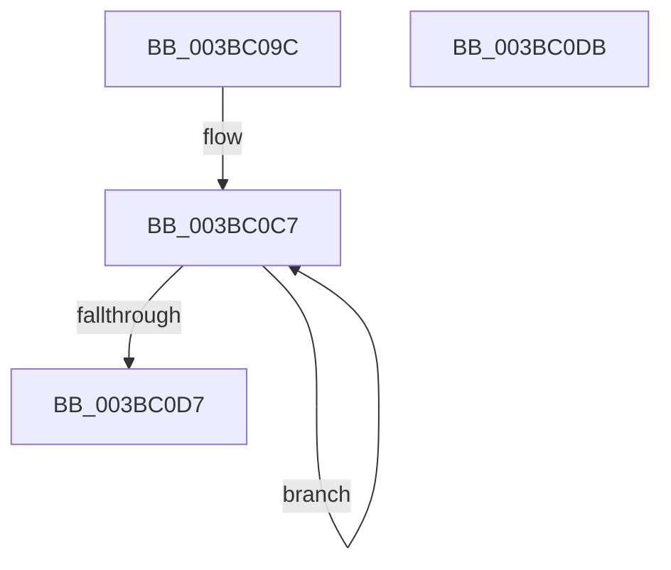

# MiGetNodeStandbyPageCount

- RVA: `0x003BC09C`–`0x003BC0DC` (길이 `64` bytes)
- VA: `0x00000001403BC09C`
- 실행 섹션: `.text`
- PDB 이름 있음: `예`; PDB Function 태그: `아니요`
- unwind 정보 RVA: `0x000DB714`
- 디코드: `18`개 명령, `64/64` bytes 표시
- 미해석 바이트: `0` (있으면 어셈블리에 `.byte`로 보존)

> 이 문서는 커널 이미지의 기계어와 PDB 기호를 분석해 생성했습니다. 4번과 5번은 함수 원형과 자료형을 바이너리 사용 방식에서 추정한 C 해석이며 원본 소스 복구 결과는 아닙니다.

## 1. Dependencies

- 직접 호출 지점: **0**; 고유 호출 대상: **0**
- 직접 호출자로 확인된 함수: **4**
- RIP 상대 이미지 참조: **0**

### Outgoing calls
- 직접 디코드된 call 명령이 없습니다.

### Direct callers
- [MiCheckZeroFreeRebalance](../28/MiCheckZeroFreeRebalance_function_0028B1FC.md) at `0x0028B26F`
- [MiRebuildLargePages](MiRebuildLargePages_function_003BA700.md) at `0x003BA8F7`
- [MiFreeZeroPagesNeeded](MiFreeZeroPagesNeeded_function_003BBA70.md) at `0x003BBAB3`
- [MiRebuildLargePage](MiRebuildLargePage_function_003BBAEC.md) at `0x003BBE63`

### Static image references
- 디코드된 RIP-relative 메모리 참조가 없습니다.

## 2. Other-region calls and transfers

- 다른 실행 섹션으로 향하는 call: **0**
- 별도 외부 분기/꼬리 이동을 확인하지 못했습니다.

## 3. Assembly (complete function range)

```asm
003BC09C  8B C2                           mov eax, edx
003BC09E  45 33 D2                        xor r10d, r10d
003BC0A1  4C 69 C8 80 DF 00 00            imul r9, rax, 0xdf80
003BC0A8  41 0F B6 C0                     movzx eax, r8b
003BC0AC  48 69 D0 C0 02 00 00            imul rdx, rax, 0x2c0
003BC0B3  48 8B 41 10                     mov rax, qword ptr [rcx + 0x10]
003BC0B7  4C 03 CA                        add r9, rdx
003BC0BA  48 05 48 14 00 00               add rax, 0x1448
003BC0C0  49 03 C1                        add rax, r9
003BC0C3  41 8D 52 08                     lea edx, [r10 + 8]
003BC0C7  48 8B 08                        mov rcx, qword ptr [rax]
003BC0CA  48 8D 40 58                     lea rax, [rax + 0x58]
003BC0CE  4C 03 D1                        add r10, rcx
003BC0D1  48 83 EA 01                     sub rdx, 1
003BC0D5  75 F0                           jne 0x1403bc0c7
003BC0D7  49 8B C2                        mov rax, r10
003BC0DA  C3                              ret
003BC0DB  CC                              int3
```

## 4. C-style interpretation (structured pseudocode)

```c
__int64 __fastcall MiGetNodeStandbyPageCount(__int64 a1, int a2, unsigned __int8 a3)
{
    __int64 result;
    __int64 v_r10;

    v_r10 = 0;
    a4 = (a4) * ((unsigned int)(a2));
    a2 = (a2) * (a3);
    a4 = (a4) + (a2);
    result = (*(unsigned __int64 *)(a1 + 16)) + (0x1448ULL);
    result = (result) + (a4);
loc_003BC0C7:
    v_r10 = (v_r10) + (*(unsigned __int64 *)(result));
    a2 = (v_r10 + 8) - (1);
    if (condition_is_not_equal) goto loc_003BC0C7;
    return v_r10;
}
```

## 5. (Beta) C Style

```c
int64_t MiGetNodeStandbyPageCount(void *Arg1, int32_t Arg2, uint8_t Arg3)
{
    uint8_t *arg1 = (uint8_t *)Arg1;

    int64_t result;
    int64_t local_r10;

    local_r10 = 0;
    a4 = (a4) * ((uint32_t)(Arg2));
    Arg2 = (Arg2) * (Arg3);
    a4 = (a4) + (Arg2);
    result = (*(uint64_t *)(arg1 + 0x10)) + (0x1448ULL);
    result = (result) + (a4);
loc_003BC0C7:
    local_r10 = (local_r10) + (*(uint64_t *)(result));
    Arg2 = (local_r10 + 8) - (1);
    if (condition_is_not_equal) goto loc_003BC0C7;
    return local_r10;
}
```

### 관측된 메모리 오프셋

구조체 형식이 확인되지 않은 접근은 인자 기준의 오프셋으로만 기록했습니다.

| 기준 인자 | 오프셋 표현 | 폭 (bit) | 접근 |
|---|---:|---:|---|
| `Arg1` | `+ 0x10` | `64` | `R` |

## 6. Execution-region graph

[열기: 2D/3D 그래프와 함수 탐색 컨트롤 패널](../../../control-panel.html?section=text&rva=0x003BC09C&view=graph)

- 2D 그래프는 위에서 아래로 흐르고, 3D 그래프는 빈 공간을 드래그해 회전합니다. Shift+드래그는 이동, 휠은 확대·축소, 함수 노드 선택은 대상 보고서 이동입니다.

### Static fallback


