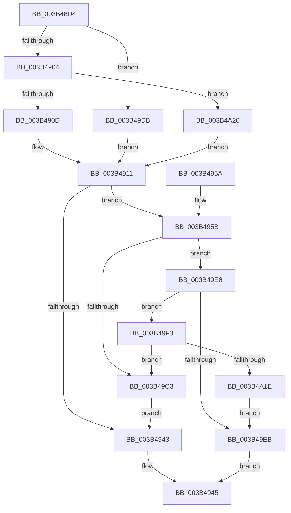

# MiGetPageTablesForLargeMap

- RVA: `0x003B48D4`–`0x003B4A2E` (길이 `346` bytes)
- VA: `0x00000001403B48D4`
- 실행 섹션: `.text`
- PDB 이름 있음: `예`; PDB Function 태그: `아니요`
- unwind 정보 RVA: `0x0008C5C8`
- 디코드: `96`개 명령, `346/346` bytes 표시
- 미해석 바이트: `0` (있으면 어셈블리에 `.byte`로 보존)

> 이 문서는 커널 이미지의 기계어와 PDB 기호를 분석해 생성했습니다. 4번과 5번은 함수 원형과 자료형을 바이너리 사용 방식에서 추정한 C 해석이며 원본 소스 복구 결과는 아닙니다.

## 1. Dependencies

- 직접 호출 지점: **4**; 고유 호출 대상: **3**
- 직접 호출자로 확인된 함수: **2**
- RIP 상대 이미지 참조: **0**

### Outgoing calls
- `0x003B4936` → [MiObtainSystemVa](MiObtainSystemVa_function_003B4F44.md) (function, `0x003B4F44`)
- `0x003B49BA` → [MiMakeZeroedPageTablesEx](MiMakeZeroedPageTablesEx_function_003B59FC.md) (function, `0x003B59FC`)
- `0x003B49D1` → [MiReturnSystemVa](../23/MiReturnSystemVa_function_002394C4.md) (function, `0x002394C4`)
- `0x003B4A15` → [MiMakeZeroedPageTablesEx](MiMakeZeroedPageTablesEx_function_003B59FC.md) (function, `0x003B59FC`)

### Direct callers
- [MiInsertInSystemSpace](MiInsertInSystemSpace_function_003B2F5C.md) at `0x003B3335`
- [MiMapContiguousMemoryLarge](MiMapContiguousMemoryLarge_function_003B44CC.md) at `0x003B4648`

### Static image references
- 디코드된 RIP-relative 메모리 참조가 없습니다.

## 2. Other-region calls and transfers

- 다른 실행 섹션으로 향하는 call: **0**
- 별도 외부 분기/꼬리 이동을 확인하지 못했습니다.

## 3. Assembly (complete function range)

```asm
003B48D4  48 89 5C 24 10                  mov qword ptr [rsp + 0x10], rbx
003B48D9  44 89 44 24 18                  mov dword ptr [rsp + 0x18], r8d
003B48DE  55                              push rbp
003B48DF  56                              push rsi
003B48E0  57                              push rdi
003B48E1  41 54                           push r12
003B48E3  41 55                           push r13
003B48E5  41 56                           push r14
003B48E7  41 57                           push r15
003B48E9  48 83 EC 30                     sub rsp, 0x30
003B48ED  41 8B D9                        mov ebx, r9d
003B48F0  8B F2                           mov esi, edx
003B48F2  4C 8B F9                        mov r15, rcx
003B48F5  41 BC 02 00 00 00               mov r12d, 2
003B48FB  83 FA 08                        cmp edx, 8
003B48FE  0F 84 D7 00 00 00               je 0x1403b49db
003B4904  83 FA 06                        cmp edx, 6
003B4907  0F 85 13 01 00 00               jne 0x1403b4a20
003B490D  44 8D 72 04                     lea r14d, [rdx + 4]
003B4911  49 8B C7                        mov rax, r15
003B4914  4D 8B EF                        mov r13, r15
003B4917  48 C1 E8 09                     shr rax, 9
003B491B  49 81 E5 00 FE FF FF            and r13, 0xfffffffffffffe00
003B4922  49 F7 C7 FF 01 00 00            test r15, 0x1ff
003B4929  41 8B D6                        mov edx, r14d
003B492C  48 8D 78 01                     lea rdi, [rax + 1]
003B4930  48 0F 44 F8                     cmove rdi, rax
003B4934  8B CF                           mov ecx, edi
003B4936  E8 09 06 00 00                  call 0x1403b4f44
003B493B  48 8B E8                        mov rbp, rax
003B493E  48 85 C0                        test rax, rax
003B4941  75 18                           jne 0x1403b495b
003B4943  33 C0                           xor eax, eax
003B4945  48 8B 5C 24 78                  mov rbx, qword ptr [rsp + 0x78]
003B494A  48 83 C4 30                     add rsp, 0x30
003B494E  41 5F                           pop r15
003B4950  41 5E                           pop r14
003B4952  41 5D                           pop r13
003B4954  41 5C                           pop r12
003B4956  5F                              pop rdi
003B4957  5E                              pop rsi
003B4958  5D                              pop rbp
003B4959  C3                              ret
003B495A  CC                              int3
003B495B  4C 8B D5                        mov r10, rbp
003B495E  48 B8 F8 FF FF FF 7F 00 00 00   movabs rax, 0x7ffffffff8
003B4968  49 C1 EA 09                     shr r10, 9
003B496C  4C 23 D0                        and r10, rax
003B496F  48 B8 00 00 00 00 80 F6 FF FF   movabs rax, 0xfffff68000000000
003B4979  4C 03 D0                        add r10, rax
003B497C  41 8B CC                        mov ecx, r12d
003B497F  83 C9 04                        or ecx, 4
003B4982  4C 89 54 24 70                  mov qword ptr [rsp + 0x70], r10
003B4987  83 BC 24 80 00 00 00 00         cmp dword ptr [rsp + 0x80], 0
003B498F  41 0F 45 CC                     cmovne ecx, r12d
003B4993  44 0F 20 C0                     mov rax, cr8
003B4997  44 8B E1                        mov r12d, ecx
003B499A  89 5C 24 20                     mov dword ptr [rsp + 0x20], ebx
003B499E  41 0F BA EC 0C                  bts r12d, 0xc
003B49A3  49 8D 55 FF                     lea rdx, [r13 - 1]
003B49A7  3C 02                           cmp al, 2
003B49A9  49 8D 14 D2                     lea rdx, [r10 + rdx*8]
003B49AD  44 8B CE                        mov r9d, esi
003B49B0  44 0F 45 E1                     cmovne r12d, ecx
003B49B4  49 8B CA                        mov rcx, r10
003B49B7  45 8B C4                        mov r8d, r12d
003B49BA  E8 3D 10 00 00                  call 0x1403b59fc
003B49BF  85 C0                           test eax, eax
003B49C1  75 23                           jne 0x1403b49e6
003B49C3  48 C1 E7 15                     shl rdi, 0x15
003B49C7  45 8B C6                        mov r8d, r14d
003B49CA  48 8B CD                        mov rcx, rbp
003B49CD  48 8D 14 2F                     lea rdx, [rdi + rbp]
003B49D1  E8 EE 4A E8 FF                  call 0x1402394c4
003B49D6  E9 68 FF FF FF                  jmp 0x1403b4943
003B49DB  41 BE 0C 00 00 00               mov r14d, 0xc
003B49E1  E9 2B FF FF FF                  jmp 0x1403b4911
003B49E6  4D 3B FD                        cmp r15, r13
003B49E9  75 08                           jne 0x1403b49f3
003B49EB  48 8B C5                        mov rax, rbp
003B49EE  E9 52 FF FF FF                  jmp 0x1403b4945
003B49F3  48 8B 44 24 70                  mov rax, qword ptr [rsp + 0x70]
003B49F8  41 81 E4 01 10 00 00            and r12d, 0x1001
003B49FF  44 8B CE                        mov r9d, esi
003B4A02  89 5C 24 20                     mov dword ptr [rsp + 0x20], ebx
003B4A06  45 8B C4                        mov r8d, r12d
003B4A09  48 8D 50 F8                     lea rdx, [rax - 8]
003B4A0D  4A 8D 14 FA                     lea rdx, [rdx + r15*8]
003B4A11  4A 8D 0C E8                     lea rcx, [rax + r13*8]
003B4A15  E8 E2 0F 00 00                  call 0x1403b59fc
003B4A1A  85 C0                           test eax, eax
003B4A1C  74 A5                           je 0x1403b49c3
003B4A1E  EB CB                           jmp 0x1403b49eb
003B4A20  44 8B F6                        mov r14d, esi
003B4A23  41 BC 03 00 00 00               mov r12d, 3
003B4A29  E9 E3 FE FF FF                  jmp 0x1403b4911
```

## 4. C-style interpretation (structured pseudocode)

```c
__int64 __fastcall MiGetPageTablesForLargeMap(__int64 a1, __int64 a2, int a3, int a4)
{
    __int64 result;
    __int64 v_r10;
    __int64 v_r12;
    __int64 v_r13;
    __int64 v_rdi;
    __int64 v_rsp;
    unsigned __int64 v_stack_p10;
    unsigned int v_stack_p18;
    unsigned int v_stack_p20;
    unsigned __int64 v_stack_p70;
    unsigned int v_stack_p80;

    v_stack_p10 = v_rbx;
    v_stack_p18 = a3;
    v_rsp = (v_rsp) - (48);
    if (((unsigned int)(a2)) == 8) goto loc_003B49DB;
    if (((unsigned int)(a2)) != 6) goto loc_003B4A20;
loc_003B4911:
    result = (a1) >> (9);
    v_r13 = (a1) & (-512);
    v_rdi = result + 1;
    if (((a1) & (511)) == 0) { v_rdi = result; }
    result = MiObtainSystemVa((unsigned int)((unsigned int)(v_rdi)), (unsigned int)((unsigned int)(a2 + 4)), a3, a4);
    if (result != 0) goto loc_003B495B;
loc_003B4943:
    result = 0;
loc_003B4945:
    v_rsp = (v_rsp) + (48);
    return result;
loc_003B495B:
    v_r10 = (0) >> (9);
    v_r10 = (v_r10) & (0);
    v_r10 = (v_r10) + (0);
    a1 = (unsigned int)((2) | (4));
    v_stack_p70 = v_r10;
    if (v_stack_p80 != 0) { a1 = 2; }
    v_stack_p20 = (unsigned int)(v_stack_p10);
    v_r12 = (unsigned int)((unsigned int)(a1));
    if (((unsigned __int8)(v_cr8)) != 2) { v_r12 = (unsigned int)(a1); }
    result = MiMakeZeroedPageTablesEx(v_r10, v_r10 + v_r13 - 1 * 8, (unsigned int)((unsigned int)(v_r12)), (unsigned int)((unsigned int)((unsigned int)((unsigned int)(a2)))));
    if ((unsigned int)(result) != 0) goto loc_003B49E6;
loc_003B49C3:
    v_rdi = (v_rdi) << (21);
    result = MiReturnSystemVa(result, v_rdi + result * 1, (unsigned int)((unsigned int)(a2 + 4)), (unsigned int)((unsigned int)((unsigned int)((unsigned int)(a2)))));
    goto loc_003B4943;
loc_003B49DB:
    goto loc_003B4911;
loc_003B49E6:
    if (a1 != v_r13) goto loc_003B49F3;
loc_003B49EB:
    goto loc_003B4945;
loc_003B49F3:
    v_r12 = (unsigned int)((v_r12) & (0x1001ULL));
    v_stack_p20 = (unsigned int)(v_stack_p10);
    result = MiMakeZeroedPageTablesEx(v_stack_p70 + v_r13 * 8, v_stack_p70 - 8 + a1 * 8, (unsigned int)((unsigned int)(v_r12)), (unsigned int)((unsigned int)((unsigned int)((unsigned int)(a2)))));
    if ((unsigned int)(result) == 0) goto loc_003B49C3;
    goto loc_003B49EB;
loc_003B4A20:
    goto loc_003B4911;
}
```

## 5. (Beta) C Style

```c
int64_t MiGetPageTablesForLargeMap(void *Arg1, int64_t Arg2, int32_t Arg3, int32_t Arg4)
{
    uint8_t *arg1 = (uint8_t *)Arg1;

    int64_t result;
    int64_t local_r10;
    int64_t local_r12;
    int64_t local_r13;
    int64_t local_rdi;
    int64_t local_rsp;
    uint64_t v_stack_p10;
    uint32_t v_stack_p18;
    uint32_t v_stack_p20;
    uint64_t v_stack_p70;
    uint32_t v_stack_p80;

    v_stack_p10 = local_rbx;
    v_stack_p18 = Arg3;
    local_rsp = (local_rsp) - (48);
    if (((uint32_t)(Arg2)) == 8) goto loc_003B49DB;
    if (((uint32_t)(Arg2)) != 6) goto loc_003B4A20;
loc_003B4911:
    result = (Arg1) >> (9);
    local_r13 = (Arg1) & (-512);
    local_rdi = result + 1;
    if (((Arg1) & (511)) == 0) { local_rdi = result; }
    result = MiObtainSystemVa((uint32_t)((uint32_t)(local_rdi)), (uint32_t)((uint32_t)(Arg2 + 4)), Arg3, Arg4);
    if (result != 0) goto loc_003B495B;
loc_003B4943:
    result = 0;
loc_003B4945:
    local_rsp = (local_rsp) + (48);
    return result;
loc_003B495B:
    local_r10 = (0) >> (9);
    local_r10 = (local_r10) & (0);
    local_r10 = (local_r10) + (0);
    Arg1 = (uint32_t)((2) | (4));
    v_stack_p70 = local_r10;
    if (v_stack_p80 != 0) { Arg1 = 2; }
    v_stack_p20 = (uint32_t)(v_stack_p10);
    local_r12 = (uint32_t)((uint32_t)(Arg1));
    if (((uint8_t)(v_cr8)) != 2) { local_r12 = (uint32_t)(Arg1); }
    result = MiMakeZeroedPageTablesEx(local_r10, local_r10 + local_r13 - 1 * 8, (uint32_t)((uint32_t)(local_r12)), (uint32_t)((uint32_t)((uint32_t)((uint32_t)(Arg2)))));
    if ((uint32_t)(result) != 0) goto loc_003B49E6;
loc_003B49C3:
    local_rdi = (local_rdi) << (21);
    result = MiReturnSystemVa(result, local_rdi + result * 1, (uint32_t)((uint32_t)(Arg2 + 4)), (uint32_t)((uint32_t)((uint32_t)((uint32_t)(Arg2)))));
    goto loc_003B4943;
loc_003B49DB:
    goto loc_003B4911;
loc_003B49E6:
    if (Arg1 != local_r13) goto loc_003B49F3;
loc_003B49EB:
    goto loc_003B4945;
loc_003B49F3:
    local_r12 = (uint32_t)((local_r12) & (0x1001ULL));
    v_stack_p20 = (uint32_t)(v_stack_p10);
    result = MiMakeZeroedPageTablesEx(v_stack_p70 + local_r13 * 8, v_stack_p70 - 8 + Arg1 * 8, (uint32_t)((uint32_t)(local_r12)), (uint32_t)((uint32_t)((uint32_t)((uint32_t)(Arg2)))));
    if ((uint32_t)(result) == 0) goto loc_003B49C3;
    goto loc_003B49EB;
loc_003B4A20:
    goto loc_003B4911;
}
```

### 관측된 메모리 오프셋

구조체 형식이 확인되지 않은 접근은 인자 기준의 오프셋으로만 기록했습니다.

| 기준 인자 | 오프셋 표현 | 폭 (bit) | 접근 |
|---|---:|---:|---|
| `Arg1` | `- 0x1` | `64` | `R` |

## 6. Execution-region graph

[열기: 2D/3D 그래프와 함수 탐색 컨트롤 패널](../../../control-panel.html?section=text&rva=0x003B48D4&view=graph)

- 2D 그래프는 위에서 아래로 흐르고, 3D 그래프는 빈 공간을 드래그해 회전합니다. Shift+드래그는 이동, 휠은 확대·축소, 함수 노드 선택은 대상 보고서 이동입니다.

### Static fallback


