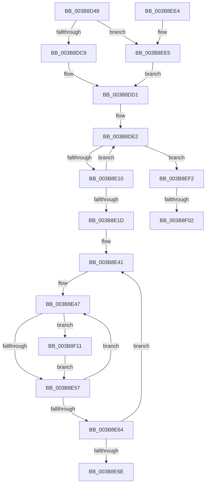

# MiGetPartitionNodeInformation

- RVA: `0x003B8D48`–`0x003B8F27` (길이 `479` bytes)
- VA: `0x00000001403B8D48`
- 실행 섹션: `.text`
- PDB 이름 있음: `예`; PDB Function 태그: `예`
- unwind 정보 RVA: `0x0008C9D8`
- 디코드: `117`개 명령, `479/479` bytes 표시
- 미해석 바이트: `0` (있으면 어셈블리에 `.byte`로 보존)

> 이 문서는 커널 이미지의 기계어와 PDB 기호를 분석해 생성했습니다. 4번과 5번은 함수 원형과 자료형을 바이너리 사용 방식에서 추정한 C 해석이며 원본 소스 복구 결과는 아닙니다.

## 1. Dependencies

- 직접 호출 지점: **9**; 고유 호출 대상: **7**
- 직접 호출자로 확인된 함수: **2**
- RIP 상대 이미지 참조: **2**

### Outgoing calls
- `0x003B8D89` → [memset](../6C/memset_function_006C6C40.md) (function, `0x006C6C40`)
- `0x003B8DA7` → [memset](../6C/memset_function_006C6C40.md) (function, `0x006C6C40`)
- `0x003B8DCC` → [ExAcquireSpinLockSharedAtDpcLevel](../24/ExAcquireSpinLockSharedAtDpcLevel_function_00248E30.md) (function, `0x00248E30`)
- `0x003B8DF3` → [MiGetPartitionNodePageCounts](MiGetPartitionNodePageCounts_function_003B8B0C.md) (function, `0x003B8B0C`)
- `0x003B8DFB` → [ExAcquireSpinLockSharedAtDpcLevel](../24/ExAcquireSpinLockSharedAtDpcLevel_function_00248E30.md) (function, `0x00248E30`)
- `0x003B8E13` → [ExReleaseSpinLockSharedFromDpcLevel](../24/ExReleaseSpinLockSharedFromDpcLevel_function_0024A590.md) (function, `0x0024A590`)
- `0x003B8E25` → [MiReleaseSpinLockShared](../34/MiReleaseSpinLockShared_function_00348BF0.md) (function, `0x00348BF0`)
- `0x003B8EC4` → [_security_check_cookie](../6A/_security_check_cookie_function_006AC640.md) (function, `0x006AC640`)
- `0x003B8EE5` → [ExAcquireSpinLockShared](../24/ExAcquireSpinLockShared_function_0024DCE0.md) (function, `0x0024DCE0`)

### Direct callers
- [MmFillEtwNodeInformation](MmFillEtwNodeInformation_function_003B9C74.md) at `0x003B9CED`
- [MmManagePartitionNodeInformation](../../page/80/MmManagePartitionNodeInformation_function_0080E490.md) at `0x0080E52C`

### Static image references
- `0x003B8D5F` → RVA `0x00E0A740` (`.data`; read)
- `0x003B8E34` → RVA `0x00011C60` (`.rdata`; read)

## 2. Other-region calls and transfers

- 다른 실행 섹션으로 향하는 call: **0**
- call이 아닌 외부 분기/꼬리 이동: **2**
  - `0x003B8EFC` → [sub_006E7A2C + 0x4D](../6E/Unknown_function_006E7A2C.md) (`tail-transfer`)
  - `0x003B8F0C` → [sub_006E7A2C](../6E/Unknown_function_006E7A2C.md) (`tail-transfer`)

## 3. Assembly (complete function range)

```asm
003B8D48  48 89 5C 24 20                  mov qword ptr [rsp + 0x20], rbx
003B8D4D  55                              push rbp
003B8D4E  56                              push rsi
003B8D4F  57                              push rdi
003B8D50  41 54                           push r12
003B8D52  41 55                           push r13
003B8D54  41 56                           push r14
003B8D56  41 57                           push r15
003B8D58  48 81 EC 90 00 00 00            sub rsp, 0x90
003B8D5F  48 8B 05 DA 19 A5 00            mov rax, qword ptr [rip + 0xa519da]
003B8D66  48 33 C4                        xor rax, rsp
003B8D69  48 89 84 24 80 00 00 00         mov qword ptr [rsp + 0x80], rax
003B8D71  8B DA                           mov ebx, edx
003B8D73  49 8B F8                        mov rdi, r8
003B8D76  33 D2                           xor edx, edx
003B8D78  4C 89 44 24 30                  mov qword ptr [rsp + 0x30], r8
003B8D7D  4C 8B F1                        mov r14, rcx
003B8D80  48 8D 4C 24 40                  lea rcx, [rsp + 0x40]
003B8D85  44 8D 42 40                     lea r8d, [rdx + 0x40]
003B8D89  E8 B2 DE 30 00                  call 0x1406c6c40
003B8D8E  33 D2                           xor edx, edx
003B8D90  48 8B CF                        mov rcx, rdi
003B8D93  4C 69 FB 80 DF 00 00            imul r15, rbx, 0xdf80
003B8D9A  44 8D 42 48                     lea r8d, [rdx + 0x48]
003B8D9E  4D 03 7E 10                     add r15, qword ptr [r14 + 0x10]
003B8DA2  4C 89 7C 24 20                  mov qword ptr [rsp + 0x20], r15
003B8DA7  E8 94 DE 30 00                  call 0x1406c6c40
003B8DAC  33 F6                           xor esi, esi
003B8DAE  44 0F 20 C0                     mov rax, cr8
003B8DB2  4D 8D A7 74 3B 00 00            lea r12, [r15 + 0x3b74]
003B8DB9  4C 89 64 24 28                  mov qword ptr [rsp + 0x28], r12
003B8DBE  49 8B CC                        mov rcx, r12
003B8DC1  3C 02                           cmp al, 2
003B8DC3  0F 82 1C 01 00 00               jb 0x1403b8ee5
003B8DC9  41 B5 11                        mov r13b, 0x11
003B8DCC  E8 5F 00 E9 FF                  call 0x140248e30
003B8DD1  49 8D BE A0 1B 00 00            lea rdi, [r14 + 0x1ba0]
003B8DD8  49 BC FF FF FF FF 3F 00 00 00   movabs r12, 0x3fffffffff
003B8DE2  49 8B AF 80 3A 00 00            mov rbp, qword ptr [r15 + 0x3a80]
003B8DE9  4C 8D 44 24 40                  lea r8, [rsp + 0x40]
003B8DEE  8B D3                           mov edx, ebx
003B8DF0  49 8B CE                        mov rcx, r14
003B8DF3  E8 14 FD FF FF                  call 0x1403b8b0c
003B8DF8  48 8B CF                        mov rcx, rdi
003B8DFB  E8 30 00 E9 FF                  call 0x140248e30
003B8E00  49 8B 86 80 1B 00 00            mov rax, qword ptr [r14 + 0x1b80]
003B8E07  48 85 C0                        test rax, rax
003B8E0A  0F 85 E2 00 00 00               jne 0x1403b8ef2
003B8E10  48 8B CF                        mov rcx, rdi
003B8E13  E8 78 17 E9 FF                  call 0x14024a590
003B8E18  48 3B F5                        cmp rsi, rbp
003B8E1B  77 C5                           ja 0x1403b8de2
003B8E1D  48 8B 4C 24 28                  mov rcx, qword ptr [rsp + 0x28]
003B8E22  41 8A D5                        mov dl, r13b
003B8E25  E8 C6 FD F8 FF                  call 0x140348bf0
003B8E2A  48 8B 7C 24 30                  mov rdi, qword ptr [rsp + 0x30]
003B8E2F  48 8D 4C 24 40                  lea rcx, [rsp + 0x40]
003B8E34  4C 8D 05 25 8E C5 FF            lea r8, [rip - 0x3a71db]
003B8E3B  41 BA 04 00 00 00               mov r10d, 4
003B8E41  41 B9 02 00 00 00               mov r9d, 2
003B8E47  48 8B 11                        mov rdx, qword ptr [rcx]
003B8E4A  48 8D 04 32                     lea rax, [rdx + rsi]
003B8E4E  48 3B C5                        cmp rax, rbp
003B8E51  0F 87 BA 00 00 00               ja 0x1403b8f11
003B8E57  48 03 F2                        add rsi, rdx
003B8E5A  48 83 C1 08                     add rcx, 8
003B8E5E  49 83 E9 01                     sub r9, 1
003B8E62  75 E3                           jne 0x1403b8e47
003B8E64  49 83 C0 08                     add r8, 8
003B8E68  49 83 EA 01                     sub r10, 1
003B8E6C  75 D3                           jne 0x1403b8e41
003B8E6E  48 8B 44 24 70                  mov rax, qword ptr [rsp + 0x70]
003B8E73  48 89 47 10                     mov qword ptr [rdi + 0x10], rax
003B8E77  48 8B 44 24 78                  mov rax, qword ptr [rsp + 0x78]
003B8E7C  48 89 47 08                     mov qword ptr [rdi + 8], rax
003B8E80  48 8B 44 24 60                  mov rax, qword ptr [rsp + 0x60]
003B8E85  48 89 47 20                     mov qword ptr [rdi + 0x20], rax
003B8E89  48 8B 44 24 68                  mov rax, qword ptr [rsp + 0x68]
003B8E8E  48 89 47 18                     mov qword ptr [rdi + 0x18], rax
003B8E92  48 8B 44 24 50                  mov rax, qword ptr [rsp + 0x50]
003B8E97  48 89 47 30                     mov qword ptr [rdi + 0x30], rax
003B8E9B  48 8B 44 24 58                  mov rax, qword ptr [rsp + 0x58]
003B8EA0  48 89 47 28                     mov qword ptr [rdi + 0x28], rax
003B8EA4  48 8B 44 24 40                  mov rax, qword ptr [rsp + 0x40]
003B8EA9  48 89 47 40                     mov qword ptr [rdi + 0x40], rax
003B8EAD  48 8B 44 24 48                  mov rax, qword ptr [rsp + 0x48]
003B8EB2  48 89 47 38                     mov qword ptr [rdi + 0x38], rax
003B8EB6  48 89 2F                        mov qword ptr [rdi], rbp
003B8EB9  48 8B 8C 24 80 00 00 00         mov rcx, qword ptr [rsp + 0x80]
003B8EC1  48 33 CC                        xor rcx, rsp
003B8EC4  E8 77 37 2F 00                  call 0x1406ac640
003B8EC9  48 8B 9C 24 E8 00 00 00         mov rbx, qword ptr [rsp + 0xe8]
003B8ED1  48 81 C4 90 00 00 00            add rsp, 0x90
003B8ED8  41 5F                           pop r15
003B8EDA  41 5E                           pop r14
003B8EDC  41 5D                           pop r13
003B8EDE  41 5C                           pop r12
003B8EE0  5F                              pop rdi
003B8EE1  5E                              pop rsi
003B8EE2  5D                              pop rbp
003B8EE3  C3                              ret
003B8EE4  CC                              int3
003B8EE5  E8 F6 4D E9 FF                  call 0x14024dce0
003B8EEA  44 8A E8                        mov r13b, al
003B8EED  E9 DF FE FF FF                  jmp 0x1403b8dd1
003B8EF2  4D 8B BE 90 1B 00 00            mov r15, qword ptr [r14 + 0x1b90]
003B8EF9  4D 3B FC                        cmp r15, r12
003B8EFC  0F 84 77 EB 32 00               je 0x1406e7a79
003B8F02  48 BF FF FF FF FF 3F 00 00 00   movabs rdi, 0x3fffffffff
003B8F0C  E9 1B EB 32 00                  jmp 0x1406e7a2c
003B8F11  33 D2                           xor edx, edx
003B8F13  48 8B C5                        mov rax, rbp
003B8F16  48 2B C6                        sub rax, rsi
003B8F19  49 F7 30                        div qword ptr [r8]
003B8F1C  48 8B D0                        mov rdx, rax
003B8F1F  48 89 01                        mov qword ptr [rcx], rax
003B8F22  E9 30 FF FF FF                  jmp 0x1403b8e57
```

## 4. C-style interpretation (structured pseudocode)

```c
__int64 __fastcall MiGetPartitionNodeInformation(__int64 a1, int a2, __int64 a3)
{
    __int64 result;
    __int64 v_r10;
    __int64 v_r15;
    __int64 v_rsi;
    __int64 v_rsp;
    unsigned __int64 v_stack_m48;
    unsigned __int64 v_stack_m50;
    unsigned __int64 v_stack_m58;
    unsigned __int64 v_stack_m60;
    unsigned __int64 v_stack_m68;
    unsigned __int64 v_stack_m70;
    unsigned __int64 v_stack_m78;
    unsigned __int64 v_stack_m80;
    unsigned __int64 v_stack_m88;
    unsigned __int64 v_stack_m98;
    unsigned __int64 v_stack_mA0;
    unsigned __int64 v_stack_mA8;
    unsigned __int64 v_stack_p20;

    v_stack_p20 = v_rbx;
    v_rsp = (v_rsp) - (144);
    result = (*(unsigned __int64 *)(v_rip + 10820058)) ^ (v_rsp);
    v_stack_m48 = result;
    a2 = 0;
    v_stack_m98 = a3;
    result = memset(v_stack_m88, a2, a2 + 64, a4);
    a2 = 0;
    v_r15 = (v_r15) * ((unsigned int)(a2));
    v_r15 = (v_r15) + (*(unsigned __int64 *)(a1 + 16));
    v_stack_mA8 = v_r15;
    result = memset(a3, a2, a2 + 72, a4);
    v_rsi = 0;
    v_stack_mA0 = v_r15 + 15220;
    if (((unsigned __int8)(v_cr8)) < 2) goto loc_003B8EE5;
    result = ExAcquireSpinLockSharedAtDpcLevel(v_r15 + 15220, a2, a2 + 72, a4);
loc_003B8DD1:
loc_003B8DE2:
    result = MiGetPartitionNodePageCounts(a1, (unsigned int)((unsigned int)((unsigned int)(a2))), v_stack_m88, a4);
    result = ExAcquireSpinLockSharedAtDpcLevel(a1 + 7072, (unsigned int)((unsigned int)((unsigned int)(a2))), v_stack_m88, a4);
    if (*(unsigned __int64 *)(a1 + 7040) != 0) goto loc_003B8EF2;
    result = ExReleaseSpinLockSharedFromDpcLevel(a1 + 7072, (unsigned int)((unsigned int)((unsigned int)(a2))), v_stack_m88, a4);
    if (0 > (*(unsigned __int64 *)(v_r15 + 14976))) goto loc_003B8DE2;
    result = MiReleaseSpinLockShared(v_stack_mA0, 17, v_stack_m88, a4);
loc_003B8E41:
loc_003B8E47:
    if ((*(unsigned __int64 *)(v_stack_m88) + v_rsi * 1) > (*(unsigned __int64 *)(v_r15 + 14976))) goto loc_003B8F11;
loc_003B8E57:
    v_rsi = (v_rsi) + (*(unsigned __int64 *)(v_stack_m88));
    a1 = (v_stack_m88) + (8);
    a4 = (2) - (1);
    if (condition_is_not_equal) goto loc_003B8E47;
    a3 = (v_rip - 3830235) + (8);
    v_r10 = (4) - (1);
    if (condition_is_not_equal) goto loc_003B8E41;
    *(unsigned __int64 *)(v_stack_m98 + 16) = v_stack_m58;
    *(unsigned __int64 *)(v_stack_m98 + 8) = v_stack_m50;
    *(unsigned __int64 *)(v_stack_m98 + 32) = v_stack_m68;
    *(unsigned __int64 *)(v_stack_m98 + 24) = v_stack_m60;
    *(unsigned __int64 *)(v_stack_m98 + 48) = v_stack_m78;
    *(unsigned __int64 *)(v_stack_m98 + 40) = v_stack_m70;
    *(unsigned __int64 *)(v_stack_m98 + 64) = v_stack_m88;
    *(unsigned __int64 *)(v_stack_m98 + 56) = v_stack_m80;
    *(unsigned __int64 *)(v_stack_m98) = *(unsigned __int64 *)(v_r15 + 14976);
    a1 = (v_stack_m48) ^ (v_rsp);
    result = _security_check_cookie(a1, *(unsigned __int64 *)(v_stack_m88), a3, a4);
    v_rsp = (v_rsp) + (144);
    return result;
loc_003B8EE5:
    result = ExAcquireSpinLockShared(a1, *(unsigned __int64 *)(v_stack_m88), a3, a4);
    goto loc_003B8DD1;
loc_003B8EF2:
loc_003B8F11:
    a2 = 0;
    result = (*(unsigned __int64 *)(v_r15 + 14976)) - (v_rsi);
    *(unsigned __int64 *)(a1) = result;
    goto loc_003B8E57;
}
```

## 5. (Beta) C Style

```c
int64_t MiGetPartitionNodeInformation(void *Arg1, int32_t Arg2, int64_t Arg3)
{
    uint8_t *arg1 = (uint8_t *)Arg1;

    int64_t result;
    int64_t local_r10;
    int64_t local_r15;
    int64_t local_rsi;
    int64_t local_rsp;
    uint64_t v_stack_m48;
    uint64_t v_stack_m50;
    uint64_t v_stack_m58;
    uint64_t v_stack_m60;
    uint64_t v_stack_m68;
    uint64_t v_stack_m70;
    uint64_t v_stack_m78;
    uint64_t v_stack_m80;
    uint64_t v_stack_m88;
    uint64_t v_stack_m98;
    uint64_t v_stack_mA0;
    uint64_t v_stack_mA8;
    uint64_t v_stack_p20;

    v_stack_p20 = local_rbx;
    local_rsp = (local_rsp) - (144);
    result = (*(uint64_t *)(v_rip + 0xA519DA)) ^ (local_rsp);
    v_stack_m48 = result;
    Arg2 = 0;
    v_stack_m98 = Arg3;
    result = memset(v_stack_m88, Arg2, Arg2 + 64, a4);
    Arg2 = 0;
    local_r15 = (local_r15) * ((uint32_t)(Arg2));
    local_r15 = (local_r15) + (*(uint64_t *)(arg1 + 0x10));
    v_stack_mA8 = local_r15;
    result = memset(Arg3, Arg2, Arg2 + 72, a4);
    local_rsi = 0;
    v_stack_mA0 = local_r15 + 15220;
    if (((uint8_t)(v_cr8)) < 2) goto loc_003B8EE5;
    result = ExAcquireSpinLockSharedAtDpcLevel(local_r15 + 15220, Arg2, Arg2 + 72, a4);
loc_003B8DD1:
loc_003B8DE2:
    result = MiGetPartitionNodePageCounts(Arg1, (uint32_t)((uint32_t)((uint32_t)(Arg2))), v_stack_m88, a4);
    result = ExAcquireSpinLockSharedAtDpcLevel(Arg1 + 7072, (uint32_t)((uint32_t)((uint32_t)(Arg2))), v_stack_m88, a4);
    if (*(uint64_t *)(arg1 + 0x1B80) != 0) goto loc_003B8EF2;
    result = ExReleaseSpinLockSharedFromDpcLevel(Arg1 + 7072, (uint32_t)((uint32_t)((uint32_t)(Arg2))), v_stack_m88, a4);
    if (0 > (*(uint64_t *)(local_r15 + 0x3A80))) goto loc_003B8DE2;
    result = MiReleaseSpinLockShared(v_stack_mA0, 17, v_stack_m88, a4);
loc_003B8E41:
loc_003B8E47:
    if ((*(uint64_t *)(v_stack_m88) + local_rsi * 1) > (*(uint64_t *)(local_r15 + 0x3A80))) goto loc_003B8F11;
loc_003B8E57:
    local_rsi = (local_rsi) + (*(uint64_t *)(v_stack_m88));
    Arg1 = (v_stack_m88) + (8);
    a4 = (2) - (1);
    if (condition_is_not_equal) goto loc_003B8E47;
    Arg3 = (v_rip - 3830235) + (8);
    local_r10 = (4) - (1);
    if (condition_is_not_equal) goto loc_003B8E41;
    *(uint64_t *)(v_stack_m98 + 0x10) = v_stack_m58;
    *(uint64_t *)(v_stack_m98 + 0x8) = v_stack_m50;
    *(uint64_t *)(v_stack_m98 + 0x20) = v_stack_m68;
    *(uint64_t *)(v_stack_m98 + 0x18) = v_stack_m60;
    *(uint64_t *)(v_stack_m98 + 0x30) = v_stack_m78;
    *(uint64_t *)(v_stack_m98 + 0x28) = v_stack_m70;
    *(uint64_t *)(v_stack_m98 + 0x40) = v_stack_m88;
    *(uint64_t *)(v_stack_m98 + 0x38) = v_stack_m80;
    *(uint64_t *)(v_stack_m98) = *(uint64_t *)(local_r15 + 0x3A80);
    Arg1 = (v_stack_m48) ^ (local_rsp);
    result = _security_check_cookie(Arg1, *(uint64_t *)(v_stack_m88), Arg3, a4);
    local_rsp = (local_rsp) + (144);
    return result;
loc_003B8EE5:
    result = ExAcquireSpinLockShared(Arg1, *(uint64_t *)(v_stack_m88), Arg3, a4);
    goto loc_003B8DD1;
loc_003B8EF2:
loc_003B8F11:
    Arg2 = 0;
    result = (*(uint64_t *)(local_r15 + 0x3A80)) - (local_rsi);
    *(uint64_t *)(arg1) = result;
    goto loc_003B8E57;
}
```

### 관측된 메모리 오프셋

구조체 형식이 확인되지 않은 접근은 인자 기준의 오프셋으로만 기록했습니다.

| 기준 인자 | 오프셋 표현 | 폭 (bit) | 접근 |
|---|---:|---:|---|
| `Arg1` | `+ 0x10` | `64` | `R` |
| `Arg1` | `+ 0x1B80` | `64` | `R` |
| `Arg1` | `+ 0x1B90` | `64` | `R` |
| `Arg1` | `+ 0x1BA0` | `64` | `R` |

## 6. Execution-region graph

[열기: 2D/3D 그래프와 함수 탐색 컨트롤 패널](../../../control-panel.html?section=text&rva=0x003B8D48&view=graph)

- 2D 그래프는 위에서 아래로 흐르고, 3D 그래프는 빈 공간을 드래그해 회전합니다. Shift+드래그는 이동, 휠은 확대·축소, 함수 노드 선택은 대상 보고서 이동입니다.

### Static fallback


