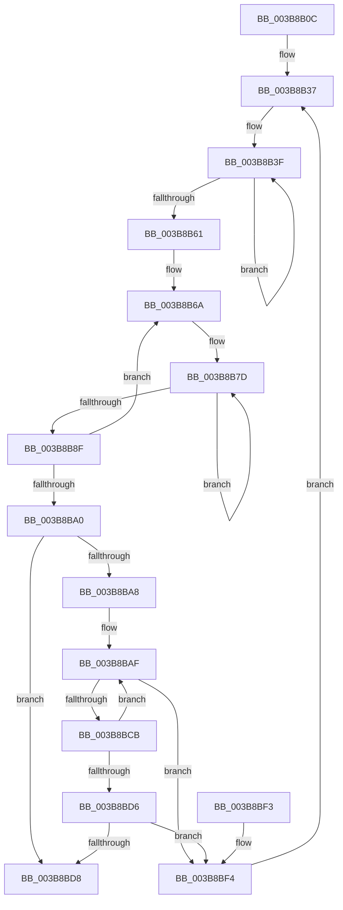

# MiGetPartitionNodePageCounts

- RVA: `0x003B8B0C`–`0x003B8BFB` (길이 `239` bytes)
- VA: `0x00000001403B8B0C`
- 실행 섹션: `.text`
- PDB 이름 있음: `예`; PDB Function 태그: `아니요`
- unwind 정보 RVA: `0x0008C994`
- 디코드: `70`개 명령, `239/239` bytes 표시
- 미해석 바이트: `0` (있으면 어셈블리에 `.byte`로 보존)

> 이 문서는 커널 이미지의 기계어와 PDB 기호를 분석해 생성했습니다. 4번과 5번은 함수 원형과 자료형을 바이너리 사용 방식에서 추정한 C 해석이며 원본 소스 복구 결과는 아닙니다.

## 1. Dependencies

- 직접 호출 지점: **2**; 고유 호출 대상: **2**
- 직접 호출자로 확인된 함수: **2**
- RIP 상대 이미지 참조: **0**

### Outgoing calls
- `0x003B8B4C` → [MiSnapPageMoveInProgress](MiSnapPageMoveInProgress_function_003B8C04.md) (function, `0x003B8C04`)
- `0x003B8BBB` → [MiWaitForPageMoveComplete](MiWaitForPageMoveComplete_function_003B8C30.md) (function, `0x003B8C30`)

### Direct callers
- [MiGetNodeChannelPageCounts](MiGetNodeChannelPageCounts_function_003B8888.md) at `0x003B892B`
- [MiGetPartitionNodeInformation](MiGetPartitionNodeInformation_function_003B8D48.md) at `0x003B8DF3`

### Static image references
- 디코드된 RIP-relative 메모리 참조가 없습니다.

## 2. Other-region calls and transfers

- 다른 실행 섹션으로 향하는 call: **0**
- 별도 외부 분기/꼬리 이동을 확인하지 못했습니다.

## 3. Assembly (complete function range)

```asm
003B8B0C  48 8B C4                        mov rax, rsp
003B8B0F  48 89 58 08                     mov qword ptr [rax + 8], rbx
003B8B13  48 89 68 10                     mov qword ptr [rax + 0x10], rbp
003B8B17  48 89 70 18                     mov qword ptr [rax + 0x18], rsi
003B8B1B  48 89 78 20                     mov qword ptr [rax + 0x20], rdi
003B8B1F  41 56                           push r14
003B8B21  48 83 EC 30                     sub rsp, 0x30
003B8B25  8B C2                           mov eax, edx
003B8B27  33 F6                           xor esi, esi
003B8B29  48 69 E8 80 DF 00 00            imul rbp, rax, 0xdf80
003B8B30  4D 8B F0                        mov r14, r8
003B8B33  48 03 69 10                     add rbp, qword ptr [rcx + 0x10]
003B8B37  45 33 C0                        xor r8d, r8d
003B8B3A  4C 8D 4C 24 20                  lea r9, [rsp + 0x20]
003B8B3F  41 8B C0                        mov eax, r8d
003B8B42  48 8B CD                        mov rcx, rbp
003B8B45  F7 D8                           neg eax
003B8B47  1B D2                           sbb edx, edx
003B8B49  83 C2 02                        add edx, 2
003B8B4C  E8 B3 00 00 00                  call 0x1403b8c04
003B8B51  41 FF C0                        inc r8d
003B8B54  49 89 01                        mov qword ptr [r9], rax
003B8B57  4D 8D 49 08                     lea r9, [r9 + 8]
003B8B5B  41 83 F8 02                     cmp r8d, 2
003B8B5F  72 DE                           jb 0x1403b8b3f
003B8B61  33 C9                           xor ecx, ecx
003B8B63  48 8B D5                        mov rdx, rbp
003B8B66  44 8D 51 04                     lea r10d, [rcx + 4]
003B8B6A  4C 8B C2                        mov r8, rdx
003B8B6D  4E 8D 0C 31                     lea r9, [rcx + r14]
003B8B71  4C 2B C1                        sub r8, rcx
003B8B74  41 BB 02 00 00 00               mov r11d, 2
003B8B7A  4D 2B C6                        sub r8, r14
003B8B7D  4B 8B 44 08 08                  mov rax, qword ptr [r8 + r9 + 8]
003B8B82  49 89 01                        mov qword ptr [r9], rax
003B8B85  4D 8D 49 08                     lea r9, [r9 + 8]
003B8B89  49 83 EB 01                     sub r11, 1
003B8B8D  75 EE                           jne 0x1403b8b7d
003B8B8F  48 81 C2 00 05 00 00            add rdx, 0x500
003B8B96  48 83 C1 10                     add rcx, 0x10
003B8B9A  49 83 EA 01                     sub r10, 1
003B8B9E  75 CA                           jne 0x1403b8b6a
003B8BA0  81 FE 00 01 00 00               cmp esi, 0x100
003B8BA6  73 30                           jae 0x1403b8bd8
003B8BA8  33 DB                           xor ebx, ebx
003B8BAA  48 8D 7C 24 20                  lea rdi, [rsp + 0x20]
003B8BAF  8B C3                           mov eax, ebx
003B8BB1  48 8B CD                        mov rcx, rbp
003B8BB4  F7 D8                           neg eax
003B8BB6  1B D2                           sbb edx, edx
003B8BB8  83 C2 02                        add edx, 2
003B8BBB  E8 70 00 00 00                  call 0x1403b8c30
003B8BC0  48 33 07                        xor rax, qword ptr [rdi]
003B8BC3  48 A9 00 00 FF FF               test rax, -0x10000
003B8BC9  75 29                           jne 0x1403b8bf4
003B8BCB  FF C3                           inc ebx
003B8BCD  48 83 C7 08                     add rdi, 8
003B8BD1  83 FB 02                        cmp ebx, 2
003B8BD4  72 D9                           jb 0x1403b8baf
003B8BD6  75 1C                           jne 0x1403b8bf4
003B8BD8  48 8B 5C 24 40                  mov rbx, qword ptr [rsp + 0x40]
003B8BDD  48 8B 6C 24 48                  mov rbp, qword ptr [rsp + 0x48]
003B8BE2  48 8B 74 24 50                  mov rsi, qword ptr [rsp + 0x50]
003B8BE7  48 8B 7C 24 58                  mov rdi, qword ptr [rsp + 0x58]
003B8BEC  48 83 C4 30                     add rsp, 0x30
003B8BF0  41 5E                           pop r14
003B8BF2  C3                              ret
003B8BF3  CC                              int3
003B8BF4  FF C6                           inc esi
003B8BF6  E9 3C FF FF FF                  jmp 0x1403b8b37
```

## 4. C-style interpretation (structured pseudocode)

```c
__int64 __fastcall MiGetPartitionNodePageCounts(__int64 a1, int a2, __int64 a3)
{
    __int64 result;
    __int64 v_r10;
    __int64 v_r11;
    __int64 v_rbp;
    __int64 v_rbx;
    __int64 v_rdi;
    __int64 v_rsi;
    __int64 v_rsp;
    unsigned __int64 v_stack_m18;
    unsigned __int64 v_stack_p10;
    unsigned __int64 v_stack_p18;
    unsigned __int64 v_stack_p20;
    unsigned __int64 v_stack_p8;

    *(unsigned __int64 *)(v_rsp + 8) = v_rbx;
    *(unsigned __int64 *)(v_rsp + 16) = v_rbp;
    *(unsigned __int64 *)(v_rsp + 24) = v_rsi;
    *(unsigned __int64 *)(v_rsp + 32) = v_rdi;
    v_rsp = (v_rsp) - (48);
    v_rsi = 0;
    v_rbp = (v_rbp) * ((unsigned int)(a2));
    v_rbp = (v_rbp) + (*(unsigned __int64 *)(a1 + 16));
loc_003B8B37:
    a3 = 0;
loc_003B8B3F:
    result = (unsigned int)(-(0));
    a2 = (unsigned int)((a2) + (2));
    result = MiSnapPageMoveInProgress(v_rbp, a2, a3, v_stack_m18);
    a3 = (unsigned int)((a3) + 1);
    *(unsigned __int64 *)(v_stack_m18) = result;
    if (((unsigned int)(a3)) < 2) goto loc_003B8B3F;
    a1 = 0;
loc_003B8B6A:
    a3 = (v_rbp) - (0);
    a3 = (a3) - (a3);
loc_003B8B7D:
    *(unsigned __int64 *)(a1 + a3 * 1) = *(unsigned __int64 *)(a3 + a1 + a3 * 1 * 1 + 8);
    v_r11 = (2) - (1);
    if (condition_is_not_equal) goto loc_003B8B7D;
    a2 = (v_rbp) + (0x500ULL);
    a1 = (a1) + (16);
    v_r10 = (a1 + 4) - (1);
    if (condition_is_not_equal) goto loc_003B8B6A;
    if (0 >= 256) goto loc_003B8BD8;
    v_rbx = 0;
loc_003B8BAF:
    result = (unsigned int)(-(0));
    a2 = (unsigned int)((a2) + (2));
    result = MiWaitForPageMoveComplete(v_rbp, a2, a3, a1 + a3 * 1 + 8);
    result = (result) ^ (*(unsigned __int64 *)(v_stack_m18));
    if (((result) & (0xFFFFFFFFFFFF0000ULL)) != 0) goto loc_003B8BF4;
    v_rbx = (unsigned int)((v_rbx) + 1);
    v_rdi = (v_stack_m18) + (8);
    if (((unsigned int)(v_rbx)) < 2) goto loc_003B8BAF;
    if (((unsigned int)(v_rbx)) != 2) goto loc_003B8BF4;
loc_003B8BD8:
    v_rsp = (v_rsp) + (48);
    return result;
loc_003B8BF4:
    v_rsi = (unsigned int)((v_stack_p18) + 1);
    goto loc_003B8B37;
}
```

## 5. (Beta) C Style

```c
int64_t MiGetPartitionNodePageCounts(void *Arg1, int32_t Arg2, int64_t Arg3)
{
    uint8_t *arg1 = (uint8_t *)Arg1;

    int64_t result;
    int64_t local_r10;
    int64_t local_r11;
    int64_t local_rbp;
    int64_t local_rbx;
    int64_t local_rdi;
    int64_t local_rsi;
    int64_t local_rsp;
    uint64_t v_stack_m18;
    uint64_t v_stack_p10;
    uint64_t v_stack_p18;
    uint64_t v_stack_p20;
    uint64_t v_stack_p8;

    *(uint64_t *)(local_rsp + 0x8) = local_rbx;
    *(uint64_t *)(local_rsp + 0x10) = local_rbp;
    *(uint64_t *)(local_rsp + 0x18) = local_rsi;
    *(uint64_t *)(local_rsp + 0x20) = local_rdi;
    local_rsp = (local_rsp) - (48);
    local_rsi = 0;
    local_rbp = (local_rbp) * ((uint32_t)(Arg2));
    local_rbp = (local_rbp) + (*(uint64_t *)(arg1 + 0x10));
loc_003B8B37:
    Arg3 = 0;
loc_003B8B3F:
    result = (uint32_t)(-(0));
    Arg2 = (uint32_t)((Arg2) + (2));
    result = MiSnapPageMoveInProgress(local_rbp, Arg2, Arg3, v_stack_m18);
    Arg3 = (uint32_t)((Arg3) + 1);
    *(uint64_t *)(v_stack_m18) = result;
    if (((uint32_t)(Arg3)) < 2) goto loc_003B8B3F;
    Arg1 = 0;
loc_003B8B6A:
    Arg3 = (local_rbp) - (0);
    Arg3 = (Arg3) - (Arg3);
loc_003B8B7D:
    *(uint64_t *)(arg1 + Arg3 * 1) = *(uint64_t *)(Arg3 + arg1 + Arg3 * 1 * 1 + 0x8);
    local_r11 = (2) - (1);
    if (condition_is_not_equal) goto loc_003B8B7D;
    Arg2 = (local_rbp) + (0x500ULL);
    Arg1 = (Arg1) + (16);
    local_r10 = (Arg1 + 4) - (1);
    if (condition_is_not_equal) goto loc_003B8B6A;
    if (0 >= 256) goto loc_003B8BD8;
    local_rbx = 0;
loc_003B8BAF:
    result = (uint32_t)(-(0));
    Arg2 = (uint32_t)((Arg2) + (2));
    result = MiWaitForPageMoveComplete(local_rbp, Arg2, Arg3, Arg1 + Arg3 * 1 + 8);
    result = (result) ^ (*(uint64_t *)(v_stack_m18));
    if (((result) & (0xFFFFFFFFFFFF0000ULL)) != 0) goto loc_003B8BF4;
    local_rbx = (uint32_t)((local_rbx) + 1);
    local_rdi = (v_stack_m18) + (8);
    if (((uint32_t)(local_rbx)) < 2) goto loc_003B8BAF;
    if (((uint32_t)(local_rbx)) != 2) goto loc_003B8BF4;
loc_003B8BD8:
    local_rsp = (local_rsp) + (48);
    return result;
loc_003B8BF4:
    local_rsi = (uint32_t)((v_stack_p18) + 1);
    goto loc_003B8B37;
}
```

### 관측된 메모리 오프셋

구조체 형식이 확인되지 않은 접근은 인자 기준의 오프셋으로만 기록했습니다.

| 기준 인자 | 오프셋 표현 | 폭 (bit) | 접근 |
|---|---:|---:|---|
| `Arg1` | `+ 0x10` | `64` | `R` |

## 6. Execution-region graph

[열기: 2D/3D 그래프와 함수 탐색 컨트롤 패널](../../../control-panel.html?section=text&rva=0x003B8B0C&view=graph)

- 2D 그래프는 위에서 아래로 흐르고, 3D 그래프는 빈 공간을 드래그해 회전합니다. Shift+드래그는 이동, 휠은 확대·축소, 함수 노드 선택은 대상 보고서 이동입니다.

### Static fallback


