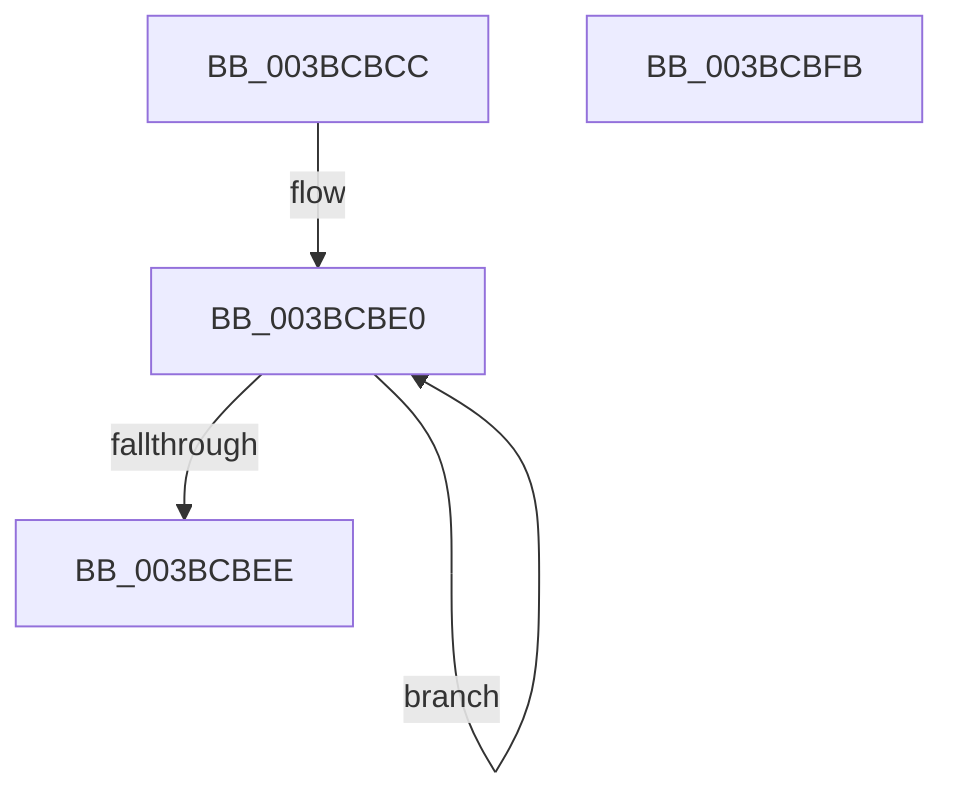

# MiGetSlabCurrentTime

- RVA: `0x003BCBCC`–`0x003BCBFC` (길이 `48` bytes)
- VA: `0x00000001403BCBCC`
- 실행 섹션: `.text`
- PDB 이름 있음: `예`; PDB Function 태그: `아니요`
- unwind 정보 RVA: `0x000DB714`
- 디코드: `12`개 명령, `48/48` bytes 표시
- 미해석 바이트: `0` (있으면 어셈블리에 `.byte`로 보존)

> 이 문서는 커널 이미지의 기계어와 PDB 기호를 분석해 생성했습니다. 4번과 5번은 함수 원형과 자료형을 바이너리 사용 방식에서 추정한 C 해석이며 원본 소스 복구 결과는 아닙니다.

## 1. Dependencies

- 직접 호출 지점: **0**; 고유 호출 대상: **0**
- 직접 호출자로 확인된 함수: **9**
- RIP 상대 이미지 참조: **0**

### Outgoing calls
- 직접 디코드된 call 명령이 없습니다.

### Direct callers
- [MiFreeUnusedSlabPages](../2D/MiFreeUnusedSlabPages_function_002DAE48.md) at `0x002DAF93`
- [MiFreeSlabEntries](../2D/MiFreeSlabEntries_function_002DAFC0.md) at `0x002DB045`
- [MiSlabUpdateRecentFailure](../2D/MiSlabUpdateRecentFailure_function_002DC618.md) at `0x002DC62D`
- [MiCreateSlabEntry](../37/MiCreateSlabEntry_function_00374DEC.md) at `0x0037526F`
- [MiInsertSlabEntry](../37/MiInsertSlabEntry_function_00378AF4.md) at `0x00378CBC`
- [MiSlabDemotionLowMemoryConditionUpdate](MiSlabDemotionLowMemoryConditionUpdate_function_003BB7E0.md) at `0x003BB828`
- [sub_006DDE00](../6D/Unknown_function_006DDE00.md) at `0x006DDE34`
- [sub_006F8400](../6F/Unknown_function_006F8400.md) at `0x006F8471`
- [MiAllocateDriverPage](../../page/A8/MiAllocateDriverPage_function_00A80128.md) at `0x00A80208`

### Static image references
- 디코드된 RIP-relative 메모리 참조가 없습니다.

## 2. Other-region calls and transfers

- 다른 실행 섹션으로 향하는 call: **0**
- 별도 외부 분기/꼬리 이동을 확인하지 못했습니다.

## 3. Assembly (complete function range)

```asm
003BCBCC  49 B8 B0 03 00 00 80 F7 FF FF   movabs r8, 0xfffff780000003b0
003BCBD6  49 B9 08 00 00 00 80 F7 FF FF   movabs r9, 0xfffff78000000008
003BCBE0  49 8B 10                        mov rdx, qword ptr [r8]
003BCBE3  49 8B 01                        mov rax, qword ptr [r9]
003BCBE6  49 8B 08                        mov rcx, qword ptr [r8]
003BCBE9  48 3B D1                        cmp rdx, rcx
003BCBEC  75 F2                           jne 0x1403bcbe0
003BCBEE  48 2B C2                        sub rax, rdx
003BCBF1  B9 01 00 00 00                  mov ecx, 1
003BCBF6  48 0F 44 C1                     cmove rax, rcx
003BCBFA  C3                              ret
003BCBFB  CC                              int3
```

## 4. C-style interpretation (structured pseudocode)

```c
__int64 __fastcall MiGetSlabCurrentTime(void)
{
    __int64 result;

loc_003BCBE0:
    if ((*(unsigned __int64 *)(a3)) != (*(unsigned __int64 *)(a3))) goto loc_003BCBE0;
    result = (*(unsigned __int64 *)(a4)) - (*(unsigned __int64 *)(a3));
    if (condition_is_equal) { result = 1; }
    return result;
}
```

## 5. (Beta) C Style

```c
void MiGetSlabCurrentTime(void)
{
    int64_t result;

loc_003BCBE0:
    if ((*(uint64_t *)(a3)) != (*(uint64_t *)(a3))) goto loc_003BCBE0;
    result = (*(uint64_t *)(a4)) - (*(uint64_t *)(a3));
    if (condition_is_equal) { result = 1; }
    return result;
}
```

## 6. Execution-region graph

[열기: 2D/3D 그래프와 함수 탐색 컨트롤 패널](../../../control-panel.html?section=text&rva=0x003BCBCC&view=graph)

- 2D 그래프는 위에서 아래로 흐르고, 3D 그래프는 빈 공간을 드래그해 회전합니다. Shift+드래그는 이동, 휠은 확대·축소, 함수 노드 선택은 대상 보고서 이동입니다.

### Static fallback


