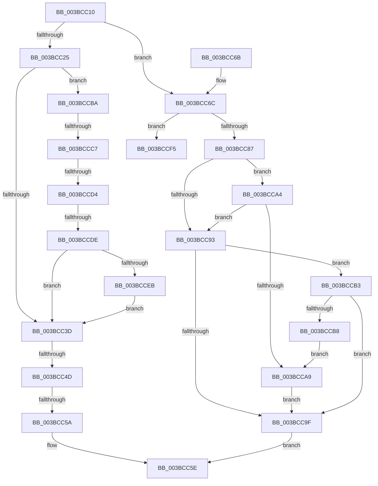

# MiIncreaseAvailablePages

- RVA: `0x003BCC10`–`0x003BCCF7` (길이 `231` bytes)
- VA: `0x00000001403BCC10`
- 실행 섹션: `.text`
- PDB 이름 있음: `예`; PDB Function 태그: `아니요`
- unwind 정보 RVA: `0x0008CDF0`
- 디코드: `59`개 명령, `231/231` bytes 표시
- 미해석 바이트: `0` (있으면 어셈블리에 `.byte`로 보존)

> 이 문서는 커널 이미지의 기계어와 PDB 기호를 분석해 생성했습니다. 4번과 5번은 함수 원형과 자료형을 바이너리 사용 방식에서 추정한 C 해석이며 원본 소스 복구 결과는 아닙니다.

## 1. Dependencies

- 직접 호출 지점: **2**; 고유 호출 대상: **2**
- 직접 호출자로 확인된 함수: **2**
- RIP 상대 이미지 참조: **0**

### Outgoing calls
- `0x003BCCAC` → [MiUpdateAvailableEventsAtDpc](MiUpdateAvailableEventsAtDpc_function_003BC804.md) (function, `0x003BC804`)
- `0x003BCCEB` → [MiSlabDemotionLowMemoryConditionUpdate](MiSlabDemotionLowMemoryConditionUpdate_function_003BB7E0.md) (function, `0x003BB7E0`)

### Direct callers
- [MiUnlinkFreeOrZeroedPage](../33/MiUnlinkFreeOrZeroedPage_function_00336C40.md) at `0x0033779C`
- [MiReplenishPageSlist](MiReplenishPageSlist_function_003BADE0.md) at `0x003BB499`

### Static image references
- 디코드된 RIP-relative 메모리 참조가 없습니다.

## 2. Other-region calls and transfers

- 다른 실행 섹션으로 향하는 call: **0**
- call이 아닌 외부 분기/꼬리 이동: **5**
  - `0x003BCC47` → [sub_003BCD6B + 0x3E](Unknown_function_003BCD6B.md) (`tail-transfer`)
  - `0x003BCC54` → [sub_003BCD6B + 0x3E](Unknown_function_003BCD6B.md) (`tail-transfer`)
  - `0x003BCCC1` → [sub_003BCD6B + 0x2](Unknown_function_003BCD6B.md) (`tail-transfer`)
  - `0x003BCCCE` → [sub_003BCE34](Unknown_function_003BCE34.md) (`tail-transfer`)
  - `0x003BCCD8` → [sub_003BCD6B](Unknown_function_003BCD6B.md) (`tail-transfer`)

## 3. Assembly (complete function range)

```asm
003BCC10  48 89 5C 24 20                  mov qword ptr [rsp + 0x20], rbx
003BCC15  55                              push rbp
003BCC16  56                              push rsi
003BCC17  57                              push rdi
003BCC18  48 83 EC 20                     sub rsp, 0x20
003BCC1C  48 8B E9                        mov rbp, rcx
003BCC1F  48 83 FA 01                     cmp rdx, 1
003BCC23  75 47                           jne 0x1403bcc6c
003BCC25  48 8B DA                        mov rbx, rdx
003BCC28  F0 48 0F C1 99 00 49 00 00      lock xadd qword ptr [rcx + 0x4900], rbx
003BCC31  48 FF C3                        inc rbx
003BCC34  48 81 FB 20 04 00 00            cmp rbx, 0x420
003BCC3B  76 7D                           jbe 0x1403bccba
003BCC3D  48 FF CB                        dec rbx
003BCC40  48 3B 9D 00 41 00 00            cmp rbx, qword ptr [rbp + 0x4100]
003BCC47  0F 84 5C 01 00 00               je 0x1403bcda9
003BCC4D  48 3B 9D 08 41 00 00            cmp rbx, qword ptr [rbp + 0x4108]
003BCC54  0F 84 4F 01 00 00               je 0x1403bcda9
003BCC5A  48 8D 43 01                     lea rax, [rbx + 1]
003BCC5E  48 8B 5C 24 58                  mov rbx, qword ptr [rsp + 0x58]
003BCC63  48 83 C4 20                     add rsp, 0x20
003BCC67  5F                              pop rdi
003BCC68  5E                              pop rsi
003BCC69  5D                              pop rbp
003BCC6A  C3                              ret
003BCC6B  CC                              int3
003BCC6C  48 8B FA                        mov rdi, rdx
003BCC6F  F0 48 0F C1 B9 00 49 00 00      lock xadd qword ptr [rcx + 0x4900], rdi
003BCC78  48 8B F7                        mov rsi, rdi
003BCC7B  48 03 FA                        add rdi, rdx
003BCC7E  48 81 FE 20 04 00 00            cmp rsi, 0x420
003BCC85  72 6E                           jb 0x1403bccf5
003BCC87  48 8B 85 08 41 00 00            mov rax, qword ptr [rbp + 0x4108]
003BCC8E  48 3B F0                        cmp rsi, rax
003BCC91  76 11                           jbe 0x1403bcca4
003BCC93  48 8B 85 00 41 00 00            mov rax, qword ptr [rbp + 0x4100]
003BCC9A  48 3B F0                        cmp rsi, rax
003BCC9D  76 14                           jbe 0x1403bccb3
003BCC9F  48 8B C7                        mov rax, rdi
003BCCA2  EB BA                           jmp 0x1403bcc5e
003BCCA4  48 3B F8                        cmp rdi, rax
003BCCA7  76 EA                           jbe 0x1403bcc93
003BCCA9  48 8B CD                        mov rcx, rbp
003BCCAC  E8 53 FB FF FF                  call 0x1403bc804
003BCCB1  EB EC                           jmp 0x1403bcc9f
003BCCB3  48 3B F8                        cmp rdi, rax
003BCCB6  76 E7                           jbe 0x1403bcc9f
003BCCB8  EB EF                           jmp 0x1403bcca9
003BCCBA  48 81 FB A0 00 00 00            cmp rbx, 0xa0
003BCCC1  0F 84 A6 00 00 00               je 0x1403bcd6d
003BCCC7  48 81 FB 20 04 00 00            cmp rbx, 0x420
003BCCCE  0F 84 60 01 00 00               je 0x1403bce34
003BCCD4  48 83 FB 22                     cmp rbx, 0x22
003BCCD8  0F 84 8D 00 00 00               je 0x1403bcd6b
003BCCDE  48 81 FB 20 01 00 00            cmp rbx, 0x120
003BCCE5  0F 85 52 FF FF FF               jne 0x1403bcc3d
003BCCEB  E8 F0 EA FF FF                  call 0x1403bb7e0
003BCCF0  E9 48 FF FF FF                  jmp 0x1403bcc3d
003BCCF5  33 D2                           xor edx, edx
```

## 4. C-style interpretation (structured pseudocode)

```c
__int64 __fastcall MiIncreaseAvailablePages(__int64 a1, __int64 a2)
{
    __int64 result;
    __int64 v_rbx;
    __int64 v_rdi;
    __int64 v_rsp;
    unsigned __int64 v_stack_p20;

    v_stack_p20 = v_rbx;
    v_rsp = (v_rsp) - (32);
    if (a2 != 1) goto loc_003BCC6C;
    v_rbx = (a2) + 1;
    if (v_rbx <= 0x420ULL) goto loc_003BCCBA;
loc_003BCC3D:
    v_rbx = (v_rbx) - 1;
loc_003BCC5E:
    v_rsp = (v_rsp) + (32);
    return v_rbx + 1;
loc_003BCC6C:
    v_rdi = (a2) + (a2);
    if (a2 < 0x420ULL) goto loc_003BCCF5;
    if (a2 <= (*(unsigned __int64 *)(a1 + 16648))) goto loc_003BCCA4;
loc_003BCC93:
    if (a2 <= (*(unsigned __int64 *)(a1 + 16640))) goto loc_003BCCB3;
loc_003BCC9F:
    goto loc_003BCC5E;
loc_003BCCA4:
    if (v_rdi <= v_rdi) goto loc_003BCC93;
loc_003BCCA9:
    result = MiUpdateAvailableEventsAtDpc(a1, a2, a3, a4);
    goto loc_003BCC9F;
loc_003BCCB3:
    if (v_rdi <= result) goto loc_003BCC9F;
    goto loc_003BCCA9;
loc_003BCCBA:
    if (v_stack_p20 != 288) goto loc_003BCC3D;
    result = MiSlabDemotionLowMemoryConditionUpdate(a1, a2, a3, a4);
    goto loc_003BCC3D;
loc_003BCCF5:
    a2 = 0;
    return result;
}
```

## 5. (Beta) C Style

```c
int64_t MiIncreaseAvailablePages(void *Arg1, int64_t Arg2)
{
    uint8_t *arg1 = (uint8_t *)Arg1;

    int64_t result;
    int64_t local_rbx;
    int64_t local_rdi;
    int64_t local_rsp;
    uint64_t v_stack_p20;

    v_stack_p20 = local_rbx;
    local_rsp = (local_rsp) - (32);
    if (Arg2 != 1) goto loc_003BCC6C;
    local_rbx = (Arg2) + 1;
    if (local_rbx <= 0x420ULL) goto loc_003BCCBA;
loc_003BCC3D:
    local_rbx = (local_rbx) - 1;
loc_003BCC5E:
    local_rsp = (local_rsp) + (32);
    return local_rbx + 1;
loc_003BCC6C:
    local_rdi = (Arg2) + (Arg2);
    if (Arg2 < 0x420ULL) goto loc_003BCCF5;
    if (Arg2 <= (*(uint64_t *)(arg1 + 0x4108))) goto loc_003BCCA4;
loc_003BCC93:
    if (Arg2 <= (*(uint64_t *)(arg1 + 0x4100))) goto loc_003BCCB3;
loc_003BCC9F:
    goto loc_003BCC5E;
loc_003BCCA4:
    if (local_rdi <= local_rdi) goto loc_003BCC93;
loc_003BCCA9:
    result = MiUpdateAvailableEventsAtDpc(Arg1, Arg2, a3, a4);
    goto loc_003BCC9F;
loc_003BCCB3:
    if (local_rdi <= result) goto loc_003BCC9F;
    goto loc_003BCCA9;
loc_003BCCBA:
    if (v_stack_p20 != 288) goto loc_003BCC3D;
    result = MiSlabDemotionLowMemoryConditionUpdate(Arg1, Arg2, a3, a4);
    goto loc_003BCC3D;
loc_003BCCF5:
    Arg2 = 0;
    return result;
}
```

### 관측된 메모리 오프셋

구조체 형식이 확인되지 않은 접근은 인자 기준의 오프셋으로만 기록했습니다.

| 기준 인자 | 오프셋 표현 | 폭 (bit) | 접근 |
|---|---:|---:|---|
| `Arg1` | `+ 0x4100` | `64` | `R` |
| `Arg1` | `+ 0x4108` | `64` | `R` |
| `Arg1` | `+ 0x4900` | `64` | `R/W` |

## 6. Execution-region graph

[열기: 2D/3D 그래프와 함수 탐색 컨트롤 패널](../../../control-panel.html?section=text&rva=0x003BCC10&view=graph)

- 2D 그래프는 위에서 아래로 흐르고, 3D 그래프는 빈 공간을 드래그해 회전합니다. Shift+드래그는 이동, 휠은 확대·축소, 함수 노드 선택은 대상 보고서 이동입니다.

### Static fallback


