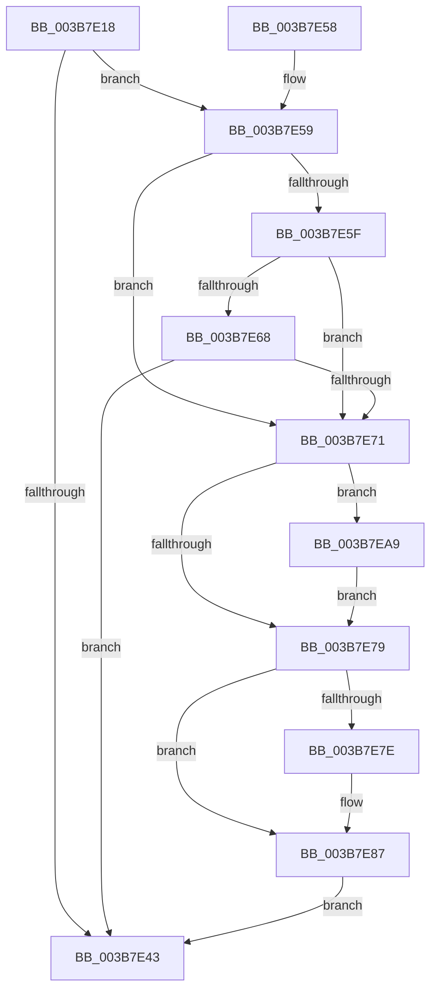

# MiInitializeBestCandidatesContext

- RVA: `0x003B7E18`–`0x003B7ED8` (길이 `192` bytes)
- VA: `0x00000001403B7E18`
- 실행 섹션: `.text`
- PDB 이름 있음: `예`; PDB Function 태그: `아니요`
- unwind 정보 RVA: `0x0008C898`
- 디코드: `54`개 명령, `192/192` bytes 표시
- 미해석 바이트: `0` (있으면 어셈블리에 `.byte`로 보존)

> 이 문서는 커널 이미지의 기계어와 PDB 기호를 분석해 생성했습니다. 4번과 5번은 함수 원형과 자료형을 바이너리 사용 방식에서 추정한 C 해석이며 원본 소스 복구 결과는 아닙니다.

## 1. Dependencies

- 직접 호출 지점: **1**; 고유 호출 대상: **1**
- 직접 호출자로 확인된 함수: **2**
- RIP 상대 이미지 참조: **1**

### Outgoing calls
- `0x003B7ECB` → [MiAllocatePool](../35/MiAllocatePool_function_0035B540.md) (function, `0x0035B540`)

### Direct callers
- [MiAllocateSkipPagesForMdl](MiAllocateSkipPagesForMdl_function_003B7C08.md) at `0x003B7D95`
- [MiFindLargePageMemory](../../page/AA/MiFindLargePageMemory_function_00AA8334.md) at `0x00AA8495`

### Static image references
- `0x003B7E9C` → RVA `0x00E2DCE0` (`.data`; read)

## 2. Other-region calls and transfers

- 다른 실행 섹션으로 향하는 call: **0**
- 별도 외부 분기/꼬리 이동을 확인하지 못했습니다.

## 3. Assembly (complete function range)

```asm
003B7E18  48 89 5C 24 08                  mov qword ptr [rsp + 8], rbx
003B7E1D  48 89 6C 24 10                  mov qword ptr [rsp + 0x10], rbp
003B7E22  48 89 74 24 18                  mov qword ptr [rsp + 0x18], rsi
003B7E27  57                              push rdi
003B7E28  48 83 EC 20                     sub rsp, 0x20
003B7E2C  48 83 21 00                     and qword ptr [rcx], 0
003B7E30  49 8B F9                        mov rdi, r9
003B7E33  49 8B D8                        mov rbx, r8
003B7E36  48 8B EA                        mov rbp, rdx
003B7E39  48 8B F1                        mov rsi, rcx
003B7E3C  4C 39 44 24 50                  cmp qword ptr [rsp + 0x50], r8
003B7E41  74 16                           je 0x1403b7e59
003B7E43  48 8B 5C 24 30                  mov rbx, qword ptr [rsp + 0x30]
003B7E48  48 8B 6C 24 38                  mov rbp, qword ptr [rsp + 0x38]
003B7E4D  48 8B 74 24 40                  mov rsi, qword ptr [rsp + 0x40]
003B7E52  48 83 C4 20                     add rsp, 0x20
003B7E56  5F                              pop rdi
003B7E57  C3                              ret
003B7E58  CC                              int3
003B7E59  48 83 FB 10                     cmp rbx, 0x10
003B7E5D  74 12                           je 0x1403b7e71
003B7E5F  48 81 FB 00 02 00 00            cmp rbx, 0x200
003B7E66  74 09                           je 0x1403b7e71
003B7E68  48 81 FB 00 00 04 00            cmp rbx, 0x40000
003B7E6F  75 D2                           jne 0x1403b7e43
003B7E71  33 C9                           xor ecx, ecx
003B7E73  49 83 F9 08                     cmp r9, 8
003B7E77  77 30                           ja 0x1403b7ea9
003B7E79  48 85 C9                        test rcx, rcx
003B7E7C  75 09                           jne 0x1403b7e87
003B7E7E  8D 79 08                        lea edi, [rcx + 8]
003B7E81  48 89 2E                        mov qword ptr [rsi], rbp
003B7E84  48 8B CD                        mov rcx, rbp
003B7E87  33 C0                           xor eax, eax
003B7E89  0F 57 C0                        xorps xmm0, xmm0
003B7E8C  0F 11 01                        movups xmmword ptr [rcx], xmm0
003B7E8F  48 89 41 10                     mov qword ptr [rcx + 0x10], rax
003B7E93  48 8D 43 FF                     lea rax, [rbx - 1]
003B7E97  89 39                           mov dword ptr [rcx], edi
003B7E99  48 F7 D0                        not rax
003B7E9C  48 23 05 3D 5E A7 00            and rax, qword ptr [rip + 0xa75e3d]
003B7EA3  48 89 41 10                     mov qword ptr [rcx + 0x10], rax
003B7EA7  EB 9A                           jmp 0x1403b7e43
003B7EA9  B8 00 04 00 00                  mov eax, 0x400
003B7EAE  B9 42 00 00 00                  mov ecx, 0x42
003B7EB3  4C 3B C8                        cmp r9, rax
003B7EB6  41 B8 4D 69 4C 63               mov r8d, 0x634c694d
003B7EBC  49 0F 46 C1                     cmovbe rax, r9
003B7EC0  48 8B F8                        mov rdi, rax
003B7EC3  48 8D 14 C5 18 00 00 00         lea rdx, [rax*8 + 0x18]
003B7ECB  E8 70 36 FA FF                  call 0x14035b540
003B7ED0  48 8B C8                        mov rcx, rax
003B7ED3  48 89 06                        mov qword ptr [rsi], rax
003B7ED6  EB A1                           jmp 0x1403b7e79
```

## 4. C-style interpretation (structured pseudocode)

```c
__int64 __fastcall MiInitializeBestCandidatesContext(__int64 a1, __int64 a2, __int64 a3, __int64 a4, __int64 a5)
{
    __int64 result;
    __int64 v_rdi;
    __int64 v_rsp;
    unsigned __int64 v_stack_p10;
    unsigned __int64 v_stack_p18;
    unsigned __int64 v_stack_p8;

    v_stack_p8 = v_rbx;
    v_stack_p10 = v_rbp;
    v_stack_p18 = v_rsi;
    v_rsp = (v_rsp) - (32);
    if (a5 == a3) goto loc_003B7E59;
loc_003B7E43:
    v_rsp = (v_rsp) + (32);
    return result;
loc_003B7E59:
    if (v_stack_p8 == 16) goto loc_003B7E71;
    if (v_stack_p8 == 512) goto loc_003B7E71;
    if (v_stack_p8 != 0x40000ULL) goto loc_003B7E43;
loc_003B7E71:
    a1 = 0;
    if (a4 > 8) goto loc_003B7EA9;
loc_003B7E79:
    v_rdi = a4;
    if (0 == 0) {
        v_rdi = a1 + 8;
        *(unsigned __int64 *)(v_stack_p18) = v_stack_p10;
        a1 = v_stack_p10;
    }
    result = 0;
    *(unsigned __int64 *)(a1) = v_xmm0;
    *(unsigned __int64 *)(a1 + 16) = 0;
    *(unsigned int *)(a1) = (unsigned int)(v_rdi);
    result = ~(v_stack_p8 - 1);
    result = (result) & (*(unsigned __int64 *)(v_rip + 10968637));
    *(unsigned __int64 *)(a1 + 16) = result;
    goto loc_003B7E43;
loc_003B7EA9:
    result = (unsigned int)(0x400ULL);
    if (a4 <= ((unsigned int)(0x400ULL))) { result = a4; }
    result = MiAllocatePool(66, result * 8 + 24, (unsigned int)(0x634C694DULL), a4);
    *(unsigned __int64 *)(v_stack_p18) = result;
    goto loc_003B7E79;
}
```

## 5. (Beta) C Style

```c
int64_t MiInitializeBestCandidatesContext(void *Arg1, int64_t Arg2, int64_t Arg3, int64_t Arg4, int64_t Arg5)
{
    uint8_t *arg1 = (uint8_t *)Arg1;

    int64_t result;
    int64_t local_rdi;
    int64_t local_rsp;
    uint64_t v_stack_p10;
    uint64_t v_stack_p18;
    uint64_t v_stack_p8;

    v_stack_p8 = local_rbx;
    v_stack_p10 = local_rbp;
    v_stack_p18 = local_rsi;
    local_rsp = (local_rsp) - (32);
    if (Arg5 == Arg3) goto loc_003B7E59;
loc_003B7E43:
    local_rsp = (local_rsp) + (32);
    return result;
loc_003B7E59:
    if (v_stack_p8 == 16) goto loc_003B7E71;
    if (v_stack_p8 == 512) goto loc_003B7E71;
    if (v_stack_p8 != 0x40000ULL) goto loc_003B7E43;
loc_003B7E71:
    Arg1 = 0;
    if (Arg4 > 8) goto loc_003B7EA9;
loc_003B7E79:
    local_rdi = Arg4;
    if (0 == 0) {
        local_rdi = Arg1 + 8;
        *(uint64_t *)(v_stack_p18) = v_stack_p10;
        Arg1 = v_stack_p10;
    }
    result = 0;
    *(uint64_t *)(arg1) = v_xmm0;
    *(uint64_t *)(arg1 + 0x10) = 0;
    *(uint32_t *)(arg1) = (uint32_t)(local_rdi);
    result = ~(v_stack_p8 - 1);
    result = (result) & (*(uint64_t *)(v_rip + 0xA75E3D));
    *(uint64_t *)(arg1 + 0x10) = result;
    goto loc_003B7E43;
loc_003B7EA9:
    result = (uint32_t)(0x400ULL);
    if (Arg4 <= ((uint32_t)(0x400ULL))) { result = Arg4; }
    result = MiAllocatePool(66, result * 8 + 24, (uint32_t)(0x634C694DULL), Arg4);
    *(uint64_t *)(v_stack_p18) = result;
    goto loc_003B7E79;
}
```

### 관측된 메모리 오프셋

구조체 형식이 확인되지 않은 접근은 인자 기준의 오프셋으로만 기록했습니다.

| 기준 인자 | 오프셋 표현 | 폭 (bit) | 접근 |
|---|---:|---:|---|
| `Arg1` | `+ 0x0` | `64` | `R/W` |
| `Arg1` | `+ 0x0` | `64` | `W` |

## 6. Execution-region graph

[열기: 2D/3D 그래프와 함수 탐색 컨트롤 패널](../../../control-panel.html?section=text&rva=0x003B7E18&view=graph)

- 2D 그래프는 위에서 아래로 흐르고, 3D 그래프는 빈 공간을 드래그해 회전합니다. Shift+드래그는 이동, 휠은 확대·축소, 함수 노드 선택은 대상 보고서 이동입니다.

### Static fallback


