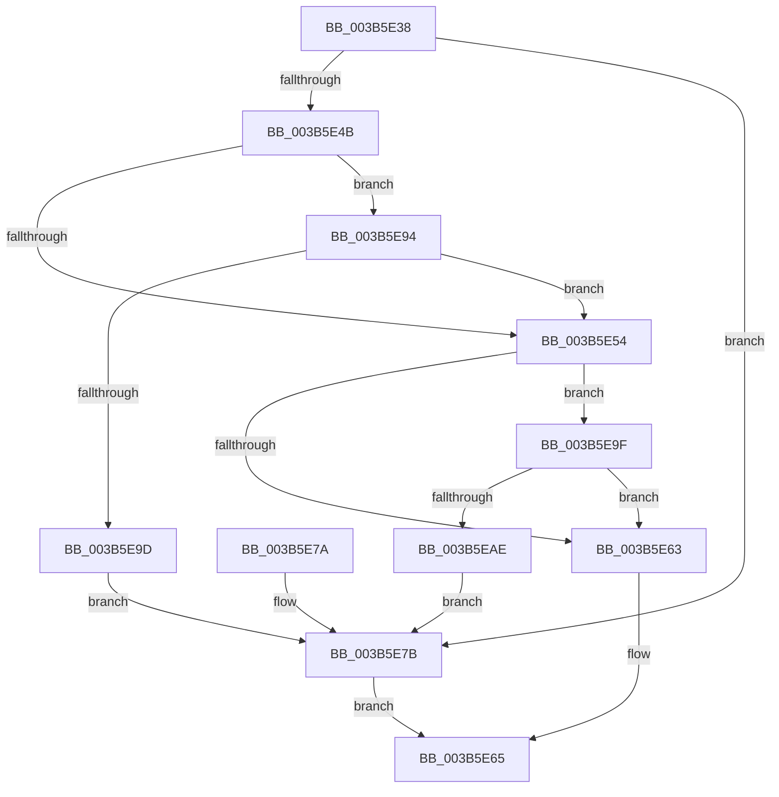

# MiInitializeColorBase

- RVA: `0x003B5E38`–`0x003B5EB0` (길이 `120` bytes)
- VA: `0x00000001403B5E38`
- 실행 섹션: `.text`
- PDB 이름 있음: `예`; PDB Function 태그: `아니요`
- unwind 정보 RVA: `0x000685EC`
- 디코드: `28`개 명령, `120/120` bytes 표시
- 미해석 바이트: `0` (있으면 어셈블리에 `.byte`로 보존)

> 이 문서는 커널 이미지의 기계어와 PDB 기호를 분석해 생성했습니다. 4번과 5번은 함수 원형과 자료형을 바이너리 사용 방식에서 추정한 C 해석이며 원본 소스 복구 결과는 아닙니다.

## 1. Dependencies

- 직접 호출 지점: **1**; 고유 호출 대상: **1**
- 직접 호출자로 확인된 함수: **3**
- RIP 상대 이미지 참조: **2**

### Outgoing calls
- `0x003B5E70` → [MiInitializePageColorBase](../32/MiInitializePageColorBase_function_00320410.md) (function, `0x00320410`)

### Direct callers
- [MiMakeZeroedPageTablesEx](MiMakeZeroedPageTablesEx_function_003B59FC.md) at `0x003B5B6C`
- [MiDemoteValidLargePageOneLevel](../68/MiDemoteValidLargePageOneLevel_function_0068A3F4.md) at `0x0068A53D`
- [MmCreateShadowMapping](../../page/80/MmCreateShadowMapping_function_00807AB0.md) at `0x00807B4A`

### Static image references
- `0x003B5E4B` → RVA `0x00E2F380` (`.data`; read)
- `0x003B5E94` → RVA `0x00E2F390` (`.data`; read)

## 2. Other-region calls and transfers

- 다른 실행 섹션으로 향하는 call: **0**
- 별도 외부 분기/꼬리 이동을 확인하지 못했습니다.

## 3. Assembly (complete function range)

```asm
003B5E38  48 83 EC 28                     sub rsp, 0x28
003B5E3C  48 B8 FF FF FE FF FF 7F 00 00   movabs rax, 0x7ffffffeffff
003B5E46  48 3B C8                        cmp rcx, rax
003B5E49  76 30                           jbe 0x1403b5e7b
003B5E4B  48 3B 0D 2E 95 A7 00            cmp rcx, qword ptr [rip + 0xa7952e]
003B5E52  73 40                           jae 0x1403b5e94
003B5E54  48 B8 00 00 00 00 80 F6 FF FF   movabs rax, 0xfffff68000000000
003B5E5E  48 3B C8                        cmp rcx, rax
003B5E61  73 3C                           jae 0x1403b5e9f
003B5E63  33 C9                           xor ecx, ecx
003B5E65  4D 8B C8                        mov r9, r8
003B5E68  44 8B C2                        mov r8d, edx
003B5E6B  BA 03 00 00 00                  mov edx, 3
003B5E70  E8 9B A5 F6 FF                  call 0x140320410
003B5E75  48 83 C4 28                     add rsp, 0x28
003B5E79  C3                              ret
003B5E7A  CC                              int3
003B5E7B  65 48 8B 04 25 88 01 00 00      mov rax, qword ptr gs:[0x188]
003B5E84  48 8B 88 B8 00 00 00            mov rcx, qword ptr [rax + 0xb8]
003B5E8B  48 81 C1 00 04 00 00            add rcx, 0x400
003B5E92  EB D1                           jmp 0x1403b5e65
003B5E94  48 3B 0D F5 94 A7 00            cmp rcx, qword ptr [rip + 0xa794f5]
003B5E9B  77 B7                           ja 0x1403b5e54
003B5E9D  EB DC                           jmp 0x1403b5e7b
003B5E9F  48 B8 FF FF FF FF FF F6 FF FF   movabs rax, 0xfffff6ffffffffff
003B5EA9  48 3B C8                        cmp rcx, rax
003B5EAC  77 B5                           ja 0x1403b5e63
003B5EAE  EB CB                           jmp 0x1403b5e7b
```

## 4. C-style interpretation (structured pseudocode)

```c
__int64 __fastcall MiInitializeColorBase(__int64 a1, int a2, __int64 a3)
{
    __int64 result;
    __int64 v_rsp;

    v_rsp = (v_rsp) - (40);
    if (a1 <= result) goto loc_003B5E7B;
    if (a1 >= (*(unsigned __int64 *)(v_rip + 10982702))) goto loc_003B5E94;
loc_003B5E54:
    if (a1 >= result) goto loc_003B5E9F;
loc_003B5E63:
    a1 = 0;
loc_003B5E65:
    result = MiInitializePageColorBase(a1, 3, (unsigned int)(a2), a3);
    v_rsp = (v_rsp) + (40);
    return result;
loc_003B5E7B:
    a1 = (*(unsigned __int64 *)(*(unsigned __int64 *)(gs_base + (0 + 392)) + 184)) + (0x400ULL);
    goto loc_003B5E65;
loc_003B5E94:
    if (a1 > (*(unsigned __int64 *)(v_rip + 10982645))) goto loc_003B5E54;
    goto loc_003B5E7B;
loc_003B5E9F:
    if (a1 > (*(unsigned __int64 *)(gs_base + (0 + 392)))) goto loc_003B5E63;
    goto loc_003B5E7B;
}
```

## 5. (Beta) C Style

```c
int64_t MiInitializeColorBase(int64_t Arg1, int32_t Arg2, int64_t Arg3)
{
    int64_t result;
    int64_t local_rsp;

    local_rsp = (local_rsp) - (40);
    if (Arg1 <= result) goto loc_003B5E7B;
    if (Arg1 >= (*(uint64_t *)(v_rip + 0xA7952E))) goto loc_003B5E94;
loc_003B5E54:
    if (Arg1 >= result) goto loc_003B5E9F;
loc_003B5E63:
    Arg1 = 0;
loc_003B5E65:
    result = MiInitializePageColorBase(Arg1, 3, (uint32_t)(Arg2), Arg3);
    local_rsp = (local_rsp) + (40);
    return result;
loc_003B5E7B:
    Arg1 = (*(uint64_t *)(*(uint64_t *)(gs_base + (0 + 0x188)) + 0xB8)) + (0x400ULL);
    goto loc_003B5E65;
loc_003B5E94:
    if (Arg1 > (*(uint64_t *)(v_rip + 0xA794F5))) goto loc_003B5E54;
    goto loc_003B5E7B;
loc_003B5E9F:
    if (Arg1 > (*(uint64_t *)(gs_base + (0 + 0x188)))) goto loc_003B5E63;
    goto loc_003B5E7B;
}
```

## 6. Execution-region graph

[열기: 2D/3D 그래프와 함수 탐색 컨트롤 패널](../../../control-panel.html?section=text&rva=0x003B5E38&view=graph)

- 2D 그래프는 위에서 아래로 흐르고, 3D 그래프는 빈 공간을 드래그해 회전합니다. Shift+드래그는 이동, 휠은 확대·축소, 함수 노드 선택은 대상 보고서 이동입니다.

### Static fallback


