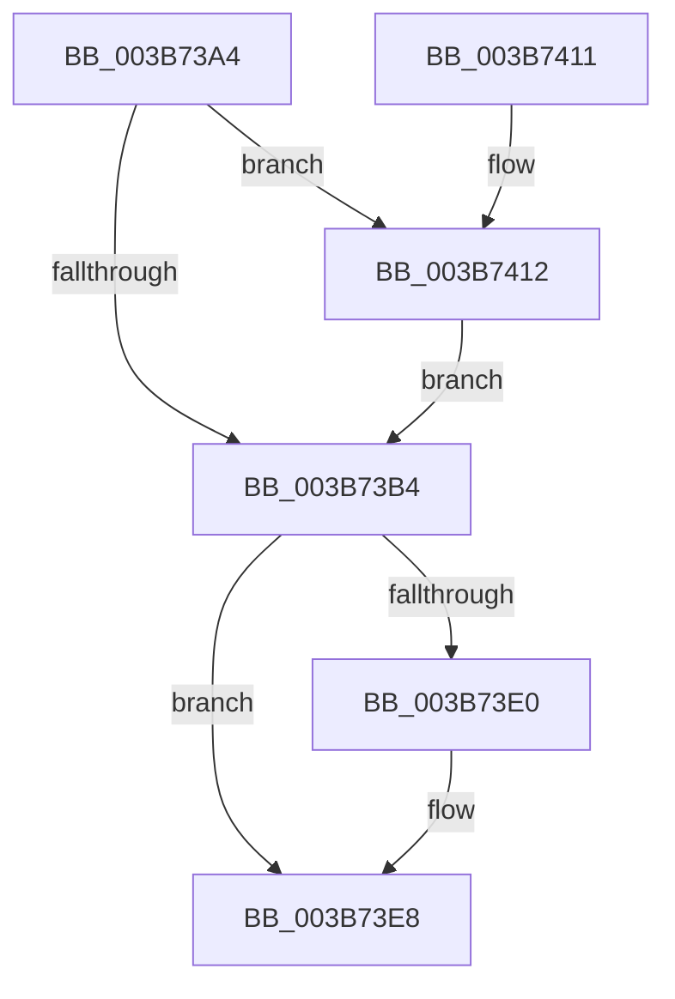

# MiInsertDpcGang

- RVA: `0x003B73A4`–`0x003B7433` (길이 `143` bytes)
- VA: `0x00000001403B73A4`
- 실행 섹션: `.text`
- PDB 이름 있음: `예`; PDB Function 태그: `아니요`
- unwind 정보 RVA: `0x000DB714`
- 디코드: `34`개 명령, `143/143` bytes 표시
- 미해석 바이트: `0` (있으면 어셈블리에 `.byte`로 보존)

> 이 문서는 커널 이미지의 기계어와 PDB 기호를 분석해 생성했습니다. 4번과 5번은 함수 원형과 자료형을 바이너리 사용 방식에서 추정한 C 해석이며 원본 소스 복구 결과는 아닙니다.

## 1. Dependencies

- 직접 호출 지점: **0**; 고유 호출 대상: **0**
- 직접 호출자로 확인된 함수: **1**
- RIP 상대 이미지 참조: **1**

### Outgoing calls
- 직접 디코드된 call 명령이 없습니다.

### Direct callers
- [MiAllocateFastLargePagesForMdl](MiAllocateFastLargePagesForMdl_function_003B701C.md) at `0x003B7341`

### Static image references
- `0x003B7416` → RVA `0x00E30088` (`.data`; read)

## 2. Other-region calls and transfers

- 다른 실행 섹션으로 향하는 call: **0**
- 별도 외부 분기/꼬리 이동을 확인하지 못했습니다.

## 3. Assembly (complete function range)

```asm
003B73A4  48 83 B9 A8 00 00 00 00         cmp qword ptr [rcx + 0xa8], 0
003B73AC  4C 8B CA                        mov r9, rdx
003B73AF  4C 8B C1                        mov r8, rcx
003B73B2  74 5E                           je 0x1403b7412
003B73B4  41 0F B7 88 98 00 00 00         movzx ecx, word ptr [r8 + 0x98]
003B73BC  33 D2                           xor edx, edx
003B73BE  8D 41 01                        lea eax, [rcx + 1]
003B73C1  66 41 89 80 98 00 00 00         mov word ptr [r8 + 0x98], ax
003B73C9  8B C1                           mov eax, ecx
003B73CB  41 F7 B0 BC 00 00 00            div dword ptr [r8 + 0xbc]
003B73D2  4D 8B 58 08                     mov r11, qword ptr [r8 + 8]
003B73D6  44 8B D2                        mov r10d, edx
003B73D9  49 83 3C D3 00                  cmp qword ptr [r11 + rdx*8], 0
003B73DE  75 08                           jne 0x1403b73e8
003B73E0  66 41 FF 80 9A 00 00 00         inc word ptr [r8 + 0x9a]
003B73E8  49 8B 01                        mov rax, qword ptr [r9]
003B73EB  49 8B 14 D3                     mov rdx, qword ptr [r11 + rdx*8]
003B73EF  48 C1 EA 03                     shr rdx, 3
003B73F3  48 8B CA                        mov rcx, rdx
003B73F6  48 33 C8                        xor rcx, rax
003B73F9  48 B8 01 00 00 00 00 F0 FF FF   movabs rax, 0xfffff00000000001
003B7403  48 23 C8                        and rcx, rax
003B7406  48 33 CA                        xor rcx, rdx
003B7409  49 89 09                        mov qword ptr [r9], rcx
003B740C  4F 89 0C D3                     mov qword ptr [r11 + r10*8], r9
003B7410  C3                              ret
003B7411  CC                              int3
003B7412  48 8B 42 28                     mov rax, qword ptr [rdx + 0x28]
003B7416  48 8B 15 6B 8C A7 00            mov rdx, qword ptr [rip + 0xa78c6b]
003B741D  48 C1 E8 2B                     shr rax, 0x2b
003B7421  25 FF 03 00 00                  and eax, 0x3ff
003B7426  48 8B 0C C2                     mov rcx, qword ptr [rdx + rax*8]
003B742A  49 89 88 A8 00 00 00            mov qword ptr [r8 + 0xa8], rcx
003B7431  EB 81                           jmp 0x1403b73b4
```

## 4. C-style interpretation (structured pseudocode)

```c
__int64 __fastcall MiInsertDpcGang(__int64 a1, __int64 a2)
{
    __int64 result;

    if ((*(unsigned __int64 *)(a1 + 168)) == 0) goto loc_003B7412;
loc_003B73B4:
    a2 = 0;
    *(unsigned __int16 *)(a1 + 152) = (unsigned __int16)(*(unsigned __int16 *)(a1 + 152) + 1);
    if ((*(unsigned __int64 *)(*(unsigned __int64 *)(a1 + 8) + a2 * 8)) == 0) {
    }
    a2 = (*(unsigned __int64 *)(*(unsigned __int64 *)(a1 + 8) + a2 * 8)) >> (3);
    a1 = (a2) ^ (*(unsigned __int64 *)(a2));
    a1 = (a1) & (*(unsigned __int64 *)(a2));
    a1 = (a1) ^ (a2);
    *(unsigned __int64 *)(a2) = a1;
    *(unsigned __int64 *)(*(unsigned __int64 *)(a1 + 8) + 0 * 8) = a2;
    return *(unsigned __int64 *)(a2);
loc_003B7412:
    result = (*(unsigned __int64 *)(a2 + 40)) >> (43);
    result = (unsigned int)((result) & (0x3FFULL));
    *(unsigned __int64 *)(a1 + 168) = *(unsigned __int64 *)(*(unsigned __int64 *)(v_rip + 10980459) + result * 8);
    goto loc_003B73B4;
}
```

## 5. (Beta) C Style

```c
int64_t MiInsertDpcGang(void *Arg1, void *Arg2)
{
    uint8_t *arg1 = (uint8_t *)Arg1;
    uint8_t *arg2 = (uint8_t *)Arg2;

    int64_t result;

    if ((*(uint64_t *)(arg1 + 0xA8)) == 0) goto loc_003B7412;
loc_003B73B4:
    Arg2 = 0;
    *(uint16_t *)(arg1 + 0x98) = (uint16_t)(*(uint16_t *)(arg1 + 0x98) + 1);
    if ((*(uint64_t *)(*(uint64_t *)(arg1 + 0x8) + arg2 * 8)) == 0) {
    }
    Arg2 = (*(uint64_t *)(*(uint64_t *)(arg1 + 0x8) + arg2 * 8)) >> (3);
    Arg1 = (Arg2) ^ (*(uint64_t *)(arg2));
    Arg1 = (Arg1) & (*(uint64_t *)(arg2));
    Arg1 = (Arg1) ^ (Arg2);
    *(void **)(arg2) = Arg1;
    *(void **)(*(uint64_t *)(arg1 + 0x8) + 0x0 * 8) = Arg2;
    return *(uint64_t *)(arg2);
loc_003B7412:
    result = (*(uint64_t *)(arg2 + 0x28)) >> (43);
    result = (uint32_t)((result) & (0x3FFULL));
    *(uint64_t *)(arg1 + 0xA8) = *(uint64_t *)(*(uint64_t *)(v_rip + 0xA78C6B) + result * 8);
    goto loc_003B73B4;
}
```

### 관측된 메모리 오프셋

구조체 형식이 확인되지 않은 접근은 인자 기준의 오프셋으로만 기록했습니다.

| 기준 인자 | 오프셋 표현 | 폭 (bit) | 접근 |
|---|---:|---:|---|
| `Arg1` | `+ 0x8` | `64` | `R` |
| `Arg1` | `+ 0x98` | `16` | `R` |
| `Arg1` | `+ 0x98` | `16` | `W` |
| `Arg1` | `+ 0x9A` | `16` | `R/W` |
| `Arg1` | `+ 0xA8` | `64` | `R` |
| `Arg1` | `+ 0xA8` | `64` | `W` |
| `Arg1` | `+ 0xBC` | `32` | `R` |
| `Arg2` | `+ 0x0` | `64` | `R` |
| `Arg2` | `+ 0x0` | `64` | `W` |
| `Arg2` | `+ 0x28` | `64` | `R` |

## 6. Execution-region graph

[열기: 2D/3D 그래프와 함수 탐색 컨트롤 패널](../../../control-panel.html?section=text&rva=0x003B73A4&view=graph)

- 2D 그래프는 위에서 아래로 흐르고, 3D 그래프는 빈 공간을 드래그해 회전합니다. Shift+드래그는 이동, 휠은 확대·축소, 함수 노드 선택은 대상 보고서 이동입니다.

### Static fallback


