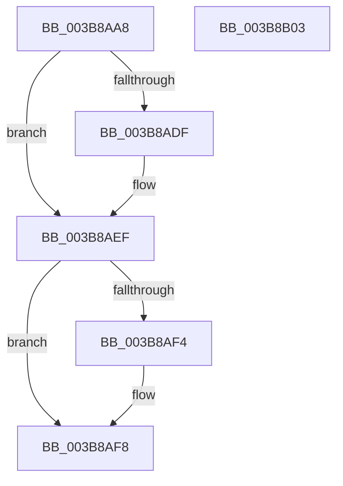

# MiLockDynamicMemoryShared

- RVA: `0x003B8AA8`–`0x003B8B04` (길이 `92` bytes)
- VA: `0x00000001403B8AA8`
- 실행 섹션: `.text`
- PDB 이름 있음: `예`; PDB Function 태그: `아니요`
- unwind 정보 RVA: `0x00068D5C`
- 디코드: `28`개 명령, `92/92` bytes 표시
- 미해석 바이트: `0` (있으면 어셈블리에 `.byte`로 보존)

> 이 문서는 커널 이미지의 기계어와 PDB 기호를 분석해 생성했습니다. 4번과 5번은 함수 원형과 자료형을 바이너리 사용 방식에서 추정한 C 해석이며 원본 소스 복구 결과는 아닙니다.

## 1. Dependencies

- 직접 호출 지점: **2**; 고유 호출 대상: **2**
- 직접 호출자로 확인된 함수: **8**
- RIP 상대 이미지 참조: **0**

### Outgoing calls
- `0x003B8AC9` → [KeAbPreAcquire](../21/KeAbPreAcquire_function_00210230.md) (function, `0x00210230`)
- `0x003B8AEA` → [ExfAcquirePushLockSharedEx](../21/ExfAcquirePushLockSharedEx_function_0021044C.md) (function, `0x0021044C`)

### Direct callers
- [MiGetChannelInformation](MiGetChannelInformation_function_003B8738.md) at `0x003B878D`
- [MiIssuePageHeatList](../44/MiIssuePageHeatList_function_0044615C.md) at `0x004461E0`
- [MiAddPartitionHugeRange](../67/MiAddPartitionHugeRange_function_006750D8.md) at `0x00675128`
- [MiMarkHugePfnBad](../67/MiMarkHugePfnBad_function_00676744.md) at `0x00676810`
- [MiAddPhysicalMemory](../../page/7F/MiAddPhysicalMemory_function_007F95FC.md) at `0x007F96DA`
- [MiMapNewPfns](../../page/7F/MiMapNewPfns_function_007FA63C.md) at `0x007FA78E`
- [MiGetPhysicalMemoryRanges](../../page/AC/MiGetPhysicalMemoryRanges_function_00ACAE08.md) at `0x00ACAE4D`
- [MmDuplicateMemory](../../pagelk/B7/MmDuplicateMemory_function_00B74158.md) at `0x00B742C3`

### Static image references
- 디코드된 RIP-relative 메모리 참조가 없습니다.

## 2. Other-region calls and transfers

- 다른 실행 섹션으로 향하는 call: **0**
- 별도 외부 분기/꼬리 이동을 확인하지 못했습니다.

## 3. Assembly (complete function range)

```asm
003B8AA8  48 89 5C 24 10                  mov qword ptr [rsp + 0x10], rbx
003B8AAD  57                              push rdi
003B8AAE  48 83 EC 20                     sub rsp, 0x20
003B8AB2  66 FF 8A E6 01 00 00            dec word ptr [rdx + 0x1e6]
003B8AB9  48 8D B9 C0 00 00 00            lea rdi, [rcx + 0xc0]
003B8AC0  48 8B CF                        mov rcx, rdi
003B8AC3  45 33 C0                        xor r8d, r8d
003B8AC6  33 D2                           xor edx, edx
003B8AC8  90                              nop
003B8AC9  E8 62 77 E5 FF                  call 0x140210230
003B8ACE  48 8B D8                        mov rbx, rax
003B8AD1  B9 11 00 00 00                  mov ecx, 0x11
003B8AD6  33 C0                           xor eax, eax
003B8AD8  F0 48 0F B1 0F                  lock cmpxchg qword ptr [rdi], rcx
003B8ADD  74 10                           je 0x1403b8aef
003B8ADF  4C 8B CF                        mov r9, rdi
003B8AE2  4C 8B C3                        mov r8, rbx
003B8AE5  33 D2                           xor edx, edx
003B8AE7  48 8B CF                        mov rcx, rdi
003B8AEA  E8 5D 79 E5 FF                  call 0x14021044c
003B8AEF  48 85 DB                        test rbx, rbx
003B8AF2  74 04                           je 0x1403b8af8
003B8AF4  C6 43 0A 01                     mov byte ptr [rbx + 0xa], 1
003B8AF8  48 8B 5C 24 38                  mov rbx, qword ptr [rsp + 0x38]
003B8AFD  48 83 C4 20                     add rsp, 0x20
003B8B01  5F                              pop rdi
003B8B02  C3                              ret
003B8B03  CC                              int3
```

## 4. C-style interpretation (structured pseudocode)

```c
__int64 __fastcall MiLockDynamicMemoryShared(__int64 a1, __int64 a2, int a3)
{
    __int64 result;
    __int64 v_rsp;
    unsigned __int64 v_stack_p10;

    v_stack_p10 = v_rbx;
    v_rsp = (v_rsp) - (32);
    a3 = 0;
    a2 = 0;
    result = KeAbPreAcquire(a1 + 192, a2, a3, a4);
    result = 0;
    if (!(condition_is_equal)) {
        a4 = a1 + 192;
        a3 = 0;
        a2 = 0;
        a1 = a1 + 192;
        result = ExfAcquirePushLockSharedEx(a1, a2, a3, a4);
    }
    if (result != 0) {
        *(unsigned __int8 *)(result + 10) = 1;
    }
    v_rsp = (v_rsp) + (32);
    return result;
}
```

## 5. (Beta) C Style

```c
int64_t MiLockDynamicMemoryShared(void *Arg1, void *Arg2, int32_t Arg3)
{
    uint8_t *arg1 = (uint8_t *)Arg1;
    uint8_t *arg2 = (uint8_t *)Arg2;

    int64_t result;
    int64_t local_rsp;
    uint64_t v_stack_p10;

    v_stack_p10 = local_rbx;
    local_rsp = (local_rsp) - (32);
    Arg3 = 0;
    Arg2 = 0;
    result = KeAbPreAcquire(Arg1 + 192, Arg2, Arg3, a4);
    result = 0;
    if (!(condition_is_equal)) {
        a4 = Arg1 + 192;
        Arg3 = 0;
        Arg2 = 0;
        Arg1 = Arg1 + 192;
        result = ExfAcquirePushLockSharedEx(Arg1, Arg2, Arg3, a4);
    }
    if (result != 0) {
        *(uint8_t *)(result + 0xA) = 1;
    }
    local_rsp = (local_rsp) + (32);
    return result;
}
```

### 관측된 메모리 오프셋

구조체 형식이 확인되지 않은 접근은 인자 기준의 오프셋으로만 기록했습니다.

| 기준 인자 | 오프셋 표현 | 폭 (bit) | 접근 |
|---|---:|---:|---|
| `Arg1` | `+ 0x0` | `64` | `R` |
| `Arg1` | `+ 0xC0` | `64` | `R` |
| `Arg2` | `+ 0x1E6` | `16` | `R/W` |

## 6. Execution-region graph

[열기: 2D/3D 그래프와 함수 탐색 컨트롤 패널](../../../control-panel.html?section=text&rva=0x003B8AA8&view=graph)

- 2D 그래프는 위에서 아래로 흐르고, 3D 그래프는 빈 공간을 드래그해 회전합니다. Shift+드래그는 이동, 휠은 확대·축소, 함수 노드 선택은 대상 보고서 이동입니다.

### Static fallback


