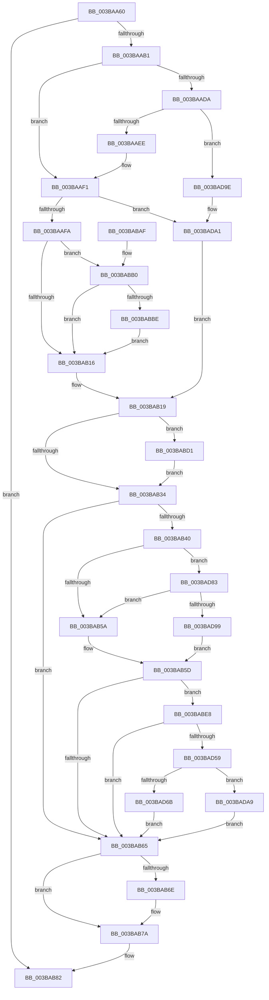

# MiLogSlabEntryAllocateFailure

- RVA: `0x003BAA60`–`0x003BADDA` (길이 `890` bytes)
- VA: `0x00000001403BAA60`
- 실행 섹션: `.text`
- PDB 이름 있음: `예`; PDB Function 태그: `아니요`
- unwind 정보 RVA: `0x0008CBD4`
- 디코드: `196`개 명령, `890/890` bytes 표시
- 미해석 바이트: `0` (있으면 어셈블리에 `.byte`로 보존)

> 이 문서는 커널 이미지의 기계어와 PDB 기호를 분석해 생성했습니다. 4번과 5번은 함수 원형과 자료형을 바이너리 사용 방식에서 추정한 C 해석이며 원본 소스 복구 결과는 아닙니다.

## 1. Dependencies

- 직접 호출 지점: **7**; 고유 호출 대상: **7**
- 직접 호출자로 확인된 함수: **1**
- RIP 상대 이미지 참조: **10**

### Outgoing calls
- `0x003BAAFA` → [MiNodeAvailablePages](MiNodeAvailablePages_function_003BB920.md) (function, `0x003BB920`)
- `0x003BAB75` → [KiLowerIrqlProcessIrqlFlags](../4F/KiLowerIrqlProcessIrqlFlags_function_004F5698.md) (function, `0x004F5698`)
- `0x003BAB89` → [_security_check_cookie](../6A/_security_check_cookie_function_006AC640.md) (function, `0x006AC640`)
- `0x003BABD7` → [KiRaiseIrqlProcessIrqlFlags](../4F/KiRaiseIrqlProcessIrqlFlags_function_004F56FC.md) (function, `0x004F56FC`)
- `0x003BAD5D` → [ExtractAggregateFieldTypes](../2F/ExtractAggregateFieldTypes_function_002F1390.md) (function, `0x002F1390`)
- `0x003BAD79` → [InsertEventEntryInLookUpTable](../2F/InsertEventEntryInLookUpTable_function_002F1424.md) (function, `0x002F1424`)
- `0x003BADD0` → [EtwWriteEx](../25/EtwWriteEx_function_0025F0D0.md) (function, `0x0025F0D0`)

### Direct callers
- [MiCreateSlabEntry](../37/MiCreateSlabEntry_function_00374DEC.md) at `0x003754AA`

### Static image references
- `0x003BAA84` → RVA `0x00E0A740` (`.data`; read)
- `0x003BAAA1` → RVA `0x00E37618` (`.data`; read)
- `0x003BAAB5` → RVA `0x00E38D00` (`.data`; read)
- `0x003BAADA` → RVA `0x00E37700` (`.data`; read)
- `0x003BAB27` → RVA `0x00FC6D20` (`ALMOSTRO`; read)
- `0x003BABF6` → RVA `0x00043590` (`.rdata`; read)
- `0x003BAC8E` → RVA `0x000599AB` (`.rdata`; read)
- `0x003BAD1D` → RVA `0x000599B5` (`.rdata`; read)
- `0x003BAD28` → RVA `0x0005BCFD` (`.rdata`; read)
- `0x003BAD48` → RVA `0x00A69500` (`TlgAggregateInternalRegisteredProviderEtwCallback`; read)

## 2. Other-region calls and transfers

- 다른 실행 섹션으로 향하는 call: **0**
- 별도 외부 분기/꼬리 이동을 확인하지 못했습니다.

## 3. Assembly (complete function range)

```asm
003BAA60  48 89 5C 24 10                  mov qword ptr [rsp + 0x10], rbx
003BAA65  48 89 74 24 18                  mov qword ptr [rsp + 0x18], rsi
003BAA6A  48 89 7C 24 20                  mov qword ptr [rsp + 0x20], rdi
003BAA6F  55                              push rbp
003BAA70  41 54                           push r12
003BAA72  41 55                           push r13
003BAA74  41 56                           push r14
003BAA76  41 57                           push r15
003BAA78  48 8D 6C 24 90                  lea rbp, [rsp - 0x70]
003BAA7D  48 81 EC 70 01 00 00            sub rsp, 0x170
003BAA84  48 8B 05 B5 FC A4 00            mov rax, qword ptr [rip + 0xa4fcb5]
003BAA8B  48 33 C4                        xor rax, rsp
003BAA8E  48 89 45 60                     mov qword ptr [rbp + 0x60], rax
003BAA92  44 89 44 24 48                  mov dword ptr [rsp + 0x48], r8d
003BAA97  45 8B E9                        mov r13d, r9d
003BAA9A  45 33 C0                        xor r8d, r8d
003BAA9D  89 54 24 44                     mov dword ptr [rsp + 0x44], edx
003BAAA1  4C 39 05 70 CB A7 00            cmp qword ptr [rip + 0xa7cb70], r8
003BAAA8  4C 8B F9                        mov r15, rcx
003BAAAB  0F 84 D1 00 00 00               je 0x1403bab82
003BAAB1  4C 8B 61 18                     mov r12, qword ptr [rcx + 0x18]
003BAAB5  48 8D 15 44 E2 A7 00            lea rdx, [rip + 0xa7e244]
003BAABC  8B 81 84 00 00 00               mov eax, dword ptr [rcx + 0x84]
003BAAC2  48 69 C8 80 DF 00 00            imul rcx, rax, 0xdf80
003BAAC9  49 03 4C 24 10                  add rcx, qword ptr [r12 + 0x10]
003BAACE  48 8B B9 80 3A 00 00            mov rdi, qword ptr [rcx + 0x3a80]
003BAAD5  4C 3B E2                        cmp r12, rdx
003BAAD8  75 17                           jne 0x1403baaf1
003BAADA  48 8D 15 1F CC A7 00            lea rdx, [rip + 0xa7cc1f]
003BAAE1  48 8B 04 C2                     mov rax, qword ptr [rdx + rax*8]
003BAAE5  48 3B F8                        cmp rdi, rax
003BAAE8  0F 86 B0 02 00 00               jbe 0x1403bad9e
003BAAEE  48 2B F8                        sub rdi, rax
003BAAF1  48 85 FF                        test rdi, rdi
003BAAF4  0F 84 A7 02 00 00               je 0x1403bada1
003BAAFA  E8 21 0E 00 00                  call 0x1403bb920
003BAAFF  48 6B C0 64                     imul rax, rax, 0x64
003BAB03  33 D2                           xor edx, edx
003BAB05  BB 0A 00 00 00                  mov ebx, 0xa
003BAB0A  48 F7 F7                        div rdi
003BAB0D  48 3B C3                        cmp rax, rbx
003BAB10  0F 87 9A 00 00 00               ja 0x1403babb0
003BAB16  45 33 C0                        xor r8d, r8d
003BAB19  45 0F 20 C6                     mov r14, cr8
003BAB1D  41 B9 02 00 00 00               mov r9d, 2
003BAB23  45 0F 22 C1                     mov cr8, r9
003BAB27  44 39 05 F2 C1 C0 00            cmp dword ptr [rip + 0xc0c1f2], r8d
003BAB2E  0F 85 9D 00 00 00               jne 0x1403babd1
003BAB34  48 8B 35 DD CA A7 00            mov rsi, qword ptr [rip + 0xa7cadd]
003BAB3B  83 3E 05                        cmp dword ptr [rsi], 5
003BAB3E  76 25                           jbe 0x1403bab65
003BAB40  49 BA 00 04 00 00 00 40 00 00   movabs r10, 0x400000000400
003BAB4A  41 BB 01 00 00 00               mov r11d, 1
003BAB50  4C 85 56 10                     test qword ptr [rsi + 0x10], r10
003BAB54  0F 85 29 02 00 00               jne 0x1403bad83
003BAB5A  41 8A C0                        mov al, r8b
003BAB5D  84 C0                           test al, al
003BAB5F  0F 85 83 00 00 00               jne 0x1403babe8
003BAB65  83 3D B4 C1 C0 00 00            cmp dword ptr [rip + 0xc0c1b4], 0
003BAB6C  74 0C                           je 0x1403bab7a
003BAB6E  44 0F 20 C1                     mov rcx, cr8
003BAB72  41 8A D6                        mov dl, r14b
003BAB75  E8 1E AB 13 00                  call 0x1404f5698
003BAB7A  41 0F B6 C6                     movzx eax, r14b
003BAB7E  44 0F 22 C0                     mov cr8, rax
003BAB82  48 8B 4D 60                     mov rcx, qword ptr [rbp + 0x60]
003BAB86  48 33 CC                        xor rcx, rsp
003BAB89  E8 B2 1A 2F 00                  call 0x1406ac640
003BAB8E  4C 8D 9C 24 70 01 00 00         lea r11, [rsp + 0x170]
003BAB96  49 8B 5B 38                     mov rbx, qword ptr [r11 + 0x38]
003BAB9A  49 8B 73 40                     mov rsi, qword ptr [r11 + 0x40]
003BAB9E  49 8B 7B 48                     mov rdi, qword ptr [r11 + 0x48]
003BABA2  49 8B E3                        mov rsp, r11
003BABA5  41 5F                           pop r15
003BABA7  41 5E                           pop r14
003BABA9  41 5D                           pop r13
003BABAB  41 5C                           pop r12
003BABAD  5D                              pop rbp
003BABAE  C3                              ret
003BABAF  CC                              int3
003BABB0  BB 1E 00 00 00                  mov ebx, 0x1e
003BABB5  48 3B C3                        cmp rax, rbx
003BABB8  0F 86 58 FF FF FF               jbe 0x1403bab16
003BABBE  BB 64 00 00 00                  mov ebx, 0x64
003BABC3  8D 4B CE                        lea ecx, [rbx - 0x32]
003BABC6  48 3B C1                        cmp rax, rcx
003BABC9  0F 46 D9                        cmovbe ebx, ecx
003BABCC  E9 45 FF FF FF                  jmp 0x1403bab16
003BABD1  41 8A D1                        mov dl, r9b
003BABD4  41 8A CE                        mov cl, r14b
003BABD7  E8 20 AB 13 00                  call 0x1404f56fc
003BABDC  45 33 C0                        xor r8d, r8d
003BABDF  45 8D 48 02                     lea r9d, [r8 + 2]
003BABE3  E9 4C FF FF FF                  jmp 0x1403bab34
003BABE8  48 8D 44 24 78                  lea rax, [rsp + 0x78]
003BABED  4C 89 5C 24 78                  mov qword ptr [rsp + 0x78], r11
003BABF2  48 89 45 B0                     mov qword ptr [rbp - 0x50], rax
003BABF6  48 8D 0D 93 89 C8 FF            lea rcx, [rip - 0x37766d]
003BABFD  41 8B 87 80 00 00 00            mov eax, dword ptr [r15 + 0x80]
003BAC04  89 44 24 4C                     mov dword ptr [rsp + 0x4c], eax
003BAC08  48 8D 44 24 4C                  lea rax, [rsp + 0x4c]
003BAC0D  48 89 45 C0                     mov qword ptr [rbp - 0x40], rax
003BAC11  41 8B 87 84 00 00 00            mov eax, dword ptr [r15 + 0x84]
003BAC18  89 44 24 50                     mov dword ptr [rsp + 0x50], eax
003BAC1C  48 8D 44 24 50                  lea rax, [rsp + 0x50]
003BAC21  48 89 45 D0                     mov qword ptr [rbp - 0x30], rax
003BAC25  41 0F B7 04 24                  movzx eax, word ptr [r12]
003BAC2A  89 44 24 54                     mov dword ptr [rsp + 0x54], eax
003BAC2E  48 8D 44 24 54                  lea rax, [rsp + 0x54]
003BAC33  48 89 45 E0                     mov qword ptr [rbp - 0x20], rax
003BAC37  8B 44 24 44                     mov eax, dword ptr [rsp + 0x44]
003BAC3B  89 44 24 44                     mov dword ptr [rsp + 0x44], eax
003BAC3F  48 8D 44 24 44                  lea rax, [rsp + 0x44]
003BAC44  48 89 45 F0                     mov qword ptr [rbp - 0x10], rax
003BAC48  48 8D 44 24 58                  lea rax, [rsp + 0x58]
003BAC4D  48 89 45 00                     mov qword ptr [rbp], rax
003BAC51  48 8D 45 80                     lea rax, [rbp - 0x80]
003BAC55  48 89 45 10                     mov qword ptr [rbp + 0x10], rax
003BAC59  8B 44 24 48                     mov eax, dword ptr [rsp + 0x48]
003BAC5D  89 44 24 48                     mov dword ptr [rsp + 0x48], eax
003BAC61  48 8D 44 24 48                  lea rax, [rsp + 0x48]
003BAC66  48 89 45 20                     mov qword ptr [rbp + 0x20], rax
003BAC6A  48 8D 44 24 5C                  lea rax, [rsp + 0x5c]
003BAC6F  48 89 45 30                     mov qword ptr [rbp + 0x30], rax
003BAC73  8A 85 C0 00 00 00               mov al, byte ptr [rbp + 0xc0]
003BAC79  88 44 24 40                     mov byte ptr [rsp + 0x40], al
003BAC7D  48 8D 44 24 40                  lea rax, [rsp + 0x40]
003BAC82  48 89 45 40                     mov qword ptr [rbp + 0x40], rax
003BAC86  48 8D 45 88                     lea rax, [rbp - 0x78]
003BAC8A  48 89 45 50                     mov qword ptr [rbp + 0x50], rax
003BAC8E  0F B7 05 16 ED C9 FF            movzx eax, word ptr [rip - 0x3612ea]
003BAC95  89 44 24 6C                     mov dword ptr [rsp + 0x6c], eax
003BAC99  48 8B 46 08                     mov rax, qword ptr [rsi + 8]
003BAC9D  48 89 45 90                     mov qword ptr [rbp - 0x70], rax
003BACA1  48 C7 45 B8 08 00 00 00         mov qword ptr [rbp - 0x48], 8
003BACA9  48 C7 45 C8 04 00 00 00         mov qword ptr [rbp - 0x38], 4
003BACB1  48 C7 45 D8 04 00 00 00         mov qword ptr [rbp - 0x28], 4
003BACB9  48 C7 45 E8 04 00 00 00         mov qword ptr [rbp - 0x18], 4
003BACC1  48 C7 45 F8 04 00 00 00         mov qword ptr [rbp - 8], 4
003BACC9  89 5C 24 58                     mov dword ptr [rsp + 0x58], ebx
003BACCD  48 C7 45 08 04 00 00 00         mov qword ptr [rbp + 8], 4
003BACD5  48 89 7D 80                     mov qword ptr [rbp - 0x80], rdi
003BACD9  48 C7 45 18 08 00 00 00         mov qword ptr [rbp + 0x18], 8
003BACE1  48 C7 45 28 04 00 00 00         mov qword ptr [rbp + 0x28], 4
003BACE9  44 89 6C 24 5C                  mov dword ptr [rsp + 0x5c], r13d
003BACEE  48 C7 45 38 04 00 00 00         mov qword ptr [rbp + 0x38], 4
003BACF6  4C 89 5D 48                     mov qword ptr [rbp + 0x48], r11
003BACFA  48 C7 45 88 00 00 00 01         mov qword ptr [rbp - 0x78], 0x1000000
003BAD02  48 C7 45 58 08 00 00 00         mov qword ptr [rbp + 0x58], 8
003BAD0A  C7 44 24 68 00 00 00 0B         mov dword ptr [rsp + 0x68], 0xb000000
003BAD12  4C 89 54 24 70                  mov qword ptr [rsp + 0x70], r10
003BAD17  0F B7 00                        movzx eax, word ptr [rax]
003BAD1A  89 45 98                        mov dword ptr [rbp - 0x68], eax
003BAD1D  48 8D 05 91 EC C9 FF            lea rax, [rip - 0x36136f]
003BAD24  48 89 45 A0                     mov qword ptr [rbp - 0x60], rax
003BAD28  48 8D 05 CE 0F CA FF            lea rax, [rip - 0x35f032]
003BAD2F  2B C1                           sub eax, ecx
003BAD31  44 89 4D 9C                     mov dword ptr [rbp - 0x64], r9d
003BAD35  C7 45 A8 D4 00 00 00            mov dword ptr [rbp - 0x58], 0xd4
003BAD3C  44 89 5D AC                     mov dword ptr [rbp - 0x54], r11d
003BAD40  89 44 24 60                     mov dword ptr [rsp + 0x60], eax
003BAD44  8B 44 24 60                     mov eax, dword ptr [rsp + 0x60]
003BAD48  48 8D 05 B1 E7 6A 00            lea rax, [rip + 0x6ae7b1]
003BAD4F  48 39 46 28                     cmp qword ptr [rsi + 0x28], rax
003BAD53  0F 85 0C FE FF FF               jne 0x1403bab65
003BAD59  48 8D 55 90                     lea rdx, [rbp - 0x70]
003BAD5D  E8 2E 66 F3 FF                  call 0x1402f1390
003BAD62  48 8D 54 24 68                  lea rdx, [rsp + 0x68]
003BAD67  84 C0                           test al, al
003BAD69  74 3E                           je 0x1403bada9
003BAD6B  4C 8D 4D 90                     lea r9, [rbp - 0x70]
003BAD6F  88 44 24 20                     mov byte ptr [rsp + 0x20], al
003BAD73  41 B0 0D                        mov r8b, 0xd
003BAD76  48 8B CE                        mov rcx, rsi
003BAD79  E8 A6 66 F3 FF                  call 0x1402f1424
003BAD7E  E9 E2 FD FF FF                  jmp 0x1403bab65
003BAD83  48 8B 4E 18                     mov rcx, qword ptr [rsi + 0x18]
003BAD87  48 8B C1                        mov rax, rcx
003BAD8A  49 23 C2                        and rax, r10
003BAD8D  48 3B C1                        cmp rax, rcx
003BAD90  41 8A C3                        mov al, r11b
003BAD93  0F 85 C1 FD FF FF               jne 0x1403bab5a
003BAD99  E9 BF FD FF FF                  jmp 0x1403bab5d
003BAD9E  49 8B F8                        mov rdi, r8
003BADA1  49 8B D8                        mov rbx, r8
003BADA4  E9 70 FD FF FF                  jmp 0x1403bab19
003BADA9  48 8B 4E 20                     mov rcx, qword ptr [rsi + 0x20]
003BADAD  48 8D 45 90                     lea rax, [rbp - 0x70]
003BADB1  48 89 44 24 38                  mov qword ptr [rsp + 0x38], rax
003BADB6  45 33 C9                        xor r9d, r9d
003BADB9  C7 44 24 30 0D 00 00 00         mov dword ptr [rsp + 0x30], 0xd
003BADC1  45 33 C0                        xor r8d, r8d
003BADC4  48 83 64 24 28 00               and qword ptr [rsp + 0x28], 0
003BADCA  48 83 64 24 20 00               and qword ptr [rsp + 0x20], 0
003BADD0  E8 FB 42 EA FF                  call 0x14025f0d0
003BADD5  E9 8B FD FF FF                  jmp 0x1403bab65
```

## 4. C-style interpretation (structured pseudocode)

```c
__int64 __fastcall MiLogSlabEntryAllocateFailure(__int64 a1, int a2, int a3, int a4, unsigned __int8 a5)
{
    __int64 result;
    __int64 v_rbx;
    __int64 v_rdi;
    __int64 v_rsp;
    unsigned __int64 v_stack_m100;
    unsigned int v_stack_m104;
    unsigned __int64 v_stack_m108;
    unsigned __int64 v_stack_m110;
    unsigned __int64 v_stack_m114;
    unsigned __int64 v_stack_m118;
    unsigned int v_stack_m11C;
    unsigned int v_stack_m120;
    unsigned int v_stack_m124;
    unsigned int v_stack_m128;
    unsigned int v_stack_m12C;
    unsigned __int8 v_stack_m130;
    unsigned __int64 v_stack_m138;
    unsigned int v_stack_m140;
    unsigned __int64 v_stack_m148;
    unsigned int v_stack_m150;
    unsigned int v_stack_m154;
    unsigned __int64 v_stack_m28;
    unsigned __int64 v_stack_m38;
    unsigned __int64 v_stack_m40;
    unsigned __int64 v_stack_m48;
    unsigned __int64 v_stack_m50;
    unsigned __int64 v_stack_m58;
    unsigned __int64 v_stack_m60;
    unsigned __int64 v_stack_m68;
    unsigned __int64 v_stack_m70;
    unsigned __int64 v_stack_m78;
    unsigned __int64 v_stack_m80;
    unsigned __int64 v_stack_m88;
    unsigned __int64 v_stack_m90;
    unsigned __int64 v_stack_m98;
    unsigned __int64 v_stack_mA0;
    unsigned __int64 v_stack_mA8;
    unsigned __int64 v_stack_mB0;
    unsigned __int64 v_stack_mB8;
    unsigned __int64 v_stack_mC0;
    unsigned __int64 v_stack_mC8;
    unsigned __int64 v_stack_mD0;
    unsigned __int64 v_stack_mD8;
    unsigned __int64 v_stack_mE0;
    unsigned __int64 v_stack_mE8;
    unsigned int v_stack_mEC;
    unsigned int v_stack_mF0;
    unsigned __int64 v_stack_mF8;
    unsigned int v_stack_mFC;
    unsigned __int64 v_stack_p10;
    unsigned __int64 v_stack_p18;
    unsigned __int64 v_stack_p20;

    v_stack_p10 = v_rbx;
    v_stack_p18 = v_rsi;
    v_stack_p20 = v_rdi;
    v_rsp = (v_rsp) - (368);
    result = (*(unsigned __int64 *)(v_rip + 10812597)) ^ (v_rsp);
    v_stack_m38 = result;
    v_stack_m150 = a3;
    a3 = 0;
    v_stack_m154 = a2;
    if ((*(unsigned __int64 *)(v_rip + 10996592)) == 0) goto loc_003BAB82;
    a1 = (a1) * ((unsigned int)(*(unsigned int *)(a1 + 132)));
    a1 = (a1) + (*(unsigned __int64 *)(*(unsigned __int64 *)(a1 + 24) + 16));
    if ((*(unsigned __int64 *)(a1 + 24)) != (v_rip + 11002436)) goto loc_003BAAF1;
    if ((*(unsigned __int64 *)(a1 + 14976)) <= (*(unsigned __int64 *)(v_rip + 10996767 + (unsigned int)(*(unsigned int *)(a1 + 132)) * 8))) goto loc_003BAD9E;
    v_rdi = (*(unsigned __int64 *)(a1 + 14976)) - (*(unsigned __int64 *)(v_rip + 10996767 + (unsigned int)(*(unsigned int *)(a1 + 132)) * 8));
loc_003BAAF1:
    if (v_rdi == 0) goto loc_003BADA1;
    result = MiNodeAvailablePages(a1, v_rip + 10996767, a3, a4);
    result = (result) * (result);
    a2 = 0;
    if (result > 10) goto loc_003BABB0;
loc_003BAB16:
    a3 = 0;
loc_003BAB19:
    if ((*(unsigned int *)(v_rip + 12632562)) != 0) goto loc_003BABD1;
loc_003BAB34:
    if ((*(unsigned int *)(*(unsigned __int64 *)(v_rip + 10996445))) <= 5) goto loc_003BAB65;
    if (((*(unsigned __int64 *)(*(unsigned __int64 *)(v_rip + 10996445) + 16)) & (v_r10)) != 0) goto loc_003BAD83;
loc_003BAB5A:
loc_003BAB5D:
    if (0 != 0) goto loc_003BABE8;
loc_003BAB65:
    result = 0;
    if ((*(unsigned int *)(v_rip + 12632500)) != 0) {
        a1 = 2;
        a2 = (unsigned __int8)(v_cr8);
        result = KiLowerIrqlProcessIrqlFlags(a1, a2, a3, 2);
    }
loc_003BAB82:
    a1 = (v_stack_m38) ^ (v_rsp);
    result = _security_check_cookie(a1, a2, a3, 2);
    return result;
loc_003BABB0:
    if (result <= 30) goto loc_003BAB16;
    v_rbx = 100;
    if (result <= (100 - 50)) { v_rbx = (unsigned int)(100 - 50); }
    goto loc_003BAB16;
loc_003BABD1:
    result = KiRaiseIrqlProcessIrqlFlags((unsigned __int8)(v_cr8), 2, a3, 2);
    a3 = 0;
    goto loc_003BAB34;
loc_003BABE8:
    v_stack_mF8 = v_stack_m28;
    v_stack_mE8 = v_stack_mF8;
    v_stack_m124 = (unsigned int)((unsigned int)(*(unsigned int *)(a1 + 128)));
    v_stack_mD8 = v_stack_m124;
    v_stack_m120 = (unsigned int)((unsigned int)(*(unsigned int *)(a1 + 132)));
    v_stack_mC8 = v_stack_m120;
    v_stack_m11C = (unsigned int)(*(unsigned __int16 *)(*(unsigned __int64 *)(a1 + 24)));
    v_stack_mB8 = v_stack_m11C;
    v_stack_m12C = (unsigned int)((unsigned int)(v_stack_m12C));
    v_stack_mA8 = v_stack_m12C;
    v_stack_m98 = v_stack_m118;
    v_stack_m88 = v_stack_m118;
    v_stack_m128 = (unsigned int)((unsigned int)(v_stack_m128));
    v_stack_m78 = v_stack_m128;
    v_stack_m68 = v_stack_m114;
    v_stack_m130 = a5;
    v_stack_m58 = v_stack_m130;
    v_stack_m48 = v_stack_m110;
    v_stack_m104 = (unsigned int)(*(unsigned __int16 *)(v_rip - 3543786));
    v_stack_m108 = *(unsigned __int64 *)(*(unsigned __int64 *)(v_stack_m28 + 64) + 8);
    v_stack_mE0 = 8;
    v_stack_mD0 = 4;
    v_stack_mC0 = 4;
    v_stack_mB0 = 4;
    v_stack_mA0 = 4;
    v_stack_m118 = (unsigned int)(v_rbx);
    v_stack_m90 = 4;
    v_stack_m118 = *(unsigned __int64 *)(v_stack_m28 + 72);
    v_stack_m80 = 8;
    v_stack_m70 = 4;
    v_stack_m114 = (unsigned int)((unsigned int)(a4));
    v_stack_m60 = 4;
    v_stack_m50 = v_stack_m28;
    v_stack_m110 = 0x1000000ULL;
    v_stack_m40 = 8;
    v_stack_m108 = 0xB000000ULL;
    v_stack_m100 = v_r10;
    v_stack_m100 = (unsigned int)(*(unsigned __int16 *)(*(unsigned __int64 *)(*(unsigned __int64 *)(v_stack_m28 + 64) + 8)));
    v_stack_mF8 = v_rip - 3543919;
    result = (unsigned int)((v_rip - 3534898) - ((unsigned int)(v_rip - 3634797)));
    v_stack_mFC = (unsigned int)(a3 + 2);
    v_stack_mF0 = 212;
    v_stack_mEC = (unsigned int)(v_stack_m28);
    v_stack_m110 = (unsigned int)(result);
    if ((*(unsigned __int64 *)(*(unsigned __int64 *)(v_stack_m28 + 64) + 40)) != (v_rip + 7006129)) goto loc_003BAB65;
    result = ExtractAggregateFieldTypes(v_rip - 3634797, v_stack_m108, a3, a3 + 2);
    if ((unsigned __int8)(result) == 0) goto loc_003BADA9;
    v_stack_m150 = (unsigned __int8)(result);
    result = InsertEventEntryInLookUpTable(*(unsigned __int64 *)(v_stack_m28 + 64), v_stack_m108, 13, v_stack_m108);
    goto loc_003BAB65;
loc_003BAD83:
    result = (*(unsigned __int64 *)(*(unsigned __int64 *)(v_stack_m28 + 64) + 24)) & (v_r10);
    if (result != (*(unsigned __int64 *)(*(unsigned __int64 *)(v_stack_m28 + 64) + 24))) goto loc_003BAB5A;
    goto loc_003BAB5D;
loc_003BAD9E:
loc_003BADA1:
    goto loc_003BAB19;
loc_003BADA9:
    v_stack_m138 = v_stack_m108;
    a4 = 0;
    v_stack_m140 = 13;
    a3 = 0;
    result = EtwWriteEx(*(unsigned __int64 *)(*(unsigned __int64 *)(v_stack_m28 + 64) + 32), v_stack_m108, a3, a4);
    goto loc_003BAB65;
}
```

## 5. (Beta) C Style

```c
int64_t MiLogSlabEntryAllocateFailure(void *Arg1, int32_t Arg2, int32_t Arg3, int32_t Arg4, uint8_t Arg5)
{
    uint8_t *arg1 = (uint8_t *)Arg1;

    int64_t result;
    int64_t local_rbx;
    int64_t local_rdi;
    int64_t local_rsp;
    uint64_t v_stack_m100;
    uint32_t v_stack_m104;
    uint64_t v_stack_m108;
    uint64_t v_stack_m110;
    uint64_t v_stack_m114;
    uint64_t v_stack_m118;
    uint32_t v_stack_m11C;
    uint32_t v_stack_m120;
    uint32_t v_stack_m124;
    uint32_t v_stack_m128;
    uint32_t v_stack_m12C;
    uint8_t v_stack_m130;
    uint64_t v_stack_m138;
    uint32_t v_stack_m140;
    uint64_t v_stack_m148;
    uint32_t v_stack_m150;
    uint32_t v_stack_m154;
    uint64_t v_stack_m28;
    uint64_t v_stack_m38;
    uint64_t v_stack_m40;
    uint64_t v_stack_m48;
    uint64_t v_stack_m50;
    uint64_t v_stack_m58;
    uint64_t v_stack_m60;
    uint64_t v_stack_m68;
    uint64_t v_stack_m70;
    uint64_t v_stack_m78;
    uint64_t v_stack_m80;
    uint64_t v_stack_m88;
    uint64_t v_stack_m90;
    uint64_t v_stack_m98;
    uint64_t v_stack_mA0;
    uint64_t v_stack_mA8;
    uint64_t v_stack_mB0;
    uint64_t v_stack_mB8;
    uint64_t v_stack_mC0;
    uint64_t v_stack_mC8;
    uint64_t v_stack_mD0;
    uint64_t v_stack_mD8;
    uint64_t v_stack_mE0;
    uint64_t v_stack_mE8;
    uint32_t v_stack_mEC;
    uint32_t v_stack_mF0;
    uint64_t v_stack_mF8;
    uint32_t v_stack_mFC;
    uint64_t v_stack_p10;
    uint64_t v_stack_p18;
    uint64_t v_stack_p20;

    v_stack_p10 = local_rbx;
    v_stack_p18 = local_rsi;
    v_stack_p20 = local_rdi;
    local_rsp = (local_rsp) - (368);
    result = (*(uint64_t *)(v_rip + 0xA4FCB5)) ^ (local_rsp);
    v_stack_m38 = result;
    v_stack_m150 = Arg3;
    Arg3 = 0;
    v_stack_m154 = Arg2;
    if ((*(uint64_t *)(v_rip + 0xA7CB70)) == 0) goto loc_003BAB82;
    Arg1 = (Arg1) * ((uint32_t)(*(uint32_t *)(arg1 + 0x84)));
    Arg1 = (Arg1) + (*(uint64_t *)(*(uint64_t *)(arg1 + 0x18) + 0x10));
    if ((*(uint64_t *)(arg1 + 0x18)) != (v_rip + 11002436)) goto loc_003BAAF1;
    if ((*(uint64_t *)(arg1 + 0x3A80)) <= (*(uint64_t *)(v_rip + 0xA7CC1F + (uint32_t)(*(uint32_t *)(arg1 + 0x84)) * 8))) goto loc_003BAD9E;
    local_rdi = (*(uint64_t *)(arg1 + 0x3A80)) - (*(uint64_t *)(v_rip + 0xA7CC1F + (uint32_t)(*(uint32_t *)(arg1 + 0x84)) * 8));
loc_003BAAF1:
    if (local_rdi == 0) goto loc_003BADA1;
    result = MiNodeAvailablePages(Arg1, v_rip + 10996767, Arg3, Arg4);
    result = (result) * (result);
    Arg2 = 0;
    if (result > 10) goto loc_003BABB0;
loc_003BAB16:
    Arg3 = 0;
loc_003BAB19:
    if ((*(uint32_t *)(v_rip + 0xC0C1F2)) != 0) goto loc_003BABD1;
loc_003BAB34:
    if ((*(uint32_t *)(*(uint64_t *)(v_rip + 0xA7CADD))) <= 5) goto loc_003BAB65;
    if (((*(uint64_t *)(*(uint64_t *)(v_rip + 0xA7CADD) + 0x10)) & (local_r10)) != 0) goto loc_003BAD83;
loc_003BAB5A:
loc_003BAB5D:
    if (0 != 0) goto loc_003BABE8;
loc_003BAB65:
    result = 0;
    if ((*(uint32_t *)(v_rip + 0xC0C1B4)) != 0) {
        Arg1 = 2;
        Arg2 = (uint8_t)(v_cr8);
        result = KiLowerIrqlProcessIrqlFlags(Arg1, Arg2, Arg3, 2);
    }
loc_003BAB82:
    Arg1 = (v_stack_m38) ^ (local_rsp);
    result = _security_check_cookie(Arg1, Arg2, Arg3, 2);
    return result;
loc_003BABB0:
    if (result <= 30) goto loc_003BAB16;
    local_rbx = 100;
    if (result <= (100 - 50)) { local_rbx = (uint32_t)(100 - 50); }
    goto loc_003BAB16;
loc_003BABD1:
    result = KiRaiseIrqlProcessIrqlFlags((uint8_t)(v_cr8), 2, Arg3, 2);
    Arg3 = 0;
    goto loc_003BAB34;
loc_003BABE8:
    v_stack_mF8 = v_stack_m28;
    v_stack_mE8 = v_stack_mF8;
    v_stack_m124 = (uint32_t)((uint32_t)(*(uint32_t *)(arg1 + 0x80)));
    v_stack_mD8 = v_stack_m124;
    v_stack_m120 = (uint32_t)((uint32_t)(*(uint32_t *)(arg1 + 0x84)));
    v_stack_mC8 = v_stack_m120;
    v_stack_m11C = (uint32_t)(*(uint16_t *)(*(uint64_t *)(arg1 + 0x18)));
    v_stack_mB8 = v_stack_m11C;
    v_stack_m12C = (uint32_t)((uint32_t)(v_stack_m12C));
    v_stack_mA8 = v_stack_m12C;
    v_stack_m98 = v_stack_m118;
    v_stack_m88 = v_stack_m118;
    v_stack_m128 = (uint32_t)((uint32_t)(v_stack_m128));
    v_stack_m78 = v_stack_m128;
    v_stack_m68 = v_stack_m114;
    v_stack_m130 = Arg5;
    v_stack_m58 = v_stack_m130;
    v_stack_m48 = v_stack_m110;
    v_stack_m104 = (uint32_t)(*(uint16_t *)(v_rip - 0x3612EA));
    v_stack_m108 = *(uint64_t *)(*(uint64_t *)(v_stack_m28 + 0x40) + 0x8);
    v_stack_mE0 = 8;
    v_stack_mD0 = 4;
    v_stack_mC0 = 4;
    v_stack_mB0 = 4;
    v_stack_mA0 = 4;
    v_stack_m118 = (uint32_t)(local_rbx);
    v_stack_m90 = 4;
    v_stack_m118 = *(uint64_t *)(v_stack_m28 + 0x48);
    v_stack_m80 = 8;
    v_stack_m70 = 4;
    v_stack_m114 = (uint32_t)((uint32_t)(Arg4));
    v_stack_m60 = 4;
    v_stack_m50 = v_stack_m28;
    v_stack_m110 = 0x1000000ULL;
    v_stack_m40 = 8;
    v_stack_m108 = 0xB000000ULL;
    v_stack_m100 = local_r10;
    v_stack_m100 = (uint32_t)(*(uint16_t *)(*(uint64_t *)(*(uint64_t *)(v_stack_m28 + 0x40) + 0x8)));
    v_stack_mF8 = v_rip - 3543919;
    result = (uint32_t)((v_rip - 3534898) - ((uint32_t)(v_rip - 3634797)));
    v_stack_mFC = (uint32_t)(Arg3 + 2);
    v_stack_mF0 = 212;
    v_stack_mEC = (uint32_t)(v_stack_m28);
    v_stack_m110 = (uint32_t)(result);
    if ((*(uint64_t *)(*(uint64_t *)(v_stack_m28 + 0x40) + 0x28)) != (v_rip + 7006129)) goto loc_003BAB65;
    result = ExtractAggregateFieldTypes(v_rip - 3634797, v_stack_m108, Arg3, Arg3 + 2);
    if ((uint8_t)(result) == 0) goto loc_003BADA9;
    v_stack_m150 = (uint8_t)(result);
    result = InsertEventEntryInLookUpTable(*(uint64_t *)(v_stack_m28 + 0x40), v_stack_m108, 13, v_stack_m108);
    goto loc_003BAB65;
loc_003BAD83:
    result = (*(uint64_t *)(*(uint64_t *)(v_stack_m28 + 0x40) + 0x18)) & (local_r10);
    if (result != (*(uint64_t *)(*(uint64_t *)(v_stack_m28 + 0x40) + 0x18))) goto loc_003BAB5A;
    goto loc_003BAB5D;
loc_003BAD9E:
loc_003BADA1:
    goto loc_003BAB19;
loc_003BADA9:
    v_stack_m138 = v_stack_m108;
    Arg4 = 0;
    v_stack_m140 = 13;
    Arg3 = 0;
    result = EtwWriteEx(*(uint64_t *)(*(uint64_t *)(v_stack_m28 + 0x40) + 0x20), v_stack_m108, Arg3, Arg4);
    goto loc_003BAB65;
}
```

### 관측된 메모리 오프셋

구조체 형식이 확인되지 않은 접근은 인자 기준의 오프셋으로만 기록했습니다.

| 기준 인자 | 오프셋 표현 | 폭 (bit) | 접근 |
|---|---:|---:|---|
| `Arg1` | `+ 0x18` | `64` | `R` |
| `Arg1` | `+ 0x80` | `32` | `R` |
| `Arg1` | `+ 0x84` | `32` | `R` |
| `Arg1` | `+ 0x3A80` | `64` | `R` |

## 6. Execution-region graph

[열기: 2D/3D 그래프와 함수 탐색 컨트롤 패널](../../../control-panel.html?section=text&rva=0x003BAA60&view=graph)

- 2D 그래프는 위에서 아래로 흐르고, 3D 그래프는 빈 공간을 드래그해 회전합니다. Shift+드래그는 이동, 휠은 확대·축소, 함수 노드 선택은 대상 보고서 이동입니다.

### Static fallback


