# MiMakeZeroedPageTablesEx

- RVA: `0x003B59FC`–`0x003B5E30` (길이 `1,076` bytes)
- VA: `0x00000001403B59FC`
- 실행 섹션: `.text`
- PDB 이름 있음: `예`; PDB Function 태그: `예`
- unwind 정보 RVA: `0x0008C63C`
- 디코드: `248`개 명령, `1,076/1,076` bytes 표시
- 미해석 바이트: `0` (있으면 어셈블리에 `.byte`로 보존)

> 이 문서는 커널 이미지의 기계어와 PDB 기호를 분석해 생성했습니다. 4번과 5번은 함수 원형과 자료형을 바이너리 사용 방식에서 추정한 C 해석이며 원본 소스 복구 결과는 아닙니다.

## 1. Dependencies

- 직접 호출 지점: **17**; 고유 호출 대상: **15**
- 직접 호출자로 확인된 함수: **5**
- RIP 상대 이미지 참조: **6**

### Outgoing calls
- `0x003B5A50` → [memset](../6C/memset_function_006C6C40.md) (function, `0x006C6C40`)
- `0x003B5A61` → [memset](../6C/memset_function_006C6C40.md) (function, `0x006C6C40`)
- `0x003B5AF5` → [MiSystemVaTypeToVm](../28/MiSystemVaTypeToVm_function_0028EB50.md) (function, `0x0028EB50`)
- `0x003B5B6C` → [MiInitializeColorBase](MiInitializeColorBase_function_003B5E38.md) (function, `0x003B5E38`)
- `0x003B5C47` → [MiLockWorkingSetShared](../27/MiLockWorkingSetShared_function_0027CBF0.md) (function, `0x0027CBF0`)
- `0x003B5C55` → [MiWalkPageTables](../2C/MiWalkPageTables_function_002C2710.md) (function, `0x002C2710`)
- `0x003B5C61` → [MiUnlockWorkingSetShared](../27/MiUnlockWorkingSetShared_function_0027D690.md) (function, `0x0027D690`)
- `0x003B5C7A` → [MiCleanupPageTablePages](MiCleanupPageTablePages_function_003B5EB8.md) (function, `0x003B5EB8`)
- `0x003B5C99` → [_security_check_cookie](../6A/_security_check_cookie_function_006AC640.md) (function, `0x006AC640`)
- `0x003B5D1A` → [MiLockWorkingSetSharedAtDpc](../23/MiLockWorkingSetSharedAtDpc_function_00239574.md) (function, `0x00239574`)
- `0x003B5D73` → [MiAsyncSlabReplenish](../4A/MiAsyncSlabReplenish_function_004AA54C.md) (function, `0x004AA54C`)
- `0x003B5D8A` → [MiFastReplenishWithAsync](../4A/MiFastReplenishWithAsync_function_004AA500.md) (function, `0x004AA500`)
- `0x003B5D9E` → [MiGetLargePagesForSystemMapping](../../page/AC/MiGetLargePagesForSystemMapping_function_00AC5094.md) (function, `0x00AC5094`)
- `0x003B5DB5` → [MiCleanupPageTablePages](MiCleanupPageTablePages_function_003B5EB8.md) (function, `0x003B5EB8`)
- `0x003B5DC6` → [MiGetAnyMultiplexedVm](../44/MiGetAnyMultiplexedVm_function_00448BD0.md) (function, `0x00448BD0`)
- `0x003B5E07` → [MiUpdateChargedWsles](../4F/MiUpdateChargedWsles_function_004F6EA0.md) (function, `0x004F6EA0`)
- `0x003B5E29` → [MiDeleteSystemPageTables](../2C/MiDeleteSystemPageTables_function_002C1110.md) (function, `0x002C1110`)

### Direct callers
- [MiGetPageTablesForLargeMap](MiGetPageTablesForLargeMap_function_003B48D4.md) at `0x003B49BA`
- [MiGetPageTablesForLargeMap](MiGetPageTablesForLargeMap_function_003B48D4.md) at `0x003B4A15`
- [MiMakeZeroedPageTables](MiMakeZeroedPageTables_function_003B4F6C.md) at `0x003B4F75`
- [MiCreatePoolPageTables](MiCreatePoolPageTables_function_003B5994.md) at `0x003B59E8`
- [MmKasanCommitRegion](../67/MmKasanCommitRegion_function_0067FCF4.md) at `0x0067FD4A`
- [MiMapNewPfns](../../page/7F/MiMapNewPfns_function_007FA63C.md) at `0x007FA7AB`

### Static image references
- `0x003B5A18` → RVA `0x00E0A740` (`.data`; read)
- `0x003B5B0D` → RVA `0x00E30088` (`.data`; read)
- `0x003B5BC2` → RVA `0x00FC6A88` (`ALMOSTRO`; read)
- `0x003B5C09` → RVA `0x004518D0` (`MiCreateSystemPageTable`; read)
- `0x003B5C14` → RVA `0x0047F890` (`MiCreateSystemPageTableTail`; read)
- `0x003B5D24` → RVA `0x00E2DCE0` (`.data`; read)

## 2. Other-region calls and transfers

- 다른 실행 섹션으로 향하는 call: **1**
  - `0x003B5D9E` → [MiGetLargePagesForSystemMapping](../../page/AC/MiGetLargePagesForSystemMapping_function_00AC5094.md) (`.text` → `PAGE`)
- call이 아닌 외부 분기/꼬리 이동: **1**
  - `0x003B5BBC` → [sub_006E73DC](../6E/Unknown_function_006E73DC.md) (`tail-transfer`)

## 3. Assembly (complete function range)

```asm
003B59FC  40 55                           push rbp
003B59FE  53                              push rbx
003B59FF  56                              push rsi
003B5A00  57                              push rdi
003B5A01  41 54                           push r12
003B5A03  41 55                           push r13
003B5A05  41 56                           push r14
003B5A07  41 57                           push r15
003B5A09  48 8D AC 24 08 FF FF FF         lea rbp, [rsp - 0xf8]
003B5A11  48 81 EC F8 01 00 00            sub rsp, 0x1f8
003B5A18  48 8B 05 21 4D A5 00            mov rax, qword ptr [rip + 0xa54d21]
003B5A1F  48 33 C4                        xor rax, rsp
003B5A22  48 89 85 E0 00 00 00            mov qword ptr [rbp + 0xe0], rax
003B5A29  41 8B D9                        mov ebx, r9d
003B5A2C  48 89 54 24 40                  mov qword ptr [rsp + 0x40], rdx
003B5A31  41 8B F8                        mov edi, r8d
003B5A34  48 89 4C 24 48                  mov qword ptr [rsp + 0x48], rcx
003B5A39  4C 8B F2                        mov r14, rdx
003B5A3C  89 5C 24 30                     mov dword ptr [rsp + 0x30], ebx
003B5A40  48 8B F1                        mov rsi, rcx
003B5A43  33 D2                           xor edx, edx
003B5A45  41 B8 C0 00 00 00               mov r8d, 0xc0
003B5A4B  48 8D 4C 24 60                  lea rcx, [rsp + 0x60]
003B5A50  E8 EB 11 31 00                  call 0x1406c6c40
003B5A55  33 D2                           xor edx, edx
003B5A57  48 8D 4D 20                     lea rcx, [rbp + 0x20]
003B5A5B  41 B8 B8 00 00 00               mov r8d, 0xb8
003B5A61  E8 DA 11 31 00                  call 0x1406c6c40
003B5A66  41 BD 04 00 00 00               mov r13d, 4
003B5A6C  48 8D 45 20                     lea rax, [rbp + 0x20]
003B5A70  41 8B CD                        mov ecx, r13d
003B5A73  45 8D 65 FD                     lea r12d, [r13 - 3]
003B5A77  48 83 60 10 00                  and qword ptr [rax + 0x10], 0
003B5A7C  48 89 40 08                     mov qword ptr [rax + 8], rax
003B5A80  48 89 00                        mov qword ptr [rax], rax
003B5A83  48 83 C0 18                     add rax, 0x18
003B5A87  49 2B CC                        sub rcx, r12
003B5A8A  75 EB                           jne 0x1403b5a77
003B5A8C  0F BA E7 0B                     bt edi, 0xb
003B5A90  0F 83 28 02 00 00               jae 0x1403b5cbe
003B5A96  B9 03 00 00 00                  mov ecx, 3
003B5A9B  89 8D A4 00 00 00               mov dword ptr [rbp + 0xa4], ecx
003B5AA1  0F BA F7 07                     btr edi, 7
003B5AA5  8B 44 24 64                     mov eax, dword ptr [rsp + 0x64]
003B5AA9  83 E1 07                        and ecx, 7
003B5AAC  C1 E1 06                        shl ecx, 6
003B5AAF  25 3F FE FF FF                  and eax, 0xfffffe3f
003B5AB4  0B C8                           or ecx, eax
003B5AB6  89 4C 24 64                     mov dword ptr [rsp + 0x64], ecx
003B5ABA  48 B8 00 00 00 00 80 F6 FF FF   movabs rax, 0xfffff68000000000
003B5AC4  48 C1 E0 19                     shl rax, 0x19
003B5AC8  4C 8B FE                        mov r15, rsi
003B5ACB  49 C1 E6 19                     shl r14, 0x19
003B5ACF  8B CB                           mov ecx, ebx
003B5AD1  4C 2B F0                        sub r14, rax
003B5AD4  49 C1 E7 19                     shl r15, 0x19
003B5AD8  4C 2B F8                        sub r15, rax
003B5ADB  49 C1 FE 10                     sar r14, 0x10
003B5ADF  49 81 C6 FF 0F 00 00            add r14, 0xfff
003B5AE6  49 C1 FF 10                     sar r15, 0x10
003B5AEA  4C 89 74 24 50                  mov qword ptr [rsp + 0x50], r14
003B5AEF  89 9D 98 00 00 00               mov dword ptr [rbp + 0x98], ebx
003B5AF5  E8 56 90 ED FF                  call 0x14028eb50
003B5AFA  48 8B F0                        mov rsi, rax
003B5AFD  48 85 C0                        test rax, rax
003B5B00  0F 84 BB 02 00 00               je 0x1403b5dc1
003B5B06  0F B7 8E AE 00 00 00            movzx ecx, word ptr [rsi + 0xae]
003B5B0D  48 8B 05 74 A5 A7 00            mov rax, qword ptr [rip + 0xa7a574]
003B5B14  8B 95 60 01 00 00               mov edx, dword ptr [rbp + 0x160]
003B5B1A  48 8B 04 C8                     mov rax, qword ptr [rax + rcx*8]
003B5B1E  48 89 44 24 38                  mov qword ptr [rsp + 0x38], rax
003B5B23  48 89 85 80 00 00 00            mov qword ptr [rbp + 0x80], rax
003B5B2A  48 83 C8 FF                     or rax, 0xffffffffffffffff
003B5B2E  89 BD A0 00 00 00               mov dword ptr [rbp + 0xa0], edi
003B5B34  89 95 9C 00 00 00               mov dword ptr [rbp + 0x9c], edx
003B5B3A  48 89 85 C8 00 00 00            mov qword ptr [rbp + 0xc8], rax
003B5B41  40 F6 C7 40                     test dil, 0x40
003B5B45  0F 84 B0 01 00 00               je 0x1403b5cfb
003B5B4B  8D 48 09                        lea ecx, [rax + 9]
003B5B4E  48 C1 E0 08                     shl rax, 8
003B5B52  48 83 C8 0A                     or rax, 0xa
003B5B56  49 2B CC                        sub rcx, r12
003B5B59  75 F3                           jne 0x1403b5b4e
003B5B5B  48 89 85 C8 00 00 00            mov qword ptr [rbp + 0xc8], rax
003B5B62  4C 8D 85 B8 00 00 00            lea r8, [rbp + 0xb8]
003B5B69  49 8B CF                        mov rcx, r15
003B5B6C  E8 C7 02 00 00                  call 0x1403b5e38
003B5B71  8B 9D C0 00 00 00               mov ebx, dword ptr [rbp + 0xc0]
003B5B77  C1 EB 09                        shr ebx, 9
003B5B7A  83 E3 3F                        and ebx, 0x3f
003B5B7D  40 84 FF                        test dil, dil
003B5B80  0F 88 0E 02 00 00               js 0x1403b5d94
003B5B86  44 39 A5 98 00 00 00            cmp dword ptr [rbp + 0x98], r12d
003B5B8D  0F 85 20 01 00 00               jne 0x1403b5cb3
003B5B93  44 8B E7                        mov r12d, edi
003B5B96  48 B9 00 00 00 00 04 00 00 00   movabs rcx, 0x400000000
003B5BA0  41 81 E4 00 10 00 00            and r12d, 0x1000
003B5BA7  41 8B C4                        mov eax, r12d
003B5BAA  F7 D8                           neg eax
003B5BAC  45 1B F6                        sbb r14d, r14d
003B5BAF  45 23 F5                        and r14d, r13d
003B5BB2  41 FF C6                        inc r14d
003B5BB5  83 BD 98 00 00 00 03            cmp dword ptr [rbp + 0x98], 3
003B5BBC  0F 84 1A 18 33 00               je 0x1406e73dc
003B5BC2  48 85 0D BF 0E C1 00            test qword ptr [rip + 0xc10ebf], rcx
003B5BC9  74 39                           je 0x1403b5c04
003B5BCB  8B C3                           mov eax, ebx
003B5BCD  4C 69 C8 80 DF 00 00            imul r9, rax, 0xdf80
003B5BD4  48 8B 44 24 38                  mov rax, qword ptr [rsp + 0x38]
003B5BD9  4C 03 48 10                     add r9, qword ptr [rax + 0x10]
003B5BDD  49 8B 91 08 44 00 00            mov rdx, qword ptr [r9 + 0x4408]
003B5BE4  49 8B 81 F8 43 00 00            mov rax, qword ptr [r9 + 0x43f8]
003B5BEB  48 8B 00                        mov rax, qword ptr [rax]
003B5BEE  44 2B AD A4 00 00 00            sub r13d, dword ptr [rbp + 0xa4]
003B5BF5  48 03 C2                        add rax, rdx
003B5BF8  45 8B C5                        mov r8d, r13d
003B5BFB  49 3B C0                        cmp rax, r8
003B5BFE  0F 82 4E 01 00 00               jb 0x1403b5d52
003B5C04  48 8B 5C 24 50                  mov rbx, qword ptr [rsp + 0x50]
003B5C09  48 8D 05 C0 BC 09 00            lea rax, [rip + 0x9bcc0]
003B5C10  48 89 45 08                     mov qword ptr [rbp + 8], rax
003B5C14  48 8D 05 75 9C 0C 00            lea rax, [rip + 0xc9c75]
003B5C1B  48 89 45 10                     mov qword ptr [rbp + 0x10], rax
003B5C1F  48 8D 45 20                     lea rax, [rbp + 0x20]
003B5C23  48 89 45 18                     mov qword ptr [rbp + 0x18], rax
003B5C27  48 8B CE                        mov rcx, rsi
003B5C2A  C7 44 24 60 07 A0 00 00         mov dword ptr [rsp + 0x60], 0xa007
003B5C32  4C 89 7D 88                     mov qword ptr [rbp - 0x78], r15
003B5C36  48 89 5D 90                     mov qword ptr [rbp - 0x70], rbx
003B5C3A  48 89 75 80                     mov qword ptr [rbp - 0x80], rsi
003B5C3E  45 85 E4                        test r12d, r12d
003B5C41  0F 85 CE 00 00 00               jne 0x1403b5d15
003B5C47  E8 A4 6F EC FF                  call 0x14027cbf0
003B5C4C  88 44 24 69                     mov byte ptr [rsp + 0x69], al
003B5C50  48 8D 4C 24 60                  lea rcx, [rsp + 0x60]
003B5C55  E8 B6 CA F0 FF                  call 0x1402c2710
003B5C5A  8A 54 24 69                     mov dl, byte ptr [rsp + 0x69]
003B5C5E  48 8B CE                        mov rcx, rsi
003B5C61  E8 2A 7A EC FF                  call 0x14027d690
003B5C66  41 BC 01 00 00 00               mov r12d, 1
003B5C6C  40 F6 C7 40                     test dil, 0x40
003B5C70  0F 85 7A 01 00 00               jne 0x1403b5df0
003B5C76  48 8D 4D 20                     lea rcx, [rbp + 0x20]
003B5C7A  E8 39 02 00 00                  call 0x1403b5eb8
003B5C7F  83 BD B0 00 00 00 00            cmp dword ptr [rbp + 0xb0], 0
003B5C86  0F 8C 85 01 00 00               jl 0x1403b5e11
003B5C8C  41 8B C4                        mov eax, r12d
003B5C8F  48 8B 8D E0 00 00 00            mov rcx, qword ptr [rbp + 0xe0]
003B5C96  48 33 CC                        xor rcx, rsp
003B5C99  E8 A2 69 2F 00                  call 0x1406ac640
003B5C9E  48 81 C4 F8 01 00 00            add rsp, 0x1f8
003B5CA5  41 5F                           pop r15
003B5CA7  41 5E                           pop r14
003B5CA9  41 5D                           pop r13
003B5CAB  41 5C                           pop r12
003B5CAD  5F                              pop rdi
003B5CAE  5E                              pop rsi
003B5CAF  5B                              pop rbx
003B5CB0  5D                              pop rbp
003B5CB1  C3                              ret
003B5CB2  CC                              int3
003B5CB3  8B 86 B8 00 00 00               mov eax, dword ptr [rsi + 0xb8]
003B5CB9  E9 D5 FE FF FF                  jmp 0x1403b5b93
003B5CBE  41 84 FD                        test r13b, dil
003B5CC1  0F 85 CF FD FF FF               jne 0x1403b5a96
003B5CC7  B9 02 00 00 00                  mov ecx, 2
003B5CCC  40 84 F9                        test cl, dil
003B5CCF  0F 85 C6 FD FF FF               jne 0x1403b5a9b
003B5CD5  8B 8D A4 00 00 00               mov ecx, dword ptr [rbp + 0xa4]
003B5CDB  40 F6 C7 20                     test dil, 0x20
003B5CDF  41 0F 44 CC                     cmove ecx, r12d
003B5CE3  89 8D A4 00 00 00               mov dword ptr [rbp + 0xa4], ecx
003B5CE9  41 3B CD                        cmp ecx, r13d
003B5CEC  74 9E                           je 0x1403b5c8c
003B5CEE  85 C9                           test ecx, ecx
003B5CF0  0F 85 AB FD FF FF               jne 0x1403b5aa1
003B5CF6  E9 AA FD FF FF                  jmp 0x1403b5aa5
003B5CFB  48 B8 00 00 00 00 00 DE FF FF   movabs rax, 0xffffde0000000000
003B5D05  4C 3B F8                        cmp r15, rax
003B5D08  73 1A                           jae 0x1403b5d24
003B5D0A  83 FB 13                        cmp ebx, 0x13
003B5D0D  0F 85 4F FE FF FF               jne 0x1403b5b62
003B5D13  EB 30                           jmp 0x1403b5d45
003B5D15  C6 44 24 69 11                  mov byte ptr [rsp + 0x69], 0x11
003B5D1A  E8 55 38 E8 FF                  call 0x140239574
003B5D1F  E9 2C FF FF FF                  jmp 0x1403b5c50
003B5D24  48 8B 05 B5 7F A7 00            mov rax, qword ptr [rip + 0xa77fb5]
003B5D2B  48 8D 0C 40                     lea rcx, [rax + rax*2]
003B5D2F  48 C1 E1 04                     shl rcx, 4
003B5D33  48 B8 30 00 00 00 00 DE FF FF   movabs rax, 0xffffde0000000030
003B5D3D  48 03 C8                        add rcx, rax
003B5D40  4C 3B F9                        cmp r15, rcx
003B5D43  73 C5                           jae 0x1403b5d0a
003B5D45  48 83 A5 C8 00 00 00 00         and qword ptr [rbp + 0xc8], 0
003B5D4D  E9 10 FE FF FF                  jmp 0x1403b5b62
003B5D52  8B 85 98 00 00 00               mov eax, dword ptr [rbp + 0x98]
003B5D58  83 F8 13                        cmp eax, 0x13
003B5D5B  77 20                           ja 0x1403b5d7d
003B5D5D  B9 10 11 08 00                  mov ecx, 0x81110
003B5D62  0F A3 C1                        bt ecx, eax
003B5D65  73 16                           jae 0x1403b5d7d
003B5D67  45 8B C6                        mov r8d, r14d
003B5D6A  49 8D 89 A8 43 00 00            lea rcx, [r9 + 0x43a8]
003B5D71  33 D2                           xor edx, edx
003B5D73  E8 D4 47 0F 00                  call 0x1404aa54c
003B5D78  E9 87 FE FF FF                  jmp 0x1403b5c04
003B5D7D  49 63 D0                        movsxd rdx, r8d
003B5D80  49 8D 89 A8 43 00 00            lea rcx, [r9 + 0x43a8]
003B5D87  45 8B C6                        mov r8d, r14d
003B5D8A  E8 71 47 0F 00                  call 0x1404aa500
003B5D8F  E9 70 FE FF FF                  jmp 0x1403b5c04
003B5D94  4D 8B C6                        mov r8, r14
003B5D97  48 8D 4D 20                     lea rcx, [rbp + 0x20]
003B5D9B  49 8B D7                        mov rdx, r15
003B5D9E  E8 F1 F2 70 00                  call 0x140ac5094
003B5DA3  85 C0                           test eax, eax
003B5DA5  79 2C                           jns 0x1403b5dd3
003B5DA7  0F BA E7 08                     bt edi, 8
003B5DAB  0F 83 E2 FD FF FF               jae 0x1403b5b93
003B5DB1  48 8D 4D 20                     lea rcx, [rbp + 0x20]
003B5DB5  E8 FE 00 00 00                  call 0x1403b5eb8
003B5DBA  33 C0                           xor eax, eax
003B5DBC  E9 CE FE FF FF                  jmp 0x1403b5c8f
003B5DC1  B9 06 00 00 00                  mov ecx, 6
003B5DC6  E8 05 2E 09 00                  call 0x140448bd0
003B5DCB  48 8B F0                        mov rsi, rax
003B5DCE  E9 33 FD FF FF                  jmp 0x1403b5b06
003B5DD3  3D 34 00 19 40                  cmp eax, 0x40190034
003B5DD8  0F 85 B5 FD FF FF               jne 0x1403b5b93
003B5DDE  B8 7F FF FF FF                  mov eax, 0xffffff7f
003B5DE3  23 F8                           and edi, eax
003B5DE5  21 85 A0 00 00 00               and dword ptr [rbp + 0xa0], eax
003B5DEB  E9 A3 FD FF FF                  jmp 0x1403b5b93
003B5DF0  44 39 A5 98 00 00 00            cmp dword ptr [rbp + 0x98], r12d
003B5DF7  0F 84 79 FE FF FF               je 0x1403b5c76
003B5DFD  48 8B 95 90 00 00 00            mov rdx, qword ptr [rbp + 0x90]
003B5E04  48 8B CE                        mov rcx, rsi
003B5E07  E8 94 10 14 00                  call 0x1404f6ea0
003B5E0C  E9 65 FE FF FF                  jmp 0x1403b5c76
003B5E11  0F BA E7 09                     bt edi, 9
003B5E15  72 A3                           jb 0x1403b5dba
003B5E17  83 64 24 20 00                  and dword ptr [rsp + 0x20], 0
003B5E1C  4C 8B CB                        mov r9, rbx
003B5E1F  8B 54 24 30                     mov edx, dword ptr [rsp + 0x30]
003B5E23  4D 8B C7                        mov r8, r15
003B5E26  48 8B CE                        mov rcx, rsi
003B5E29  E8 E2 B2 F0 FF                  call 0x1402c1110
003B5E2E  EB 8A                           jmp 0x1403b5dba
```

## 4. C-style interpretation (structured pseudocode)

```c
__int64 __fastcall MiMakeZeroedPageTablesEx(__int64 a1, __int64 a2, int a3, int a4, unsigned int a5)
{
    __int64 result;
    __int64 v_r12;
    __int64 v_r13;
    __int64 v_r14;
    __int64 v_r15;
    __int64 v_rbx;
    __int64 v_rdi;
    __int64 v_rsp;
    unsigned __int64 v_stack_m118;
    unsigned __int64 v_stack_m120;
    unsigned __int64 v_stack_m128;
    unsigned __int64 v_stack_m130;
    unsigned __int64 v_stack_m138;
    unsigned __int64 v_stack_m1A8;
    unsigned __int64 v_stack_m1B0;
    unsigned __int64 v_stack_m1B8;
    unsigned __int8 v_stack_m1CF;
    unsigned int v_stack_m1D4;
    unsigned __int64 v_stack_m1D8;
    unsigned __int64 v_stack_m1E8;
    unsigned __int64 v_stack_m1F0;
    unsigned __int64 v_stack_m1F8;
    unsigned __int64 v_stack_m200;
    unsigned int v_stack_m208;
    unsigned __int64 v_stack_m58;
    unsigned __int64 v_stack_m70;
    unsigned int v_stack_m78;
    unsigned __int64 v_stack_m80;
    unsigned int v_stack_m88;
    unsigned int v_stack_m94;
    unsigned int v_stack_m98;
    unsigned int v_stack_m9C;
    unsigned int v_stack_mA0;
    unsigned __int64 v_stack_mA8;
    unsigned __int64 v_stack_mB8;
    unsigned int v_stack_p20;
    unsigned int v_stack_p30;
    unsigned __int8 v_stack_p69;

    v_rsp = (v_rsp) - (504);
    result = (*(unsigned __int64 *)(v_rip + 10833185)) ^ (v_rsp);
    v_stack_m58 = result;
    v_stack_m1F8 = a2;
    v_stack_m1F0 = a1;
    v_stack_m208 = (unsigned int)((unsigned int)(a4));
    a2 = 0;
    result = memset(v_stack_m1D8, a2, 192, a4);
    a2 = 0;
    result = memset(v_stack_m118, a2, 184, a4);
loc_003B5A77:
    *(unsigned __int64 *)(v_stack_m118 + 8) = v_stack_m118;
    *(unsigned __int64 *)(v_stack_m118) = v_stack_m118;
    result = (v_stack_m118) + (24);
    a1 = (4) - (4 - 3);
    if (condition_is_not_equal) goto loc_003B5A77;
    if (condition_is_above_or_equal) goto loc_003B5CBE;
loc_003B5A96:
loc_003B5A9B:
    v_stack_m94 = 3;
loc_003B5AA1:
loc_003B5AA5:
    a1 = (unsigned int)((3) & (7));
    a1 = (unsigned int)((a1) << (6));
    result = (unsigned int)(((unsigned int)(v_stack_m1D4)) & (0xFFFFFE3FULL));
    a1 = (unsigned int)((a1) | ((unsigned int)(result)));
    v_stack_m1D4 = (unsigned int)(a1);
    result = (result) << (25);
    v_r14 = (a2) << (25);
    v_r14 = (v_r14) - (result);
    v_r15 = (a1) << (25);
    v_r15 = (v_r15) - (result);
    v_r14 = (v_r14) >> (16);
    v_r14 = (v_r14) + (0xFFFULL);
    v_r15 = (v_r15) >> (16);
    v_stack_m1E8 = v_r14;
    v_stack_mA0 = (unsigned int)((unsigned int)(a4));
    result = MiSystemVaTypeToVm((unsigned int)((unsigned int)((unsigned int)(a4))), a2, 184, a4);
    if (result == 0) goto loc_003B5DC1;
loc_003B5B06:
    v_stack_m200 = *(unsigned __int64 *)(*(unsigned __int64 *)(v_rip + 10986868) + *(unsigned __int16 *)(result + 174) * 8);
    v_stack_mB8 = *(unsigned __int64 *)(*(unsigned __int64 *)(v_rip + 10986868) + *(unsigned __int16 *)(result + 174) * 8);
    result = (*(unsigned __int64 *)(*(unsigned __int64 *)(v_rip + 10986868) + *(unsigned __int16 *)(result + 174) * 8)) | (-1);
    v_stack_m98 = (unsigned int)((unsigned int)(a3));
    v_stack_m9C = (unsigned int)((unsigned int)(a5));
    v_stack_m70 = result;
    if ((((unsigned __int8)((unsigned int)(a3))) & (64)) == 0) goto loc_003B5CFB;
loc_003B5B4E:
    result = (result) << (8);
    result = (result) | (10);
    a1 = (result + 9) - (4 - 3);
    if (condition_is_not_equal) goto loc_003B5B4E;
    v_stack_m70 = result;
loc_003B5B62:
    result = MiInitializeColorBase(v_r15, (unsigned int)(a5), v_stack_m80, a4);
    v_rbx = (unsigned int)(((unsigned int)(v_stack_m78)) >> (9));
    v_rbx = (unsigned int)((v_rbx) & (63));
    if (sign_flag) goto loc_003B5D94;
    if (v_stack_mA0 != ((unsigned int)(4 - 3))) goto loc_003B5CB3;
loc_003B5B93:
    v_r12 = (unsigned int)(((unsigned int)((unsigned int)((unsigned int)(a3)))) & (0x1000ULL));
    result = (unsigned int)(-((unsigned int)((unsigned int)(v_r12))));
    v_r14 = (unsigned int)((v_r14) & (4));
    v_r14 = (unsigned int)((v_r14) + 1);
    if (((*(unsigned __int64 *)(v_rip + 12652223)) & (v_r15)) == 0) goto loc_003B5C04;
    a4 = (a4) * ((unsigned int)((unsigned int)(v_rbx)));
    a4 = (a4) + (*(unsigned __int64 *)(v_stack_m200 + 16));
    v_r13 = (unsigned int)((4) - (v_stack_m94));
    result = (*(unsigned __int64 *)(*(unsigned __int64 *)(a4 + 17400))) + (*(unsigned __int64 *)(a4 + 17416));
    if (result < ((unsigned int)((unsigned int)(v_r13)))) goto loc_003B5D52;
loc_003B5C04:
    v_stack_m130 = v_rip + 638144;
    v_stack_m128 = v_rip + 826485;
    v_stack_m120 = v_stack_m118;
    v_stack_m1D8 = 0xA007ULL;
    v_stack_m1B0 = v_r15;
    v_stack_m1A8 = v_stack_m1E8;
    v_stack_m1B8 = result;
    if ((unsigned int)(v_r12) != 0) goto loc_003B5D15;
    result = MiLockWorkingSetShared(result, *(unsigned __int64 *)(a4 + 17416), (unsigned int)((unsigned int)(v_r13)), a4);
    v_stack_m1CF = (unsigned __int8)(result);
loc_003B5C50:
    result = MiWalkPageTables(v_stack_m1D8, *(unsigned __int64 *)(a4 + 17416), (unsigned int)((unsigned int)(v_r13)), a4);
    result = MiUnlockWorkingSetShared(result, v_stack_m1CF, (unsigned int)((unsigned int)(v_r13)), a4);
    if ((((unsigned __int8)((unsigned int)(a3))) & (64)) != 0) goto loc_003B5DF0;
loc_003B5C76:
    result = MiCleanupPageTablePages(v_stack_m118, v_stack_m1CF, (unsigned int)((unsigned int)(v_r13)), a4);
    if (v_stack_m88 < 0) goto loc_003B5E11;
loc_003B5C8C:
loc_003B5C8F:
    a1 = (v_stack_m58) ^ (v_rsp);
    result = _security_check_cookie(a1, v_stack_m1CF, (unsigned int)((unsigned int)(v_r13)), a4);
    v_rsp = (v_rsp) + (504);
    return result;
loc_003B5CB3:
    goto loc_003B5B93;
loc_003B5CBE:
    if ((((unsigned __int8)(v_r13)) & ((unsigned __int8)((unsigned int)(a3)))) != 0) goto loc_003B5A96;
    if (((2) & ((unsigned __int8)((unsigned int)(a3)))) != 0) goto loc_003B5A9B;
    a1 = (unsigned int)(v_stack_m94);
    if ((((unsigned __int8)((unsigned int)(a3))) & (32)) == 0) { a1 = 1; }
    v_stack_m94 = (unsigned int)(a1);
    if (((unsigned int)(a1)) == ((unsigned int)(v_r13))) goto loc_003B5C8C;
    if ((unsigned int)(a1) != 0) goto loc_003B5AA1;
    goto loc_003B5AA5;
loc_003B5CFB:
    if (v_r15 >= ((unsigned int)(*(unsigned int *)(result + 184)))) goto loc_003B5D24;
loc_003B5D0A:
    if (((unsigned int)(v_stack_m1E8)) != 19) goto loc_003B5B62;
    goto loc_003B5D45;
loc_003B5D15:
    v_stack_p69 = 17;
    result = MiLockWorkingSetSharedAtDpc(a1, v_stack_m1CF, (unsigned int)((unsigned int)(v_r13)), a4);
    goto loc_003B5C50;
loc_003B5D24:
    a1 = (*(unsigned __int64 *)(v_rip + 10977205) + *(unsigned __int64 *)(v_rip + 10977205) * 2) << (4);
    a1 = (a1) + (*(unsigned __int64 *)(v_rip + 10977205));
    if (v_r15 >= a1) goto loc_003B5D0A;
loc_003B5D45:
    goto loc_003B5B62;
loc_003B5D52:
    if (((unsigned int)((unsigned int)(v_stack_mA0))) > 19) goto loc_003B5D7D;
    if (((unsigned int)((unsigned int)(v_stack_mA0))) >= 19) goto loc_003B5D7D;
    a2 = 0;
    result = MiAsyncSlabReplenish(a4 + 17320, a2, (unsigned int)((unsigned int)(v_r14)), a4);
    goto loc_003B5C04;
loc_003B5D7D:
    result = MiFastReplenishWithAsync(a4 + 17320, (int)((unsigned int)((unsigned int)((unsigned int)(v_r14)))), (unsigned int)((unsigned int)(v_r14)), a4);
    goto loc_003B5C04;
loc_003B5D94:
    result = MiGetLargePagesForSystemMapping(v_stack_m118, v_r15, v_r14, a4);
    if (!sign_flag) goto loc_003B5DD3;
    if (condition_is_above_or_equal) goto loc_003B5B93;
    result = MiCleanupPageTablePages(v_stack_m118, v_r15, v_r14, a4);
loc_003B5DBA:
    result = 0;
    goto loc_003B5C8F;
loc_003B5DC1:
    result = MiGetAnyMultiplexedVm(6, v_r15, v_r14, a4);
    goto loc_003B5B06;
loc_003B5DD3:
    if (((unsigned int)(result)) != 0x40190034ULL) goto loc_003B5B93;
    v_rdi = (unsigned int)(((unsigned int)(a3)) & ((unsigned int)((unsigned int)(0xFFFFFF7FULL))));
    goto loc_003B5B93;
loc_003B5DF0:
    if (v_stack_mA0 == 1) goto loc_003B5C76;
    result = MiUpdateChargedWsles(result, v_stack_mA8, v_r14, a4);
    goto loc_003B5C76;
loc_003B5E11:
    if (v_stack_mA0 < 1) goto loc_003B5DBA;
    result = MiDeleteSystemPageTables(result, (unsigned int)(v_stack_p30), v_r15, v_stack_m1E8);
    goto loc_003B5DBA;
}
```

## 5. (Beta) C Style

```c
int64_t MiMakeZeroedPageTablesEx(int64_t Arg1, int64_t Arg2, int32_t Arg3, int32_t Arg4, uint32_t Arg5)
{
    int64_t result;
    int64_t local_r12;
    int64_t local_r13;
    int64_t local_r14;
    int64_t local_r15;
    int64_t local_rbx;
    int64_t local_rdi;
    int64_t local_rsp;
    uint64_t v_stack_m118;
    uint64_t v_stack_m120;
    uint64_t v_stack_m128;
    uint64_t v_stack_m130;
    uint64_t v_stack_m138;
    uint64_t v_stack_m1A8;
    uint64_t v_stack_m1B0;
    uint64_t v_stack_m1B8;
    uint8_t v_stack_m1CF;
    uint32_t v_stack_m1D4;
    uint64_t v_stack_m1D8;
    uint64_t v_stack_m1E8;
    uint64_t v_stack_m1F0;
    uint64_t v_stack_m1F8;
    uint64_t v_stack_m200;
    uint32_t v_stack_m208;
    uint64_t v_stack_m58;
    uint64_t v_stack_m70;
    uint32_t v_stack_m78;
    uint64_t v_stack_m80;
    uint32_t v_stack_m88;
    uint32_t v_stack_m94;
    uint32_t v_stack_m98;
    uint32_t v_stack_m9C;
    uint32_t v_stack_mA0;
    uint64_t v_stack_mA8;
    uint64_t v_stack_mB8;
    uint32_t v_stack_p20;
    uint32_t v_stack_p30;
    uint8_t v_stack_p69;

    local_rsp = (local_rsp) - (504);
    result = (*(uint64_t *)(v_rip + 0xA54D21)) ^ (local_rsp);
    v_stack_m58 = result;
    v_stack_m1F8 = Arg2;
    v_stack_m1F0 = Arg1;
    v_stack_m208 = (uint32_t)((uint32_t)(Arg4));
    Arg2 = 0;
    result = memset(v_stack_m1D8, Arg2, 192, Arg4);
    Arg2 = 0;
    result = memset(v_stack_m118, Arg2, 184, Arg4);
loc_003B5A77:
    *(uint64_t *)(v_stack_m118 + 0x8) = v_stack_m118;
    *(uint64_t *)(v_stack_m118) = v_stack_m118;
    result = (v_stack_m118) + (24);
    Arg1 = (4) - (4 - 3);
    if (condition_is_not_equal) goto loc_003B5A77;
    if (condition_is_above_or_equal) goto loc_003B5CBE;
loc_003B5A96:
loc_003B5A9B:
    v_stack_m94 = 3;
loc_003B5AA1:
loc_003B5AA5:
    Arg1 = (uint32_t)((3) & (7));
    Arg1 = (uint32_t)((Arg1) << (6));
    result = (uint32_t)(((uint32_t)(v_stack_m1D4)) & (0xFFFFFE3FULL));
    Arg1 = (uint32_t)((Arg1) | ((uint32_t)(result)));
    v_stack_m1D4 = (uint32_t)(Arg1);
    result = (result) << (25);
    local_r14 = (Arg2) << (25);
    local_r14 = (local_r14) - (result);
    local_r15 = (Arg1) << (25);
    local_r15 = (local_r15) - (result);
    local_r14 = (local_r14) >> (16);
    local_r14 = (local_r14) + (0xFFFULL);
    local_r15 = (local_r15) >> (16);
    v_stack_m1E8 = local_r14;
    v_stack_mA0 = (uint32_t)((uint32_t)(Arg4));
    result = MiSystemVaTypeToVm((uint32_t)((uint32_t)((uint32_t)(Arg4))), Arg2, 184, Arg4);
    if (result == 0) goto loc_003B5DC1;
loc_003B5B06:
    v_stack_m200 = *(uint64_t *)(*(uint64_t *)(v_rip + 0xA7A574) + *(uint16_t *)(result + 0xAE) * 8);
    v_stack_mB8 = *(uint64_t *)(*(uint64_t *)(v_rip + 0xA7A574) + *(uint16_t *)(result + 0xAE) * 8);
    result = (*(uint64_t *)(*(uint64_t *)(v_rip + 0xA7A574) + *(uint16_t *)(result + 0xAE) * 8)) | (-1);
    v_stack_m98 = (uint32_t)((uint32_t)(Arg3));
    v_stack_m9C = (uint32_t)((uint32_t)(Arg5));
    v_stack_m70 = result;
    if ((((uint8_t)((uint32_t)(Arg3))) & (64)) == 0) goto loc_003B5CFB;
loc_003B5B4E:
    result = (result) << (8);
    result = (result) | (10);
    Arg1 = (result + 9) - (4 - 3);
    if (condition_is_not_equal) goto loc_003B5B4E;
    v_stack_m70 = result;
loc_003B5B62:
    result = MiInitializeColorBase(local_r15, (uint32_t)(Arg5), v_stack_m80, Arg4);
    local_rbx = (uint32_t)(((uint32_t)(v_stack_m78)) >> (9));
    local_rbx = (uint32_t)((local_rbx) & (63));
    if (sign_flag) goto loc_003B5D94;
    if (v_stack_mA0 != ((uint32_t)(4 - 3))) goto loc_003B5CB3;
loc_003B5B93:
    local_r12 = (uint32_t)(((uint32_t)((uint32_t)((uint32_t)(Arg3)))) & (0x1000ULL));
    result = (uint32_t)(-((uint32_t)((uint32_t)(local_r12))));
    local_r14 = (uint32_t)((local_r14) & (4));
    local_r14 = (uint32_t)((local_r14) + 1);
    if (((*(uint64_t *)(v_rip + 0xC10EBF)) & (local_r15)) == 0) goto loc_003B5C04;
    Arg4 = (Arg4) * ((uint32_t)((uint32_t)(local_rbx)));
    Arg4 = (Arg4) + (*(uint64_t *)(v_stack_m200 + 0x10));
    local_r13 = (uint32_t)((4) - (v_stack_m94));
    result = (*(uint64_t *)(*(uint64_t *)(Arg4 + 0x43F8))) + (*(uint64_t *)(Arg4 + 0x4408));
    if (result < ((uint32_t)((uint32_t)(local_r13)))) goto loc_003B5D52;
loc_003B5C04:
    v_stack_m130 = v_rip + 638144;
    v_stack_m128 = v_rip + 826485;
    v_stack_m120 = v_stack_m118;
    v_stack_m1D8 = 0xA007ULL;
    v_stack_m1B0 = local_r15;
    v_stack_m1A8 = v_stack_m1E8;
    v_stack_m1B8 = result;
    if ((uint32_t)(local_r12) != 0) goto loc_003B5D15;
    result = MiLockWorkingSetShared(result, *(uint64_t *)(Arg4 + 0x4408), (uint32_t)((uint32_t)(local_r13)), Arg4);
    v_stack_m1CF = (uint8_t)(result);
loc_003B5C50:
    result = MiWalkPageTables(v_stack_m1D8, *(uint64_t *)(Arg4 + 0x4408), (uint32_t)((uint32_t)(local_r13)), Arg4);
    result = MiUnlockWorkingSetShared(result, v_stack_m1CF, (uint32_t)((uint32_t)(local_r13)), Arg4);
    if ((((uint8_t)((uint32_t)(Arg3))) & (64)) != 0) goto loc_003B5DF0;
loc_003B5C76:
    result = MiCleanupPageTablePages(v_stack_m118, v_stack_m1CF, (uint32_t)((uint32_t)(local_r13)), Arg4);
    if (v_stack_m88 < 0) goto loc_003B5E11;
loc_003B5C8C:
loc_003B5C8F:
    Arg1 = (v_stack_m58) ^ (local_rsp);
    result = _security_check_cookie(Arg1, v_stack_m1CF, (uint32_t)((uint32_t)(local_r13)), Arg4);
    local_rsp = (local_rsp) + (504);
    return result;
loc_003B5CB3:
    goto loc_003B5B93;
loc_003B5CBE:
    if ((((uint8_t)(local_r13)) & ((uint8_t)((uint32_t)(Arg3)))) != 0) goto loc_003B5A96;
    if (((2) & ((uint8_t)((uint32_t)(Arg3)))) != 0) goto loc_003B5A9B;
    Arg1 = (uint32_t)(v_stack_m94);
    if ((((uint8_t)((uint32_t)(Arg3))) & (32)) == 0) { Arg1 = 1; }
    v_stack_m94 = (uint32_t)(Arg1);
    if (((uint32_t)(Arg1)) == ((uint32_t)(local_r13))) goto loc_003B5C8C;
    if ((uint32_t)(Arg1) != 0) goto loc_003B5AA1;
    goto loc_003B5AA5;
loc_003B5CFB:
    if (local_r15 >= ((uint32_t)(*(uint32_t *)(result + 0xB8)))) goto loc_003B5D24;
loc_003B5D0A:
    if (((uint32_t)(v_stack_m1E8)) != 19) goto loc_003B5B62;
    goto loc_003B5D45;
loc_003B5D15:
    v_stack_p69 = 17;
    result = MiLockWorkingSetSharedAtDpc(Arg1, v_stack_m1CF, (uint32_t)((uint32_t)(local_r13)), Arg4);
    goto loc_003B5C50;
loc_003B5D24:
    Arg1 = (*(uint64_t *)(v_rip + 0xA77FB5) + *(uint64_t *)(v_rip + 0xA77FB5) * 2) << (4);
    Arg1 = (Arg1) + (*(uint64_t *)(v_rip + 0xA77FB5));
    if (local_r15 >= Arg1) goto loc_003B5D0A;
loc_003B5D45:
    goto loc_003B5B62;
loc_003B5D52:
    if (((uint32_t)((uint32_t)(v_stack_mA0))) > 19) goto loc_003B5D7D;
    if (((uint32_t)((uint32_t)(v_stack_mA0))) >= 19) goto loc_003B5D7D;
    Arg2 = 0;
    result = MiAsyncSlabReplenish(Arg4 + 17320, Arg2, (uint32_t)((uint32_t)(local_r14)), Arg4);
    goto loc_003B5C04;
loc_003B5D7D:
    result = MiFastReplenishWithAsync(Arg4 + 17320, (int32_t)((uint32_t)((uint32_t)((uint32_t)(local_r14)))), (uint32_t)((uint32_t)(local_r14)), Arg4);
    goto loc_003B5C04;
loc_003B5D94:
    result = MiGetLargePagesForSystemMapping(v_stack_m118, local_r15, local_r14, Arg4);
    if (!sign_flag) goto loc_003B5DD3;
    if (condition_is_above_or_equal) goto loc_003B5B93;
    result = MiCleanupPageTablePages(v_stack_m118, local_r15, local_r14, Arg4);
loc_003B5DBA:
    result = 0;
    goto loc_003B5C8F;
loc_003B5DC1:
    result = MiGetAnyMultiplexedVm(6, local_r15, local_r14, Arg4);
    goto loc_003B5B06;
loc_003B5DD3:
    if (((uint32_t)(result)) != 0x40190034ULL) goto loc_003B5B93;
    local_rdi = (uint32_t)(((uint32_t)(Arg3)) & ((uint32_t)((uint32_t)(0xFFFFFF7FULL))));
    goto loc_003B5B93;
loc_003B5DF0:
    if (v_stack_mA0 == 1) goto loc_003B5C76;
    result = MiUpdateChargedWsles(result, v_stack_mA8, local_r14, Arg4);
    goto loc_003B5C76;
loc_003B5E11:
    if (v_stack_mA0 < 1) goto loc_003B5DBA;
    result = MiDeleteSystemPageTables(result, (uint32_t)(v_stack_p30), local_r15, v_stack_m1E8);
    goto loc_003B5DBA;
}
```

## 6. Execution-region graph

[열기: 2D/3D 그래프와 함수 탐색 컨트롤 패널](../../../control-panel.html?section=text&rva=0x003B59FC&view=graph)

- 2D 그래프는 위에서 아래로 흐르고, 3D 그래프는 빈 공간을 드래그해 회전합니다. Shift+드래그는 이동, 휠은 확대·축소, 함수 노드 선택은 대상 보고서 이동입니다.

### Static fallback

```mermaid
flowchart TD
  bb_003B59FC[BB_003B59FC]
  bb_003B5A77[BB_003B5A77]
  bb_003B5A8C[BB_003B5A8C]
  bb_003B5A96[BB_003B5A96]
  bb_003B5A9B[BB_003B5A9B]
  bb_003B5AA1[BB_003B5AA1]
  bb_003B5AA5[BB_003B5AA5]
  bb_003B5B06[BB_003B5B06]
  bb_003B5B4B[BB_003B5B4B]
  bb_003B5B4E[BB_003B5B4E]
  bb_003B5B5B[BB_003B5B5B]
  bb_003B5B62[BB_003B5B62]
  bb_003B5B86[BB_003B5B86]
  bb_003B5B93[BB_003B5B93]
  bb_003B5BC2[BB_003B5BC2]
  bb_003B5BCB[BB_003B5BCB]
  bb_003B5C04[BB_003B5C04]
  bb_003B5C47[BB_003B5C47]
  bb_003B5C50[BB_003B5C50]
  bb_003B5C76[BB_003B5C76]
  bb_003B5C8C[BB_003B5C8C]
  bb_003B5C8F[BB_003B5C8F]
  bb_003B5CB2[BB_003B5CB2]
  bb_003B5CB3[BB_003B5CB3]
  bb_003B5CBE[BB_003B5CBE]
  bb_003B5CC7[BB_003B5CC7]
  bb_003B5CD5[BB_003B5CD5]
  bb_003B5CEE[BB_003B5CEE]
  bb_003B5CF6[BB_003B5CF6]
  bb_003B5CFB[BB_003B5CFB]
  bb_003B5D0A[BB_003B5D0A]
  bb_003B5D13[BB_003B5D13]
  bb_003B5D15[BB_003B5D15]
  bb_003B5D24[BB_003B5D24]
  bb_003B5D45[BB_003B5D45]
  bb_003B5D52[BB_003B5D52]
  bb_003B5D5D[BB_003B5D5D]
  bb_003B5D67[BB_003B5D67]
  bb_003B5D7D[BB_003B5D7D]
  bb_003B5D94[BB_003B5D94]
  bb_003B5DA7[BB_003B5DA7]
  bb_003B5DB1[BB_003B5DB1]
  bb_003B5DBA[BB_003B5DBA]
  bb_003B5DC1[BB_003B5DC1]
  bb_003B5DD3[BB_003B5DD3]
  bb_003B5DDE[BB_003B5DDE]
  bb_003B5DF0[BB_003B5DF0]
  bb_003B5DFD[BB_003B5DFD]
  bb_003B5E11[BB_003B5E11]
  bb_003B5E17[BB_003B5E17]
  bb_003B59FC -->|flow| bb_003B5A77
  bb_003B5A77 -->|branch| bb_003B5A77
  bb_003B5A77 -->|fallthrough| bb_003B5A8C
  bb_003B5A8C -->|branch| bb_003B5CBE
  bb_003B5A8C -->|fallthrough| bb_003B5A96
  bb_003B5A96 -->|flow| bb_003B5A9B
  bb_003B5A9B -->|flow| bb_003B5AA1
  bb_003B5AA1 -->|flow| bb_003B5AA5
  bb_003B5AA5 -->|branch| bb_003B5DC1
  bb_003B5AA5 -->|fallthrough| bb_003B5B06
  bb_003B5B06 -->|branch| bb_003B5CFB
  bb_003B5B06 -->|fallthrough| bb_003B5B4B
  bb_003B5B4B -->|flow| bb_003B5B4E
  bb_003B5B4E -->|branch| bb_003B5B4E
  bb_003B5B4E -->|fallthrough| bb_003B5B5B
  bb_003B5B5B -->|flow| bb_003B5B62
  bb_003B5B62 -->|branch| bb_003B5D94
  bb_003B5B62 -->|fallthrough| bb_003B5B86
  bb_003B5B86 -->|branch| bb_003B5CB3
  bb_003B5B86 -->|fallthrough| bb_003B5B93
  bb_003B5B93 -->|fallthrough| bb_003B5BC2
  bb_003B5BC2 -->|branch| bb_003B5C04
  bb_003B5BC2 -->|fallthrough| bb_003B5BCB
  bb_003B5BCB -->|branch| bb_003B5D52
  bb_003B5BCB -->|fallthrough| bb_003B5C04
  bb_003B5C04 -->|branch| bb_003B5D15
  bb_003B5C04 -->|fallthrough| bb_003B5C47
  bb_003B5C47 -->|flow| bb_003B5C50
  bb_003B5C50 -->|branch| bb_003B5DF0
  bb_003B5C50 -->|fallthrough| bb_003B5C76
  bb_003B5C76 -->|branch| bb_003B5E11
  bb_003B5C76 -->|fallthrough| bb_003B5C8C
  bb_003B5C8C -->|flow| bb_003B5C8F
  bb_003B5CB2 -->|flow| bb_003B5CB3
  bb_003B5CB3 -->|branch| bb_003B5B93
  bb_003B5CBE -->|branch| bb_003B5A96
  bb_003B5CBE -->|fallthrough| bb_003B5CC7
  bb_003B5CC7 -->|branch| bb_003B5A9B
  bb_003B5CC7 -->|fallthrough| bb_003B5CD5
  bb_003B5CD5 -->|branch| bb_003B5C8C
  bb_003B5CD5 -->|fallthrough| bb_003B5CEE
  bb_003B5CEE -->|branch| bb_003B5AA1
  bb_003B5CEE -->|fallthrough| bb_003B5CF6
  bb_003B5CF6 -->|branch| bb_003B5AA5
  bb_003B5CFB -->|branch| bb_003B5D24
  bb_003B5CFB -->|fallthrough| bb_003B5D0A
  bb_003B5D0A -->|branch| bb_003B5B62
  bb_003B5D0A -->|fallthrough| bb_003B5D13
  bb_003B5D13 -->|branch| bb_003B5D45
  bb_003B5D15 -->|branch| bb_003B5C50
  bb_003B5D24 -->|branch| bb_003B5D0A
  bb_003B5D24 -->|fallthrough| bb_003B5D45
  bb_003B5D45 -->|branch| bb_003B5B62
  bb_003B5D52 -->|branch| bb_003B5D7D
  bb_003B5D52 -->|fallthrough| bb_003B5D5D
  bb_003B5D5D -->|branch| bb_003B5D7D
  bb_003B5D5D -->|fallthrough| bb_003B5D67
  bb_003B5D67 -->|branch| bb_003B5C04
  bb_003B5D7D -->|branch| bb_003B5C04
  bb_003B5D94 -->|branch| bb_003B5DD3
  bb_003B5D94 -->|fallthrough| bb_003B5DA7
  bb_003B5DA7 -->|branch| bb_003B5B93
  bb_003B5DA7 -->|fallthrough| bb_003B5DB1
  bb_003B5DB1 -->|flow| bb_003B5DBA
  bb_003B5DBA -->|branch| bb_003B5C8F
  bb_003B5DC1 -->|branch| bb_003B5B06
  bb_003B5DD3 -->|branch| bb_003B5B93
  bb_003B5DD3 -->|fallthrough| bb_003B5DDE
  bb_003B5DDE -->|branch| bb_003B5B93
  bb_003B5DF0 -->|branch| bb_003B5C76
  bb_003B5DF0 -->|fallthrough| bb_003B5DFD
  bb_003B5DFD -->|branch| bb_003B5C76
  bb_003B5E11 -->|branch| bb_003B5DBA
  bb_003B5E11 -->|fallthrough| bb_003B5E17
  bb_003B5E17 -->|branch| bb_003B5DBA
```


