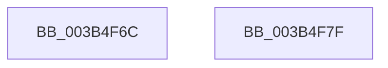

# MiMakeZeroedPageTables

- RVA: `0x003B4F6C`–`0x003B4F80` (길이 `20` bytes)
- VA: `0x00000001403B4F6C`
- 실행 섹션: `.text`
- PDB 이름 있음: `예`; PDB Function 태그: `아니요`
- unwind 정보 RVA: `0x0005D2F4`
- 디코드: `6`개 명령, `20/20` bytes 표시
- 미해석 바이트: `0` (있으면 어셈블리에 `.byte`로 보존)

> 이 문서는 커널 이미지의 기계어와 PDB 기호를 분석해 생성했습니다. 4번과 5번은 함수 원형과 자료형을 바이너리 사용 방식에서 추정한 C 해석이며 원본 소스 복구 결과는 아닙니다.

## 1. Dependencies

- 직접 호출 지점: **1**; 고유 호출 대상: **1**
- 직접 호출자로 확인된 함수: **11**
- RIP 상대 이미지 참조: **0**

### Outgoing calls
- `0x003B4F75` → [MiMakeZeroedPageTablesEx](MiMakeZeroedPageTablesEx_function_003B59FC.md) (function, `0x003B59FC`)

### Direct callers
- [MiExpandSystemCache](MiExpandSystemCache_function_003B3DC8.md) at `0x003B3E65`
- [MiSplitBitmapPages](MiSplitBitmapPages_function_003B4A34.md) at `0x003B4AA1`
- [MiExpandPtes](MiExpandPtes_function_003B4B78.md) at `0x003B4C74`
- [MiInitializeDynamicBitmap](../67/MiInitializeDynamicBitmap_function_0067F5BC.md) at `0x0067F663`
- [MiApplyHotPatchToLoadedDriver](../../page/80/MiApplyHotPatchToLoadedDriver_function_00802078.md) at `0x00802123`
- [MiExpandPartitionIds](../../page/80/MiExpandPartitionIds_function_0080D258.md) at `0x0080D354`
- [MiAllocateKernelCfgBitmapPageTables](../../page/A4/MiAllocateKernelCfgBitmapPageTables_function_00A4B80C.md) at `0x00A4B87D`
- [MiReserveDriverPtes](../../page/A7/MiReserveDriverPtes_function_00A75150.md) at `0x00A752E0`
- [MiReserveExistingDriverPtes](../../page/AF/MiReserveExistingDriverPtes_function_00AF84DC.md) at `0x00AF85FD`
- [MiInitializeKernelCfg](../../init/C6/MiInitializeKernelCfg_function_00C6A2FC.md) at `0x00C6A3BC`
- [MiCreateTopLevelUltraMappings](../../init/C6/MiCreateTopLevelUltraMappings_function_00C6CCB0.md) at `0x00C6CD0B`

### Static image references
- 디코드된 RIP-relative 메모리 참조가 없습니다.

## 2. Other-region calls and transfers

- 다른 실행 섹션으로 향하는 call: **0**
- 별도 외부 분기/꼬리 이동을 확인하지 못했습니다.

## 3. Assembly (complete function range)

```asm
003B4F6C  48 83 EC 38                     sub rsp, 0x38
003B4F70  83 64 24 20 00                  and dword ptr [rsp + 0x20], 0
003B4F75  E8 82 0A 00 00                  call 0x1403b59fc
003B4F7A  48 83 C4 38                     add rsp, 0x38
003B4F7E  C3                              ret
003B4F7F  CC                              int3
```

## 4. C-style interpretation (structured pseudocode)

```c
__int64 __fastcall MiMakeZeroedPageTables(void)
{
    __int64 result;
    __int64 v_rsp;
    unsigned int v_stack_m18;

    v_rsp = (v_rsp) - (56);
    result = MiMakeZeroedPageTablesEx(a1, a2, a3, a4);
    v_rsp = (v_rsp) + (56);
    return result;
}
```

## 5. (Beta) C Style

```c
void MiMakeZeroedPageTables(void)
{
    int64_t result;
    int64_t local_rsp;
    uint32_t v_stack_m18;

    local_rsp = (local_rsp) - (56);
    result = MiMakeZeroedPageTablesEx(a1, a2, a3, a4);
    local_rsp = (local_rsp) + (56);
    return result;
}
```

## 6. Execution-region graph

[열기: 2D/3D 그래프와 함수 탐색 컨트롤 패널](../../../control-panel.html?section=text&rva=0x003B4F6C&view=graph)

- 2D 그래프는 위에서 아래로 흐르고, 3D 그래프는 빈 공간을 드래그해 회전합니다. Shift+드래그는 이동, 휠은 확대·축소, 함수 노드 선택은 대상 보고서 이동입니다.

### Static fallback


