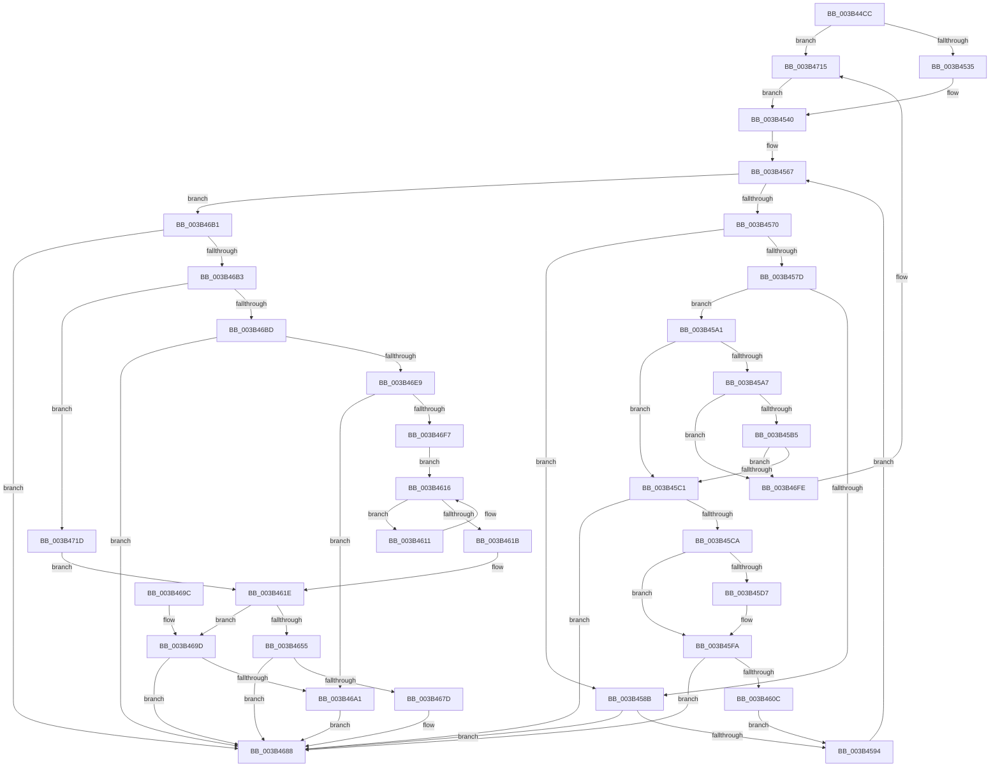

# MiMapContiguousMemoryLarge

- RVA: `0x003B44CC`–`0x003B4725` (길이 `601` bytes)
- VA: `0x00000001403B44CC`
- 실행 섹션: `.text`
- PDB 이름 있음: `예`; PDB Function 태그: `아니요`
- unwind 정보 RVA: `0x0008C584`
- 디코드: `168`개 명령, `601/601` bytes 표시
- 미해석 바이트: `0` (있으면 어셈블리에 `.byte`로 보존)

> 이 문서는 커널 이미지의 기계어와 PDB 기호를 분석해 생성했습니다. 4번과 5번은 함수 원형과 자료형을 바이너리 사용 방식에서 추정한 C 해석이며 원본 소스 복구 결과는 아닙니다.

## 1. Dependencies

- 직접 호출 지점: **8**; 고유 호출 대상: **8**
- 직접 호출자로 확인된 함수: **1**
- RIP 상대 이미지 참조: **2**

### Outgoing calls
- `0x003B4503` → [MiProtectionToCacheAttribute](../2B/MiProtectionToCacheAttribute_function_002B8530.md) (function, `0x002B8530`)
- `0x003B45DD` → [MiAssignInitialPageAttribute](MiAssignInitialPageAttribute_function_003B472C.md) (function, `0x003B472C`)
- `0x003B4621` → [MiPageToNode](../33/MiPageToNode_function_00338CD0.md) (function, `0x00338CD0`)
- `0x003B4648` → [MiGetPageTablesForLargeMap](MiGetPageTablesForLargeMap_function_003B48D4.md) (function, `0x003B48D4`)
- `0x003B4673` → [MiMapWithLargePages](MiMapWithLargePages_function_003B6624.md) (function, `0x003B6624`)
- `0x003B46AA` → [MiDereferenceIoPages](../2A/MiDereferenceIoPages_function_002AB1B0.md) (function, `0x002AB1B0`)
- `0x003B46E0` → [MiReferenceIoPages](../23/MiReferenceIoPages_function_0023C804.md) (function, `0x0023C804`)
- `0x003B470F` → [KeBugCheckEx](../4F/KeBugCheckEx_function_004FD660.md) (function, `0x004FD660`)

### Direct callers
- [sub_006E1C04](../6E/Unknown_function_006E1C04.md) at `0x006E1C2C`

### Static image references
- `0x003B4524` → RVA `0x00E2DCE0` (`.data`; read)
- `0x003B4659` → RVA `0x00E38200` (`.data`; read)

## 2. Other-region calls and transfers

- 다른 실행 섹션으로 향하는 call: **0**
- 별도 외부 분기/꼬리 이동을 확인하지 못했습니다.

## 3. Assembly (complete function range)

```asm
003B44CC  44 89 4C 24 20                  mov dword ptr [rsp + 0x20], r9d
003B44D1  44 89 44 24 18                  mov dword ptr [rsp + 0x18], r8d
003B44D6  53                              push rbx
003B44D7  55                              push rbp
003B44D8  56                              push rsi
003B44D9  57                              push rdi
003B44DA  41 54                           push r12
003B44DC  41 55                           push r13
003B44DE  41 56                           push r14
003B44E0  41 57                           push r15
003B44E2  48 83 EC 58                     sub rsp, 0x58
003B44E6  48 8B 84 24 C0 00 00 00         mov rax, qword ptr [rsp + 0xc0]
003B44EE  48 8B F9                        mov rdi, rcx
003B44F1  45 33 DB                        xor r11d, r11d
003B44F4  41 8B C8                        mov ecx, r8d
003B44F7  45 8B D1                        mov r10d, r9d
003B44FA  48 8B F2                        mov rsi, rdx
003B44FD  45 8B EB                        mov r13d, r11d
003B4500  44 89 18                        mov dword ptr [rax], r11d
003B4503  E8 28 40 F0 FF                  call 0x1402b8530
003B4508  48 8D 0C 7F                     lea rcx, [rdi + rdi*2]
003B450C  89 84 24 A0 00 00 00            mov dword ptr [rsp + 0xa0], eax
003B4513  48 C1 E1 04                     shl rcx, 4
003B4517  44 8B C8                        mov r9d, eax
003B451A  48 B8 28 00 00 00 00 DE FF FF   movabs rax, 0xffffde0000000028
003B4524  48 3B 3D B5 97 A7 00            cmp rdi, qword ptr [rip + 0xa797b5]
003B452B  4C 8D 24 01                     lea r12, [rcx + rax]
003B452F  0F 87 E0 01 00 00               ja 0x1403b4715
003B4535  49 8B 1C 24                     mov rbx, qword ptr [r12]
003B4539  48 C1 EB 36                     shr rbx, 0x36
003B453D  83 E3 01                        and ebx, 1
003B4540  8B C3                           mov eax, ebx
003B4542  48 BA 00 00 00 00 00 DE FF FF   movabs rdx, 0xffffde0000000000
003B454C  48 03 CA                        add rcx, rdx
003B454F  BD 03 00 00 00                  mov ebp, 3
003B4554  F7 D8                           neg eax
003B4556  4D 8B FB                        mov r15, r11
003B4559  48 1B D2                        sbb rdx, rdx
003B455C  48 23 D1                        and rdx, rcx
003B455F  48 89 54 24 48                  mov qword ptr [rsp + 0x48], rdx
003B4564  4C 8B F2                        mov r14, rdx
003B4567  4C 3B FE                        cmp r15, rsi
003B456A  0F 83 41 01 00 00               jae 0x1403b46b1
003B4570  4D 8D 04 3F                     lea r8, [r15 + rdi]
003B4574  4C 3B 05 65 97 A7 00            cmp r8, qword ptr [rip + 0xa79765]
003B457B  77 0E                           ja 0x1403b458b
003B457D  49 8B 04 24                     mov rax, qword ptr [r12]
003B4581  48 C1 E8 36                     shr rax, 0x36
003B4585  0F BA E0 00                     bt eax, 0
003B4589  72 16                           jb 0x1403b45a1
003B458B  48 85 D2                        test rdx, rdx
003B458E  0F 85 F4 00 00 00               jne 0x1403b4688
003B4594  49 FF C7                        inc r15
003B4597  49 83 C4 30                     add r12, 0x30
003B459B  49 83 C6 30                     add r14, 0x30
003B459F  EB C6                           jmp 0x1403b4567
003B45A1  41 F6 C2 02                     test r10b, 2
003B45A5  74 1A                           je 0x1403b45c1
003B45A7  41 8A 46 22                     mov al, byte ptr [r14 + 0x22]
003B45AB  24 07                           and al, 7
003B45AD  3C 05                           cmp al, 5
003B45AF  0F 85 49 01 00 00               jne 0x1403b46fe
003B45B5  49 0F BA 66 28 35               bt qword ptr [r14 + 0x28], 0x35
003B45BB  0F 83 3D 01 00 00               jae 0x1403b46fe
003B45C1  48 85 D2                        test rdx, rdx
003B45C4  0F 84 BE 00 00 00               je 0x1403b4688
003B45CA  41 8B 46 20                     mov eax, dword ptr [r14 + 0x20]
003B45CE  C1 E8 10                        shr eax, 0x10
003B45D1  24 C0                           and al, 0xc0
003B45D3  3C C0                           cmp al, 0xc0
003B45D5  75 23                           jne 0x1403b45fa
003B45D7  41 8B D1                        mov edx, r9d
003B45DA  49 8B CE                        mov rcx, r14
003B45DD  E8 4A 01 00 00                  call 0x1403b472c
003B45E2  48 8B 54 24 48                  mov rdx, qword ptr [rsp + 0x48]
003B45E7  45 33 DB                        xor r11d, r11d
003B45EA  44 8B 8C 24 A0 00 00 00         mov r9d, dword ptr [rsp + 0xa0]
003B45F2  44 8B 94 24 B8 00 00 00         mov r10d, dword ptr [rsp + 0xb8]
003B45FA  41 8B 46 20                     mov eax, dword ptr [r14 + 0x20]
003B45FE  C1 E8 10                        shr eax, 0x10
003B4601  0F B6 C8                        movzx ecx, al
003B4604  C1 E9 06                        shr ecx, 6
003B4607  41 3B C9                        cmp ecx, r9d
003B460A  75 7C                           jne 0x1403b4688
003B460C  41 8B E9                        mov ebp, r9d
003B460F  EB 83                           jmp 0x1403b4594
003B4611  41 03 EC                        add ebp, r12d
003B4614  D1 EA                           shr edx, 1
003B4616  41 84 D4                        test r12b, dl
003B4619  74 F6                           je 0x1403b4611
003B461B  45 8B F4                        mov r14d, r12d
003B461E  48 8B CF                        mov rcx, rdi
003B4621  E8 AA 46 F8 FF                  call 0x140338cd0
003B4626  44 8B BC 24 B0 00 00 00         mov r15d, dword ptr [rsp + 0xb0]
003B462E  45 8B C4                        mov r8d, r12d
003B4631  41 8B CF                        mov ecx, r15d
003B4634  80 E1 18                        and cl, 0x18
003B4637  F6 D9                           neg cl
003B4639  45 8D 0C 04                     lea r9d, [r12 + rax]
003B463D  48 8B CE                        mov rcx, rsi
003B4640  1B D2                           sbb edx, edx
003B4642  83 E2 FE                        and edx, 0xfffffffe
003B4645  83 C2 08                        add edx, 8
003B4648  E8 87 02 00 00                  call 0x1403b48d4
003B464D  4C 8B E8                        mov r13, rax
003B4650  48 85 C0                        test rax, rax
003B4653  74 48                           je 0x1403b469d
003B4655  89 6C 24 30                     mov dword ptr [rsp + 0x30], ebp
003B4659  48 8D 0D A0 3B A8 00            lea rcx, [rip + 0xa83ba0]
003B4660  44 89 7C 24 28                  mov dword ptr [rsp + 0x28], r15d
003B4665  4C 8B CE                        mov r9, rsi
003B4668  4C 8B C7                        mov r8, rdi
003B466B  44 89 64 24 20                  mov dword ptr [rsp + 0x20], r12d
003B4670  48 8B D0                        mov rdx, rax
003B4673  E8 AC 1F 00 00                  call 0x1403b6624
003B4678  45 85 F6                        test r14d, r14d
003B467B  74 0B                           je 0x1403b4688
003B467D  48 8B 84 24 C0 00 00 00         mov rax, qword ptr [rsp + 0xc0]
003B4685  44 09 20                        or dword ptr [rax], r12d
003B4688  49 8B C5                        mov rax, r13
003B468B  48 83 C4 58                     add rsp, 0x58
003B468F  41 5F                           pop r15
003B4691  41 5E                           pop r14
003B4693  41 5D                           pop r13
003B4695  41 5C                           pop r12
003B4697  5F                              pop rdi
003B4698  5E                              pop rsi
003B4699  5D                              pop rbp
003B469A  5B                              pop rbx
003B469B  C3                              ret
003B469C  CC                              int3
003B469D  85 DB                           test ebx, ebx
003B469F  75 E7                           jne 0x1403b4688
003B46A1  4C 8B C6                        mov r8, rsi
003B46A4  48 8B D7                        mov rdx, rdi
003B46A7  41 8B CC                        mov ecx, r12d
003B46AA  E8 01 6B EF FF                  call 0x1402ab1b0
003B46AF  EB D7                           jmp 0x1403b4688
003B46B1  75 D5                           jne 0x1403b4688
003B46B3  41 BC 01 00 00 00               mov r12d, 1
003B46B9  85 DB                           test ebx, ebx
003B46BB  75 60                           jne 0x1403b471d
003B46BD  48 8D 84 24 A0 00 00 00         lea rax, [rsp + 0xa0]
003B46C5  4C 89 5C 24 28                  mov qword ptr [rsp + 0x28], r11
003B46CA  4C 8B C6                        mov r8, rsi
003B46CD  48 89 44 24 20                  mov qword ptr [rsp + 0x20], rax
003B46D2  48 8B D7                        mov rdx, rdi
003B46D5  44 89 9C 24 A0 00 00 00         mov dword ptr [rsp + 0xa0], r11d
003B46DD  41 8B CC                        mov ecx, r12d
003B46E0  E8 1F 81 E8 FF                  call 0x14023c804
003B46E5  85 C0                           test eax, eax
003B46E7  78 9F                           js 0x1403b4688
003B46E9  8B 94 24 A0 00 00 00            mov edx, dword ptr [rsp + 0xa0]
003B46F0  8D 42 FF                        lea eax, [rdx - 1]
003B46F3  85 C2                           test edx, eax
003B46F5  75 AA                           jne 0x1403b46a1
003B46F7  33 ED                           xor ebp, ebp
003B46F9  E9 18 FF FF FF                  jmp 0x1403b4616
003B46FE  45 33 C9                        xor r9d, r9d
003B4701  4C 89 5C 24 20                  mov qword ptr [rsp + 0x20], r11
003B4706  BA 46 12 00 00                  mov edx, 0x1246
003B470B  41 8D 49 1A                     lea ecx, [r9 + 0x1a]
003B470F  E8 4C 8F 14 00                  call 0x1404fd660
003B4714  CC                              int3
003B4715  41 8B DB                        mov ebx, r11d
003B4718  E9 23 FE FF FF                  jmp 0x1403b4540
003B471D  45 8B F5                        mov r14d, r13d
003B4720  E9 F9 FE FF FF                  jmp 0x1403b461e
```

## 4. C-style interpretation (structured pseudocode)

```c
__int64 __fastcall MiMapContiguousMemoryLarge(__int64 a1, __int64 a2, int a3, int a4, __int64 a5)
{
    __int64 result;
    __int64 v_r10;
    __int64 v_r11;
    __int64 v_r12;
    __int64 v_r14;
    __int64 v_r15;
    __int64 v_rbp;
    __int64 v_rbx;
    __int64 v_rsp;
    unsigned __int64 v_stack_m50;
    unsigned int v_stack_m68;
    unsigned int v_stack_m70;
    unsigned int v_stack_m78;
    unsigned int v_stack_p18;
    unsigned int v_stack_p20;
    unsigned __int64 v_stack_p28;
    unsigned int v_stack_p8;
    unsigned __int64 v_stack_pA0;

    v_stack_p20 = a4;
    v_stack_p18 = a3;
    v_rsp = (v_rsp) - (88);
    v_r11 = 0;
    *(unsigned int *)(a5) = 0;
    result = MiProtectionToCacheAttribute((unsigned int)(a3), a2, a3, a4);
    v_stack_p8 = (unsigned int)(result);
    a1 = (a1 + a1 * 2) << (4);
    if (a1 > (*(unsigned __int64 *)(v_rip + 10983349))) goto loc_003B4715;
    v_rbx = (*(unsigned __int64 *)(a1 + result * 1)) >> (54);
    v_rbx = (unsigned int)((v_rbx) & (1));
loc_003B4540:
    a1 = (a1) + (a2);
    result = (unsigned int)(-((unsigned int)((unsigned int)(v_rbx))));
    a2 = (a2) & (a1);
    v_stack_m50 = a2;
loc_003B4567:
    if (0 >= a2) goto loc_003B46B1;
    if ((0 + a1 * 1) > (*(unsigned __int64 *)(v_rip + 10983269))) goto loc_003B458B;
    result = (*(unsigned __int64 *)(a1 + result * 1)) >> (54);
    if (condition_is_below) goto loc_003B45A1;
loc_003B458B:
    if (a2 != 0) goto loc_003B4688;
loc_003B4594:
    v_r15 = (0) + 1;
    v_r12 = (a1 + result * 1) + (48);
    v_r14 = (a2) + (48);
    goto loc_003B4567;
loc_003B45A1:
    if ((((unsigned __int8)((unsigned int)(a4))) & (2)) == 0) goto loc_003B45C1;
    result = (unsigned __int8)((*(unsigned __int8 *)(v_r14 + 34)) & (7));
    if (((unsigned __int8)(result)) != 5) goto loc_003B46FE;
    if (((unsigned __int8)(result)) >= 5) goto loc_003B46FE;
loc_003B45C1:
    if (a2 == 0) goto loc_003B4688;
    result = (unsigned int)(((unsigned int)(*(unsigned int *)(v_r14 + 32))) >> (16));
    result = (unsigned __int8)((result) & (192));
    v_r10 = (unsigned int)(a4);
    if (((unsigned __int8)(result)) == 192) {
        a2 = (unsigned int)((unsigned int)((unsigned int)(result)));
        a1 = v_r14;
        result = MiAssignInitialPageAttribute(a1, a2, 0 + a1 * 1, (unsigned int)((unsigned int)(result)));
        a2 = v_stack_m50;
        v_r11 = 0;
        a4 = v_stack_p8;
        v_r10 = v_stack_p20;
    }
    result = (unsigned int)(((unsigned int)(*(unsigned int *)(v_r14 + 32))) >> (16));
    a1 = (unsigned int)(((unsigned __int8)(result)) >> (6));
    if (((unsigned int)(a1)) != a4) goto loc_003B4688;
    goto loc_003B4594;
loc_003B4611:
    v_rbp = (unsigned int)(((unsigned int)(a4)) + ((unsigned int)(v_r12)));
    a2 = (unsigned int)((a2) >> (1));
loc_003B4616:
    if ((((unsigned __int8)(v_r12)) & ((unsigned __int8)(a2))) == 0) goto loc_003B4611;
loc_003B461E:
    result = MiPageToNode(a1, a2, 0 + a1 * 1, a4);
    a1 = (unsigned __int8)(((unsigned int)((unsigned int)((unsigned int)(v_stack_p18)))) & (24));
    a1 = (unsigned __int8)(-(a1));
    a2 = (unsigned int)((a2) & (0xFFFFFFFEULL));
    a2 = (unsigned int)((a2) + (8));
    result = MiGetPageTablesForLargeMap(a2, a2, (unsigned int)((unsigned int)(v_r12)), v_r12 + result * 1);
    if (result == 0) goto loc_003B469D;
    v_stack_m68 = (unsigned int)(v_rbp);
    v_stack_m70 = (unsigned int)((unsigned int)(v_stack_p18));
    v_stack_m78 = (unsigned int)(v_r12);
    result = MiMapWithLargePages(v_rip + 11025312, result, a1, a2);
    if ((unsigned int)((unsigned int)((unsigned int)(v_r12))) != 0) {
        result = a5;
    }
    v_rsp = (v_rsp) + (88);
    return result;
loc_003B469D:
    if ((unsigned int)(v_rbx) != 0) goto loc_003B4688;
loc_003B46A1:
    result = MiDereferenceIoPages((unsigned int)((unsigned int)(v_r12)), a1, a2, a2);
    goto loc_003B4688;
loc_003B46B1:
    if ((unsigned int)(v_rbx) != 0) goto loc_003B4688;
    if ((unsigned int)(v_rbx) != 0) goto loc_003B471D;
    v_stack_p28 = 0;
    v_stack_p20 = v_stack_pA0;
    v_stack_pA0 = 0;
    result = MiReferenceIoPages(1, a1, a2, a2);
    if (sign_flag) goto loc_003B4688;
    if ((((unsigned int)((unsigned int)(v_stack_pA0))) & ((unsigned int)((unsigned int)(v_stack_pA0) - 1))) != 0) goto loc_003B46A1;
    v_rbp = 0;
    goto loc_003B4616;
loc_003B46FE:
    a4 = 0;
    v_stack_p20 = 0;
    result = KeBugCheckEx(a4 + 26, (unsigned int)(0x1246ULL), a2, a4);
loc_003B4715:
    goto loc_003B4540;
loc_003B471D:
    goto loc_003B461E;
}
```

## 5. (Beta) C Style

```c
int64_t MiMapContiguousMemoryLarge(void *Arg1, int64_t Arg2, int32_t Arg3, int32_t Arg4, void *Arg5)
{
    uint8_t *arg1 = (uint8_t *)Arg1;
    uint8_t *arg5 = (uint8_t *)Arg5;

    int64_t result;
    int64_t local_r10;
    int64_t local_r11;
    int64_t local_r12;
    int64_t local_r14;
    int64_t local_r15;
    int64_t local_rbp;
    int64_t local_rbx;
    int64_t local_rsp;
    uint64_t v_stack_m50;
    uint32_t v_stack_m68;
    uint32_t v_stack_m70;
    uint32_t v_stack_m78;
    uint32_t v_stack_p18;
    uint32_t v_stack_p20;
    uint64_t v_stack_p28;
    uint32_t v_stack_p8;
    uint64_t v_stack_pA0;

    v_stack_p20 = Arg4;
    v_stack_p18 = Arg3;
    local_rsp = (local_rsp) - (88);
    local_r11 = 0;
    *(uint32_t *)(arg5) = 0;
    result = MiProtectionToCacheAttribute((uint32_t)(Arg3), Arg2, Arg3, Arg4);
    v_stack_p8 = (uint32_t)(result);
    Arg1 = (Arg1 + Arg1 * 2) << (4);
    if (Arg1 > (*(uint64_t *)(v_rip + 0xA797B5))) goto loc_003B4715;
    local_rbx = (*(uint64_t *)(arg1 + result * 1)) >> (54);
    local_rbx = (uint32_t)((local_rbx) & (1));
loc_003B4540:
    Arg1 = (Arg1) + (Arg2);
    result = (uint32_t)(-((uint32_t)((uint32_t)(local_rbx))));
    Arg2 = (Arg2) & (Arg1);
    v_stack_m50 = Arg2;
loc_003B4567:
    if (0 >= Arg2) goto loc_003B46B1;
    if ((0 + Arg1 * 1) > (*(uint64_t *)(v_rip + 0xA79765))) goto loc_003B458B;
    result = (*(uint64_t *)(arg1 + result * 1)) >> (54);
    if (condition_is_below) goto loc_003B45A1;
loc_003B458B:
    if (Arg2 != 0) goto loc_003B4688;
loc_003B4594:
    local_r15 = (0) + 1;
    local_r12 = (Arg1 + result * 1) + (48);
    local_r14 = (Arg2) + (48);
    goto loc_003B4567;
loc_003B45A1:
    if ((((uint8_t)((uint32_t)(Arg4))) & (2)) == 0) goto loc_003B45C1;
    result = (uint8_t)((*(uint8_t *)(local_r14 + 0x22)) & (7));
    if (((uint8_t)(result)) != 5) goto loc_003B46FE;
    if (((uint8_t)(result)) >= 5) goto loc_003B46FE;
loc_003B45C1:
    if (Arg2 == 0) goto loc_003B4688;
    result = (uint32_t)(((uint32_t)(*(uint32_t *)(local_r14 + 0x20))) >> (16));
    result = (uint8_t)((result) & (192));
    local_r10 = (uint32_t)(Arg4);
    if (((uint8_t)(result)) == 192) {
        Arg2 = (uint32_t)((uint32_t)((uint32_t)(result)));
        Arg1 = local_r14;
        result = MiAssignInitialPageAttribute(Arg1, Arg2, 0 + Arg1 * 1, (uint32_t)((uint32_t)(result)));
        Arg2 = v_stack_m50;
        local_r11 = 0;
        Arg4 = v_stack_p8;
        local_r10 = v_stack_p20;
    }
    result = (uint32_t)(((uint32_t)(*(uint32_t *)(local_r14 + 0x20))) >> (16));
    Arg1 = (uint32_t)(((uint8_t)(result)) >> (6));
    if (((uint32_t)(Arg1)) != Arg4) goto loc_003B4688;
    goto loc_003B4594;
loc_003B4611:
    local_rbp = (uint32_t)(((uint32_t)(Arg4)) + ((uint32_t)(local_r12)));
    Arg2 = (uint32_t)((Arg2) >> (1));
loc_003B4616:
    if ((((uint8_t)(local_r12)) & ((uint8_t)(Arg2))) == 0) goto loc_003B4611;
loc_003B461E:
    result = MiPageToNode(Arg1, Arg2, 0 + Arg1 * 1, Arg4);
    Arg1 = (uint8_t)(((uint32_t)((uint32_t)((uint32_t)(v_stack_p18)))) & (24));
    Arg1 = (uint8_t)(-(Arg1));
    Arg2 = (uint32_t)((Arg2) & (0xFFFFFFFEULL));
    Arg2 = (uint32_t)((Arg2) + (8));
    result = MiGetPageTablesForLargeMap(Arg2, Arg2, (uint32_t)((uint32_t)(local_r12)), local_r12 + result * 1);
    if (result == 0) goto loc_003B469D;
    v_stack_m68 = (uint32_t)(local_rbp);
    v_stack_m70 = (uint32_t)((uint32_t)(v_stack_p18));
    v_stack_m78 = (uint32_t)(local_r12);
    result = MiMapWithLargePages(v_rip + 11025312, result, Arg1, Arg2);
    if ((uint32_t)((uint32_t)((uint32_t)(local_r12))) != 0) {
        result = Arg5;
    }
    local_rsp = (local_rsp) + (88);
    return result;
loc_003B469D:
    if ((uint32_t)(local_rbx) != 0) goto loc_003B4688;
loc_003B46A1:
    result = MiDereferenceIoPages((uint32_t)((uint32_t)(local_r12)), Arg1, Arg2, Arg2);
    goto loc_003B4688;
loc_003B46B1:
    if ((uint32_t)(local_rbx) != 0) goto loc_003B4688;
    if ((uint32_t)(local_rbx) != 0) goto loc_003B471D;
    v_stack_p28 = 0;
    v_stack_p20 = v_stack_pA0;
    v_stack_pA0 = 0;
    result = MiReferenceIoPages(1, Arg1, Arg2, Arg2);
    if (sign_flag) goto loc_003B4688;
    if ((((uint32_t)((uint32_t)(v_stack_pA0))) & ((uint32_t)((uint32_t)(v_stack_pA0) - 1))) != 0) goto loc_003B46A1;
    local_rbp = 0;
    goto loc_003B4616;
loc_003B46FE:
    Arg4 = 0;
    v_stack_p20 = 0;
    result = KeBugCheckEx(Arg4 + 26, (uint32_t)(0x1246ULL), Arg2, Arg4);
loc_003B4715:
    goto loc_003B4540;
loc_003B471D:
    goto loc_003B461E;
}
```

### 관측된 메모리 오프셋

구조체 형식이 확인되지 않은 접근은 인자 기준의 오프셋으로만 기록했습니다.

| 기준 인자 | 오프셋 표현 | 폭 (bit) | 접근 |
|---|---:|---:|---|
| `Arg1` | `+ 0x0 + rdi*2` | `64` | `R` |
| `Arg5` | `+ 0x0` | `32` | `R/W` |
| `Arg5` | `+ 0x0` | `32` | `W` |

## 6. Execution-region graph

[열기: 2D/3D 그래프와 함수 탐색 컨트롤 패널](../../../control-panel.html?section=text&rva=0x003B44CC&view=graph)

- 2D 그래프는 위에서 아래로 흐르고, 3D 그래프는 빈 공간을 드래그해 회전합니다. Shift+드래그는 이동, 휠은 확대·축소, 함수 노드 선택은 대상 보고서 이동입니다.

### Static fallback


