# MiMapWithLargePages

- RVA: `0x003B6624`–`0x003B692D` (길이 `777` bytes)
- VA: `0x00000001403B6624`
- 실행 섹션: `.text`
- PDB 이름 있음: `예`; PDB Function 태그: `아니요`
- unwind 정보 RVA: `0x0008C75C`
- 디코드: `207`개 명령, `777/777` bytes 표시
- 미해석 바이트: `0` (있으면 어셈블리에 `.byte`로 보존)

> 이 문서는 커널 이미지의 기계어와 PDB 기호를 분석해 생성했습니다. 4번과 5번은 함수 원형과 자료형을 바이너리 사용 방식에서 추정한 C 해석이며 원본 소스 복구 결과는 아닙니다.

## 1. Dependencies

- 직접 호출 지점: **15**; 고유 호출 대상: **13**
- 직접 호출자로 확인된 함수: **2**
- RIP 상대 이미지 참조: **3**

### Outgoing calls
- `0x003B6731` → [MiMakeValidPte](../2C/MiMakeValidPte_function_002C5590.md) (function, `0x002C5590`)
- `0x003B6779` → [MiCheckLinearProtectedPteAccessedBit](../29/MiCheckLinearProtectedPteAccessedBit_function_00292D80.md) (function, `0x00292D80`)
- `0x003B67AF` → [MiGetLargePteAddress](../3D/MiGetLargePteAddress_function_003D3300.md) (function, `0x003D3300`)
- `0x003B67FF` → [MiLockWorkingSetExclusiveAtDpc](../23/MiLockWorkingSetExclusiveAtDpc_function_002395EC.md) (function, `0x002395EC`)
- `0x003B6806` → [MiLockWorkingSetExclusive](../32/MiLockWorkingSetExclusive_function_003238A0.md) (function, `0x003238A0`)
- `0x003B6816` → [MiLockWorkingSetSharedAtDpc](../23/MiLockWorkingSetSharedAtDpc_function_00239574.md) (function, `0x00239574`)
- `0x003B681D` → [MiLockWorkingSetShared](../27/MiLockWorkingSetShared_function_0027CBF0.md) (function, `0x0027CBF0`)
- `0x003B6854` → [MiFinishPageTableForLargePage](../4D/MiFinishPageTableForLargePage_function_004D3D4C.md) (function, `0x004D3D4C`)
- `0x003B6887` → [MiLockNestedPageTable](../23/MiLockNestedPageTable_function_0023E890.md) (function, `0x0023E890`)
- `0x003B689B` → [MiFinishPageTableForLargePage](../4D/MiFinishPageTableForLargePage_function_004D3D4C.md) (function, `0x004D3D4C`)
- `0x003B68AB` → [MI_READ_PTE_LOCK_FREE](../28/MI_READ_PTE_LOCK_FREE_function_002828A0.md) (function, `0x002828A0`)
- `0x003B68C5` → [MiWriteLargePte](../2C/MiWriteLargePte_function_002C6DE0.md) (function, `0x002C6DE0`)
- `0x003B68F8` → [MiFinishPageTableForLargePage](../4D/MiFinishPageTableForLargePage_function_004D3D4C.md) (function, `0x004D3D4C`)
- `0x003B6908` → [MiUnlockWorkingSetExclusive](../27/MiUnlockWorkingSetExclusive_function_0027EC70.md) (function, `0x0027EC70`)
- `0x003B690F` → [MiUnlockWorkingSetShared](../27/MiUnlockWorkingSetShared_function_0027D690.md) (function, `0x0027D690`)

### Direct callers
- [MiMapContiguousMemoryLarge](MiMapContiguousMemoryLarge_function_003B44CC.md) at `0x003B4673`
- [sub_006E710A](../6E/Unknown_function_006E710A.md) at `0x006E71D3`

### Static image references
- `0x003B6658` → RVA `0x00000000` (`image boundary/outside`; read)
- `0x003B66A2` → RVA `0x00E2DCE0` (`.data`; read)
- `0x003B6748` → RVA `0x00FC6A88` (`ALMOSTRO`; read)

## 2. Other-region calls and transfers

- 다른 실행 섹션으로 향하는 call: **0**
- 별도 외부 분기/꼬리 이동을 확인하지 못했습니다.

## 3. Assembly (complete function range)

```asm
003B6624  48 89 5C 24 20                  mov qword ptr [rsp + 0x20], rbx
003B6629  4C 89 44 24 18                  mov qword ptr [rsp + 0x18], r8
003B662E  48 89 54 24 10                  mov qword ptr [rsp + 0x10], rdx
003B6633  55                              push rbp
003B6634  56                              push rsi
003B6635  57                              push rdi
003B6636  41 54                           push r12
003B6638  41 55                           push r13
003B663A  41 56                           push r14
003B663C  41 57                           push r15
003B663E  48 8B EC                        mov rbp, rsp
003B6641  48 83 EC 40                     sub rsp, 0x40
003B6645  8B 7D 68                        mov edi, dword ptr [rbp + 0x68]
003B6648  4D 8B E8                        mov r13, r8
003B664B  83 65 FC 00                     and dword ptr [rbp - 4], 0
003B664F  4C 8B F9                        mov r15, rcx
003B6652  8B 4D 60                        mov ecx, dword ptr [rbp + 0x60]
003B6655  4C 8B C2                        mov r8, rdx
003B6658  48 8D 15 A1 99 C4 FF            lea rdx, [rip - 0x3b665f]
003B665F  49 C1 E8 09                     shr r8, 9
003B6663  48 B8 F8 FF FF FF 7F 00 00 00   movabs rax, 0x7ffffffff8
003B666D  4D 8B E1                        mov r12, r9
003B6670  4C 23 C0                        and r8, rax
003B6673  83 E7 07                        and edi, 7
003B6676  4C 8B 9C CA 60 1C 01 00         mov r11, qword ptr [rdx + rcx*8 + 0x11c60]
003B667E  8B 8C 8A E8 35 01 00            mov ecx, dword ptr [rdx + rcx*4 + 0x135e8]
003B6685  49 D3 EC                        shr r12, cl
003B6688  4D 8B D4                        mov r10, r12
003B668B  4C 89 5D 40                     mov qword ptr [rbp + 0x40], r11
003B668F  49 D3 E2                        shl r10, cl
003B6692  48 B8 00 00 00 00 80 F6 FF FF   movabs rax, 0xfffff68000000000
003B669C  48 8B C0                        mov rax, rax
003B669F  4C 03 C0                        add r8, rax
003B66A2  4C 3B 2D 37 76 A7 00            cmp r13, qword ptr [rip + 0xa77637]
003B66A9  77 4A                           ja 0x1403b66f5
003B66AB  4A 8D 0C 6D 00 00 00 00         lea rcx, [r13*2]
003B66B3  49 03 CD                        add rcx, r13
003B66B6  48 03 C9                        add rcx, rcx
003B66B9  48 B8 28 00 00 00 00 DE FF FF   movabs rax, 0xffffde0000000028
003B66C3  48 8B 04 C8                     mov rax, qword ptr [rax + rcx*8]
003B66C7  48 C1 E8 36                     shr rax, 0x36
003B66CB  0F BA E0 00                     bt eax, 0
003B66CF  73 24                           jae 0x1403b66f5
003B66D1  48 B8 20 00 00 00 00 DE FF FF   movabs rax, 0xffffde0000000020
003B66DB  8B 04 C8                        mov eax, dword ptr [rax + rcx*8]
003B66DE  C1 E8 10                        shr eax, 0x10
003B66E1  0F B6 C8                        movzx ecx, al
003B66E4  C1 E9 06                        shr ecx, 6
003B66E7  85 C9                           test ecx, ecx
003B66E9  75 05                           jne 0x1403b66f0
003B66EB  83 CF 08                        or edi, 8
003B66EE  EB 19                           jmp 0x1403b6709
003B66F0  83 F9 02                        cmp ecx, 2
003B66F3  EB 0F                           jmp 0x1403b6704
003B66F5  8B 45 70                        mov eax, dword ptr [rbp + 0x70]
003B66F8  85 C0                           test eax, eax
003B66FA  75 05                           jne 0x1403b6701
003B66FC  83 CF 10                        or edi, 0x10
003B66FF  EB 08                           jmp 0x1403b6709
003B6701  83 F8 02                        cmp eax, 2
003B6704  75 03                           jne 0x1403b6709
003B6706  83 CF 18                        or edi, 0x18
003B6709  33 D2                           xor edx, edx
003B670B  49 8B C1                        mov rax, r9
003B670E  49 F7 F3                        div r11
003B6711  81 CF 00 00 00 A0               or edi, 0xa0000000
003B6717  48 85 D2                        test rdx, rdx
003B671A  0F 84 88 00 00 00               je 0x1403b67a8
003B6720  4B 8D 34 D0                     lea rsi, [r8 + r10*8]
003B6724  33 C9                           xor ecx, ecx
003B6726  4F 8D 34 C8                     lea r14, [r8 + r9*8]
003B672A  44 8B C7                        mov r8d, edi
003B672D  4B 8D 14 2A                     lea rdx, [r10 + r13]
003B6731  E8 5A EE F0 FF                  call 0x1402c5590
003B6736  48 8B D8                        mov rbx, rax
003B6739  49 3B F6                        cmp rsi, r14
003B673C  73 6A                           jae 0x1403b67a8
003B673E  49 BD 00 00 00 00 80 F6 FF FF   movabs r13, 0xfffff68000000000
003B6748  48 0F BA 25 37 03 C1 00 24      bt qword ptr [rip + 0xc10337], 0x24
003B6751  73 2B                           jae 0x1403b677e
003B6753  F6 C3 20                        test bl, 0x20
003B6756  75 26                           jne 0x1403b677e
003B6758  49 8B C5                        mov rax, r13
003B675B  48 B9 00 00 00 00 40 00 00 00   movabs rcx, 0x4000000000
003B6765  48 03 C1                        add rax, rcx
003B6768  48 3B F0                        cmp rsi, rax
003B676B  72 11                           jb 0x1403b677e
003B676D  41 B8 80 00 00 00               mov r8d, 0x80
003B6773  48 8B D3                        mov rdx, rbx
003B6776  48 8B CE                        mov rcx, rsi
003B6779  E8 02 C6 ED FF                  call 0x140292d80
003B677E  48 89 1E                        mov qword ptr [rsi], rbx
003B6781  48 8D 8B 00 10 00 00            lea rcx, [rbx + 0x1000]
003B6788  48 33 D9                        xor rbx, rcx
003B678B  48 BA FF 0F 00 00 00 00 F0 FF   movabs rdx, 0xfff0000000000fff
003B6795  48 23 DA                        and rbx, rdx
003B6798  48 83 C6 08                     add rsi, 8
003B679C  48 33 D9                        xor rbx, rcx
003B679F  49 3B F6                        cmp rsi, r14
003B67A2  72 A4                           jb 0x1403b6748
003B67A4  4C 8B 6D 50                     mov r13, qword ptr [rbp + 0x50]
003B67A8  8B 55 60                        mov edx, dword ptr [rbp + 0x60]
003B67AB  48 8B 4D 48                     mov rcx, qword ptr [rbp + 0x48]
003B67AF  E8 4C CB 01 00                  call 0x1403d3300
003B67B4  48 83 65 F0 00                  and qword ptr [rbp - 0x10], 0
003B67B9  48 8D 0D 40 98 C4 FF            lea rcx, [rip - 0x3b67c0]
003B67C0  83 65 F8 00                     and dword ptr [rbp - 8], 0
003B67C4  4C 8B F0                        mov r14, rax
003B67C7  8B 45 60                        mov eax, dword ptr [rbp + 0x60]
003B67CA  33 F6                           xor esi, esi
003B67CC  0F BA EF 1A                     bts edi, 0x1a
003B67D0  4C 89 7D E0                     mov qword ptr [rbp - 0x20], r15
003B67D4  48 89 75 E8                     mov qword ptr [rbp - 0x18], rsi
003B67D8  4C 0F AF A4 C1 A8 45 01 00      imul r12, qword ptr [rcx + rax*8 + 0x145a8]
003B67E1  4F 8D 24 E6                     lea r12, [r14 + r12*8]
003B67E5  4C 89 65 50                     mov qword ptr [rbp + 0x50], r12
003B67E9  44 0F 20 C0                     mov rax, cr8
003B67ED  83 7D 60 01                     cmp dword ptr [rbp + 0x60], 1
003B67F1  49 8B CF                        mov rcx, r15
003B67F4  73 17                           jae 0x1403b680d
003B67F6  3C 02                           cmp al, 2
003B67F8  75 0C                           jne 0x1403b6806
003B67FA  B3 11                           mov bl, 0x11
003B67FC  88 5D 68                        mov byte ptr [rbp + 0x68], bl
003B67FF  E8 E8 2D E8 FF                  call 0x1402395ec
003B6804  EB 21                           jmp 0x1403b6827
003B6806  E8 95 D0 F6 FF                  call 0x1403238a0
003B680B  EB 15                           jmp 0x1403b6822
003B680D  3C 02                           cmp al, 2
003B680F  75 0C                           jne 0x1403b681d
003B6811  B3 11                           mov bl, 0x11
003B6813  88 5D 68                        mov byte ptr [rbp + 0x68], bl
003B6816  E8 59 2D E8 FF                  call 0x140239574
003B681B  EB 0A                           jmp 0x1403b6827
003B681D  E8 CE 63 EC FF                  call 0x14027cbf0
003B6822  88 45 68                        mov byte ptr [rbp + 0x68], al
003B6825  8A D8                           mov bl, al
003B6827  4D 3B F4                        cmp r14, r12
003B682A  0F 83 C4 00 00 00               jae 0x1403b68f4
003B6830  4C 8B 65 40                     mov r12, qword ptr [rbp + 0x40]
003B6834  48 8B 5D 48                     mov rbx, qword ptr [rbp + 0x48]
003B6838  49 C1 E4 0C                     shl r12, 0xc
003B683C  83 7D 60 01                     cmp dword ptr [rbp + 0x60], 1
003B6840  72 4C                           jb 0x1403b688e
003B6842  48 85 F6                        test rsi, rsi
003B6845  74 09                           je 0x1403b6850
003B6847  49 F7 C6 FF 0F 00 00            test r14, 0xfff
003B684E  75 54                           jne 0x1403b68a4
003B6850  48 8D 4D E0                     lea rcx, [rbp - 0x20]
003B6854  E8 F3 D4 11 00                  call 0x1404d3d4c
003B6859  48 B8 F8 FF FF FF 7F 00 00 00   movabs rax, 0x7ffffffff8
003B6863  49 8B F6                        mov rsi, r14
003B6866  48 C1 EE 09                     shr rsi, 9
003B686A  48 23 F0                        and rsi, rax
003B686D  48 B8 00 00 00 00 80 F6 FF FF   movabs rax, 0xfffff68000000000
003B6877  48 8B C0                        mov rax, rax
003B687A  48 03 F0                        add rsi, rax
003B687D  49 8B CF                        mov rcx, r15
003B6880  48 8B D6                        mov rdx, rsi
003B6883  48 89 75 E8                     mov qword ptr [rbp - 0x18], rsi
003B6887  E8 04 80 E8 FF                  call 0x14023e890
003B688C  EB 16                           jmp 0x1403b68a4
003B688E  49 F7 C6 FF 0F 00 00            test r14, 0xfff
003B6895  75 0D                           jne 0x1403b68a4
003B6897  48 8D 4D E0                     lea rcx, [rbp - 0x20]
003B689B  E8 AC D4 11 00                  call 0x1404d3d4c
003B68A0  48 8B 75 E8                     mov rsi, qword ptr [rbp - 0x18]
003B68A4  48 FF 45 F0                     inc qword ptr [rbp - 0x10]
003B68A8  49 8B CE                        mov rcx, r14
003B68AB  E8 F0 BF EC FF                  call 0x1402828a0
003B68B0  48 85 C0                        test rax, rax
003B68B3  75 03                           jne 0x1403b68b8
003B68B5  FF 45 F8                        inc dword ptr [rbp - 8]
003B68B8  44 8B 45 60                     mov r8d, dword ptr [rbp + 0x60]
003B68BC  44 8B CF                        mov r9d, edi
003B68BF  49 8B D5                        mov rdx, r13
003B68C2  48 8B CB                        mov rcx, rbx
003B68C5  E8 16 05 F1 FF                  call 0x1402c6de0
003B68CA  8B 45 60                        mov eax, dword ptr [rbp + 0x60]
003B68CD  48 8D 0D 2C 97 C4 FF            lea rcx, [rip - 0x3b68d4]
003B68D4  4C 03 6D 40                     add r13, qword ptr [rbp + 0x40]
003B68D8  49 03 DC                        add rbx, r12
003B68DB  48 8B 84 C1 A8 45 01 00         mov rax, qword ptr [rcx + rax*8 + 0x145a8]
003B68E3  4D 8D 34 C6                     lea r14, [r14 + rax*8]
003B68E7  4C 3B 75 50                     cmp r14, qword ptr [rbp + 0x50]
003B68EB  0F 82 4B FF FF FF               jb 0x1403b683c
003B68F1  8A 5D 68                        mov bl, byte ptr [rbp + 0x68]
003B68F4  48 8D 4D E0                     lea rcx, [rbp - 0x20]
003B68F8  E8 4F D4 11 00                  call 0x1404d3d4c
003B68FD  83 7D 60 01                     cmp dword ptr [rbp + 0x60], 1
003B6901  8A D3                           mov dl, bl
003B6903  49 8B CF                        mov rcx, r15
003B6906  73 07                           jae 0x1403b690f
003B6908  E8 63 83 EC FF                  call 0x14027ec70
003B690D  EB 05                           jmp 0x1403b6914
003B690F  E8 7C 6D EC FF                  call 0x14027d690
003B6914  48 8B 9C 24 98 00 00 00         mov rbx, qword ptr [rsp + 0x98]
003B691C  48 83 C4 40                     add rsp, 0x40
003B6920  41 5F                           pop r15
003B6922  41 5E                           pop r14
003B6924  41 5D                           pop r13
003B6926  41 5C                           pop r12
003B6928  5F                              pop rdi
003B6929  5E                              pop rsi
003B692A  5D                              pop rbp
003B692B  C3                              ret
003B692C  CC                              int3
```

## 4. C-style interpretation (structured pseudocode)

```c
__int64 __fastcall MiMapWithLargePages(__int64 a1, __int64 a2, __int64 a3, __int64 a4, unsigned int a5, unsigned __int8 a6, unsigned int a7)
{
    __int64 result;
    __int64 v_r10;
    __int64 v_r12;
    __int64 v_r13;
    __int64 v_rbx;
    __int64 v_rdi;
    __int64 v_rsi;
    __int64 v_rsp;
    unsigned int v_stack_m3C;
    unsigned int v_stack_m40;
    unsigned __int64 v_stack_m48;
    unsigned __int64 v_stack_m50;
    unsigned __int64 v_stack_m58;
    unsigned __int64 v_stack_p10;
    unsigned __int64 v_stack_p18;
    unsigned __int64 v_stack_p20;
    unsigned __int8 v_stack_p30;
    unsigned __int64 v_stack_p8;

    v_stack_p20 = v_rbx;
    v_stack_p18 = a3;
    v_stack_p10 = a2;
    v_rsp = (v_rsp) - (64);
    a3 = (a2) >> (9);
    a3 = (a3) & (result);
    v_rdi = (unsigned int)(((unsigned int)(a6)) & (7));
    v_r12 = (a4) >> ((unsigned __int8)((unsigned int)(*(unsigned int *)(v_rip - 3892831 + (unsigned int)(a5) * 4 + 79336))));
    v_stack_p8 = *(unsigned __int64 *)(v_rip - 3892831 + (unsigned int)(a5) * 8 + 72800);
    v_r10 = (v_r12) << ((unsigned __int8)((unsigned int)(*(unsigned int *)(v_rip - 3892831 + (unsigned int)(a5) * 4 + 79336))));
    a3 = (a3) + (result);
    if (a3 > (*(unsigned __int64 *)(v_rip + 10974775))) goto loc_003B66F5;
    a1 = (a3 * 2) + (a3);
    a1 = (a1) + (a1);
    result = (*(unsigned __int64 *)(result + a1 * 8)) >> (54);
    if (condition_is_above_or_equal) goto loc_003B66F5;
    result = (unsigned int)(((unsigned int)(*(unsigned int *)(result + a1 * 8))) >> (16));
    a1 = (unsigned int)(((unsigned __int8)(result)) >> (6));
    if ((unsigned int)(a1) != 0) goto loc_003B66F0;
    v_rdi = (unsigned int)((v_rdi) | (8));
    goto loc_003B6709;
loc_003B66F0:
    goto loc_003B6704;
loc_003B66F5:
    if ((unsigned int)((unsigned int)(a7)) != 0) goto loc_003B6701;
    v_rdi = (unsigned int)((v_rdi) | (16));
    goto loc_003B6709;
loc_003B6701:
loc_003B6704:
    if (((unsigned int)((unsigned int)(a7))) == 2) {
        v_rdi = (unsigned int)((v_rdi) | (24));
    }
    a2 = 0;
    v_rdi = (unsigned int)((v_rdi) | (0xA0000000ULL));
    if (0 == 0) goto loc_003B67A8;
    a1 = 0;
    result = MiMakeValidPte(a1, v_r10 + a3 * 1, (unsigned int)((unsigned int)(v_rdi)), a4);
    if ((a3 + v_r10 * 8) >= (a3 + a4 * 8)) goto loc_003B67A8;
loc_003B6748:
    if ((a3 + v_r10 * 8) >= (a3 + a4 * 8)) goto loc_003B677E;
    if ((((unsigned __int8)(result)) & (32)) != 0) goto loc_003B677E;
    result = (a3) + (0);
    if ((a3 + v_r10 * 8) >= result) {
        a3 = 128;
        a2 = result;
        a1 = a3 + v_r10 * 8;
        result = MiCheckLinearProtectedPteAccessedBit(a1, a2, a3, a4);
    }
    *(unsigned __int64 *)(a3 + v_r10 * 8) = result;
    v_rbx = (result) ^ (result + 4096);
    v_rbx = (v_rbx) & (a2);
    v_rsi = (a3 + v_r10 * 8) + (8);
    v_rbx = (v_rbx) ^ (result + 4096);
    if (v_rsi < (a3 + a4 * 8)) goto loc_003B6748;
loc_003B67A8:
    result = MiGetLargePteAddress(v_stack_p10, (unsigned int)(a5), a3, a4);
    v_rsi = 0;
    v_stack_m58 = a1;
    v_stack_m50 = 0;
    v_r12 = (v_r12) * (*(unsigned __int64 *)(v_rip - 3893184 + (unsigned int)(a5) * 8 + 83368));
    v_stack_p18 = result + v_r12 * 8;
    if (a5 >= 1) goto loc_003B680D;
    if (((unsigned __int8)(v_cr8)) != 2) goto loc_003B6806;
    v_stack_p30 = 17;
    result = MiLockWorkingSetExclusiveAtDpc(a1, (unsigned int)(a5), a3, a4);
    goto loc_003B6827;
loc_003B6806:
    result = MiLockWorkingSetExclusive(a1, (unsigned int)(a5), a3, a4);
    goto loc_003B6822;
loc_003B680D:
    if (((unsigned __int8)(result)) != 2) goto loc_003B681D;
    v_stack_p30 = 17;
    result = MiLockWorkingSetSharedAtDpc(a1, (unsigned int)(a5), a3, a4);
    goto loc_003B6827;
loc_003B681D:
    result = MiLockWorkingSetShared(a1, (unsigned int)(a5), a3, a4);
loc_003B6822:
    v_stack_p30 = (unsigned __int8)(result);
loc_003B6827:
    if (result >= (result + v_r12 * 8)) goto loc_003B68F4;
    v_r12 = (v_stack_p8) << (12);
loc_003B683C:
    if (a5 < 1) goto loc_003B688E;
    if (0 == 0) goto loc_003B6850;
    if (((result) & (0xFFFULL)) != 0) goto loc_003B68A4;
loc_003B6850:
    result = MiFinishPageTableForLargePage(v_stack_m58, (unsigned int)(a5), a3, a4);
    v_rsi = (result) >> (9);
    v_rsi = (v_rsi) & (result);
    v_rsi = (v_rsi) + (result);
    v_stack_m50 = v_rsi;
    result = MiLockNestedPageTable(a1, v_rsi, a3, a4);
    goto loc_003B68A4;
loc_003B688E:
    if (((result) & (0xFFFULL)) == 0) {
        a1 = v_stack_m58;
        result = MiFinishPageTableForLargePage(a1, v_rsi, a3, a4);
        v_rsi = v_stack_m50;
    }
    result = MI_READ_PTE_LOCK_FREE(result, v_rsi, a3, a4);
    if (result == 0) {
    }
    result = MiWriteLargePte(v_stack_p10, v_stack_p18, (unsigned int)(a5), (unsigned int)((unsigned int)(v_rdi)));
    v_r13 = (v_stack_p18) + (v_stack_p8);
    v_rbx = (v_stack_p10) + (v_r12);
    if ((result + *(unsigned __int64 *)(v_rip - 3893460 + (unsigned int)(a5) * 8 + 83368) * 8) < v_stack_p18) goto loc_003B683C;
loc_003B68F4:
    result = MiFinishPageTableForLargePage(v_stack_m58, v_stack_p18, (unsigned int)(a5), (unsigned int)((unsigned int)(v_rdi)));
    if (a5 >= 1) goto loc_003B690F;
    result = MiUnlockWorkingSetExclusive(a1, a6, (unsigned int)(a5), (unsigned int)((unsigned int)(v_rdi)));
    goto loc_003B6914;
loc_003B690F:
    result = MiUnlockWorkingSetShared(a1, a6, (unsigned int)(a5), (unsigned int)((unsigned int)(v_rdi)));
loc_003B6914:
    v_rsp = (v_rsp) + (64);
    return result;
}
```

## 5. (Beta) C Style

```c
int64_t MiMapWithLargePages(int64_t Arg1, int64_t Arg2, int64_t Arg3, int64_t Arg4, uint32_t Arg5, uint8_t Arg6, uint32_t Arg7)
{
    int64_t result;
    int64_t local_r10;
    int64_t local_r12;
    int64_t local_r13;
    int64_t local_rbx;
    int64_t local_rdi;
    int64_t local_rsi;
    int64_t local_rsp;
    uint32_t v_stack_m3C;
    uint32_t v_stack_m40;
    uint64_t v_stack_m48;
    uint64_t v_stack_m50;
    uint64_t v_stack_m58;
    uint64_t v_stack_p10;
    uint64_t v_stack_p18;
    uint64_t v_stack_p20;
    uint8_t v_stack_p30;
    uint64_t v_stack_p8;

    v_stack_p20 = local_rbx;
    v_stack_p18 = Arg3;
    v_stack_p10 = Arg2;
    local_rsp = (local_rsp) - (64);
    Arg3 = (Arg2) >> (9);
    Arg3 = (Arg3) & (result);
    local_rdi = (uint32_t)(((uint32_t)(Arg6)) & (7));
    local_r12 = (Arg4) >> ((uint8_t)((uint32_t)(*(uint32_t *)(v_rip - 0x3B665F + (uint32_t)(Arg5) * 4 + 0x135E8))));
    v_stack_p8 = *(uint64_t *)(v_rip - 0x3B665F + (uint32_t)(Arg5) * 8 + 0x11C60);
    local_r10 = (local_r12) << ((uint8_t)((uint32_t)(*(uint32_t *)(v_rip - 0x3B665F + (uint32_t)(Arg5) * 4 + 0x135E8))));
    Arg3 = (Arg3) + (result);
    if (Arg3 > (*(uint64_t *)(v_rip + 0xA77637))) goto loc_003B66F5;
    Arg1 = (Arg3 * 2) + (Arg3);
    Arg1 = (Arg1) + (Arg1);
    result = (*(uint64_t *)(result + Arg1 * 8)) >> (54);
    if (condition_is_above_or_equal) goto loc_003B66F5;
    result = (uint32_t)(((uint32_t)(*(uint32_t *)(result + Arg1 * 8))) >> (16));
    Arg1 = (uint32_t)(((uint8_t)(result)) >> (6));
    if ((uint32_t)(Arg1) != 0) goto loc_003B66F0;
    local_rdi = (uint32_t)((local_rdi) | (8));
    goto loc_003B6709;
loc_003B66F0:
    goto loc_003B6704;
loc_003B66F5:
    if ((uint32_t)((uint32_t)(Arg7)) != 0) goto loc_003B6701;
    local_rdi = (uint32_t)((local_rdi) | (16));
    goto loc_003B6709;
loc_003B6701:
loc_003B6704:
    if (((uint32_t)((uint32_t)(Arg7))) == 2) {
        local_rdi = (uint32_t)((local_rdi) | (24));
    }
    Arg2 = 0;
    local_rdi = (uint32_t)((local_rdi) | (0xA0000000ULL));
    if (0 == 0) goto loc_003B67A8;
    Arg1 = 0;
    result = MiMakeValidPte(Arg1, local_r10 + Arg3 * 1, (uint32_t)((uint32_t)(local_rdi)), Arg4);
    if ((Arg3 + local_r10 * 8) >= (Arg3 + Arg4 * 8)) goto loc_003B67A8;
loc_003B6748:
    if ((Arg3 + local_r10 * 8) >= (Arg3 + Arg4 * 8)) goto loc_003B677E;
    if ((((uint8_t)(result)) & (32)) != 0) goto loc_003B677E;
    result = (Arg3) + (0);
    if ((Arg3 + local_r10 * 8) >= result) {
        Arg3 = 128;
        Arg2 = result;
        Arg1 = Arg3 + local_r10 * 8;
        result = MiCheckLinearProtectedPteAccessedBit(Arg1, Arg2, Arg3, Arg4);
    }
    *(uint64_t *)(Arg3 + local_r10 * 8) = result;
    local_rbx = (result) ^ (result + 4096);
    local_rbx = (local_rbx) & (Arg2);
    local_rsi = (Arg3 + local_r10 * 8) + (8);
    local_rbx = (local_rbx) ^ (result + 4096);
    if (local_rsi < (Arg3 + Arg4 * 8)) goto loc_003B6748;
loc_003B67A8:
    result = MiGetLargePteAddress(v_stack_p10, (uint32_t)(Arg5), Arg3, Arg4);
    local_rsi = 0;
    v_stack_m58 = Arg1;
    v_stack_m50 = 0;
    local_r12 = (local_r12) * (*(uint64_t *)(v_rip - 0x3B67C0 + (uint32_t)(Arg5) * 8 + 0x145A8));
    v_stack_p18 = result + local_r12 * 8;
    if (Arg5 >= 1) goto loc_003B680D;
    if (((uint8_t)(v_cr8)) != 2) goto loc_003B6806;
    v_stack_p30 = 17;
    result = MiLockWorkingSetExclusiveAtDpc(Arg1, (uint32_t)(Arg5), Arg3, Arg4);
    goto loc_003B6827;
loc_003B6806:
    result = MiLockWorkingSetExclusive(Arg1, (uint32_t)(Arg5), Arg3, Arg4);
    goto loc_003B6822;
loc_003B680D:
    if (((uint8_t)(result)) != 2) goto loc_003B681D;
    v_stack_p30 = 17;
    result = MiLockWorkingSetSharedAtDpc(Arg1, (uint32_t)(Arg5), Arg3, Arg4);
    goto loc_003B6827;
loc_003B681D:
    result = MiLockWorkingSetShared(Arg1, (uint32_t)(Arg5), Arg3, Arg4);
loc_003B6822:
    v_stack_p30 = (uint8_t)(result);
loc_003B6827:
    if (result >= (result + local_r12 * 8)) goto loc_003B68F4;
    local_r12 = (v_stack_p8) << (12);
loc_003B683C:
    if (Arg5 < 1) goto loc_003B688E;
    if (0 == 0) goto loc_003B6850;
    if (((result) & (0xFFFULL)) != 0) goto loc_003B68A4;
loc_003B6850:
    result = MiFinishPageTableForLargePage(v_stack_m58, (uint32_t)(Arg5), Arg3, Arg4);
    local_rsi = (result) >> (9);
    local_rsi = (local_rsi) & (result);
    local_rsi = (local_rsi) + (result);
    v_stack_m50 = local_rsi;
    result = MiLockNestedPageTable(Arg1, local_rsi, Arg3, Arg4);
    goto loc_003B68A4;
loc_003B688E:
    if (((result) & (0xFFFULL)) == 0) {
        Arg1 = v_stack_m58;
        result = MiFinishPageTableForLargePage(Arg1, local_rsi, Arg3, Arg4);
        local_rsi = v_stack_m50;
    }
    result = MI_READ_PTE_LOCK_FREE(result, local_rsi, Arg3, Arg4);
    if (result == 0) {
    }
    result = MiWriteLargePte(v_stack_p10, v_stack_p18, (uint32_t)(Arg5), (uint32_t)((uint32_t)(local_rdi)));
    local_r13 = (v_stack_p18) + (v_stack_p8);
    local_rbx = (v_stack_p10) + (local_r12);
    if ((result + *(uint64_t *)(v_rip - 0x3B68D4 + (uint32_t)(Arg5) * 8 + 0x145A8) * 8) < v_stack_p18) goto loc_003B683C;
loc_003B68F4:
    result = MiFinishPageTableForLargePage(v_stack_m58, v_stack_p18, (uint32_t)(Arg5), (uint32_t)((uint32_t)(local_rdi)));
    if (Arg5 >= 1) goto loc_003B690F;
    result = MiUnlockWorkingSetExclusive(Arg1, Arg6, (uint32_t)(Arg5), (uint32_t)((uint32_t)(local_rdi)));
    goto loc_003B6914;
loc_003B690F:
    result = MiUnlockWorkingSetShared(Arg1, Arg6, (uint32_t)(Arg5), (uint32_t)((uint32_t)(local_rdi)));
loc_003B6914:
    local_rsp = (local_rsp) + (64);
    return result;
}
```

## 6. Execution-region graph

[열기: 2D/3D 그래프와 함수 탐색 컨트롤 패널](../../../control-panel.html?section=text&rva=0x003B6624&view=graph)

- 2D 그래프는 위에서 아래로 흐르고, 3D 그래프는 빈 공간을 드래그해 회전합니다. Shift+드래그는 이동, 휠은 확대·축소, 함수 노드 선택은 대상 보고서 이동입니다.

### Static fallback

```mermaid
flowchart TD
  bb_003B6624[BB_003B6624]
  bb_003B66AB[BB_003B66AB]
  bb_003B66D1[BB_003B66D1]
  bb_003B66EB[BB_003B66EB]
  bb_003B66F0[BB_003B66F0]
  bb_003B66F5[BB_003B66F5]
  bb_003B66FC[BB_003B66FC]
  bb_003B6701[BB_003B6701]
  bb_003B6704[BB_003B6704]
  bb_003B6706[BB_003B6706]
  bb_003B6709[BB_003B6709]
  bb_003B6720[BB_003B6720]
  bb_003B673E[BB_003B673E]
  bb_003B6748[BB_003B6748]
  bb_003B6753[BB_003B6753]
  bb_003B6758[BB_003B6758]
  bb_003B676D[BB_003B676D]
  bb_003B677E[BB_003B677E]
  bb_003B67A4[BB_003B67A4]
  bb_003B67A8[BB_003B67A8]
  bb_003B67F6[BB_003B67F6]
  bb_003B67FA[BB_003B67FA]
  bb_003B6806[BB_003B6806]
  bb_003B680D[BB_003B680D]
  bb_003B6811[BB_003B6811]
  bb_003B681D[BB_003B681D]
  bb_003B6822[BB_003B6822]
  bb_003B6827[BB_003B6827]
  bb_003B6830[BB_003B6830]
  bb_003B683C[BB_003B683C]
  bb_003B6842[BB_003B6842]
  bb_003B6847[BB_003B6847]
  bb_003B6850[BB_003B6850]
  bb_003B688E[BB_003B688E]
  bb_003B6897[BB_003B6897]
  bb_003B68A4[BB_003B68A4]
  bb_003B68B5[BB_003B68B5]
  bb_003B68B8[BB_003B68B8]
  bb_003B68F1[BB_003B68F1]
  bb_003B68F4[BB_003B68F4]
  bb_003B6908[BB_003B6908]
  bb_003B690F[BB_003B690F]
  bb_003B6914[BB_003B6914]
  bb_003B692C[BB_003B692C]
  bb_003B6624 -->|branch| bb_003B66F5
  bb_003B6624 -->|fallthrough| bb_003B66AB
  bb_003B66AB -->|branch| bb_003B66F5
  bb_003B66AB -->|fallthrough| bb_003B66D1
  bb_003B66D1 -->|branch| bb_003B66F0
  bb_003B66D1 -->|fallthrough| bb_003B66EB
  bb_003B66EB -->|branch| bb_003B6709
  bb_003B66F0 -->|branch| bb_003B6704
  bb_003B66F5 -->|branch| bb_003B6701
  bb_003B66F5 -->|fallthrough| bb_003B66FC
  bb_003B66FC -->|branch| bb_003B6709
  bb_003B6701 -->|flow| bb_003B6704
  bb_003B6704 -->|branch| bb_003B6709
  bb_003B6704 -->|fallthrough| bb_003B6706
  bb_003B6706 -->|flow| bb_003B6709
  bb_003B6709 -->|branch| bb_003B67A8
  bb_003B6709 -->|fallthrough| bb_003B6720
  bb_003B6720 -->|branch| bb_003B67A8
  bb_003B6720 -->|fallthrough| bb_003B673E
  bb_003B673E -->|flow| bb_003B6748
  bb_003B6748 -->|branch| bb_003B677E
  bb_003B6748 -->|fallthrough| bb_003B6753
  bb_003B6753 -->|branch| bb_003B677E
  bb_003B6753 -->|fallthrough| bb_003B6758
  bb_003B6758 -->|branch| bb_003B677E
  bb_003B6758 -->|fallthrough| bb_003B676D
  bb_003B676D -->|flow| bb_003B677E
  bb_003B677E -->|branch| bb_003B6748
  bb_003B677E -->|fallthrough| bb_003B67A4
  bb_003B67A4 -->|flow| bb_003B67A8
  bb_003B67A8 -->|branch| bb_003B680D
  bb_003B67A8 -->|fallthrough| bb_003B67F6
  bb_003B67F6 -->|branch| bb_003B6806
  bb_003B67F6 -->|fallthrough| bb_003B67FA
  bb_003B67FA -->|branch| bb_003B6827
  bb_003B6806 -->|branch| bb_003B6822
  bb_003B680D -->|branch| bb_003B681D
  bb_003B680D -->|fallthrough| bb_003B6811
  bb_003B6811 -->|branch| bb_003B6827
  bb_003B681D -->|flow| bb_003B6822
  bb_003B6822 -->|flow| bb_003B6827
  bb_003B6827 -->|branch| bb_003B68F4
  bb_003B6827 -->|fallthrough| bb_003B6830
  bb_003B6830 -->|flow| bb_003B683C
  bb_003B683C -->|branch| bb_003B688E
  bb_003B683C -->|fallthrough| bb_003B6842
  bb_003B6842 -->|branch| bb_003B6850
  bb_003B6842 -->|fallthrough| bb_003B6847
  bb_003B6847 -->|branch| bb_003B68A4
  bb_003B6847 -->|fallthrough| bb_003B6850
  bb_003B6850 -->|branch| bb_003B68A4
  bb_003B688E -->|branch| bb_003B68A4
  bb_003B688E -->|fallthrough| bb_003B6897
  bb_003B6897 -->|flow| bb_003B68A4
  bb_003B68A4 -->|branch| bb_003B68B8
  bb_003B68A4 -->|fallthrough| bb_003B68B5
  bb_003B68B5 -->|flow| bb_003B68B8
  bb_003B68B8 -->|branch| bb_003B683C
  bb_003B68B8 -->|fallthrough| bb_003B68F1
  bb_003B68F1 -->|flow| bb_003B68F4
  bb_003B68F4 -->|branch| bb_003B690F
  bb_003B68F4 -->|fallthrough| bb_003B6908
  bb_003B6908 -->|branch| bb_003B6914
  bb_003B690F -->|flow| bb_003B6914
```


