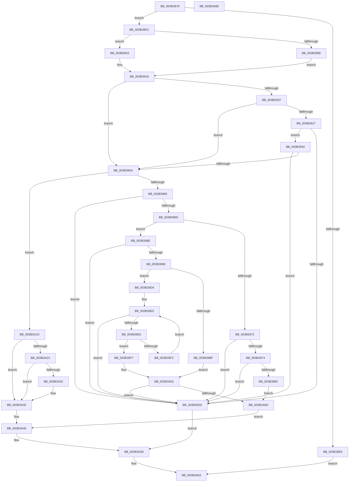

# MiMarkSystemVaAllocated

- RVA: `0x003B3878`–`0x003B3A81` (길이 `521` bytes)
- VA: `0x00000001403B3878`
- 실행 섹션: `.text`
- PDB 이름 있음: `예`; PDB Function 태그: `아니요`
- unwind 정보 RVA: `0x000855B4`
- 디코드: `156`개 명령, `521/521` bytes 표시
- 미해석 바이트: `0` (있으면 어셈블리에 `.byte`로 보존)

> 이 문서는 커널 이미지의 기계어와 PDB 기호를 분석해 생성했습니다. 4번과 5번은 함수 원형과 자료형을 바이너리 사용 방식에서 추정한 C 해석이며 원본 소스 복구 결과는 아닙니다.

## 1. Dependencies

- 직접 호출 지점: **8**; 고유 호출 대상: **8**
- 직접 호출자로 확인된 함수: **1**
- RIP 상대 이미지 참조: **1**

### Outgoing calls
- `0x003B38D4` → [MiSystemVaToDynamicBitmap](MiSystemVaToDynamicBitmap_function_003B4F88.md) (function, `0x003B4F88`)
- `0x003B3909` → [ExAcquireSpinLockExclusiveAtDpcLevel](../24/ExAcquireSpinLockExclusiveAtDpcLevel_function_00248E80.md) (function, `0x00248E80`)
- `0x003B3910` → [ExAcquireSpinLockExclusive](../24/ExAcquireSpinLockExclusive_function_00248690.md) (function, `0x00248690`)
- `0x003B3951` → [MiExtendDynamicBitMap](MiExtendDynamicBitMap_function_003B6934.md) (function, `0x003B6934`)
- `0x003B3A16` → [RtlSetBitsEx](RtlSetBitsEx_function_003B6570.md) (function, `0x003B6570`)
- `0x003B3A29` → [MiSystemVaPreserveGuardPage](../67/MiSystemVaPreserveGuardPage_function_0067FCA8.md) (function, `0x0067FCA8`)
- `0x003B3A3E` → [RtlClearBitsEx](../29/RtlClearBitsEx_function_00297740.md) (function, `0x00297740`)
- `0x003B3A5C` → [MiReleaseSpinLockExclusive](../24/MiReleaseSpinLockExclusive_function_002482C0.md) (function, `0x002482C0`)

### Direct callers
- [MiReservePoolMemory](MiReservePoolMemory_function_003B4AD8.md) at `0x003B4B61`

### Static image references
- `0x003B3A46` → RVA `0x00E2CB40` (`.data`; read)

## 2. Other-region calls and transfers

- 다른 실행 섹션으로 향하는 call: **0**
- 별도 외부 분기/꼬리 이동을 확인하지 못했습니다.

## 3. Assembly (complete function range)

```asm
003B3878  48 8B C4                        mov rax, rsp
003B387B  48 89 58 08                     mov qword ptr [rax + 8], rbx
003B387F  48 89 68 10                     mov qword ptr [rax + 0x10], rbp
003B3883  48 89 70 18                     mov qword ptr [rax + 0x18], rsi
003B3887  44 89 48 20                     mov dword ptr [rax + 0x20], r9d
003B388B  57                              push rdi
003B388C  41 54                           push r12
003B388E  41 55                           push r13
003B3890  41 56                           push r14
003B3892  41 57                           push r15
003B3894  48 83 EC 20                     sub rsp, 0x20
003B3898  49 8B F8                        mov rdi, r8
003B389B  4C 63 E1                        movsxd r12, ecx
003B389E  BD 01 00 00 00                  mov ebp, 1
003B38A3  48 B8 00 00 00 00 80 F6 FF FF   movabs rax, 0xfffff68000000000
003B38AD  48 C1 E0 19                     shl rax, 0x19
003B38B1  48 8B DA                        mov rbx, rdx
003B38B4  48 C1 E3 19                     shl rbx, 0x19
003B38B8  48 2B FA                        sub rdi, rdx
003B38BB  48 2B D8                        sub rbx, rax
003B38BE  48 C1 FF 03                     sar rdi, 3
003B38C2  48 C1 FB 10                     sar rbx, 0x10
003B38C6  41 8B CC                        mov ecx, r12d
003B38C9  48 C1 E3 19                     shl rbx, 0x19
003B38CD  48 2B D8                        sub rbx, rax
003B38D0  48 C1 FB 10                     sar rbx, 0x10
003B38D4  E8 AF 16 00 00                  call 0x1403b4f88
003B38D9  48 8B F0                        mov rsi, rax
003B38DC  48 8B 40 20                     mov rax, qword ptr [rax + 0x20]
003B38E0  48 3B D8                        cmp rbx, rax
003B38E3  73 07                           jae 0x1403b38ec
003B38E5  33 C0                           xor eax, eax
003B38E7  E9 77 01 00 00                  jmp 0x1403b3a63
003B38EC  48 2B D8                        sub rbx, rax
003B38EF  48 C1 EB 15                     shr rbx, 0x15
003B38F3  4C 8D 34 1F                     lea r14, [rdi + rbx]
003B38F7  44 0F 20 C0                     mov rax, cr8
003B38FB  4C 8D 7E 40                     lea r15, [rsi + 0x40]
003B38FF  49 8B CF                        mov rcx, r15
003B3902  3C 02                           cmp al, 2
003B3904  75 0A                           jne 0x1403b3910
003B3906  41 B5 11                        mov r13b, 0x11
003B3909  E8 72 55 E9 FF                  call 0x140248e80
003B390E  EB 08                           jmp 0x1403b3918
003B3910  E8 7B 4D E9 FF                  call 0x140248690
003B3915  44 8A E8                        mov r13b, al
003B3918  83 7C 24 70 00                  cmp dword ptr [rsp + 0x70], 0
003B391D  74 3B                           je 0x1403b395a
003B391F  48 8B 0E                        mov rcx, qword ptr [rsi]
003B3922  4C 3B F1                        cmp r14, rcx
003B3925  76 33                           jbe 0x1403b395a
003B3927  4C 3B 76 10                     cmp r14, qword ptr [rsi + 0x10]
003B392B  72 07                           jb 0x1403b3934
003B392D  33 ED                           xor ebp, ebp
003B392F  E9 22 01 00 00                  jmp 0x1403b3a56
003B3934  4D 8B C6                        mov r8, r14
003B3937  45 8B CC                        mov r9d, r12d
003B393A  4C 2B C1                        sub r8, rcx
003B393D  48 8B D6                        mov rdx, rsi
003B3940  49 81 C0 FF 7F 00 00            add r8, 0x7fff
003B3947  48 8B CE                        mov rcx, rsi
003B394A  49 81 E0 00 80 FF FF            and r8, 0xffffffffffff8000
003B3951  E8 DE 2F 00 00                  call 0x1403b6934
003B3956  85 C0                           test eax, eax
003B3958  74 D3                           je 0x1403b392d
003B395A  83 7C 24 68 00                  cmp dword ptr [rsp + 0x68], 0
003B395F  0F 84 B8 00 00 00               je 0x1403b3a1d
003B3965  48 8B 06                        mov rax, qword ptr [rsi]
003B3968  48 3B D8                        cmp rbx, rax
003B396B  73 C0                           jae 0x1403b392d
003B396D  48 3B FD                        cmp rdi, rbp
003B3970  77 1C                           ja 0x1403b398e
003B3972  75 B9                           jne 0x1403b392d
003B3974  48 8B 46 08                     mov rax, qword ptr [rsi + 8]
003B3978  48 8B D3                        mov rdx, rbx
003B397B  48 8B CB                        mov rcx, rbx
003B397E  83 E2 3F                        and edx, 0x3f
003B3981  48 C1 E9 06                     shr rcx, 6
003B3985  48 0F A3 14 C8                  bt qword ptr [rax + rcx*8], rdx
003B398A  72 A1                           jb 0x1403b392d
003B398C  EB 7F                           jmp 0x1403b3a0d
003B398E  48 2B C3                        sub rax, rbx
003B3991  48 3B C7                        cmp rax, rdi
003B3994  72 97                           jb 0x1403b392d
003B3996  48 8B 4E 08                     mov rcx, qword ptr [rsi + 8]
003B399A  49 FF CE                        dec r14
003B399D  48 8B C3                        mov rax, rbx
003B39A0  49 83 C8 FF                     or r8, 0xffffffffffffffff
003B39A4  48 C1 E8 06                     shr rax, 6
003B39A8  48 8D 14 C1                     lea rdx, [rcx + rax*8]
003B39AC  49 8B C6                        mov rax, r14
003B39AF  4C 8B 0A                        mov r9, qword ptr [rdx]
003B39B2  48 C1 E8 06                     shr rax, 6
003B39B6  4C 8D 14 C1                     lea r10, [rcx + rax*8]
003B39BA  49 3B D2                        cmp rdx, r10
003B39BD  75 15                           jne 0x1403b39d4
003B39BF  41 8D 48 41                     lea ecx, [r8 + 0x41]
003B39C3  40 2A CF                        sub cl, dil
003B39C6  49 D3 E8                        shr r8, cl
003B39C9  48 8B CB                        mov rcx, rbx
003B39CC  49 D3 E0                        shl r8, cl
003B39CF  4D 85 C8                        test r8, r9
003B39D2  EB 2E                           jmp 0x1403b3a02
003B39D4  48 8B CB                        mov rcx, rbx
003B39D7  49 8B C0                        mov rax, r8
003B39DA  48 D3 E0                        shl rax, cl
003B39DD  4C 85 C8                        test rax, r9
003B39E0  0F 85 47 FF FF FF               jne 0x1403b392d
003B39E6  48 83 C2 08                     add rdx, 8
003B39EA  48 8B 02                        mov rax, qword ptr [rdx]
003B39ED  49 3B D2                        cmp rdx, r10
003B39F0  74 05                           je 0x1403b39f7
003B39F2  48 85 C0                        test rax, rax
003B39F5  EB E9                           jmp 0x1403b39e0
003B39F7  41 8A CE                        mov cl, r14b
003B39FA  F6 D1                           not cl
003B39FC  49 D3 E8                        shr r8, cl
003B39FF  49 85 C0                        test r8, rax
003B3A02  0F 94 C0                        sete al
003B3A05  84 C0                           test al, al
003B3A07  0F 84 20 FF FF FF               je 0x1403b392d
003B3A0D  4C 8B C7                        mov r8, rdi
003B3A10  48 8B D3                        mov rdx, rbx
003B3A13  48 8B CE                        mov rcx, rsi
003B3A16  E8 55 2B 00 00                  call 0x1403b6570
003B3A1B  EB 29                           jmp 0x1403b3a46
003B3A1D  4C 3B 76 10                     cmp r14, qword ptr [rsi + 0x10]
003B3A21  75 12                           jne 0x1403b3a35
003B3A23  41 8B D4                        mov edx, r12d
003B3A26  48 8B CE                        mov rcx, rsi
003B3A29  E8 7A C2 2C 00                  call 0x14067fca8
003B3A2E  85 C0                           test eax, eax
003B3A30  74 03                           je 0x1403b3a35
003B3A32  48 2B FD                        sub rdi, rbp
003B3A35  4C 8B C7                        mov r8, rdi
003B3A38  48 8B D3                        mov rdx, rbx
003B3A3B  48 8B CE                        mov rcx, rsi
003B3A3E  E8 FD 3C EE FF                  call 0x140297740
003B3A43  48 F7 DF                        neg rdi
003B3A46  48 8D 0D F3 90 A7 00            lea rcx, [rip + 0xa790f3]
003B3A4D  F0 4A 01 BC E1 C8 BE 00 00      lock add qword ptr [rcx + r12*8 + 0xbec8], rdi
003B3A56  41 8A D5                        mov dl, r13b
003B3A59  49 8B CF                        mov rcx, r15
003B3A5C  E8 5F 48 E9 FF                  call 0x1402482c0
003B3A61  8B C5                           mov eax, ebp
003B3A63  48 8B 5C 24 50                  mov rbx, qword ptr [rsp + 0x50]
003B3A68  48 8B 6C 24 58                  mov rbp, qword ptr [rsp + 0x58]
003B3A6D  48 8B 74 24 60                  mov rsi, qword ptr [rsp + 0x60]
003B3A72  48 83 C4 20                     add rsp, 0x20
003B3A76  41 5F                           pop r15
003B3A78  41 5E                           pop r14
003B3A7A  41 5D                           pop r13
003B3A7C  41 5C                           pop r12
003B3A7E  5F                              pop rdi
003B3A7F  C3                              ret
003B3A80  CC                              int3
```

## 4. C-style interpretation (structured pseudocode)

```c
__int64 __fastcall MiMarkSystemVaAllocated(int a1, __int64 a2, __int64 a3, int a4, unsigned int a5)
{
    __int64 result;
    __int64 v_r14;
    __int64 v_rbp;
    __int64 v_rbx;
    __int64 v_rdi;
    __int64 v_rsp;
    unsigned __int64 v_stack_p10;
    unsigned __int64 v_stack_p18;
    unsigned int v_stack_p20;
    unsigned __int64 v_stack_p8;

    *(unsigned __int64 *)(v_rsp + 8) = v_rbx;
    *(unsigned __int64 *)(v_rsp + 16) = v_rbp;
    *(unsigned __int64 *)(v_rsp + 24) = v_rsi;
    *(unsigned int *)(v_rsp + 32) = a4;
    v_rsp = (v_rsp) - (32);
    result = (v_rsp) << (25);
    v_rbx = (a2) << (25);
    v_rdi = (a3) - (a2);
    v_rbx = (v_rbx) - (result);
    v_rdi = (v_rdi) >> (3);
    v_rbx = (v_rbx) >> (16);
    v_rbx = (v_rbx) << (25);
    v_rbx = (v_rbx) - (result);
    v_rbx = (v_rbx) >> (16);
    result = MiSystemVaToDynamicBitmap((unsigned int)((unsigned int)((int)(a1))), a2, a3, a4);
    if (v_rbx >= (*(unsigned __int64 *)(result + 32))) goto loc_003B38EC;
    result = 0;
    goto loc_003B3A63;
loc_003B38EC:
    v_rbx = (v_rbx) - (0);
    v_rbx = (v_rbx) >> (21);
    if (((unsigned __int8)(v_cr8)) != 2) goto loc_003B3910;
    result = ExAcquireSpinLockExclusiveAtDpcLevel(result + 64, a2, a3, a4);
    goto loc_003B3918;
loc_003B3910:
    result = ExAcquireSpinLockExclusive(result + 64, a2, a3, a4);
loc_003B3918:
    if (a5 == 0) goto loc_003B395A;
    if ((v_rdi + v_rbx * 1) <= (*(unsigned __int64 *)(result))) goto loc_003B395A;
    if ((v_rdi + v_rbx * 1) < (*(unsigned __int64 *)(result + 16))) goto loc_003B3934;
loc_003B392D:
    v_rbp = 0;
    goto loc_003B3A56;
loc_003B3934:
    a3 = (v_rdi + v_rbx * 1) - (*(unsigned __int64 *)(result));
    a3 = (a3) + (0x7FFFULL);
    a3 = (a3) & (0xFFFFFFFFFFFF8000ULL);
    result = MiExtendDynamicBitMap(result, result, a3, (unsigned int)((unsigned int)((int)(a1))));
    if ((unsigned int)(result) == 0) goto loc_003B392D;
loc_003B395A:
    if (v_stack_p20 == 0) goto loc_003B3A1D;
    if (v_rbx >= (*(unsigned __int64 *)(result))) goto loc_003B392D;
    if (v_rdi > 0) goto loc_003B398E;
    if (v_rdi != 0) goto loc_003B392D;
    a2 = (unsigned int)((v_rbx) & (63));
    a1 = (v_rbx) >> (6);
    if (condition_is_below) goto loc_003B392D;
    goto loc_003B3A0D;
loc_003B398E:
    result = (*(unsigned __int64 *)(result + 8)) - (v_rbx);
    if (result < v_rdi) goto loc_003B392D;
    v_r14 = (v_rdi + v_rbx * 1) - 1;
    a3 = (a3) | (-1);
    result = (v_rbx) >> (6);
    result = (v_r14) >> (6);
    if ((*(unsigned __int64 *)(result + 8) + result * 8) != (*(unsigned __int64 *)(result + 8) + result * 8)) goto loc_003B39D4;
    a1 = (unsigned __int8)((a3 + 65) - ((unsigned __int8)(v_rdi)));
    a3 = (a3) >> ((unsigned __int8)(a1));
    a3 = (a3) << ((unsigned __int8)(v_rbx));
    goto loc_003B3A02;
loc_003B39D4:
    result = (a3) << ((unsigned __int8)(v_rbx));
loc_003B39E0:
    if (((result) & (*(unsigned __int64 *)(*(unsigned __int64 *)(result + 8) + result * 8))) != 0) goto loc_003B392D;
    a2 = (*(unsigned __int64 *)(result + 8) + result * 8) + (8);
    if (a2 == (*(unsigned __int64 *)(result + 8) + result * 8)) goto loc_003B39F7;
    goto loc_003B39E0;
loc_003B39F7:
    a1 = (unsigned __int8)(~((unsigned __int8)(v_r14)));
    a3 = (a3) >> ((unsigned __int8)(a1));
loc_003B3A02:
    result = (((a3) & (*(unsigned __int64 *)(a2))) == 0) ? 1 : 0;
    if ((unsigned __int8)(result) == 0) goto loc_003B392D;
loc_003B3A0D:
    result = RtlSetBitsEx(result, v_rbx, v_rdi, *(unsigned __int64 *)(*(unsigned __int64 *)(result + 8) + result * 8));
    goto loc_003B3A46;
loc_003B3A1D:
    if (v_r14 != (*(unsigned __int64 *)(result + 16))) goto loc_003B3A35;
    result = MiSystemVaPreserveGuardPage(result, (unsigned int)((unsigned int)((int)(a1))), v_rdi, *(unsigned __int64 *)(*(unsigned __int64 *)(result + 8) + result * 8));
    if ((unsigned int)(result) != 0) {
        v_rdi = (v_rdi) - (0);
    }
    result = RtlClearBitsEx(result, v_rbx, v_rdi, *(unsigned __int64 *)(*(unsigned __int64 *)(result + 8) + result * 8));
    v_rdi = -(v_rdi);
loc_003B3A46:
loc_003B3A56:
    result = MiReleaseSpinLockExclusive(result + 64, (unsigned __int8)((unsigned __int8)(result)), v_rdi, *(unsigned __int64 *)(*(unsigned __int64 *)(result + 8) + result * 8));
loc_003B3A63:
    v_rsp = (v_rsp) + (32);
    return 0;
}
```

## 5. (Beta) C Style

```c
int64_t MiMarkSystemVaAllocated(int32_t Arg1, int64_t Arg2, int64_t Arg3, int32_t Arg4, uint32_t Arg5)
{
    int64_t result;
    int64_t local_r14;
    int64_t local_rbp;
    int64_t local_rbx;
    int64_t local_rdi;
    int64_t local_rsp;
    uint64_t v_stack_p10;
    uint64_t v_stack_p18;
    uint32_t v_stack_p20;
    uint64_t v_stack_p8;

    *(uint64_t *)(local_rsp + 0x8) = local_rbx;
    *(uint64_t *)(local_rsp + 0x10) = local_rbp;
    *(uint64_t *)(local_rsp + 0x18) = local_rsi;
    *(uint32_t *)(local_rsp + 0x20) = Arg4;
    local_rsp = (local_rsp) - (32);
    result = (local_rsp) << (25);
    local_rbx = (Arg2) << (25);
    local_rdi = (Arg3) - (Arg2);
    local_rbx = (local_rbx) - (result);
    local_rdi = (local_rdi) >> (3);
    local_rbx = (local_rbx) >> (16);
    local_rbx = (local_rbx) << (25);
    local_rbx = (local_rbx) - (result);
    local_rbx = (local_rbx) >> (16);
    result = MiSystemVaToDynamicBitmap((uint32_t)((uint32_t)((int32_t)(Arg1))), Arg2, Arg3, Arg4);
    if (local_rbx >= (*(uint64_t *)(result + 0x20))) goto loc_003B38EC;
    result = 0;
    goto loc_003B3A63;
loc_003B38EC:
    local_rbx = (local_rbx) - (0);
    local_rbx = (local_rbx) >> (21);
    if (((uint8_t)(v_cr8)) != 2) goto loc_003B3910;
    result = ExAcquireSpinLockExclusiveAtDpcLevel(result + 64, Arg2, Arg3, Arg4);
    goto loc_003B3918;
loc_003B3910:
    result = ExAcquireSpinLockExclusive(result + 64, Arg2, Arg3, Arg4);
loc_003B3918:
    if (Arg5 == 0) goto loc_003B395A;
    if ((local_rdi + local_rbx * 1) <= (*(uint64_t *)(result))) goto loc_003B395A;
    if ((local_rdi + local_rbx * 1) < (*(uint64_t *)(result + 0x10))) goto loc_003B3934;
loc_003B392D:
    local_rbp = 0;
    goto loc_003B3A56;
loc_003B3934:
    Arg3 = (local_rdi + local_rbx * 1) - (*(uint64_t *)(result));
    Arg3 = (Arg3) + (0x7FFFULL);
    Arg3 = (Arg3) & (0xFFFFFFFFFFFF8000ULL);
    result = MiExtendDynamicBitMap(result, result, Arg3, (uint32_t)((uint32_t)((int32_t)(Arg1))));
    if ((uint32_t)(result) == 0) goto loc_003B392D;
loc_003B395A:
    if (v_stack_p20 == 0) goto loc_003B3A1D;
    if (local_rbx >= (*(uint64_t *)(result))) goto loc_003B392D;
    if (local_rdi > 0) goto loc_003B398E;
    if (local_rdi != 0) goto loc_003B392D;
    Arg2 = (uint32_t)((local_rbx) & (63));
    Arg1 = (local_rbx) >> (6);
    if (condition_is_below) goto loc_003B392D;
    goto loc_003B3A0D;
loc_003B398E:
    result = (*(uint64_t *)(result + 0x8)) - (local_rbx);
    if (result < local_rdi) goto loc_003B392D;
    local_r14 = (local_rdi + local_rbx * 1) - 1;
    Arg3 = (Arg3) | (-1);
    result = (local_rbx) >> (6);
    result = (local_r14) >> (6);
    if ((*(uint64_t *)(result + 0x8) + result * 8) != (*(uint64_t *)(result + 0x8) + result * 8)) goto loc_003B39D4;
    Arg1 = (uint8_t)((Arg3 + 65) - ((uint8_t)(local_rdi)));
    Arg3 = (Arg3) >> ((uint8_t)(Arg1));
    Arg3 = (Arg3) << ((uint8_t)(local_rbx));
    goto loc_003B3A02;
loc_003B39D4:
    result = (Arg3) << ((uint8_t)(local_rbx));
loc_003B39E0:
    if (((result) & (*(uint64_t *)(*(uint64_t *)(result + 0x8) + result * 8))) != 0) goto loc_003B392D;
    Arg2 = (*(uint64_t *)(result + 0x8) + result * 8) + (8);
    if (Arg2 == (*(uint64_t *)(result + 0x8) + result * 8)) goto loc_003B39F7;
    goto loc_003B39E0;
loc_003B39F7:
    Arg1 = (uint8_t)(~((uint8_t)(local_r14)));
    Arg3 = (Arg3) >> ((uint8_t)(Arg1));
loc_003B3A02:
    result = (((Arg3) & (*(uint64_t *)(Arg2))) == 0) ? 1 : 0;
    if ((uint8_t)(result) == 0) goto loc_003B392D;
loc_003B3A0D:
    result = RtlSetBitsEx(result, local_rbx, local_rdi, *(uint64_t *)(*(uint64_t *)(result + 0x8) + result * 8));
    goto loc_003B3A46;
loc_003B3A1D:
    if (local_r14 != (*(uint64_t *)(result + 0x10))) goto loc_003B3A35;
    result = MiSystemVaPreserveGuardPage(result, (uint32_t)((uint32_t)((int32_t)(Arg1))), local_rdi, *(uint64_t *)(*(uint64_t *)(result + 0x8) + result * 8));
    if ((uint32_t)(result) != 0) {
        local_rdi = (local_rdi) - (0);
    }
    result = RtlClearBitsEx(result, local_rbx, local_rdi, *(uint64_t *)(*(uint64_t *)(result + 0x8) + result * 8));
    local_rdi = -(local_rdi);
loc_003B3A46:
loc_003B3A56:
    result = MiReleaseSpinLockExclusive(result + 64, (uint8_t)((uint8_t)(result)), local_rdi, *(uint64_t *)(*(uint64_t *)(result + 0x8) + result * 8));
loc_003B3A63:
    local_rsp = (local_rsp) + (32);
    return 0;
}
```

## 6. Execution-region graph

[열기: 2D/3D 그래프와 함수 탐색 컨트롤 패널](../../../control-panel.html?section=text&rva=0x003B3878&view=graph)

- 2D 그래프는 위에서 아래로 흐르고, 3D 그래프는 빈 공간을 드래그해 회전합니다. Shift+드래그는 이동, 휠은 확대·축소, 함수 노드 선택은 대상 보고서 이동입니다.

### Static fallback


