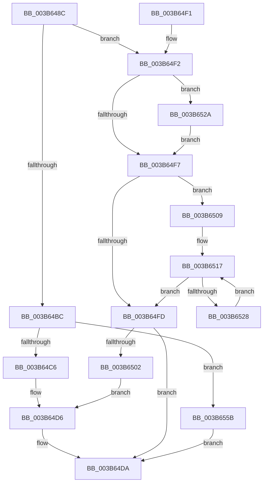

# MiMirrorAddPagesToBrownList

- RVA: `0x003B648C`–`0x003B6567` (길이 `219` bytes)
- VA: `0x00000001403B648C`
- 실행 섹션: `.text`
- PDB 이름 있음: `예`; PDB Function 태그: `아니요`
- unwind 정보 RVA: `0x0008C6E0`
- 디코드: `66`개 명령, `219/219` bytes 표시
- 미해석 바이트: `0` (있으면 어셈블리에 `.byte`로 보존)

> 이 문서는 커널 이미지의 기계어와 PDB 기호를 분석해 생성했습니다. 4번과 5번은 함수 원형과 자료형을 바이너리 사용 방식에서 추정한 C 해석이며 원본 소스 복구 결과는 아닙니다.

## 1. Dependencies

- 직접 호출 지점: **1**; 고유 호출 대상: **1**
- 직접 호출자로 확인된 함수: **3**
- RIP 상대 이미지 참조: **2**

### Outgoing calls
- `0x003B64E7` → [RtlSetBitsEx](RtlSetBitsEx_function_003B6570.md) (function, `0x003B6570`)

### Direct callers
- [MiWalkPagesOnLists](MiWalkPagesOnLists_function_003B6AA4.md) at `0x003B6B6E`
- [MiWalkPagesOnLists](MiWalkPagesOnLists_function_003B6AA4.md) at `0x003B6C79`
- [MiWalkPagesOnLists](MiWalkPagesOnLists_function_003B6AA4.md) at `0x003B6E79`
- [MiMirrorZeroFreeListsCallback](../47/MiMirrorZeroFreeListsCallback_function_00471DF0.md) at `0x00471F85`
- [sub_006E753C](../6E/Unknown_function_006E753C.md) at `0x006E756C`

### Static image references
- `0x003B6490` → RVA `0x00E301A8` (`.data`; read)
- `0x003B64DD` → RVA `0x00E30190` (`.data`; read)

## 2. Other-region calls and transfers

- 다른 실행 섹션으로 향하는 call: **0**
- 별도 외부 분기/꼬리 이동을 확인하지 못했습니다.

## 3. Assembly (complete function range)

```asm
003B648C  48 83 EC 28                     sub rsp, 0x28
003B6490  48 8B 05 11 9D A7 00            mov rax, qword ptr [rip + 0xa79d11]
003B6497  4C 8B D9                        mov r11, rcx
003B649A  4D 8B C3                        mov r8, r11
003B649D  4C 8B D2                        mov r10, rdx
003B64A0  49 C1 E8 05                     shr r8, 5
003B64A4  48 8B CA                        mov rcx, rdx
003B64A7  4E 8D 0C 80                     lea r9, [rax + r8*4]
003B64AB  4D 8B C3                        mov r8, r11
003B64AE  41 83 E0 1F                     and r8d, 0x1f
003B64B2  49 8D 04 10                     lea rax, [r8 + rdx]
003B64B6  48 83 F8 20                     cmp rax, 0x20
003B64BA  77 36                           ja 0x1403b64f2
003B64BC  48 83 FA 20                     cmp rdx, 0x20
003B64C0  0F 84 95 00 00 00               je 0x1403b655b
003B64C6  B8 01 00 00 00                  mov eax, 1
003B64CB  D3 E0                           shl eax, cl
003B64CD  41 8B C8                        mov ecx, r8d
003B64D0  FF C8                           dec eax
003B64D2  D3 E0                           shl eax, cl
003B64D4  F7 D0                           not eax
003B64D6  F0 41 21 01                     lock and dword ptr [r9], eax
003B64DA  4D 8B C2                        mov r8, r10
003B64DD  48 8D 0D AC 9C A7 00            lea rcx, [rip + 0xa79cac]
003B64E4  49 8B D3                        mov rdx, r11
003B64E7  E8 84 00 00 00                  call 0x1403b6570
003B64EC  48 83 C4 28                     add rsp, 0x28
003B64F0  C3                              ret
003B64F1  CC                              int3
003B64F2  4D 85 C0                        test r8, r8
003B64F5  75 33                           jne 0x1403b652a
003B64F7  48 83 F9 20                     cmp rcx, 0x20
003B64FB  73 0C                           jae 0x1403b6509
003B64FD  48 85 C9                        test rcx, rcx
003B6500  74 D8                           je 0x1403b64da
003B6502  83 C8 FF                        or eax, 0xffffffff
003B6505  D3 E0                           shl eax, cl
003B6507  EB CD                           jmp 0x1403b64d6
003B6509  48 8B D1                        mov rdx, rcx
003B650C  48 C1 EA 05                     shr rdx, 5
003B6510  48 6B C2 E0                     imul rax, rdx, -0x20
003B6514  48 03 C8                        add rcx, rax
003B6517  41 C7 01 00 00 00 00            mov dword ptr [r9], 0
003B651E  49 83 C1 04                     add r9, 4
003B6522  48 83 EA 01                     sub rdx, 1
003B6526  74 D5                           je 0x1403b64fd
003B6528  EB ED                           jmp 0x1403b6517
003B652A  41 8B C3                        mov eax, r11d
003B652D  BA 20 00 00 00                  mov edx, 0x20
003B6532  83 E0 1F                        and eax, 0x1f
003B6535  2B D0                           sub edx, eax
003B6537  B8 01 00 00 00                  mov eax, 1
003B653C  8B CA                           mov ecx, edx
003B653E  D3 E0                           shl eax, cl
003B6540  49 8B C8                        mov rcx, r8
003B6543  FF C8                           dec eax
003B6545  D3 E0                           shl eax, cl
003B6547  F7 D0                           not eax
003B6549  F0 41 21 01                     lock and dword ptr [r9], eax
003B654D  8B C2                           mov eax, edx
003B654F  49 8B CA                        mov rcx, r10
003B6552  48 2B C8                        sub rcx, rax
003B6555  49 83 C1 04                     add r9, 4
003B6559  EB 9C                           jmp 0x1403b64f7
003B655B  41 C7 01 00 00 00 00            mov dword ptr [r9], 0
003B6562  E9 73 FF FF FF                  jmp 0x1403b64da
```

## 4. C-style interpretation (structured pseudocode)

```c
__int64 __fastcall MiMirrorAddPagesToBrownList(__int64 a1, __int64 a2)
{
    __int64 result;
    __int64 v_rsp;

    v_rsp = (v_rsp) - (40);
    a3 = (a1) >> (5);
    a3 = (unsigned int)((a1) & (31));
    if ((a3 + a2 * 1) > 32) goto loc_003B64F2;
    if (a2 == 32) goto loc_003B655B;
    result = (unsigned int)((1) << ((unsigned __int8)(a2)));
    result = (unsigned int)((result) - 1);
    result = (unsigned int)((result) << ((unsigned __int8)((unsigned int)((unsigned int)(a3)))));
    result = (unsigned int)(~(result));
loc_003B64D6:
loc_003B64DA:
    result = RtlSetBitsEx(v_rip + 10984620, a1, a2, *(unsigned __int64 *)(v_rip + 10984721) + a3 * 4);
    v_rsp = (v_rsp) + (40);
    return result;
loc_003B64F2:
    if (a2 != 0) goto loc_003B652A;
loc_003B64F7:
    if ((v_rip + 10984620) >= 32) goto loc_003B6509;
loc_003B64FD:
    if (v_rip + 10984620 == 0) goto loc_003B64DA;
    result = (unsigned int)((result) | (0xFFFFFFFFULL));
    result = (unsigned int)((result) << ((unsigned __int8)(v_rip + 10984620)));
    goto loc_003B64D6;
loc_003B6509:
    a2 = (v_rip + 10984620) >> (5);
    result = (result) * (a2);
    a1 = (v_rip + 10984620) + (result);
loc_003B6517:
    *(unsigned int *)(*(unsigned __int64 *)(v_rip + 10984721) + a3 * 4) = 0;
    a4 = (*(unsigned __int64 *)(v_rip + 10984721) + a3 * 4) + (4);
    a2 = (a2) - (1);
    if (condition_is_equal) goto loc_003B64FD;
    goto loc_003B6517;
loc_003B652A:
    result = (unsigned int)(((unsigned int)((unsigned int)(a1))) & (31));
    a2 = (unsigned int)((32) - ((unsigned int)(result)));
    result = (unsigned int)((1) << ((unsigned __int8)((unsigned int)((unsigned int)(a2)))));
    result = (unsigned int)((result) - 1);
    result = (unsigned int)((result) << ((unsigned __int8)(a2)));
    result = (unsigned int)(~(result));
    a1 = (a2) - ((unsigned int)((unsigned int)(a2)));
    a4 = (a4) + (4);
    goto loc_003B64F7;
loc_003B655B:
    *(unsigned int *)(a4) = 0;
    goto loc_003B64DA;
}
```

## 5. (Beta) C Style

```c
int64_t MiMirrorAddPagesToBrownList(void *Arg1, int64_t Arg2)
{
    uint8_t *arg1 = (uint8_t *)Arg1;

    int64_t result;
    int64_t local_rsp;

    local_rsp = (local_rsp) - (40);
    a3 = (Arg1) >> (5);
    a3 = (uint32_t)((Arg1) & (31));
    if ((a3 + Arg2 * 1) > 32) goto loc_003B64F2;
    if (Arg2 == 32) goto loc_003B655B;
    result = (uint32_t)((1) << ((uint8_t)(Arg2)));
    result = (uint32_t)((result) - 1);
    result = (uint32_t)((result) << ((uint8_t)((uint32_t)((uint32_t)(a3)))));
    result = (uint32_t)(~(result));
loc_003B64D6:
loc_003B64DA:
    result = RtlSetBitsEx(v_rip + 10984620, Arg1, Arg2, *(uint64_t *)(v_rip + 0xA79D11) + a3 * 4);
    local_rsp = (local_rsp) + (40);
    return result;
loc_003B64F2:
    if (Arg2 != 0) goto loc_003B652A;
loc_003B64F7:
    if ((v_rip + 10984620) >= 32) goto loc_003B6509;
loc_003B64FD:
    if (v_rip + 10984620 == 0) goto loc_003B64DA;
    result = (uint32_t)((result) | (0xFFFFFFFFULL));
    result = (uint32_t)((result) << ((uint8_t)(v_rip + 10984620)));
    goto loc_003B64D6;
loc_003B6509:
    Arg2 = (v_rip + 10984620) >> (5);
    result = (result) * (Arg2);
    Arg1 = (v_rip + 10984620) + (result);
loc_003B6517:
    *(uint32_t *)(*(uint64_t *)(v_rip + 0xA79D11) + a3 * 4) = 0;
    a4 = (*(uint64_t *)(v_rip + 0xA79D11) + a3 * 4) + (4);
    Arg2 = (Arg2) - (1);
    if (condition_is_equal) goto loc_003B64FD;
    goto loc_003B6517;
loc_003B652A:
    result = (uint32_t)(((uint32_t)((uint32_t)(Arg1))) & (31));
    Arg2 = (uint32_t)((32) - ((uint32_t)(result)));
    result = (uint32_t)((1) << ((uint8_t)((uint32_t)((uint32_t)(Arg2)))));
    result = (uint32_t)((result) - 1);
    result = (uint32_t)((result) << ((uint8_t)(Arg2)));
    result = (uint32_t)(~(result));
    Arg1 = (Arg2) - ((uint32_t)((uint32_t)(Arg2)));
    a4 = (a4) + (4);
    goto loc_003B64F7;
loc_003B655B:
    *(uint32_t *)(a4) = 0;
    goto loc_003B64DA;
}
```

### 관측된 메모리 오프셋

구조체 형식이 확인되지 않은 접근은 인자 기준의 오프셋으로만 기록했습니다.

| 기준 인자 | 오프셋 표현 | 폭 (bit) | 접근 |
|---|---:|---:|---|
| `Arg1` | `+ 0x0 + rdx*1` | `64` | `R` |

## 6. Execution-region graph

[열기: 2D/3D 그래프와 함수 탐색 컨트롤 패널](../../../control-panel.html?section=text&rva=0x003B648C&view=graph)

- 2D 그래프는 위에서 아래로 흐르고, 3D 그래프는 빈 공간을 드래그해 회전합니다. Shift+드래그는 이동, 휠은 확대·축소, 함수 노드 선택은 대상 보고서 이동입니다.

### Static fallback


