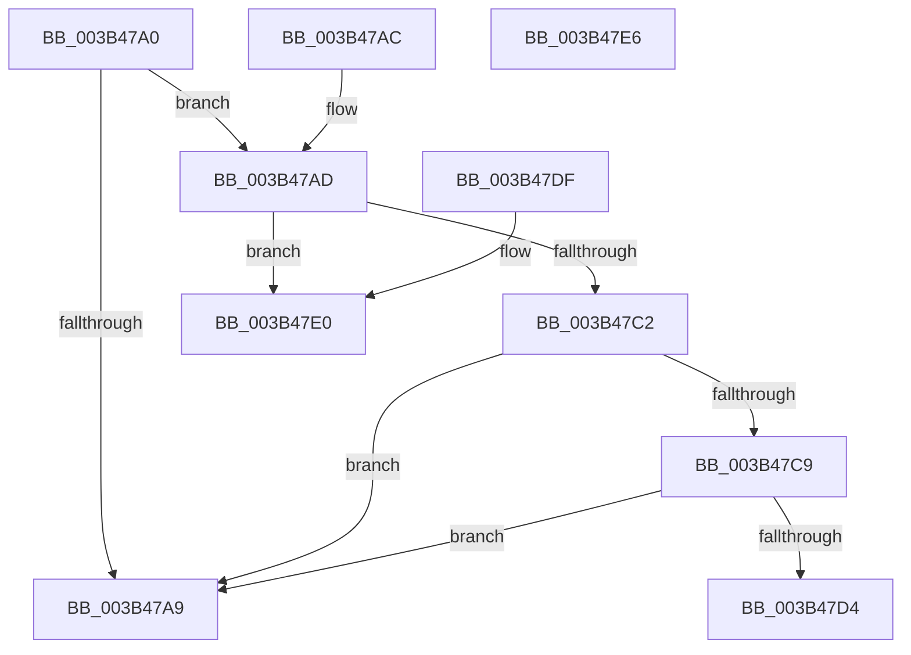

# MiMirrorInSingleProcessorMode

- RVA: `0x003B47A0`–`0x003B47E7` (길이 `71` bytes)
- VA: `0x00000001403B47A0`
- 실행 섹션: `.text`
- PDB 이름 있음: `예`; PDB Function 태그: `아니요`
- unwind 정보 RVA: `0x000DB714`
- 디코드: `22`개 명령, `71/71` bytes 표시
- 미해석 바이트: `0` (있으면 어셈블리에 `.byte`로 보존)

> 이 문서는 커널 이미지의 기계어와 PDB 기호를 분석해 생성했습니다. 4번과 5번은 함수 원형과 자료형을 바이너리 사용 방식에서 추정한 C 해석이며 원본 소스 복구 결과는 아닙니다.

## 1. Dependencies

- 직접 호출 지점: **0**; 고유 호출 대상: **0**
- 직접 호출자로 확인된 함수: **4**
- RIP 상대 이미지 참조: **3**

### Outgoing calls
- 직접 디코드된 call 명령이 없습니다.

### Direct callers
- [MiChangePageAttribute](../33/MiChangePageAttribute_function_00332ECC.md) at `0x00332EEA`
- [MiAssignInitialPageAttribute](MiAssignInitialPageAttribute_function_003B472C.md) at `0x003B473B`
- [MiSystemInSingleProcessorMode](../67/MiSystemInSingleProcessorMode_function_00673D40.md) at `0x00673D59`
- [MmGetCacheAttributeEx](../67/MmGetCacheAttributeEx_function_00674F80.md) at `0x00674FEC`

### Static image references
- `0x003B47A0` → RVA `0x00E3014C` (`.data`; read)
- `0x003B47AD` → RVA `0x00E30188` (`.data`; read)
- `0x003B47C9` → RVA `0x00FC6A88` (`ALMOSTRO`; read)

## 2. Other-region calls and transfers

- 다른 실행 섹션으로 향하는 call: **0**
- 별도 외부 분기/꼬리 이동을 확인하지 못했습니다.

## 3. Assembly (complete function range)

```asm
003B47A0  83 3D A5 B9 A7 00 02            cmp dword ptr [rip + 0xa7b9a5], 2
003B47A7  74 04                           je 0x1403b47ad
003B47A9  33 C0                           xor eax, eax
003B47AB  C3                              ret
003B47AC  CC                              int3
003B47AD  48 8B 0D D4 B9 A7 00            mov rcx, qword ptr [rip + 0xa7b9d4]
003B47B4  65 48 8B 04 25 88 01 00 00      mov rax, qword ptr gs:[0x188]
003B47BD  48 3B C8                        cmp rcx, rax
003B47C0  74 1E                           je 0x1403b47e0
003B47C2  33 C0                           xor eax, eax
003B47C4  48 85 C9                        test rcx, rcx
003B47C7  74 E0                           je 0x1403b47a9
003B47C9  48 0F BA 25 B6 22 C1 00 28      bt qword ptr [rip + 0xc122b6], 0x28
003B47D2  73 D5                           jae 0x1403b47a9
003B47D4  44 0F 20 C1                     mov rcx, cr8
003B47D8  80 F9 0F                        cmp cl, 0xf
003B47DB  0F 94 C0                        sete al
003B47DE  C3                              ret
003B47DF  CC                              int3
003B47E0  B8 01 00 00 00                  mov eax, 1
003B47E5  C3                              ret
003B47E6  CC                              int3
```

## 4. C-style interpretation (structured pseudocode)

```c
__int64 __fastcall MiMirrorInSingleProcessorMode(void)
{
    __int64 result;

    if ((*(unsigned int *)(v_rip + 10992037)) == 2) goto loc_003B47AD;
loc_003B47A9:
    result = 0;
    return result;
loc_003B47AD:
    if ((*(unsigned __int64 *)(v_rip + 10992084)) == (*(unsigned __int64 *)(gs_base + (0 + 392)))) goto loc_003B47E0;
    result = 0;
    if (*(unsigned __int64 *)(v_rip + 10992084) == 0) goto loc_003B47A9;
    if (condition_is_above_or_equal) goto loc_003B47A9;
    result = (((unsigned __int8)(v_cr8)) == 15) ? 1 : 0;
    return result;
loc_003B47E0:
    return 1;
}
```

## 5. (Beta) C Style

```c
void MiMirrorInSingleProcessorMode(void)
{
    int64_t result;

    if ((*(uint32_t *)(v_rip + 0xA7B9A5)) == 2) goto loc_003B47AD;
loc_003B47A9:
    result = 0;
    return result;
loc_003B47AD:
    if ((*(uint64_t *)(v_rip + 0xA7B9D4)) == (*(uint64_t *)(gs_base + (0 + 0x188)))) goto loc_003B47E0;
    result = 0;
    if (*(uint64_t *)(v_rip + 0xA7B9D4) == 0) goto loc_003B47A9;
    if (condition_is_above_or_equal) goto loc_003B47A9;
    result = (((uint8_t)(v_cr8)) == 15) ? 1 : 0;
    return result;
loc_003B47E0:
    return 1;
}
```

## 6. Execution-region graph

[열기: 2D/3D 그래프와 함수 탐색 컨트롤 패널](../../../control-panel.html?section=text&rva=0x003B47A0&view=graph)

- 2D 그래프는 위에서 아래로 흐르고, 3D 그래프는 빈 공간을 드래그해 회전합니다. Shift+드래그는 이동, 휠은 확대·축소, 함수 노드 선택은 대상 보고서 이동입니다.

### Static fallback


