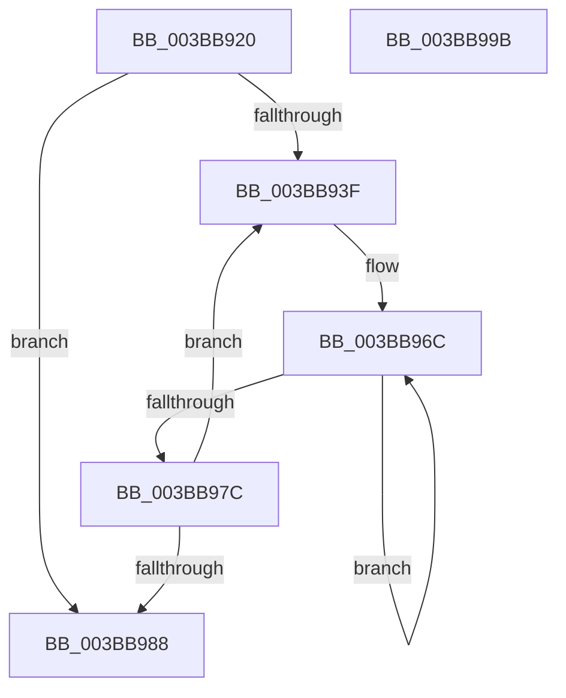

# MiNodeAvailablePages

- RVA: `0x003BB920`–`0x003BB99C` (길이 `124` bytes)
- VA: `0x00000001403BB920`
- 실행 섹션: `.text`
- PDB 이름 있음: `예`; PDB Function 태그: `아니요`
- unwind 정보 RVA: `0x00060BC4`
- 디코드: `34`개 명령, `124/124` bytes 표시
- 미해석 바이트: `0` (있으면 어셈블리에 `.byte`로 보존)

> 이 문서는 커널 이미지의 기계어와 PDB 기호를 분석해 생성했습니다. 4번과 5번은 함수 원형과 자료형을 바이너리 사용 방식에서 추정한 C 해석이며 원본 소스 복구 결과는 아닙니다.

## 1. Dependencies

- 직접 호출 지점: **1**; 고유 호출 대상: **1**
- 직접 호출자로 확인된 함수: **2**
- RIP 상대 이미지 참조: **1**

### Outgoing calls
- `0x003BB94B` → [MiNodeFreeZeroPages](MiNodeFreeZeroPages_function_003BBF60.md) (function, `0x003BBF60`)

### Direct callers
- [MiLogSlabEntryAllocateFailure](MiLogSlabEntryAllocateFailure_function_003BAA60.md) at `0x003BAAFA`
- [MiAddPhysicalMemoryChunks](../../page/7F/MiAddPhysicalMemoryChunks_function_007F98D4.md) at `0x007F9C33`

### Static image references
- `0x003BB934` → RVA `0x00FC5002` (`ALMOSTRO`; read)

## 2. Other-region calls and transfers

- 다른 실행 섹션으로 향하는 call: **0**
- 별도 외부 분기/꼬리 이동을 확인하지 못했습니다.

## 3. Assembly (complete function range)

```asm
003BB920  48 89 5C 24 08                  mov qword ptr [rsp + 8], rbx
003BB925  48 89 74 24 10                  mov qword ptr [rsp + 0x10], rsi
003BB92A  57                              push rdi
003BB92B  48 83 EC 20                     sub rsp, 0x20
003BB92F  33 DB                           xor ebx, ebx
003BB931  48 8B F1                        mov rsi, rcx
003BB934  38 1D C8 96 C0 00               cmp byte ptr [rip + 0xc096c8], bl
003BB93A  40 8A FB                        mov dil, bl
003BB93D  76 49                           jbe 0x1403bb988
003BB93F  41 B8 00 00 08 00               mov r8d, 0x80000
003BB945  40 8A D7                        mov dl, dil
003BB948  48 8B CE                        mov rcx, rsi
003BB94B  E8 10 06 00 00                  call 0x1403bbf60
003BB950  48 03 D8                        add rbx, rax
003BB953  BA 08 00 00 00                  mov edx, 8
003BB958  40 0F B6 C7                     movzx eax, dil
003BB95C  48 69 C0 C0 02 00 00            imul rax, rax, 0x2c0
003BB963  48 05 48 14 00 00               add rax, 0x1448
003BB969  48 03 C6                        add rax, rsi
003BB96C  48 8B 08                        mov rcx, qword ptr [rax]
003BB96F  48 8D 40 58                     lea rax, [rax + 0x58]
003BB973  48 03 D9                        add rbx, rcx
003BB976  48 83 EA 01                     sub rdx, 1
003BB97A  75 F0                           jne 0x1403bb96c
003BB97C  40 FE C7                        inc dil
003BB97F  40 3A 3D 7C 96 C0 00            cmp dil, byte ptr [rip + 0xc0967c]
003BB986  72 B7                           jb 0x1403bb93f
003BB988  48 8B 74 24 38                  mov rsi, qword ptr [rsp + 0x38]
003BB98D  48 8B C3                        mov rax, rbx
003BB990  48 8B 5C 24 30                  mov rbx, qword ptr [rsp + 0x30]
003BB995  48 83 C4 20                     add rsp, 0x20
003BB999  5F                              pop rdi
003BB99A  C3                              ret
003BB99B  CC                              int3
```

## 4. C-style interpretation (structured pseudocode)

```c
__int64 __fastcall MiNodeAvailablePages(__int64 a1)
{
    __int64 result;
    __int64 v_rbx;
    __int64 v_rdi;
    __int64 v_rsp;
    unsigned __int64 v_stack_p10;
    unsigned __int64 v_stack_p8;

    v_stack_p8 = v_rbx;
    v_stack_p10 = v_rsi;
    v_rsp = (v_rsp) - (32);
    v_rbx = 0;
    if ((*(unsigned __int8 *)(v_rip + 12621512)) <= 0) goto loc_003BB988;
loc_003BB93F:
    result = MiNodeFreeZeroPages(a1, 0, (unsigned int)(0x80000ULL), a4);
    v_rbx = (v_rbx) + (result);
    result = (0) * (0);
    result = (result) + (0x1448ULL);
    result = (result) + (a1);
loc_003BB96C:
    v_rbx = (v_rbx) + (*(unsigned __int64 *)(result));
    a2 = (8) - (1);
    if (condition_is_not_equal) goto loc_003BB96C;
    v_rdi = (unsigned __int8)((0) + 1);
    if (((unsigned __int8)(v_rdi)) < (*(unsigned __int8 *)(v_rip + 12621436))) goto loc_003BB93F;
loc_003BB988:
    v_rsp = (v_rsp) + (32);
    return v_rbx;
}
```

## 5. (Beta) C Style

```c
int64_t MiNodeAvailablePages(int64_t Arg1)
{
    int64_t result;
    int64_t local_rbx;
    int64_t local_rdi;
    int64_t local_rsp;
    uint64_t v_stack_p10;
    uint64_t v_stack_p8;

    v_stack_p8 = local_rbx;
    v_stack_p10 = local_rsi;
    local_rsp = (local_rsp) - (32);
    local_rbx = 0;
    if ((*(uint8_t *)(v_rip + 0xC096C8)) <= 0) goto loc_003BB988;
loc_003BB93F:
    result = MiNodeFreeZeroPages(Arg1, 0, (uint32_t)(0x80000ULL), a4);
    local_rbx = (local_rbx) + (result);
    result = (0) * (0);
    result = (result) + (0x1448ULL);
    result = (result) + (Arg1);
loc_003BB96C:
    local_rbx = (local_rbx) + (*(uint64_t *)(result));
    a2 = (8) - (1);
    if (condition_is_not_equal) goto loc_003BB96C;
    local_rdi = (uint8_t)((0) + 1);
    if (((uint8_t)(local_rdi)) < (*(uint8_t *)(v_rip + 0xC0967C))) goto loc_003BB93F;
loc_003BB988:
    local_rsp = (local_rsp) + (32);
    return local_rbx;
}
```

## 6. Execution-region graph

[열기: 2D/3D 그래프와 함수 탐색 컨트롤 패널](../../../control-panel.html?section=text&rva=0x003BB920&view=graph)

- 2D 그래프는 위에서 아래로 흐르고, 3D 그래프는 빈 공간을 드래그해 회전합니다. Shift+드래그는 이동, 휠은 확대·축소, 함수 노드 선택은 대상 보고서 이동입니다.

### Static fallback


