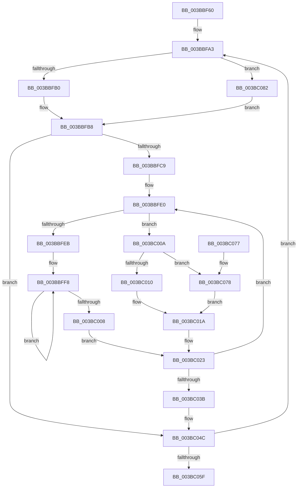

# MiNodeFreeZeroPages

- RVA: `0x003BBF60`–`0x003BC093` (길이 `307` bytes)
- VA: `0x00000001403BBF60`
- 실행 섹션: `.text`
- PDB 이름 있음: `예`; PDB Function 태그: `아니요`
- unwind 정보 RVA: `0x0008CD40`
- 디코드: `89`개 명령, `307/307` bytes 표시
- 미해석 바이트: `0` (있으면 어셈블리에 `.byte`로 보존)

> 이 문서는 커널 이미지의 기계어와 PDB 기호를 분석해 생성했습니다. 4번과 5번은 함수 원형과 자료형을 바이너리 사용 방식에서 추정한 C 해석이며 원본 소스 복구 결과는 아닙니다.

## 1. Dependencies

- 직접 호출 지점: **0**; 고유 호출 대상: **0**
- 직접 호출자로 확인된 함수: **9**
- RIP 상대 이미지 참조: **2**

### Outgoing calls
- 직접 디코드된 call 명령이 없습니다.

### Direct callers
- [MiCheckZeroFreeRebalance](../28/MiCheckZeroFreeRebalance_function_0028B1FC.md) at `0x0028B244`
- [MiSignalLargePageRebuild](../2D/MiSignalLargePageRebuild_function_002DB4C8.md) at `0x002DB5ED`
- [MiRebuildLargePages](MiRebuildLargePages_function_003BA700.md) at `0x003BA8A1`
- [MiReplenishPageSlist](MiReplenishPageSlist_function_003BADE0.md) at `0x003BAEAB`
- [MiReplenishPageSlist](MiReplenishPageSlist_function_003BADE0.md) at `0x003BB0DE`
- [MiNodeAvailablePages](MiNodeAvailablePages_function_003BB920.md) at `0x003BB94B`
- [MiFreeZeroPagesNeeded](MiFreeZeroPagesNeeded_function_003BBA70.md) at `0x003BBA9B`
- [MiRebuildLargePage](MiRebuildLargePage_function_003BBAEC.md) at `0x003BBCAA`
- [MiPruneStandbyPages](MiPruneStandbyPages_function_003BC0E4.md) at `0x003BC417`
- [sub_006E7C12](../6E/Unknown_function_006E7C12.md) at `0x006E7C1E`

### Static image references
- `0x003BBFA3` → RVA `0x00FC5002` (`ALMOSTRO`; read)
- `0x003BBFCB` → RVA `0x00011C60` (`.rdata`; read)

## 2. Other-region calls and transfers

- 다른 실행 섹션으로 향하는 call: **0**
- 별도 외부 분기/꼬리 이동을 확인하지 못했습니다.

## 3. Assembly (complete function range)

```asm
003BBF60  48 89 5C 24 10                  mov qword ptr [rsp + 0x10], rbx
003BBF65  48 89 4C 24 08                  mov qword ptr [rsp + 8], rcx
003BBF6A  55                              push rbp
003BBF6B  56                              push rsi
003BBF6C  57                              push rdi
003BBF6D  41 54                           push r12
003BBF6F  41 55                           push r13
003BBF71  41 56                           push r14
003BBF73  41 57                           push r15
003BBF75  48 83 EC 10                     sub rsp, 0x10
003BBF79  41 8B E8                        mov ebp, r8d
003BBF7C  44 0F B6 F2                     movzx r14d, dl
003BBF80  F7 D5                           not ebp
003BBF82  33 F6                           xor esi, esi
003BBF84  48 C1 ED 04                     shr rbp, 4
003BBF88  45 33 FF                        xor r15d, r15d
003BBF8B  83 E5 01                        and ebp, 1
003BBF8E  45 33 E4                        xor r12d, r12d
003BBF91  48 89 2C 24                     mov qword ptr [rsp], rbp
003BBF95  41 81 E0 00 00 08 00            and r8d, 0x80000
003BBF9C  48 8B D1                        mov rdx, rcx
003BBF9F  44 8D 6E 74                     lea r13d, [rsi + 0x74]
003BBFA3  80 3D 58 90 C0 00 01            cmp byte ptr [rip + 0xc09058], 1
003BBFAA  0F 87 D2 00 00 00               ja 0x1403bc082
003BBFB0  4A 8B 84 E2 08 0F 00 00         mov rax, qword ptr [rdx + r12*8 + 0xf08]
003BBFB8  48 03 F0                        add rsi, rax
003BBFBB  48 89 74 24 68                  mov qword ptr [rsp + 0x68], rsi
003BBFC0  45 85 C0                        test r8d, r8d
003BBFC3  0F 84 83 00 00 00               je 0x1403bc04c
003BBFC9  33 DB                           xor ebx, ebx
003BBFCB  4C 8D 0D 8E 5C C5 FF            lea r9, [rip - 0x3aa372]
003BBFD2  4C 8B DA                        mov r11, rdx
003BBFD5  4D 8B D6                        mov r10, r14
003BBFD8  8D 7B 03                        lea edi, [rbx + 3]
003BBFDB  0F 1F 44 00 00                  nop dword ptr [rax + rax]
003BBFE0  49 8B 01                        mov rax, qword ptr [r9]
003BBFE3  33 D2                           xor edx, edx
003BBFE5  41 80 FE 02                     cmp r14b, 2
003BBFE9  74 1F                           je 0x1403bc00a
003BBFEB  4B 8D 0C 2A                     lea rcx, [r10 + r13]
003BBFEF  BD 02 00 00 00                  mov ebp, 2
003BBFF4  49 8D 34 CB                     lea rsi, [r11 + rcx*8]
003BBFF8  48 8B 0E                        mov rcx, qword ptr [rsi]
003BBFFB  48 8D 76 20                     lea rsi, [rsi + 0x20]
003BBFFF  48 03 D1                        add rdx, rcx
003BC002  48 83 ED 01                     sub rbp, 1
003BC006  75 F0                           jne 0x1403bbff8
003BC008  EB 19                           jmp 0x1403bc023
003BC00A  41 83 FF 02                     cmp r15d, 2
003BC00E  74 68                           je 0x1403bc078
003BC010  49 63 CF                        movsxd rcx, r15d
003BC013  48 FF C1                        inc rcx
003BC016  49 8D 0C CB                     lea rcx, [r11 + rcx*8]
003BC01A  48 8B 09                        mov rcx, qword ptr [rcx]
003BC01D  4D 8B D6                        mov r10, r14
003BC020  48 03 D1                        add rdx, rcx
003BC023  48 0F AF C2                     imul rax, rdx
003BC027  49 83 C1 08                     add r9, 8
003BC02B  49 81 C3 00 05 00 00            add r11, 0x500
003BC032  48 03 D8                        add rbx, rax
003BC035  48 83 EF 01                     sub rdi, 1
003BC039  75 A5                           jne 0x1403bbfe0
003BC03B  48 8B 74 24 68                  mov rsi, qword ptr [rsp + 0x68]
003BC040  48 8B 54 24 50                  mov rdx, qword ptr [rsp + 0x50]
003BC045  48 03 F3                        add rsi, rbx
003BC048  48 8B 2C 24                     mov rbp, qword ptr [rsp]
003BC04C  41 FF C7                        inc r15d
003BC04F  49 FF C4                        inc r12
003BC052  49 83 C5 02                     add r13, 2
003BC056  4C 3B E5                        cmp r12, rbp
003BC059  0F 8E 44 FF FF FF               jle 0x1403bbfa3
003BC05F  48 8B 5C 24 58                  mov rbx, qword ptr [rsp + 0x58]
003BC064  48 8B C6                        mov rax, rsi
003BC067  48 83 C4 10                     add rsp, 0x10
003BC06B  41 5F                           pop r15
003BC06D  41 5E                           pop r14
003BC06F  41 5D                           pop r13
003BC071  41 5C                           pop r12
003BC073  5F                              pop rdi
003BC074  5E                              pop rsi
003BC075  5D                              pop rbp
003BC076  C3                              ret
003BC077  CC                              int3
003BC078  49 8B 53 08                     mov rdx, qword ptr [r11 + 8]
003BC07C  49 8D 4B 10                     lea rcx, [r11 + 0x10]
003BC080  EB 98                           jmp 0x1403bc01a
003BC082  4B 8D 0C 74                     lea rcx, [r12 + r14*2]
003BC086  48 8B 84 CA 30 3B 00 00         mov rax, qword ptr [rdx + rcx*8 + 0x3b30]
003BC08E  E9 25 FF FF FF                  jmp 0x1403bbfb8
```

## 4. C-style interpretation (structured pseudocode)

```c
__int64 __fastcall MiNodeFreeZeroPages(__int64 a1, unsigned __int8 a2, int a3)
{
    __int64 result;
    __int64 v_r11;
    __int64 v_r12;
    __int64 v_r13;
    __int64 v_r15;
    __int64 v_rbp;
    __int64 v_rbx;
    __int64 v_rdi;
    __int64 v_rsi;
    __int64 v_rsp;
    unsigned __int64 v_stack_m48;
    unsigned __int64 v_stack_p10;
    unsigned __int64 v_stack_p20;
    unsigned __int64 v_stack_p8;

    v_stack_p10 = v_rbx;
    v_stack_p8 = a1;
    v_rsp = (v_rsp) - (16);
    v_rbp = (unsigned int)(~((unsigned int)(a3)));
    v_rsi = 0;
    v_rbp = (v_rbp) >> (4);
    v_r15 = 0;
    v_rbp = (unsigned int)((v_rbp) & (1));
    v_r12 = 0;
    v_stack_m48 = v_rbp;
    a3 = (unsigned int)((a3) & (0x80000ULL));
loc_003BBFA3:
    if ((*(unsigned __int8 *)(v_rip + 12619864)) > 1) goto loc_003BC082;
loc_003BBFB8:
    v_rsi = (v_rsi) + (*(unsigned __int64 *)(a1 + v_r12 * 8 + 3848));
    v_stack_p20 = v_rsi;
    if (a3 == 0) goto loc_003BC04C;
    v_rbx = 0;
loc_003BBFE0:
    a2 = 0;
    if (0 == 2) goto loc_003BC00A;
loc_003BBFF8:
    a2 = (a2) + (*(unsigned __int64 *)(a1 + a2 + v_rsi + 116 * 1 * 8));
    v_rbp = (2) - (1);
    if (condition_is_not_equal) goto loc_003BBFF8;
    goto loc_003BC023;
loc_003BC00A:
    if (0 == 2) goto loc_003BC078;
    a1 = ((int)(0)) + 1;
loc_003BC01A:
    a2 = (a2) + (*(unsigned __int64 *)(a1 + a1 * 8));
loc_003BC023:
    result = (*(unsigned __int64 *)(v_rip - 3842930)) * (a2);
    a4 = (v_rip - 3842930) + (8);
    v_r11 = (a1) + (0x500ULL);
    v_rbx = (v_rbx) + (result);
    v_rdi = (v_rbx + 3) - (1);
    if (condition_is_not_equal) goto loc_003BBFE0;
    v_rsi = (v_stack_p20) + (v_rbx);
loc_003BC04C:
    v_r15 = (unsigned int)((v_r15) + 1);
    v_r12 = (v_r12) + 1;
    v_r13 = (v_rsi + 116) + (2);
    if (v_r12 <= v_stack_m48) goto loc_003BBFA3;
    v_rsp = (v_rsp) + (16);
    return v_rsi;
loc_003BC078:
    goto loc_003BC01A;
loc_003BC082:
    goto loc_003BBFB8;
}
```

## 5. (Beta) C Style

```c
int64_t MiNodeFreeZeroPages(int64_t Arg1, uint8_t Arg2, int32_t Arg3)
{
    int64_t result;
    int64_t local_r11;
    int64_t local_r12;
    int64_t local_r13;
    int64_t local_r15;
    int64_t local_rbp;
    int64_t local_rbx;
    int64_t local_rdi;
    int64_t local_rsi;
    int64_t local_rsp;
    uint64_t v_stack_m48;
    uint64_t v_stack_p10;
    uint64_t v_stack_p20;
    uint64_t v_stack_p8;

    v_stack_p10 = local_rbx;
    v_stack_p8 = Arg1;
    local_rsp = (local_rsp) - (16);
    local_rbp = (uint32_t)(~((uint32_t)(Arg3)));
    local_rsi = 0;
    local_rbp = (local_rbp) >> (4);
    local_r15 = 0;
    local_rbp = (uint32_t)((local_rbp) & (1));
    local_r12 = 0;
    v_stack_m48 = local_rbp;
    Arg3 = (uint32_t)((Arg3) & (0x80000ULL));
loc_003BBFA3:
    if ((*(uint8_t *)(v_rip + 0xC09058)) > 1) goto loc_003BC082;
loc_003BBFB8:
    local_rsi = (local_rsi) + (*(uint64_t *)(Arg1 + local_r12 * 8 + 0xF08));
    v_stack_p20 = local_rsi;
    if (Arg3 == 0) goto loc_003BC04C;
    local_rbx = 0;
loc_003BBFE0:
    Arg2 = 0;
    if (0 == 2) goto loc_003BC00A;
loc_003BBFF8:
    Arg2 = (Arg2) + (*(uint64_t *)(Arg1 + Arg2 + local_rsi + 0x74 * 1 * 8));
    local_rbp = (2) - (1);
    if (condition_is_not_equal) goto loc_003BBFF8;
    goto loc_003BC023;
loc_003BC00A:
    if (0 == 2) goto loc_003BC078;
    Arg1 = ((int32_t)(0)) + 1;
loc_003BC01A:
    Arg2 = (Arg2) + (*(uint64_t *)(Arg1 + Arg1 * 8));
loc_003BC023:
    result = (*(uint64_t *)(v_rip - 0x3AA372)) * (Arg2);
    a4 = (v_rip - 3842930) + (8);
    local_r11 = (Arg1) + (0x500ULL);
    local_rbx = (local_rbx) + (result);
    local_rdi = (local_rbx + 3) - (1);
    if (condition_is_not_equal) goto loc_003BBFE0;
    local_rsi = (v_stack_p20) + (local_rbx);
loc_003BC04C:
    local_r15 = (uint32_t)((local_r15) + 1);
    local_r12 = (local_r12) + 1;
    local_r13 = (local_rsi + 116) + (2);
    if (local_r12 <= v_stack_m48) goto loc_003BBFA3;
    local_rsp = (local_rsp) + (16);
    return local_rsi;
loc_003BC078:
    goto loc_003BC01A;
loc_003BC082:
    goto loc_003BBFB8;
}
```

## 6. Execution-region graph

[열기: 2D/3D 그래프와 함수 탐색 컨트롤 패널](../../../control-panel.html?section=text&rva=0x003BBF60&view=graph)

- 2D 그래프는 위에서 아래로 흐르고, 3D 그래프는 빈 공간을 드래그해 회전합니다. Shift+드래그는 이동, 휠은 확대·축소, 함수 노드 선택은 대상 보고서 이동입니다.

### Static fallback


