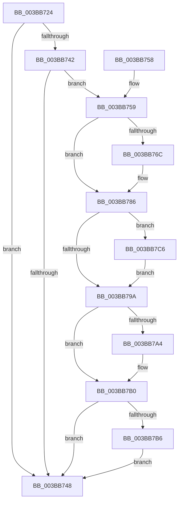

# MiObtainFreePages

- RVA: `0x003BB724`–`0x003BB7D9` (길이 `181` bytes)
- VA: `0x00000001403BB724`
- 실행 섹션: `.text`
- PDB 이름 있음: `예`; PDB Function 태그: `아니요`
- unwind 정보 RVA: `0x000817F8`
- 디코드: `48`개 명령, `181/181` bytes 표시
- 미해석 바이트: `0` (있으면 어셈블리에 `.byte`로 보존)

> 이 문서는 커널 이미지의 기계어와 PDB 기호를 분석해 생성했습니다. 4번과 5번은 함수 원형과 자료형을 바이너리 사용 방식에서 추정한 C 해석이며 원본 소스 복구 결과는 아닙니다.

## 1. Dependencies

- 직접 호출 지점: **6**; 고유 호출 대상: **5**
- 직접 호출자로 확인된 함수: **5**
- RIP 상대 이미지 참조: **0**

### Outgoing calls
- `0x003BB763` → [PsReferencePartitionSafe](PsReferencePartitionSafe_function_003BA6C0.md) (function, `0x003BA6C0`)
- `0x003BB774` → [CcNotifyWriteBehindEx](CcNotifyWriteBehindEx_function_003BCBA8.md) (function, `0x003BCBA8`)
- `0x003BB781` → [PsDereferencePartition](../34/PsDereferencePartition_function_00342E70.md) (function, `0x00342E70`)
- `0x003BB7AB` → [MiWakeModifiedPageWriter](MiWakeModifiedPageWriter_function_003BCB18.md) (function, `0x003BCB18`)
- `0x003BB7BF` → [KeSetEvent](../33/KeSetEvent_function_0033F310.md) (function, `0x0033F310`)
- `0x003BB7D2` → [KeSetEvent](../33/KeSetEvent_function_0033F310.md) (function, `0x0033F310`)

### Direct callers
- [sub_00287E84](../28/Unknown_function_00287E84.md) at `0x00287F0D`
- [MiWaitForFreePage](../2A/MiWaitForFreePage_function_002A3324.md) at `0x002A3425`
- [MiUnlinkFreeOrZeroedPage](../33/MiUnlinkFreeOrZeroedPage_function_00336C40.md) at `0x00337579`
- [sub_0033DA89](../33/Unknown_function_0033DA89.md) at `0x0033DC15`
- [sub_003BB64A](Unknown_function_003BB64A.md) at `0x003BB668`

### Static image references
- 디코드된 RIP-relative 메모리 참조가 없습니다.

## 2. Other-region calls and transfers

- 다른 실행 섹션으로 향하는 call: **0**
- 별도 외부 분기/꼬리 이동을 확인하지 못했습니다.

## 3. Assembly (complete function range)

```asm
003BB724  48 89 5C 24 08                  mov qword ptr [rsp + 8], rbx
003BB729  48 89 74 24 10                  mov qword ptr [rsp + 0x10], rsi
003BB72E  57                              push rdi
003BB72F  48 83 EC 20                     sub rsp, 0x20
003BB733  48 8B B9 C0 44 00 00            mov rdi, qword ptr [rcx + 0x44c0]
003BB73A  48 8B D9                        mov rbx, rcx
003BB73D  48 85 FF                        test rdi, rdi
003BB740  74 06                           je 0x1403bb748
003BB742  80 7F 34 00                     cmp byte ptr [rdi + 0x34], 0
003BB746  74 11                           je 0x1403bb759
003BB748  48 8B 5C 24 30                  mov rbx, qword ptr [rsp + 0x30]
003BB74D  48 8B 74 24 38                  mov rsi, qword ptr [rsp + 0x38]
003BB752  48 83 C4 20                     add rsp, 0x20
003BB756  5F                              pop rdi
003BB757  C3                              ret
003BB758  CC                              int3
003BB759  48 8B B1 B8 00 00 00            mov rsi, qword ptr [rcx + 0xb8]
003BB760  48 8B CE                        mov rcx, rsi
003BB763  E8 58 EF FF FF                  call 0x1403ba6c0
003BB768  84 C0                           test al, al
003BB76A  74 1A                           je 0x1403bb786
003BB76C  48 8B D6                        mov rdx, rsi
003BB76F  B9 01 00 00 00                  mov ecx, 1
003BB774  E8 2F 14 00 00                  call 0x1403bcba8
003BB779  BA 4D 6D 4F 66                  mov edx, 0x664f6d4d
003BB77E  48 8B CE                        mov rcx, rsi
003BB781  E8 EA 76 F8 FF                  call 0x140342e70
003BB786  48 8B 83 C0 4B 00 00            mov rax, qword ptr [rbx + 0x4bc0]
003BB78D  48 2B 83 A0 4C 00 00            sub rax, qword ptr [rbx + 0x4ca0]
003BB794  48 83 F8 10                     cmp rax, 0x10
003BB798  73 2C                           jae 0x1403bb7c6
003BB79A  48 83 BB A0 4C 00 00 10         cmp qword ptr [rbx + 0x4ca0], 0x10
003BB7A2  72 0C                           jb 0x1403bb7b0
003BB7A4  48 83 CA FF                     or rdx, 0xffffffffffffffff
003BB7A8  48 8B CB                        mov rcx, rbx
003BB7AB  E8 68 13 00 00                  call 0x1403bcb18
003BB7B0  80 7F 62 00                     cmp byte ptr [rdi + 0x62], 0
003BB7B4  74 92                           je 0x1403bb748
003BB7B6  48 8D 4F 60                     lea rcx, [rdi + 0x60]
003BB7BA  45 33 C0                        xor r8d, r8d
003BB7BD  33 D2                           xor edx, edx
003BB7BF  E8 4C 3B F8 FF                  call 0x14033f310
003BB7C4  EB 82                           jmp 0x1403bb748
003BB7C6  48 8D 8B 48 03 00 00            lea rcx, [rbx + 0x348]
003BB7CD  45 33 C0                        xor r8d, r8d
003BB7D0  33 D2                           xor edx, edx
003BB7D2  E8 39 3B F8 FF                  call 0x14033f310
003BB7D7  EB C1                           jmp 0x1403bb79a
```

## 4. C-style interpretation (structured pseudocode)

```c
__int64 __fastcall MiObtainFreePages(__int64 a1, __int64 a2, int a3)
{
    __int64 result;
    __int64 v_rsp;
    unsigned __int64 v_stack_p10;
    unsigned __int64 v_stack_p8;

    v_stack_p8 = v_rbx;
    v_stack_p10 = v_rsi;
    v_rsp = (v_rsp) - (32);
    if (*(unsigned __int64 *)(a1 + 17600) == 0) goto loc_003BB748;
    if ((*(unsigned __int8 *)(*(unsigned __int64 *)(a1 + 17600) + 52)) == 0) goto loc_003BB759;
loc_003BB748:
    v_rsp = (v_rsp) + (32);
    return result;
loc_003BB759:
    result = PsReferencePartitionSafe(*(unsigned __int64 *)(a1 + 184), a2, a3, a4);
    if ((unsigned __int8)(result) != 0) {
        a2 = *(unsigned __int64 *)(a1 + 184);
        a1 = 1;
        result = CcNotifyWriteBehindEx(a1, a2, a3, a4);
        a2 = 0x664F6D4DULL;
        a1 = *(unsigned __int64 *)(a1 + 184);
        result = PsDereferencePartition(a1, a2, a3, a4);
    }
    result = (*(unsigned __int64 *)(v_stack_p8 + 19392)) - (*(unsigned __int64 *)(v_stack_p8 + 19616));
    if (result >= 16) goto loc_003BB7C6;
loc_003BB79A:
    if ((*(unsigned __int64 *)(v_stack_p8 + 19616)) >= 16) {
        a2 = (a2) | (-1);
        a1 = v_stack_p8;
        result = MiWakeModifiedPageWriter(a1, a2, a3, a4);
    }
    if ((*(unsigned __int8 *)(*(unsigned __int64 *)(a1 + 17600) + 98)) == 0) goto loc_003BB748;
    a3 = 0;
    a2 = 0;
    result = KeSetEvent(*(unsigned __int64 *)(a1 + 17600) + 96, a2, a3, a4);
    goto loc_003BB748;
loc_003BB7C6:
    a3 = 0;
    a2 = 0;
    result = KeSetEvent(v_stack_p8 + 840, a2, a3, a4);
    goto loc_003BB79A;
}
```

## 5. (Beta) C Style

```c
int64_t MiObtainFreePages(void *Arg1, int64_t Arg2, int32_t Arg3)
{
    uint8_t *arg1 = (uint8_t *)Arg1;

    int64_t result;
    int64_t local_rsp;
    uint64_t v_stack_p10;
    uint64_t v_stack_p8;

    v_stack_p8 = local_rbx;
    v_stack_p10 = local_rsi;
    local_rsp = (local_rsp) - (32);
    if (*(uint64_t *)(arg1 + 0x44C0) == 0) goto loc_003BB748;
    if ((*(uint8_t *)(*(uint64_t *)(arg1 + 0x44C0) + 0x34)) == 0) goto loc_003BB759;
loc_003BB748:
    local_rsp = (local_rsp) + (32);
    return result;
loc_003BB759:
    result = PsReferencePartitionSafe(*(uint64_t *)(arg1 + 0xB8), Arg2, Arg3, a4);
    if ((uint8_t)(result) != 0) {
        Arg2 = *(uint64_t *)(arg1 + 0xB8);
        Arg1 = 1;
        result = CcNotifyWriteBehindEx(Arg1, Arg2, Arg3, a4);
        Arg2 = 0x664F6D4DULL;
        Arg1 = *(uint64_t *)(arg1 + 0xB8);
        result = PsDereferencePartition(Arg1, Arg2, Arg3, a4);
    }
    result = (*(uint64_t *)(v_stack_p8 + 0x4BC0)) - (*(uint64_t *)(v_stack_p8 + 0x4CA0));
    if (result >= 16) goto loc_003BB7C6;
loc_003BB79A:
    if ((*(uint64_t *)(v_stack_p8 + 0x4CA0)) >= 16) {
        Arg2 = (Arg2) | (-1);
        Arg1 = v_stack_p8;
        result = MiWakeModifiedPageWriter(Arg1, Arg2, Arg3, a4);
    }
    if ((*(uint8_t *)(*(uint64_t *)(arg1 + 0x44C0) + 0x62)) == 0) goto loc_003BB748;
    Arg3 = 0;
    Arg2 = 0;
    result = KeSetEvent(*(uint64_t *)(arg1 + 0x44C0) + 96, Arg2, Arg3, a4);
    goto loc_003BB748;
loc_003BB7C6:
    Arg3 = 0;
    Arg2 = 0;
    result = KeSetEvent(v_stack_p8 + 840, Arg2, Arg3, a4);
    goto loc_003BB79A;
}
```

### 관측된 메모리 오프셋

구조체 형식이 확인되지 않은 접근은 인자 기준의 오프셋으로만 기록했습니다.

| 기준 인자 | 오프셋 표현 | 폭 (bit) | 접근 |
|---|---:|---:|---|
| `Arg1` | `+ 0xB8` | `64` | `R` |
| `Arg1` | `+ 0x348` | `64` | `R` |
| `Arg1` | `+ 0x44C0` | `64` | `R` |
| `Arg1` | `+ 0x4BC0` | `64` | `R` |
| `Arg1` | `+ 0x4CA0` | `64` | `R` |

## 6. Execution-region graph

[열기: 2D/3D 그래프와 함수 탐색 컨트롤 패널](../../../control-panel.html?section=text&rva=0x003BB724&view=graph)

- 2D 그래프는 위에서 아래로 흐르고, 3D 그래프는 빈 공간을 드래그해 회전합니다. Shift+드래그는 이동, 휠은 확대·축소, 함수 노드 선택은 대상 보고서 이동입니다.

### Static fallback


