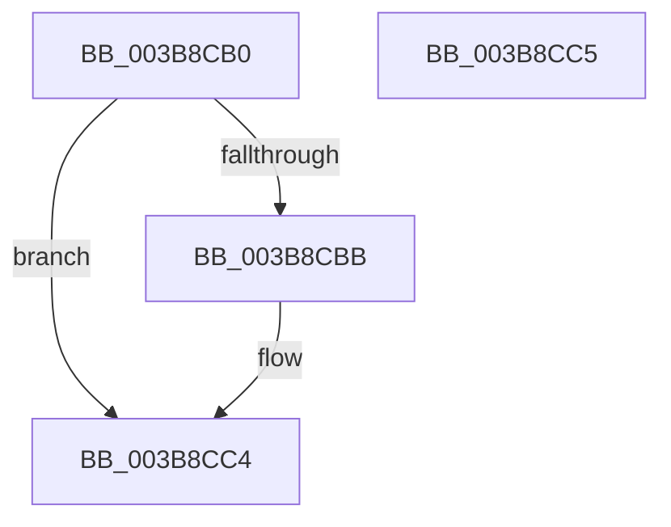

# MiPageIndexToMoveInProgress

- RVA: `0x003B8CB0`–`0x003B8CC6` (길이 `22` bytes)
- VA: `0x00000001403B8CB0`
- 실행 섹션: `.text`
- PDB 이름 있음: `예`; PDB Function 태그: `아니요`
- unwind 정보 RVA: `0x000DB714`
- 디코드: `9`개 명령, `22/22` bytes 표시
- 미해석 바이트: `0` (있으면 어셈블리에 `.byte`로 보존)

> 이 문서는 커널 이미지의 기계어와 PDB 기호를 분석해 생성했습니다. 4번과 5번은 함수 원형과 자료형을 바이너리 사용 방식에서 추정한 C 해석이며 원본 소스 복구 결과는 아닙니다.

## 1. Dependencies

- 직접 호출 지점: **0**; 고유 호출 대상: **0**
- 직접 호출자로 확인된 함수: **1**
- RIP 상대 이미지 참조: **0**

### Outgoing calls
- 직접 디코드된 call 명령이 없습니다.

### Direct callers
- [MiGetLargePageDemoteAsNeeded](MiGetLargePageDemoteAsNeeded_function_003B8440.md) at `0x003B849D`

### Static image references
- 디코드된 RIP-relative 메모리 참조가 없습니다.

## 2. Other-region calls and transfers

- 다른 실행 섹션으로 향하는 call: **0**
- 별도 외부 분기/꼬리 이동을 확인하지 못했습니다.

## 3. Assembly (complete function range)

```asm
003B8CB0  45 33 C0                        xor r8d, r8d
003B8CB3  41 8D 40 02                     lea eax, [r8 + 2]
003B8CB7  85 D2                           test edx, edx
003B8CB9  75 09                           jne 0x1403b8cc4
003B8CBB  3B C8                           cmp ecx, eax
003B8CBD  41 0F 92 C0                     setb r8b
003B8CC1  41 8B C0                        mov eax, r8d
003B8CC4  C3                              ret
003B8CC5  CC                              int3
```

## 4. C-style interpretation (structured pseudocode)

```c
__int64 __fastcall MiPageIndexToMoveInProgress(int a1, int a2, int a3)
{
    __int64 result;

    a3 = 0;
    result = a3 + 2;
    if (a2 == 0) {
        a3 = (a1 < ((unsigned int)(a3 + 2))) ? 1 : 0;
        result = a3;
    }
    return result;
}
```

## 5. (Beta) C Style

```c
int64_t MiPageIndexToMoveInProgress(int32_t Arg1, int32_t Arg2, int32_t Arg3)
{
    int64_t result;

    Arg3 = 0;
    result = Arg3 + 2;
    if (Arg2 == 0) {
        Arg3 = (Arg1 < ((uint32_t)(Arg3 + 2))) ? 1 : 0;
        result = Arg3;
    }
    return result;
}
```

## 6. Execution-region graph

[열기: 2D/3D 그래프와 함수 탐색 컨트롤 패널](../../../control-panel.html?section=text&rva=0x003B8CB0&view=graph)

- 2D 그래프는 위에서 아래로 흐르고, 3D 그래프는 빈 공간을 드래그해 회전합니다. Shift+드래그는 이동, 휠은 확대·축소, 함수 노드 선택은 대상 보고서 이동입니다.

### Static fallback


