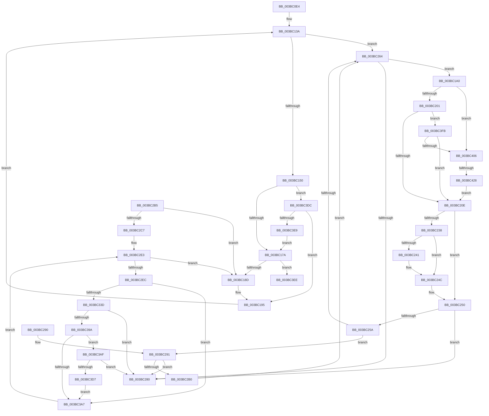

# MiPruneStandbyPages

- RVA: `0x003BC0E4`–`0x003BC435` (길이 `849` bytes)
- VA: `0x00000001403BC0E4`
- 실행 섹션: `.text`
- PDB 이름 있음: `예`; PDB Function 태그: `예`
- unwind 정보 RVA: `0x0008CD5C`
- 디코드: `198`개 명령, `849/849` bytes 표시
- 미해석 바이트: `0` (있으면 어셈블리에 `.byte`로 보존)

> 이 문서는 커널 이미지의 기계어와 PDB 기호를 분석해 생성했습니다. 4번과 5번은 함수 원형과 자료형을 바이너리 사용 방식에서 추정한 C 해석이며 원본 소스 복구 결과는 아닙니다.

## 1. Dependencies

- 직접 호출 지점: **16**; 고유 호출 대상: **13**
- 직접 호출자로 확인된 함수: **1**
- RIP 상대 이미지 참조: **6**

### Outgoing calls
- `0x003BC1CE` → [MiIsFreeZeroPfnCold](../31/MiIsFreeZeroPfnCold_function_0031E5E4.md) (function, `0x0031E5E4`)
- `0x003BC1E8` → [MiPageToNode](../33/MiPageToNode_function_00338CD0.md) (function, `0x00338CD0`)
- `0x003BC1F2` → [MiGetPfnChannel](../33/MiGetPfnChannel_function_0033BA90.md) (function, `0x0033BA90`)
- `0x003BC211` → [MiLockPageInline](../31/MiLockPageInline_function_0031A340.md) (function, `0x0031A340`)
- `0x003BC21F` → [MiInsertPageInFreeOrZeroedList](../33/MiInsertPageInFreeOrZeroedList_function_00334D20.md) (function, `0x00334D20`)
- `0x003BC247` → [KiLowerIrqlProcessIrqlFlags](../4F/KiLowerIrqlProcessIrqlFlags_function_004F5698.md) (function, `0x004F5698`)
- `0x003BC26E` → [MiRemoveLowestPriorityStandbyPage](../33/MiRemoveLowestPriorityStandbyPage_function_00334600.md) (function, `0x00334600`)
- `0x003BC29E` → [MiFreeZeroPagesNeeded](MiFreeZeroPagesNeeded_function_003BBA70.md) (function, `0x003BBA70`)
- `0x003BC2D7` → [MiInitializePageColorBase](../32/MiInitializePageColorBase_function_00320410.md) (function, `0x00320410`)
- `0x003BC32D` → [MiGetPage](../28/MiGetPage_function_002884C0.md) (function, `0x002884C0`)
- `0x003BC350` → [MiSwapNumaStandbyPage](../38/MiSwapNumaStandbyPage_function_00385144.md) (function, `0x00385144`)
- `0x003BC373` → [MiLockPageInline](../31/MiLockPageInline_function_0031A340.md) (function, `0x0031A340`)
- `0x003BC380` → [MiInsertPageInFreeOrZeroedList](../33/MiInsertPageInFreeOrZeroedList_function_00334D20.md) (function, `0x00334D20`)
- `0x003BC38A` → [MiUnlockPage](../31/MiUnlockPage_function_0031A3E0.md) (function, `0x0031A3E0`)
- `0x003BC3C1` → [MiFreeZeroPagesNeeded](MiFreeZeroPagesNeeded_function_003BBA70.md) (function, `0x003BBA70`)
- `0x003BC417` → [MiNodeFreeZeroPages](MiNodeFreeZeroPages_function_003BBF60.md) (function, `0x003BBF60`)

### Direct callers
- [MiRebalanceZeroFreeLists](MiRebalanceZeroFreeLists_function_003BB9B0.md) at `0x003BBA61`

### Static image references
- `0x003BC13A` → RVA `0x00FC5000` (`ALMOSTRO`; read)
- `0x003BC155` → RVA `0x00E2DBD0` (`.data`; read)
- `0x003BC180` → RVA `0x00FC5002` (`ALMOSTRO`; read)
- `0x003BC238` → RVA `0x00FC6D20` (`ALMOSTRO`; read)
- `0x003BC2FF` → RVA `0x00E2DCC0` (`.data`; read)
- `0x003BC3DC` → RVA `0x00FC6A88` (`ALMOSTRO`; read)

## 2. Other-region calls and transfers

- 다른 실행 섹션으로 향하는 call: **0**
- call이 아닌 외부 분기/꼬리 이동: **2**
  - `0x003BC3F6` → [sub_006E7C12](../6E/Unknown_function_006E7C12.md) (`tail-transfer`)
  - `0x003BC422` → [sub_006E7C12 + 0x25](../6E/Unknown_function_006E7C12.md) (`tail-transfer`)

## 3. Assembly (complete function range)

```asm
003BC0E4  48 8B C4                        mov rax, rsp
003BC0E7  4C 89 48 20                     mov qword ptr [rax + 0x20], r9
003BC0EB  44 88 40 18                     mov byte ptr [rax + 0x18], r8b
003BC0EF  48 89 48 08                     mov qword ptr [rax + 8], rcx
003BC0F3  53                              push rbx
003BC0F4  55                              push rbp
003BC0F5  57                              push rdi
003BC0F6  41 54                           push r12
003BC0F8  41 55                           push r13
003BC0FA  41 56                           push r14
003BC0FC  41 57                           push r15
003BC0FE  48 83 EC 40                     sub rsp, 0x40
003BC102  41 BC 02 00 00 00               mov r12d, 2
003BC108  8B FA                           mov edi, edx
003BC10A  48 69 D7 80 DF 00 00            imul rdx, rdi, 0xdf80
003BC111  0F 57 C0                        xorps xmm0, xmm0
003BC114  0F 11 40 B8                     movups xmmword ptr [rax - 0x48], xmm0
003BC118  44 89 64 24 20                  mov dword ptr [rsp + 0x20], r12d
003BC11D  41 8D 5C 24 FF                  lea ebx, [r12 - 1]
003BC122  48 8B 41 10                     mov rax, qword ptr [rcx + 0x10]
003BC126  4C 8B F9                        mov r15, rcx
003BC129  8B 84 02 50 3B 00 00            mov eax, dword ptr [rdx + rax + 0x3b50]
003BC130  83 E0 01                        and eax, 1
003BC133  89 44 24 24                     mov dword ptr [rsp + 0x24], eax
003BC137  45 33 ED                        xor r13d, r13d
003BC13A  0F B7 05 BF 8E C0 00            movzx eax, word ptr [rip + 0xc08ebf]
003BC141  89 9C 24 88 00 00 00            mov dword ptr [rsp + 0x88], ebx
003BC148  3B D8                           cmp ebx, eax
003BC14A  0F 83 14 01 00 00               jae 0x1403bc264
003BC150  0F AF C7                        imul eax, edi
003BC153  03 C3                           add eax, ebx
003BC155  48 8B 1D 74 1A A7 00            mov rbx, qword ptr [rip + 0xa71a74]
003BC15C  8B 1C 83                        mov ebx, dword ptr [rbx + rax*4]
003BC15F  48 69 EB 80 DF 00 00            imul rbp, rbx, 0xdf80
003BC166  49 03 6F 10                     add rbp, qword ptr [r15 + 0x10]
003BC16A  48 8B 85 80 3A 00 00            mov rax, qword ptr [rbp + 0x3a80]
003BC171  48 85 C0                        test rax, rax
003BC174  0F 84 62 02 00 00               je 0x1403bc3dc
003BC17A  45 33 FF                        xor r15d, r15d
003BC17D  45 32 F6                        xor r14b, r14b
003BC180  44 38 35 7B 8E C0 00            cmp byte ptr [rip + 0xc08e7b], r14b
003BC187  0F 87 61 02 00 00               ja 0x1403bc3ee
003BC18D  4C 8B BC 24 80 00 00 00         mov r15, qword ptr [rsp + 0x80]
003BC195  8B 9C 24 88 00 00 00            mov ebx, dword ptr [rsp + 0x88]
003BC19C  FF C3                           inc ebx
003BC19E  EB 9A                           jmp 0x1403bc13a
003BC1A0  4B 8D 2C 76                     lea rbp, [r14 + r14*2]
003BC1A4  4C 89 AC 24 80 00 00 00         mov qword ptr [rsp + 0x80], r13
003BC1AC  48 C1 E5 04                     shl rbp, 4
003BC1B0  48 B8 00 00 00 00 00 DE FF FF   movabs rax, 0xffffde0000000000
003BC1BA  48 8B C8                        mov rcx, rax
003BC1BD  83 A4 24 88 00 00 00 00         and dword ptr [rsp + 0x88], 0
003BC1C5  48 03 E9                        add rbp, rcx
003BC1C8  48 8B CD                        mov rcx, rbp
003BC1CB  49 FF C5                        inc r13
003BC1CE  E8 11 24 F6 FF                  call 0x14031e5e4
003BC1D3  41 8B CC                        mov ecx, r12d
003BC1D6  41 0F BA EC 0A                  bts r12d, 0xa
003BC1DB  0F BA F1 0A                     btr ecx, 0xa
003BC1DF  85 C0                           test eax, eax
003BC1E1  44 0F 44 E1                     cmove r12d, ecx
003BC1E5  49 8B CE                        mov rcx, r14
003BC1E8  E8 E3 CA F7 FF                  call 0x140338cd0
003BC1ED  48 8B CD                        mov rcx, rbp
003BC1F0  8B D8                           mov ebx, eax
003BC1F2  E8 99 F8 F7 FF                  call 0x14033ba90
003BC1F7  8A D0                           mov dl, al
003BC1F9  3B DF                           cmp ebx, edi
003BC1FB  0F 85 05 02 00 00               jne 0x1403bc406
003BC201  3A 84 24 90 00 00 00            cmp al, byte ptr [rsp + 0x90]
003BC208  0F 85 ED 01 00 00               jne 0x1403bc3fb
003BC20E  48 8B CD                        mov rcx, rbp
003BC211  E8 2A E1 F5 FF                  call 0x14031a340
003BC216  41 8B D4                        mov edx, r12d
003BC219  0F B6 D8                        movzx ebx, al
003BC21C  49 8B CE                        mov rcx, r14
003BC21F  E8 FC 8A F7 FF                  call 0x140334d20
003BC224  48 B8 FF FF FF FF FF FF FF 7F   movabs rax, 0x7fffffffffffffff
003BC22E  F0 48 21 45 18                  lock and qword ptr [rbp + 0x18], rax
003BC233  80 FB 02                        cmp bl, 2
003BC236  73 18                           jae 0x1403bc250
003BC238  83 3D E1 AA C0 00 00            cmp dword ptr [rip + 0xc0aae1], 0
003BC23F  74 0B                           je 0x1403bc24c
003BC241  44 0F 20 C1                     mov rcx, cr8
003BC245  8A D3                           mov dl, bl
003BC247  E8 4C 94 13 00                  call 0x1404f5698
003BC24C  44 0F 22 C3                     mov cr8, rbx
003BC250  83 BC 24 88 00 00 00 00         cmp dword ptr [rsp + 0x88], 0
003BC258  75 26                           jne 0x1403bc280
003BC25A  4C 3B AC 24 98 00 00 00         cmp r13, qword ptr [rsp + 0x98]
003BC262  74 2D                           je 0x1403bc291
003BC264  45 33 C0                        xor r8d, r8d
003BC267  49 8B CF                        mov rcx, r15
003BC26A  41 8D 50 08                     lea edx, [r8 + 8]
003BC26E  E8 8D 83 F7 FF                  call 0x140334600
003BC273  4C 8B F0                        mov r14, rax
003BC276  48 83 F8 FF                     cmp rax, -1
003BC27A  0F 85 20 FF FF FF               jne 0x1403bc1a0
003BC280  48 83 C4 40                     add rsp, 0x40
003BC284  41 5F                           pop r15
003BC286  41 5E                           pop r14
003BC288  41 5D                           pop r13
003BC28A  41 5C                           pop r12
003BC28C  5F                              pop rdi
003BC28D  5D                              pop rbp
003BC28E  5B                              pop rbx
003BC28F  C3                              ret
003BC290  CC                              int3
003BC291  44 8A 84 24 90 00 00 00         mov r8b, byte ptr [rsp + 0x90]
003BC299  8B D7                           mov edx, edi
003BC29B  49 8B CF                        mov rcx, r15
003BC29E  E8 CD F7 FF FF                  call 0x1403bba70
003BC2A3  48 89 84 24 98 00 00 00         mov qword ptr [rsp + 0x98], rax
003BC2AB  48 85 C0                        test rax, rax
003BC2AE  74 D0                           je 0x1403bc280
003BC2B0  45 33 ED                        xor r13d, r13d
003BC2B3  EB AF                           jmp 0x1403bc264
003BC2B5  44 8B 64 24 20                  mov r12d, dword ptr [rsp + 0x20]
003BC2BA  49 81 FF 00 00 01 00            cmp r15, 0x10000
003BC2C1  0F 86 C6 FE FF FF               jbe 0x1403bc18d
003BC2C7  44 8D 43 01                     lea r8d, [rbx + 1]
003BC2CB  BA 03 00 00 00                  mov edx, 3
003BC2D0  4C 8D 4C 24 30                  lea r9, [rsp + 0x30]
003BC2D5  33 C9                           xor ecx, ecx
003BC2D7  E8 34 41 F6 FF                  call 0x140320410
003BC2DC  49 81 EF 00 00 01 00            sub r15, 0x10000
003BC2E3  4D 85 FF                        test r15, r15
003BC2E6  0F 84 A1 FE FF FF               je 0x1403bc18d
003BC2EC  48 8B 4C 24 30                  mov rcx, qword ptr [rsp + 0x30]
003BC2F1  B8 01 00 00 00                  mov eax, 1
003BC2F6  F0 0F C1 01                     lock xadd dword ptr [rcx], eax
003BC2FA  4C 8B 44 24 38                  mov r8, qword ptr [rsp + 0x38]
003BC2FF  4C 8D 0D BA 19 A7 00            lea r9, [rip + 0xa719ba]
003BC306  33 D2                           xor edx, edx
003BC308  49 8B C8                        mov rcx, r8
003BC30B  48 C1 E9 10                     shr rcx, 0x10
003BC30F  83 E1 03                        and ecx, 3
003BC312  41 F7 34 89                     div dword ptr [r9 + rcx*4]
003BC316  48 8B 8C 24 80 00 00 00         mov rcx, qword ptr [rsp + 0x80]
003BC31E  41 33 D0                        xor edx, r8d
003BC321  0F B6 D2                        movzx edx, dl
003BC324  41 33 D0                        xor edx, r8d
003BC327  41 B8 00 10 01 00               mov r8d, 0x11000
003BC32D  E8 8E C1 EC FF                  call 0x1402884c0
003BC332  48 89 44 24 28                  mov qword ptr [rsp + 0x28], rax
003BC337  48 83 F8 FF                     cmp rax, -1
003BC33B  74 6A                           je 0x1403bc3a7
003BC33D  44 8A 84 24 90 00 00 00         mov r8b, byte ptr [rsp + 0x90]
003BC345  41 B9 00 10 00 00               mov r9d, 0x1000
003BC34B  8B D7                           mov edx, edi
003BC34D  48 8B C8                        mov rcx, rax
003BC350  E8 EF 8D FC FF                  call 0x140385144
003BC355  4C 8B F0                        mov r14, rax
003BC358  48 8D 2C 40                     lea rbp, [rax + rax*2]
003BC35C  48 B8 00 00 00 00 00 DE FF FF   movabs rax, 0xffffde0000000000
003BC366  48 C1 E5 04                     shl rbp, 4
003BC36A  48 8B D0                        mov rdx, rax
003BC36D  48 03 EA                        add rbp, rdx
003BC370  48 8B CD                        mov rcx, rbp
003BC373  E8 C8 DF F5 FF                  call 0x14031a340
003BC378  41 8B D4                        mov edx, r12d
003BC37B  49 8B CE                        mov rcx, r14
003BC37E  8A D8                           mov bl, al
003BC380  E8 9B 89 F7 FF                  call 0x140334d20
003BC385  8A D3                           mov dl, bl
003BC387  48 8B CD                        mov rcx, rbp
003BC38A  E8 51 E0 F5 FF                  call 0x14031a3e0
003BC38F  4C 3B 74 24 28                  cmp r14, qword ptr [rsp + 0x28]
003BC394  0F 84 E6 FE FF FF               je 0x1403bc280
003BC39A  49 FF C5                        inc r13
003BC39D  4C 3B AC 24 98 00 00 00         cmp r13, qword ptr [rsp + 0x98]
003BC3A5  74 08                           je 0x1403bc3af
003BC3A7  49 FF CF                        dec r15
003BC3AA  E9 34 FF FF FF                  jmp 0x1403bc2e3
003BC3AF  44 8A 84 24 90 00 00 00         mov r8b, byte ptr [rsp + 0x90]
003BC3B7  8B D7                           mov edx, edi
003BC3B9  48 8B 8C 24 80 00 00 00         mov rcx, qword ptr [rsp + 0x80]
003BC3C1  E8 AA F6 FF FF                  call 0x1403bba70
003BC3C6  48 89 84 24 98 00 00 00         mov qword ptr [rsp + 0x98], rax
003BC3CE  48 85 C0                        test rax, rax
003BC3D1  0F 84 A9 FE FF FF               je 0x1403bc280
003BC3D7  45 33 ED                        xor r13d, r13d
003BC3DA  EB CB                           jmp 0x1403bc3a7
003BC3DC  F6 05 A5 A6 C0 00 30            test byte ptr [rip + 0xc0a6a5], 0x30
003BC3E3  0F 85 AC FD FF FF               jne 0x1403bc195
003BC3E9  E9 8C FD FF FF                  jmp 0x1403bc17a
003BC3EE  44 8A A4 24 90 00 00 00         mov r12b, byte ptr [rsp + 0x90]
003BC3F6  E9 17 B8 32 00                  jmp 0x1406e7c12
003BC3FB  83 7C 24 24 00                  cmp dword ptr [rsp + 0x24], 0
003BC400  0F 84 08 FE FF FF               je 0x1403bc20e
003BC406  48 69 CB 80 DF 00 00            imul rcx, rbx, 0xdf80
003BC40D  41 B8 00 00 08 00               mov r8d, 0x80000
003BC413  49 03 4F 10                     add rcx, qword ptr [r15 + 0x10]
003BC417  E8 44 FB FF FF                  call 0x1403bbf60
003BC41C  48 3D 00 02 00 00               cmp rax, 0x200
003BC422  0F 83 0F B8 32 00               jae 0x1406e7c37
003BC428  4C 8B AC 24 80 00 00 00         mov r13, qword ptr [rsp + 0x80]
003BC430  E9 D9 FD FF FF                  jmp 0x1403bc20e
```

## 4. C-style interpretation (structured pseudocode)

```c
__int64 __fastcall MiPruneStandbyPages(__int64 a1, int a2, int a3, __int64 a4)
{
    __int64 result;
    __int64 v_r12;
    __int64 v_r13;
    __int64 v_r14;
    __int64 v_r15;
    __int64 v_rbp;
    __int64 v_rbx;
    __int64 v_rsp;
    unsigned int v_stack_m54;
    unsigned int v_stack_m58;
    unsigned int v_stack_p10;
    unsigned __int8 v_stack_p18;
    unsigned __int64 v_stack_p20;
    unsigned int v_stack_p24;
    unsigned __int64 v_stack_p28;
    unsigned __int64 v_stack_p30;
    unsigned __int64 v_stack_p38;
    unsigned __int64 v_stack_p8;
    unsigned __int64 v_stack_p80;
    unsigned __int8 v_stack_p90;
    unsigned __int64 v_stack_p98;

    *(unsigned __int64 *)(v_rsp + 32) = a4;
    *(unsigned __int8 *)(v_rsp + 24) = (unsigned __int8)(a3);
    *(unsigned __int64 *)(v_rsp + 8) = a1;
    v_rsp = (v_rsp) - (64);
    a2 = (a2) * ((unsigned int)(a2));
    *(unsigned __int64 *)(v_rsp - 72) = v_xmm0;
    v_stack_m58 = 2;
    result = (unsigned int)(((unsigned int)(*(unsigned int *)(a2 + *(unsigned __int64 *)(a1 + 16) * 1 + 15184))) & (1));
    v_stack_m54 = (unsigned int)(result);
    v_r13 = 0;
loc_003BC13A:
    v_stack_p10 = (unsigned int)(2 - 1);
    if (((unsigned int)(2 - 1)) >= ((unsigned int)(*(unsigned __int16 *)(v_rip + 12619455)))) goto loc_003BC264;
    result = (unsigned int)((*(unsigned __int16 *)(v_rip + 12619455)) * ((unsigned int)((unsigned int)(a2))));
    result = (unsigned int)((result) + ((unsigned int)(2 - 1)));
    v_rbp = (v_rbp) * ((unsigned int)(*(unsigned int *)(*(unsigned __int64 *)(v_rip + 10951284) + result * 4)));
    v_rbp = (v_rbp) + (*(unsigned __int64 *)(a1 + 16));
    if (*(unsigned __int64 *)(v_rbp + 14976) == 0) goto loc_003BC3DC;
loc_003BC17A:
    v_r15 = 0;
    v_r14 = 0;
    if ((*(unsigned __int8 *)(v_rip + 12619387)) > 0) goto loc_003BC3EE;
loc_003BC18D:
loc_003BC195:
    v_rbx = (unsigned int)(((unsigned int)(v_stack_p10)) + 1);
    goto loc_003BC13A;
loc_003BC1A0:
    v_stack_p8 = 0;
    v_rbp = (v_r14 + v_r14 * 2) << (4);
    v_rbp = (v_rbp) + (*(unsigned __int64 *)(v_rbp + 14976));
    v_r13 = (v_r13) + 1;
    result = MiIsFreeZeroPfnCold(v_rbp, a2, a3, a4);
    v_r12 = 2;
    if ((unsigned int)(result) == 0) { v_r12 = 2; }
    result = MiPageToNode(0, a2, a3, a4);
    result = MiGetPfnChannel(v_rbp, a2, a3, a4);
    if (((unsigned int)((unsigned int)((unsigned int)(result)))) != ((unsigned int)((unsigned int)(a2)))) goto loc_003BC406;
    if (((unsigned __int8)(result)) != v_stack_p18) goto loc_003BC3FB;
loc_003BC20E:
    result = MiLockPageInline(v_rbp, (unsigned __int8)(result), a3, a4);
    result = MiInsertPageInFreeOrZeroedList(0, (unsigned int)((unsigned int)(v_r12)), a3, a4);
    if (((unsigned __int8)((unsigned __int8)(result))) >= 2) goto loc_003BC250;
    if ((*(unsigned int *)(v_rip + 12626657)) != 0) {
        a1 = v_cr8;
        a2 = (unsigned __int8)((unsigned __int8)(result));
        result = KiLowerIrqlProcessIrqlFlags(a1, a2, a3, a4);
    }
loc_003BC250:
    if (v_stack_p10 != 0) goto loc_003BC280;
    if (v_r13 == v_stack_p20) goto loc_003BC291;
loc_003BC264:
    a3 = 0;
    result = MiRemoveLowestPriorityStandbyPage(v_stack_p8, a3 + 8, a3, a4);
    if (result != -1) goto loc_003BC1A0;
loc_003BC280:
    v_rsp = (v_rsp) + (64);
    return result;
loc_003BC291:
    result = MiFreeZeroPagesNeeded(v_stack_p8, (unsigned int)((unsigned int)((unsigned int)(a2))), v_stack_p90, a4);
    v_stack_p98 = result;
    if (result == 0) goto loc_003BC280;
    v_r13 = 0;
    goto loc_003BC264;
loc_003BC3DC:
    if (((*(unsigned __int8 *)(v_rip + 12625573)) & (48)) != 0) goto loc_003BC195;
    goto loc_003BC17A;
loc_003BC3EE:
loc_003BC3FB:
    if (v_stack_p24 == 0) goto loc_003BC20E;
loc_003BC406:
    a1 = (v_stack_p8) * ((unsigned __int8)(result));
    a1 = (a1) + (*(unsigned __int64 *)(v_stack_p8 + 16));
    result = MiNodeFreeZeroPages(a1, (unsigned int)((unsigned int)((unsigned int)(a2))), (unsigned int)(0x80000ULL), a4);
    goto loc_003BC20E;
}
```

## 5. (Beta) C Style

```c
int64_t MiPruneStandbyPages(void *Arg1, void *Arg2, int32_t Arg3, int64_t Arg4)
{
    uint8_t *arg1 = (uint8_t *)Arg1;
    uint8_t *arg2 = (uint8_t *)Arg2;

    int64_t result;
    int64_t local_r12;
    int64_t local_r13;
    int64_t local_r14;
    int64_t local_r15;
    int64_t local_rbp;
    int64_t local_rbx;
    int64_t local_rsp;
    uint32_t v_stack_m54;
    uint32_t v_stack_m58;
    uint32_t v_stack_p10;
    uint8_t v_stack_p18;
    uint64_t v_stack_p20;
    uint32_t v_stack_p24;
    uint64_t v_stack_p28;
    uint64_t v_stack_p30;
    uint64_t v_stack_p38;
    uint64_t v_stack_p8;
    uint64_t v_stack_p80;
    uint8_t v_stack_p90;
    uint64_t v_stack_p98;

    *(uint64_t *)(local_rsp + 0x20) = Arg4;
    *(uint8_t *)(local_rsp + 0x18) = (uint8_t)(Arg3);
    *(void **)(local_rsp + 0x8) = Arg1;
    local_rsp = (local_rsp) - (64);
    Arg2 = (Arg2) * ((uint32_t)(Arg2));
    *(uint64_t *)(local_rsp - 0x48) = v_xmm0;
    v_stack_m58 = 2;
    result = (uint32_t)(((uint32_t)(*(uint32_t *)(arg2 + *(uint64_t *)(arg1 + 0x10) * 1 + 0x3B50))) & (1));
    v_stack_m54 = (uint32_t)(result);
    local_r13 = 0;
loc_003BC13A:
    v_stack_p10 = (uint32_t)(2 - 1);
    if (((uint32_t)(2 - 1)) >= ((uint32_t)(*(uint16_t *)(v_rip + 0xC08EBF)))) goto loc_003BC264;
    result = (uint32_t)((*(uint16_t *)(v_rip + 0xC08EBF)) * ((uint32_t)((uint32_t)(Arg2))));
    result = (uint32_t)((result) + ((uint32_t)(2 - 1)));
    local_rbp = (local_rbp) * ((uint32_t)(*(uint32_t *)(*(uint64_t *)(v_rip + 0xA71A74) + result * 4)));
    local_rbp = (local_rbp) + (*(uint64_t *)(arg1 + 0x10));
    if (*(uint64_t *)(local_rbp + 0x3A80) == 0) goto loc_003BC3DC;
loc_003BC17A:
    local_r15 = 0;
    local_r14 = 0;
    if ((*(uint8_t *)(v_rip + 0xC08E7B)) > 0) goto loc_003BC3EE;
loc_003BC18D:
loc_003BC195:
    local_rbx = (uint32_t)(((uint32_t)(v_stack_p10)) + 1);
    goto loc_003BC13A;
loc_003BC1A0:
    v_stack_p8 = 0;
    local_rbp = (local_r14 + local_r14 * 2) << (4);
    local_rbp = (local_rbp) + (*(uint64_t *)(local_rbp + 0x3A80));
    local_r13 = (local_r13) + 1;
    result = MiIsFreeZeroPfnCold(local_rbp, Arg2, Arg3, Arg4);
    local_r12 = 2;
    if ((uint32_t)(result) == 0) { local_r12 = 2; }
    result = MiPageToNode(0, Arg2, Arg3, Arg4);
    result = MiGetPfnChannel(local_rbp, Arg2, Arg3, Arg4);
    if (((uint32_t)((uint32_t)((uint32_t)(result)))) != ((uint32_t)((uint32_t)(Arg2)))) goto loc_003BC406;
    if (((uint8_t)(result)) != v_stack_p18) goto loc_003BC3FB;
loc_003BC20E:
    result = MiLockPageInline(local_rbp, (uint8_t)(result), Arg3, Arg4);
    result = MiInsertPageInFreeOrZeroedList(0, (uint32_t)((uint32_t)(local_r12)), Arg3, Arg4);
    if (((uint8_t)((uint8_t)(result))) >= 2) goto loc_003BC250;
    if ((*(uint32_t *)(v_rip + 0xC0AAE1)) != 0) {
        Arg1 = v_cr8;
        Arg2 = (uint8_t)((uint8_t)(result));
        result = KiLowerIrqlProcessIrqlFlags(Arg1, Arg2, Arg3, Arg4);
    }
loc_003BC250:
    if (v_stack_p10 != 0) goto loc_003BC280;
    if (local_r13 == v_stack_p20) goto loc_003BC291;
loc_003BC264:
    Arg3 = 0;
    result = MiRemoveLowestPriorityStandbyPage(v_stack_p8, Arg3 + 8, Arg3, Arg4);
    if (result != -1) goto loc_003BC1A0;
loc_003BC280:
    local_rsp = (local_rsp) + (64);
    return result;
loc_003BC291:
    result = MiFreeZeroPagesNeeded(v_stack_p8, (uint32_t)((uint32_t)((uint32_t)(Arg2))), v_stack_p90, Arg4);
    v_stack_p98 = result;
    if (result == 0) goto loc_003BC280;
    local_r13 = 0;
    goto loc_003BC264;
loc_003BC3DC:
    if (((*(uint8_t *)(v_rip + 0xC0A6A5)) & (48)) != 0) goto loc_003BC195;
    goto loc_003BC17A;
loc_003BC3EE:
loc_003BC3FB:
    if (v_stack_p24 == 0) goto loc_003BC20E;
loc_003BC406:
    Arg1 = (v_stack_p8) * ((uint8_t)(result));
    Arg1 = (Arg1) + (*(uint64_t *)(v_stack_p8 + 0x10));
    result = MiNodeFreeZeroPages(Arg1, (uint32_t)((uint32_t)((uint32_t)(Arg2))), (uint32_t)(0x80000ULL), Arg4);
    goto loc_003BC20E;
}
```

### 관측된 메모리 오프셋

구조체 형식이 확인되지 않은 접근은 인자 기준의 오프셋으로만 기록했습니다.

| 기준 인자 | 오프셋 표현 | 폭 (bit) | 접근 |
|---|---:|---:|---|
| `Arg1` | `+ 0x10` | `64` | `R` |
| `Arg2` | `+ 0x3B50 + rax*1` | `32` | `R` |

## 6. Execution-region graph

[열기: 2D/3D 그래프와 함수 탐색 컨트롤 패널](../../../control-panel.html?section=text&rva=0x003BC0E4&view=graph)

- 2D 그래프는 위에서 아래로 흐르고, 3D 그래프는 빈 공간을 드래그해 회전합니다. Shift+드래그는 이동, 휠은 확대·축소, 함수 노드 선택은 대상 보고서 이동입니다.

### Static fallback


