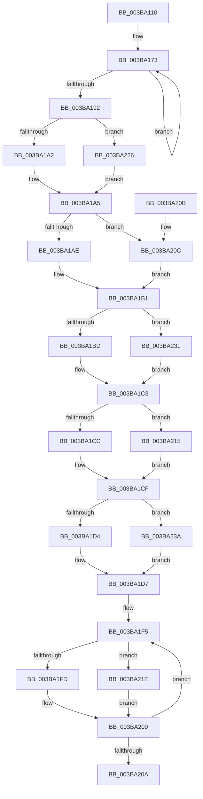

# MiQueryMemoryListInformation

- RVA: `0x003BA110`–`0x003BA243` (길이 `307` bytes)
- VA: `0x00000001403BA110`
- 실행 섹션: `.text`
- PDB 이름 있음: `예`; PDB Function 태그: `아니요`
- unwind 정보 RVA: `0x000DB714`
- 디코드: `81`개 명령, `307/307` bytes 표시
- 미해석 바이트: `0` (있으면 어셈블리에 `.byte`로 보존)

> 이 문서는 커널 이미지의 기계어와 PDB 기호를 분석해 생성했습니다. 4번과 5번은 함수 원형과 자료형을 바이너리 사용 방식에서 추정한 C 해석이며 원본 소스 복구 결과는 아닙니다.

## 1. Dependencies

- 직접 호출 지점: **0**; 고유 호출 대상: **0**
- 직접 호출자로 확인된 함수: **2**
- RIP 상대 이미지 참조: **0**

### Outgoing calls
- 직접 디코드된 call 명령이 없습니다.

### Direct callers
- [MmQueryMemoryListInformation](MmQueryMemoryListInformation_function_003B9EDC.md) at `0x003B9FAF`
- [MmManagePartitionMemoryInformation](../../page/90/MmManagePartitionMemoryInformation_function_0090343C.md) at `0x0090355C`

### Static image references
- 디코드된 RIP-relative 메모리 참조가 없습니다.

## 2. Other-region calls and transfers

- 다른 실행 섹션으로 향하는 call: **0**
- 별도 외부 분기/꼬리 이동을 확인하지 못했습니다.

## 3. Assembly (complete function range)

```asm
003BA110  48 8B 81 40 0B 00 00            mov rax, qword ptr [rcx + 0xb40]
003BA117  4C 8D 91 20 1C 00 00            lea r10, [rcx + 0x1c20]
003BA11E  4C 8B 81 50 48 00 00            mov r8, qword ptr [rcx + 0x4850]
003BA125  4C 8D 4A 68                     lea r9, [rdx + 0x68]
003BA129  48 89 02                        mov qword ptr [rdx], rax
003BA12C  41 BB 08 00 00 00               mov r11d, 8
003BA132  48 8B 81 C0 0B 00 00            mov rax, qword ptr [rcx + 0xbc0]
003BA139  48 89 42 08                     mov qword ptr [rdx + 8], rax
003BA13D  48 8B 81 C0 4B 00 00            mov rax, qword ptr [rcx + 0x4bc0]
003BA144  48 89 42 10                     mov qword ptr [rdx + 0x10], rax
003BA148  48 8B 81 40 4C 00 00            mov rax, qword ptr [rcx + 0x4c40]
003BA14F  48 89 42 18                     mov qword ptr [rdx + 0x18], rax
003BA153  48 8B 81 80 1B 00 00            mov rax, qword ptr [rcx + 0x1b80]
003BA15A  48 89 42 20                     mov qword ptr [rdx + 0x20], rax
003BA15E  48 8B 81 A0 4C 00 00            mov rax, qword ptr [rcx + 0x4ca0]
003BA165  48 81 C1 C0 0C 00 00            add rcx, 0xcc0
003BA16C  48 89 82 A8 00 00 00            mov qword ptr [rdx + 0xa8], rax
003BA173  48 8B 01                        mov rax, qword ptr [rcx]
003BA176  48 8D 49 58                     lea rcx, [rcx + 0x58]
003BA17A  49 89 41 C0                     mov qword ptr [r9 - 0x40], rax
003BA17E  41 8B 02                        mov eax, dword ptr [r10]
003BA181  4D 8D 52 04                     lea r10, [r10 + 4]
003BA185  49 89 01                        mov qword ptr [r9], rax
003BA188  4D 8D 49 08                     lea r9, [r9 + 8]
003BA18C  49 83 EB 01                     sub r11, 1
003BA190  75 E1                           jne 0x1403ba173
003BA192  48 8B 02                        mov rax, qword ptr [rdx]
003BA195  4C 8B 4A 20                     mov r9, qword ptr [rdx + 0x20]
003BA199  49 3B C0                        cmp rax, r8
003BA19C  0F 87 84 00 00 00               ja 0x1403ba226
003BA1A2  4C 2B C0                        sub r8, rax
003BA1A5  48 8B 42 08                     mov rax, qword ptr [rdx + 8]
003BA1A9  49 3B C0                        cmp rax, r8
003BA1AC  77 5E                           ja 0x1403ba20c
003BA1AE  4C 2B C0                        sub r8, rax
003BA1B1  48 8B 42 10                     mov rax, qword ptr [rdx + 0x10]
003BA1B5  49 8B C8                        mov rcx, r8
003BA1B8  49 3B C0                        cmp rax, r8
003BA1BB  77 74                           ja 0x1403ba231
003BA1BD  4C 2B C0                        sub r8, rax
003BA1C0  48 8B C8                        mov rcx, rax
003BA1C3  48 8B 42 18                     mov rax, qword ptr [rdx + 0x18]
003BA1C7  49 3B C0                        cmp rax, r8
003BA1CA  77 49                           ja 0x1403ba215
003BA1CC  4C 2B C0                        sub r8, rax
003BA1CF  4D 3B C8                        cmp r9, r8
003BA1D2  77 66                           ja 0x1403ba23a
003BA1D4  4D 2B C1                        sub r8, r9
003BA1D7  48 8B 82 A8 00 00 00            mov rax, qword ptr [rdx + 0xa8]
003BA1DE  48 3B C1                        cmp rax, rcx
003BA1E1  48 0F 43 C1                     cmovae rax, rcx
003BA1E5  B9 08 00 00 00                  mov ecx, 8
003BA1EA  48 89 82 A8 00 00 00            mov qword ptr [rdx + 0xa8], rax
003BA1F1  48 83 C2 28                     add rdx, 0x28
003BA1F5  48 8B 02                        mov rax, qword ptr [rdx]
003BA1F8  49 3B C0                        cmp rax, r8
003BA1FB  77 21                           ja 0x1403ba21e
003BA1FD  4C 2B C0                        sub r8, rax
003BA200  48 83 C2 08                     add rdx, 8
003BA204  48 83 E9 01                     sub rcx, 1
003BA208  75 EB                           jne 0x1403ba1f5
003BA20A  C3                              ret
003BA20B  CC                              int3
003BA20C  4C 89 42 08                     mov qword ptr [rdx + 8], r8
003BA210  45 33 C0                        xor r8d, r8d
003BA213  EB 9C                           jmp 0x1403ba1b1
003BA215  4C 89 42 18                     mov qword ptr [rdx + 0x18], r8
003BA219  45 33 C0                        xor r8d, r8d
003BA21C  EB B1                           jmp 0x1403ba1cf
003BA21E  4C 89 02                        mov qword ptr [rdx], r8
003BA221  45 33 C0                        xor r8d, r8d
003BA224  EB DA                           jmp 0x1403ba200
003BA226  4C 89 02                        mov qword ptr [rdx], r8
003BA229  45 33 C0                        xor r8d, r8d
003BA22C  E9 74 FF FF FF                  jmp 0x1403ba1a5
003BA231  4C 89 42 10                     mov qword ptr [rdx + 0x10], r8
003BA235  45 33 C0                        xor r8d, r8d
003BA238  EB 89                           jmp 0x1403ba1c3
003BA23A  4C 89 42 20                     mov qword ptr [rdx + 0x20], r8
003BA23E  45 33 C0                        xor r8d, r8d
003BA241  EB 94                           jmp 0x1403ba1d7
```

## 4. C-style interpretation (structured pseudocode)

```c
__int64 __fastcall MiQueryMemoryListInformation(__int64 a1, __int64 a2)
{
    __int64 result;
    __int64 v_r11;

    *(unsigned __int64 *)(a2) = *(unsigned __int64 *)(a1 + 2880);
    *(unsigned __int64 *)(a2 + 8) = *(unsigned __int64 *)(a1 + 3008);
    *(unsigned __int64 *)(a2 + 16) = *(unsigned __int64 *)(a1 + 19392);
    *(unsigned __int64 *)(a2 + 24) = *(unsigned __int64 *)(a1 + 19520);
    *(unsigned __int64 *)(a2 + 32) = *(unsigned __int64 *)(a1 + 7040);
    a1 = (a1) + (0xCC0ULL);
    *(unsigned __int64 *)(a2 + 168) = *(unsigned __int64 *)(a1 + 19616);
loc_003BA173:
    *(unsigned __int64 *)(a2 + 104 - 64) = *(unsigned __int64 *)(a1);
    *(unsigned __int64 *)(a2 + 104) = (unsigned int)(*(unsigned int *)(a1 + 7200));
    v_r11 = (8) - (1);
    if (condition_is_not_equal) goto loc_003BA173;
    if ((*(unsigned __int64 *)(a2)) > (*(unsigned __int64 *)(a1 + 18512))) goto loc_003BA226;
    a3 = (*(unsigned __int64 *)(a1 + 18512)) - (*(unsigned __int64 *)(a2));
loc_003BA1A5:
    if ((*(unsigned __int64 *)(a2 + 8)) > a3) goto loc_003BA20C;
    a3 = (a3) - (*(unsigned __int64 *)(a2 + 8));
loc_003BA1B1:
    if ((*(unsigned __int64 *)(a2 + 16)) > a3) goto loc_003BA231;
    a3 = (a3) - (*(unsigned __int64 *)(a2 + 16));
loc_003BA1C3:
    if ((*(unsigned __int64 *)(a2 + 24)) > a3) goto loc_003BA215;
    a3 = (a3) - (*(unsigned __int64 *)(a2 + 24));
loc_003BA1CF:
    if ((*(unsigned __int64 *)(a2 + 32)) > a3) goto loc_003BA23A;
    a3 = (a3) - (*(unsigned __int64 *)(a2 + 32));
loc_003BA1D7:
    result = *(unsigned __int64 *)(a2 + 168);
    if ((*(unsigned __int64 *)(a2 + 168)) >= (*(unsigned __int64 *)(a2 + 16))) { result = *(unsigned __int64 *)(a2 + 16); }
    *(unsigned __int64 *)(a2 + 168) = result;
    a2 = (a2) + (40);
loc_003BA1F5:
    if ((*(unsigned __int64 *)(a2)) > a3) goto loc_003BA21E;
    a3 = (a3) - (*(unsigned __int64 *)(a2));
loc_003BA200:
    a2 = (a2) + (8);
    a1 = (8) - (1);
    if (condition_is_not_equal) goto loc_003BA1F5;
    return *(unsigned __int64 *)(a2);
loc_003BA20C:
    *(unsigned __int64 *)(a2 + 8) = a3;
    a3 = 0;
    goto loc_003BA1B1;
loc_003BA215:
    *(unsigned __int64 *)(a2 + 24) = 0;
    a3 = 0;
    goto loc_003BA1CF;
loc_003BA21E:
    *(unsigned __int64 *)(a2) = 0;
    a3 = 0;
    goto loc_003BA200;
loc_003BA226:
    *(unsigned __int64 *)(a2) = 0;
    a3 = 0;
    goto loc_003BA1A5;
loc_003BA231:
    *(unsigned __int64 *)(a2 + 16) = 0;
    a3 = 0;
    goto loc_003BA1C3;
loc_003BA23A:
    *(unsigned __int64 *)(a2 + 32) = 0;
    a3 = 0;
    goto loc_003BA1D7;
}
```

## 5. (Beta) C Style

```c
int64_t MiQueryMemoryListInformation(void *Arg1, void *Arg2)
{
    uint8_t *arg1 = (uint8_t *)Arg1;
    uint8_t *arg2 = (uint8_t *)Arg2;

    int64_t result;
    int64_t local_r11;

    *(uint64_t *)(arg2) = *(uint64_t *)(arg1 + 0xB40);
    *(uint64_t *)(arg2 + 0x8) = *(uint64_t *)(arg1 + 0xBC0);
    *(uint64_t *)(arg2 + 0x10) = *(uint64_t *)(arg1 + 0x4BC0);
    *(uint64_t *)(arg2 + 0x18) = *(uint64_t *)(arg1 + 0x4C40);
    *(uint64_t *)(arg2 + 0x20) = *(uint64_t *)(arg1 + 0x1B80);
    Arg1 = (Arg1) + (0xCC0ULL);
    *(uint64_t *)(arg2 + 0xA8) = *(uint64_t *)(arg1 + 0x4CA0);
loc_003BA173:
    *(uint64_t *)(arg2 + 0x68 - 0x40) = *(uint64_t *)(arg1);
    *(uint64_t *)(arg2 + 0x68) = (uint32_t)(*(uint32_t *)(arg1 + 0x1C20));
    local_r11 = (8) - (1);
    if (condition_is_not_equal) goto loc_003BA173;
    if ((*(uint64_t *)(arg2)) > (*(uint64_t *)(arg1 + 0x4850))) goto loc_003BA226;
    a3 = (*(uint64_t *)(arg1 + 0x4850)) - (*(uint64_t *)(arg2));
loc_003BA1A5:
    if ((*(uint64_t *)(arg2 + 0x8)) > a3) goto loc_003BA20C;
    a3 = (a3) - (*(uint64_t *)(arg2 + 0x8));
loc_003BA1B1:
    if ((*(uint64_t *)(arg2 + 0x10)) > a3) goto loc_003BA231;
    a3 = (a3) - (*(uint64_t *)(arg2 + 0x10));
loc_003BA1C3:
    if ((*(uint64_t *)(arg2 + 0x18)) > a3) goto loc_003BA215;
    a3 = (a3) - (*(uint64_t *)(arg2 + 0x18));
loc_003BA1CF:
    if ((*(uint64_t *)(arg2 + 0x20)) > a3) goto loc_003BA23A;
    a3 = (a3) - (*(uint64_t *)(arg2 + 0x20));
loc_003BA1D7:
    result = *(uint64_t *)(arg2 + 0xA8);
    if ((*(uint64_t *)(arg2 + 0xA8)) >= (*(uint64_t *)(arg2 + 0x10))) { result = *(uint64_t *)(arg2 + 0x10); }
    *(uint64_t *)(arg2 + 0xA8) = result;
    Arg2 = (Arg2) + (40);
loc_003BA1F5:
    if ((*(uint64_t *)(arg2)) > a3) goto loc_003BA21E;
    a3 = (a3) - (*(uint64_t *)(arg2));
loc_003BA200:
    Arg2 = (Arg2) + (8);
    Arg1 = (8) - (1);
    if (condition_is_not_equal) goto loc_003BA1F5;
    return *(uint64_t *)(arg2);
loc_003BA20C:
    *(uint64_t *)(arg2 + 0x8) = a3;
    a3 = 0;
    goto loc_003BA1B1;
loc_003BA215:
    *(uint64_t *)(arg2 + 0x18) = 0;
    a3 = 0;
    goto loc_003BA1CF;
loc_003BA21E:
    *(uint64_t *)(arg2) = 0;
    a3 = 0;
    goto loc_003BA200;
loc_003BA226:
    *(uint64_t *)(arg2) = 0;
    a3 = 0;
    goto loc_003BA1A5;
loc_003BA231:
    *(uint64_t *)(arg2 + 0x10) = 0;
    a3 = 0;
    goto loc_003BA1C3;
loc_003BA23A:
    *(uint64_t *)(arg2 + 0x20) = 0;
    a3 = 0;
    goto loc_003BA1D7;
}
```

### 관측된 메모리 오프셋

구조체 형식이 확인되지 않은 접근은 인자 기준의 오프셋으로만 기록했습니다.

| 기준 인자 | 오프셋 표현 | 폭 (bit) | 접근 |
|---|---:|---:|---|
| `Arg1` | `+ 0x0` | `32` | `R` |
| `Arg1` | `+ 0x0` | `64` | `R` |
| `Arg1` | `+ 0x4` | `64` | `R` |
| `Arg1` | `+ 0x58` | `64` | `R` |
| `Arg1` | `+ 0xB40` | `64` | `R` |
| `Arg1` | `+ 0xBC0` | `64` | `R` |
| `Arg1` | `+ 0x1B80` | `64` | `R` |
| `Arg1` | `+ 0x1C20` | `64` | `R` |
| `Arg1` | `+ 0x4850` | `64` | `R` |
| `Arg1` | `+ 0x4BC0` | `64` | `R` |
| `Arg1` | `+ 0x4C40` | `64` | `R` |
| `Arg1` | `+ 0x4CA0` | `64` | `R` |
| `Arg2` | `- 0x40` | `64` | `W` |
| `Arg2` | `+ 0x0` | `64` | `R` |
| `Arg2` | `+ 0x0` | `64` | `W` |
| `Arg2` | `+ 0x8` | `64` | `R` |
| `Arg2` | `+ 0x8` | `64` | `W` |
| `Arg2` | `+ 0x10` | `64` | `R` |
| `Arg2` | `+ 0x10` | `64` | `W` |
| `Arg2` | `+ 0x18` | `64` | `R` |
| `Arg2` | `+ 0x18` | `64` | `W` |
| `Arg2` | `+ 0x20` | `64` | `R` |
| `Arg2` | `+ 0x20` | `64` | `W` |
| `Arg2` | `+ 0x68` | `64` | `R` |
| `Arg2` | `+ 0xA8` | `64` | `R` |
| `Arg2` | `+ 0xA8` | `64` | `W` |

## 6. Execution-region graph

[열기: 2D/3D 그래프와 함수 탐색 컨트롤 패널](../../../control-panel.html?section=text&rva=0x003BA110&view=graph)

- 2D 그래프는 위에서 아래로 흐르고, 3D 그래프는 빈 공간을 드래그해 회전합니다. Shift+드래그는 이동, 휠은 확대·축소, 함수 노드 선택은 대상 보고서 이동입니다.

### Static fallback


