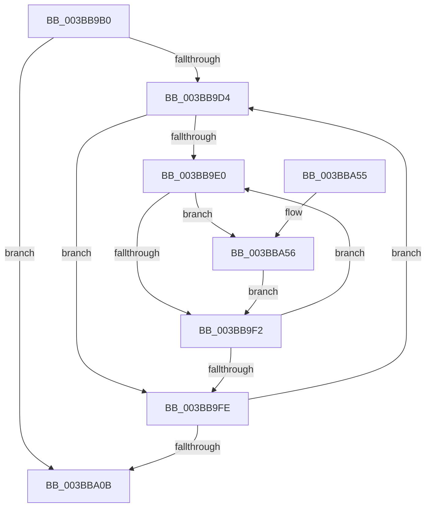

# MiRebalanceZeroFreeLists

- RVA: `0x003BB9B0`–`0x003BBA68` (길이 `184` bytes)
- VA: `0x00000001403BB9B0`
- 실행 섹션: `.text`
- PDB 이름 있음: `예`; PDB Function 태그: `아니요`
- unwind 정보 RVA: `0x0008CD0C`
- 디코드: `49`개 명령, `184/184` bytes 표시
- 미해석 바이트: `0` (있으면 어셈블리에 `.byte`로 보존)

> 이 문서는 커널 이미지의 기계어와 PDB 기호를 분석해 생성했습니다. 4번과 5번은 함수 원형과 자료형을 바이너리 사용 방식에서 추정한 C 해석이며 원본 소스 복구 결과는 아닙니다.

## 1. Dependencies

- 직접 호출 지점: **5**; 고유 호출 대상: **5**
- 직접 호출자로 확인된 함수: **0**
- RIP 상대 이미지 참조: **3**

### Outgoing calls
- `0x003BB9E8` → [MiFreeZeroPagesNeeded](MiFreeZeroPagesNeeded_function_003BBA70.md) (function, `0x003BBA70`)
- `0x003BBA19` → [ExAcquireSpinLockExclusive](../24/ExAcquireSpinLockExclusive_function_00248690.md) (function, `0x00248690`)
- `0x003BBA2E` → [MiReleaseSpinLockExclusive](../24/MiReleaseSpinLockExclusive_function_002482C0.md) (function, `0x002482C0`)
- `0x003BBA3B` → [PsDereferencePartition](../34/PsDereferencePartition_function_00342E70.md) (function, `0x00342E70`)
- `0x003BBA61` → [MiPruneStandbyPages](MiPruneStandbyPages_function_003BC0E4.md) (function, `0x003BC0E4`)

### Direct callers
- 이 함수 시작 RVA로 연결되는 직접 call은 확인되지 않았습니다. 간접 호출은 완전히 역산할 수 없습니다.

### Static image references
- `0x003BB9C9` → RVA `0x00FC5000` (`ALMOSTRO`; read)
- `0x003BB9D4` → RVA `0x00FC5002` (`ALMOSTRO`; read)
- `0x003BBA12` → RVA `0x00E30040` (`.data`; read)

## 2. Other-region calls and transfers

- 다른 실행 섹션으로 향하는 call: **0**
- 별도 외부 분기/꼬리 이동을 확인하지 못했습니다.

## 3. Assembly (complete function range)

```asm
003BB9B0  48 89 5C 24 08                  mov qword ptr [rsp + 8], rbx
003BB9B5  48 89 6C 24 10                  mov qword ptr [rsp + 0x10], rbp
003BB9BA  48 89 74 24 18                  mov qword ptr [rsp + 0x18], rsi
003BB9BF  57                              push rdi
003BB9C0  48 83 EC 20                     sub rsp, 0x20
003BB9C4  33 ED                           xor ebp, ebp
003BB9C6  48 8B F1                        mov rsi, rcx
003BB9C9  66 3B 2D 30 96 C0 00            cmp bp, word ptr [rip + 0xc09630]
003BB9D0  8B DD                           mov ebx, ebp
003BB9D2  73 37                           jae 0x1403bba0b
003BB9D4  40 38 2D 27 96 C0 00            cmp byte ptr [rip + 0xc09627], bpl
003BB9DB  40 8A FD                        mov dil, bpl
003BB9DE  74 1E                           je 0x1403bb9fe
003BB9E0  44 8A C7                        mov r8b, dil
003BB9E3  8B D3                           mov edx, ebx
003BB9E5  48 8B CE                        mov rcx, rsi
003BB9E8  E8 83 00 00 00                  call 0x1403bba70
003BB9ED  48 85 C0                        test rax, rax
003BB9F0  75 64                           jne 0x1403bba56
003BB9F2  40 FE C7                        inc dil
003BB9F5  40 3A 3D 06 96 C0 00            cmp dil, byte ptr [rip + 0xc09606]
003BB9FC  72 E2                           jb 0x1403bb9e0
003BB9FE  0F B7 05 FB 95 C0 00            movzx eax, word ptr [rip + 0xc095fb]
003BBA05  FF C3                           inc ebx
003BBA07  3B D8                           cmp ebx, eax
003BBA09  72 C9                           jb 0x1403bb9d4
003BBA0B  48 8B 9E B8 00 00 00            mov rbx, qword ptr [rsi + 0xb8]
003BBA12  48 8D 0D 27 46 A7 00            lea rcx, [rip + 0xa74627]
003BBA19  E8 72 CC E8 FF                  call 0x140248690
003BBA1E  8A D0                           mov dl, al
003BBA20  48 89 AE 20 42 00 00            mov qword ptr [rsi + 0x4220], rbp
003BBA27  48 8D 0D 12 46 A7 00            lea rcx, [rip + 0xa74612]
003BBA2E  E8 8D C8 E8 FF                  call 0x1402482c0
003BBA33  BA 4D 6D 46 72                  mov edx, 0x72466d4d
003BBA38  48 8B CB                        mov rcx, rbx
003BBA3B  E8 30 74 F8 FF                  call 0x140342e70
003BBA40  48 8B 5C 24 30                  mov rbx, qword ptr [rsp + 0x30]
003BBA45  48 8B 6C 24 38                  mov rbp, qword ptr [rsp + 0x38]
003BBA4A  48 8B 74 24 40                  mov rsi, qword ptr [rsp + 0x40]
003BBA4F  48 83 C4 20                     add rsp, 0x20
003BBA53  5F                              pop rdi
003BBA54  C3                              ret
003BBA55  CC                              int3
003BBA56  4C 8B C8                        mov r9, rax
003BBA59  44 8A C7                        mov r8b, dil
003BBA5C  8B D3                           mov edx, ebx
003BBA5E  48 8B CE                        mov rcx, rsi
003BBA61  E8 7E 06 00 00                  call 0x1403bc0e4
003BBA66  EB 8A                           jmp 0x1403bb9f2
```

## 4. C-style interpretation (structured pseudocode)

```c
__int64 __fastcall MiRebalanceZeroFreeLists(__int64 a1)
{
    __int64 result;
    __int64 v_rbp;
    __int64 v_rbx;
    __int64 v_rdi;
    __int64 v_rsp;
    unsigned __int64 v_stack_p10;
    unsigned __int64 v_stack_p18;
    unsigned __int64 v_stack_p8;

    v_stack_p8 = v_rbx;
    v_stack_p10 = v_rbp;
    v_stack_p18 = v_rsi;
    v_rsp = (v_rsp) - (32);
    v_rbp = 0;
    if (0 >= (*(unsigned __int16 *)(v_rip + 12621360))) goto loc_003BBA0B;
loc_003BB9D4:
    if ((*(unsigned __int8 *)(v_rip + 12621351)) == 0) goto loc_003BB9FE;
loc_003BB9E0:
    result = MiFreeZeroPagesNeeded(a1, 0, 0, a4);
    if (result != 0) goto loc_003BBA56;
loc_003BB9F2:
    v_rdi = (unsigned __int8)((0) + 1);
    if (((unsigned __int8)(v_rdi)) < (*(unsigned __int8 *)(v_rip + 12621318))) goto loc_003BB9E0;
loc_003BB9FE:
    v_rbx = (unsigned int)((0) + 1);
    if (((unsigned int)(v_rbx)) < ((unsigned int)(*(unsigned __int16 *)(v_rip + 12621307)))) goto loc_003BB9D4;
loc_003BBA0B:
    result = ExAcquireSpinLockExclusive(v_rip + 10962471, 0, 0, a4);
    *(unsigned __int64 *)(a1 + 16928) = 0;
    result = MiReleaseSpinLockExclusive(v_rip + 10962450, (unsigned __int8)(result), 0, a4);
    result = PsDereferencePartition(*(unsigned __int64 *)(a1 + 184), (unsigned int)(0x72466D4DULL), 0, a4);
    v_rsp = (v_rsp) + (32);
    return result;
loc_003BBA56:
    result = MiPruneStandbyPages(v_stack_p18, (unsigned int)((unsigned int)(v_stack_p8)), (unsigned __int8)(v_rdi), result);
    goto loc_003BB9F2;
}
```

## 5. (Beta) C Style

```c
int64_t MiRebalanceZeroFreeLists(void *Arg1)
{
    uint8_t *arg1 = (uint8_t *)Arg1;

    int64_t result;
    int64_t local_rbp;
    int64_t local_rbx;
    int64_t local_rdi;
    int64_t local_rsp;
    uint64_t v_stack_p10;
    uint64_t v_stack_p18;
    uint64_t v_stack_p8;

    v_stack_p8 = local_rbx;
    v_stack_p10 = local_rbp;
    v_stack_p18 = local_rsi;
    local_rsp = (local_rsp) - (32);
    local_rbp = 0;
    if (0 >= (*(uint16_t *)(v_rip + 0xC09630))) goto loc_003BBA0B;
loc_003BB9D4:
    if ((*(uint8_t *)(v_rip + 0xC09627)) == 0) goto loc_003BB9FE;
loc_003BB9E0:
    result = MiFreeZeroPagesNeeded(Arg1, 0, 0, a4);
    if (result != 0) goto loc_003BBA56;
loc_003BB9F2:
    local_rdi = (uint8_t)((0) + 1);
    if (((uint8_t)(local_rdi)) < (*(uint8_t *)(v_rip + 0xC09606))) goto loc_003BB9E0;
loc_003BB9FE:
    local_rbx = (uint32_t)((0) + 1);
    if (((uint32_t)(local_rbx)) < ((uint32_t)(*(uint16_t *)(v_rip + 0xC095FB)))) goto loc_003BB9D4;
loc_003BBA0B:
    result = ExAcquireSpinLockExclusive(v_rip + 10962471, 0, 0, a4);
    *(uint64_t *)(arg1 + 0x4220) = 0;
    result = MiReleaseSpinLockExclusive(v_rip + 10962450, (uint8_t)(result), 0, a4);
    result = PsDereferencePartition(*(uint64_t *)(arg1 + 0xB8), (uint32_t)(0x72466D4DULL), 0, a4);
    local_rsp = (local_rsp) + (32);
    return result;
loc_003BBA56:
    result = MiPruneStandbyPages(v_stack_p18, (uint32_t)((uint32_t)(v_stack_p8)), (uint8_t)(local_rdi), result);
    goto loc_003BB9F2;
}
```

### 관측된 메모리 오프셋

구조체 형식이 확인되지 않은 접근은 인자 기준의 오프셋으로만 기록했습니다.

| 기준 인자 | 오프셋 표현 | 폭 (bit) | 접근 |
|---|---:|---:|---|
| `Arg1` | `+ 0xB8` | `64` | `R` |
| `Arg1` | `+ 0x4220` | `64` | `W` |

## 6. Execution-region graph

[열기: 2D/3D 그래프와 함수 탐색 컨트롤 패널](../../../control-panel.html?section=text&rva=0x003BB9B0&view=graph)

- 2D 그래프는 위에서 아래로 흐르고, 3D 그래프는 빈 공간을 드래그해 회전합니다. Shift+드래그는 이동, 휠은 확대·축소, 함수 노드 선택은 대상 보고서 이동입니다.

### Static fallback


