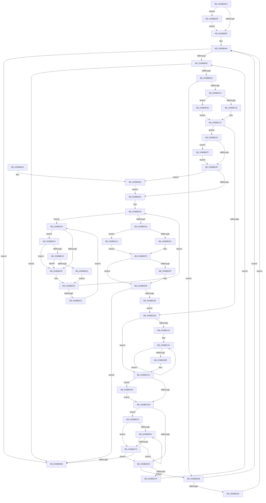

# MiRebuildLargePage

- RVA: `0x003BBAEC`–`0x003BBF51` (길이 `1,125` bytes)
- VA: `0x00000001403BBAEC`
- 실행 섹션: `.text`
- PDB 이름 있음: `예`; PDB Function 태그: `아니요`
- unwind 정보 RVA: `0x0008CD24`
- 디코드: `254`개 명령, `1,125/1,125` bytes 표시
- 미해석 바이트: `0` (있으면 어셈블리에 `.byte`로 보존)

> 이 문서는 커널 이미지의 기계어와 PDB 기호를 분석해 생성했습니다. 4번과 5번은 함수 원형과 자료형을 바이너리 사용 방식에서 추정한 C 해석이며 원본 소스 복구 결과는 아닙니다.

## 1. Dependencies

- 직접 호출 지점: **16**; 고유 호출 대상: **16**
- 직접 호출자로 확인된 함수: **3**
- RIP 상대 이미지 참조: **6**

### Outgoing calls
- `0x003BBB3F` → [MiReferencePageRuns](../37/MiReferencePageRuns_function_00379540.md) (function, `0x00379540`)
- `0x003BBBED` → [MiFindRebuildCandidate](../31/MiFindRebuildCandidate_function_0031AE80.md) (function, `0x0031AE80`)
- `0x003BBC7B` → [MiFindContiguousPagesEx](../28/MiFindContiguousPagesEx_function_0028BDE0.md) (function, `0x0028BDE0`)
- `0x003BBCAA` → [MiNodeFreeZeroPages](MiNodeFreeZeroPages_function_003BBF60.md) (function, `0x003BBF60`)
- `0x003BBD56` → [MiConvertSmallPageRangeToLarge](../34/MiConvertSmallPageRangeToLarge_function_003484DC.md) (function, `0x003484DC`)
- `0x003BBDE1` → [MiInsertPageInFreeOrZeroedList](../33/MiInsertPageInFreeOrZeroedList_function_00334D20.md) (function, `0x00334D20`)
- `0x003BBE06` → [KiLowerIrqlProcessIrqlFlags](../4F/KiLowerIrqlProcessIrqlFlags_function_004F5698.md) (function, `0x004F5698`)
- `0x003BBE19` → [MiReleaseNonPagedResources](../32/MiReleaseNonPagedResources_function_0032299C.md) (function, `0x0032299C`)
- `0x003BBE63` → [MiGetNodeStandbyPageCount](MiGetNodeStandbyPageCount_function_003BC09C.md) (function, `0x003BC09C`)
- `0x003BBE95` → [MiDereferencePageRuns](MiDereferencePageRuns_function_003BD388.md) (function, `0x003BD388`)
- `0x003BBEB8` → [KiRaiseIrqlProcessIrqlFlags](../4F/KiRaiseIrqlProcessIrqlFlags_function_004F56FC.md) (function, `0x004F56FC`)
- `0x003BBED2` → [KiCheckVpBackingLongSpinWaitHypercall](../30/KiCheckVpBackingLongSpinWaitHypercall_function_0030F490.md) (function, `0x0030F490`)
- `0x003BBEE3` → [HvlNotifyLongSpinWait](../30/HvlNotifyLongSpinWait_function_0030F460.md) (function, `0x0030F460`)
- `0x003BBF10` → [MiUpdateLargePageBitMap](../37/MiUpdateLargePageBitMap_function_0037619C.md) (function, `0x0037619C`)
- `0x003BBF2E` → [MiInsertPossiblyBadPage](../68/MiInsertPossiblyBadPage_function_00689DF0.md) (function, `0x00689DF0`)
- `0x003BBF44` → [MiNodeLargeFreeZeroPagesRange](../48/MiNodeLargeFreeZeroPagesRange_function_0048E1C4.md) (function, `0x0048E1C4`)

### Direct callers
- [MiRebuildLargePages](MiRebuildLargePages_function_003BA700.md) at `0x003BA9F3`
- [MmManagePartitionCreateLargePages](../../page/80/MmManagePartitionCreateLargePages_function_0080E000.md) at `0x0080E114`
- [MmBuildLargePages](../../page/9F/MmBuildLargePages_function_009FFB08.md) at `0x009FFB8D`

### Static image references
- `0x003BBB24` → RVA `0x00FC5002` (`ALMOSTRO`; read)
- `0x003BBB44` → RVA `0x00E3D548` (`.data`; read)
- `0x003BBB4B` → RVA `0x00011C60` (`.rdata`; read)
- `0x003BBD85` → RVA `0x00FC6D20` (`ALMOSTRO`; read)
- `0x003BBE37` → RVA `0x00FC52AC` (`ALMOSTRO`; reference)
- `0x003BBEC4` → RVA `0x00FC6AB8` (`ALMOSTRO`; read)

## 2. Other-region calls and transfers

- 다른 실행 섹션으로 향하는 call: **0**
- 별도 외부 분기/꼬리 이동을 확인하지 못했습니다.

## 3. Assembly (complete function range)

```asm
003BBAEC  48 8B C4                        mov rax, rsp
003BBAEF  4C 89 48 20                     mov qword ptr [rax + 0x20], r9
003BBAF3  44 89 40 18                     mov dword ptr [rax + 0x18], r8d
003BBAF7  89 50 10                        mov dword ptr [rax + 0x10], edx
003BBAFA  53                              push rbx
003BBAFB  55                              push rbp
003BBAFC  56                              push rsi
003BBAFD  57                              push rdi
003BBAFE  41 54                           push r12
003BBB00  41 55                           push r13
003BBB02  41 56                           push r14
003BBB04  41 57                           push r15
003BBB06  48 81 EC B8 00 00 00            sub rsp, 0xb8
003BBB0D  33 FF                           xor edi, edi
003BBB0F  8B DA                           mov ebx, edx
003BBB11  48 89 78 80                     mov qword ptr [rax - 0x80], rdi
003BBB15  4C 8B E9                        mov r13, rcx
003BBB18  65 48 8B 04 25 88 01 00 00      mov rax, qword ptr gs:[0x188]
003BBB21  44 8B E7                        mov r12d, edi
003BBB24  44 0F B6 3D D6 94 C0 00         movzx r15d, byte ptr [rip + 0xc094d6]
003BBB2C  8D 57 01                        lea edx, [rdi + 1]
003BBB2F  44 88 7C 24 70                  mov byte ptr [rsp + 0x70], r15b
003BBB34  41 8B F0                        mov esi, r8d
003BBB37  48 89 84 24 A0 00 00 00         mov qword ptr [rsp + 0xa0], rax
003BBB3F  E8 FC D9 FB FF                  call 0x140379540
003BBB44  48 8B 15 FD 19 A8 00            mov rdx, qword ptr [rip + 0xa819fd]
003BBB4B  48 8D 2D 0E 61 C5 FF            lea rbp, [rip - 0x3a9ef2]
003BBB52  48 8B 6C F5 00                  mov rbp, qword ptr [rbp + rsi*8]
003BBB57  48 69 CB 80 DF 00 00            imul rcx, rbx, 0xdf80
003BBB5E  48 89 84 24 98 00 00 00         mov qword ptr [rsp + 0x98], rax
003BBB66  49 03 4D 10                     add rcx, qword ptr [r13 + 0x10]
003BBB6A  48 89 8C 24 88 00 00 00         mov qword ptr [rsp + 0x88], rcx
003BBB72  48 89 94 24 80 00 00 00         mov qword ptr [rsp + 0x80], rdx
003BBB7A  40 88 BC 24 00 01 00 00         mov byte ptr [rsp + 0x100], dil
003BBB82  4C 8D B1 81 3B 00 00            lea r14, [rcx + 0x3b81]
003BBB89  41 80 FF 01                     cmp r15b, 1
003BBB8D  0F 87 5C 03 00 00               ja 0x1403bbeef
003BBB93  49 8B CC                        mov rcx, r12
003BBB96  4C 0F 46 F1                     cmovbe r14, rcx
003BBB9A  4B 8D 04 3E                     lea rax, [r14 + r15]
003BBB9E  48 89 84 24 90 00 00 00         mov qword ptr [rsp + 0x90], rax
003BBBA6  4C 3B F0                        cmp r14, rax
003BBBA9  0F 84 DE 02 00 00               je 0x1403bbe8d
003BBBAF  48 8B 84 24 A0 00 00 00         mov rax, qword ptr [rsp + 0xa0]
003BBBB7  8B 80 A0 05 00 00               mov eax, dword ptr [rax + 0x5a0]
003BBBBD  A8 01                           test al, 1
003BBBBF  0F 85 C8 02 00 00               jne 0x1403bbe8d
003BBBC5  8B 84 24 20 01 00 00            mov eax, dword ptr [rsp + 0x120]
003BBBCC  4C 8B CD                        mov r9, rbp
003BBBCF  89 44 24 30                     mov dword ptr [rsp + 0x30], eax
003BBBD3  44 8A C7                        mov r8b, dil
003BBBD6  48 8B 84 24 98 00 00 00         mov rax, qword ptr [rsp + 0x98]
003BBBDE  49 8B CD                        mov rcx, r13
003BBBE1  48 89 44 24 28                  mov qword ptr [rsp + 0x28], rax
003BBBE6  48 89 54 24 20                  mov qword ptr [rsp + 0x20], rdx
003BBBEB  8B D3                           mov edx, ebx
003BBBED  E8 8E F2 F5 FF                  call 0x14031ae80
003BBBF2  48 89 44 24 78                  mov qword ptr [rsp + 0x78], rax
003BBBF7  48 8B D0                        mov rdx, rax
003BBBFA  48 83 F8 FF                     cmp rax, -1
003BBBFE  0F 84 07 01 00 00               je 0x1403bbd0b
003BBC04  B9 00 00 80 40                  mov ecx, 0x40800000
003BBC09  48 81 FD 00 02 00 00            cmp rbp, 0x200
003BBC10  0F 84 22 01 00 00               je 0x1403bbd38
003BBC16  48 83 FD 10                     cmp rbp, 0x10
003BBC1A  B8 00 00 80 41                  mov eax, 0x41800000
003BBC1F  0F 44 C8                        cmove ecx, eax
003BBC22  45 33 C9                        xor r9d, r9d
003BBC25  4C 8D 45 FF                     lea r8, [rbp - 1]
003BBC29  8B C1                           mov eax, ecx
003BBC2B  4C 03 C2                        add r8, rdx
003BBC2E  0F BA E8 1B                     bts eax, 0x1b
003BBC32  44 39 8C 24 20 01 00 00         cmp dword ptr [rsp + 0x120], r9d
003BBC3A  0F 44 C1                        cmove eax, ecx
003BBC3D  48 8D 4C 24 78                  lea rcx, [rsp + 0x78]
003BBC42  48 89 4C 24 68                  mov qword ptr [rsp + 0x68], rcx
003BBC47  49 8B CD                        mov rcx, r13
003BBC4A  4C 89 4C 24 60                  mov qword ptr [rsp + 0x60], r9
003BBC4F  4C 89 4C 24 58                  mov qword ptr [rsp + 0x58], r9
003BBC54  44 89 4C 24 50                  mov dword ptr [rsp + 0x50], r9d
003BBC59  89 44 24 48                     mov dword ptr [rsp + 0x48], eax
003BBC5D  40 88 7C 24 40                  mov byte ptr [rsp + 0x40], dil
003BBC62  89 5C 24 38                     mov dword ptr [rsp + 0x38], ebx
003BBC66  C7 44 24 30 01 00 00 00         mov dword ptr [rsp + 0x30], 1
003BBC6E  48 89 6C 24 28                  mov qword ptr [rsp + 0x28], rbp
003BBC73  4C 89 4C 24 20                  mov qword ptr [rsp + 0x20], r9
003BBC78  4C 8B CD                        mov r9, rbp
003BBC7B  E8 60 01 ED FF                  call 0x14028bde0
003BBC80  85 C0                           test eax, eax
003BBC82  0F 89 BA 00 00 00               jns 0x1403bbd42
003BBC88  33 C0                           xor eax, eax
003BBC8A  38 05 72 93 C0 00               cmp byte ptr [rip + 0xc09372], al
003BBC90  8B F8                           mov edi, eax
003BBC92  40 8A F0                        mov sil, al
003BBC95  76 33                           jbe 0x1403bbcca
003BBC97  4C 8B BC 24 88 00 00 00         mov r15, qword ptr [rsp + 0x88]
003BBC9F  33 DB                           xor ebx, ebx
003BBCA1  44 8B C3                        mov r8d, ebx
003BBCA4  40 8A D6                        mov dl, sil
003BBCA7  49 8B CF                        mov rcx, r15
003BBCAA  E8 B1 02 00 00                  call 0x1403bbf60
003BBCAF  48 03 F8                        add rdi, rax
003BBCB2  40 FE C6                        inc sil
003BBCB5  40 3A 35 46 93 C0 00            cmp sil, byte ptr [rip + 0xc09346]
003BBCBC  72 E3                           jb 0x1403bbca1
003BBCBE  8B 9C 24 08 01 00 00            mov ebx, dword ptr [rsp + 0x108]
003BBCC5  44 8A 7C 24 70                  mov r15b, byte ptr [rsp + 0x70]
003BBCCA  8B B4 24 10 01 00 00            mov esi, dword ptr [rsp + 0x110]
003BBCD1  48 83 FD 10                     cmp rbp, 0x10
003BBCD5  0F 87 5D 02 00 00               ja 0x1403bbf38
003BBCDB  48 81 FF 00 10 00 00            cmp rdi, 0x1000
003BBCE2  0F 82 6C 01 00 00               jb 0x1403bbe54
003BBCE8  48 8B 44 24 78                  mov rax, qword ptr [rsp + 0x78]
003BBCED  40 8A BC 24 00 01 00 00         mov dil, byte ptr [rsp + 0x100]
003BBCF5  48 85 C0                        test rax, rax
003BBCF8  74 11                           je 0x1403bbd0b
003BBCFA  48 8D 50 FF                     lea rdx, [rax - 1]
003BBCFE  48 89 94 24 80 00 00 00         mov qword ptr [rsp + 0x80], rdx
003BBD06  E9 A4 FE FF FF                  jmp 0x1403bbbaf
003BBD0B  48 8B 84 24 90 00 00 00         mov rax, qword ptr [rsp + 0x90]
003BBD13  49 FF C6                        inc r14
003BBD16  48 8B 94 24 80 00 00 00         mov rdx, qword ptr [rsp + 0x80]
003BBD1E  41 80 FF 01                     cmp r15b, 1
003BBD22  0F 86 7E FE FF FF               jbe 0x1403bbba6
003BBD28  41 8A 3E                        mov dil, byte ptr [r14]
003BBD2B  40 88 BC 24 00 01 00 00         mov byte ptr [rsp + 0x100], dil
003BBD33  E9 6E FE FF FF                  jmp 0x1403bbba6
003BBD38  B9 00 00 80 42                  mov ecx, 0x42800000
003BBD3D  E9 E0 FE FF FF                  jmp 0x1403bbc22
003BBD42  48 81 FD 00 02 00 00            cmp rbp, 0x200
003BBD49  0F 83 B0 01 00 00               jae 0x1403bbeff
003BBD4F  48 8B 4C 24 78                  mov rcx, qword ptr [rsp + 0x78]
003BBD54  8B D6                           mov edx, esi
003BBD56  E8 81 C7 F8 FF                  call 0x1403484dc
003BBD5B  48 8B 44 24 78                  mov rax, qword ptr [rsp + 0x78]
003BBD60  48 8D 3C 40                     lea rdi, [rax + rax*2]
003BBD64  48 C1 E7 04                     shl rdi, 4
003BBD68  48 B8 00 00 00 00 00 DE FF FF   movabs rax, 0xffffde0000000000
003BBD72  48 03 F8                        add rdi, rax
003BBD75  45 0F 20 C7                     mov r15, cr8
003BBD79  41 B8 02 00 00 00               mov r8d, 2
003BBD7F  45 0F 22 C0                     mov cr8, r8
003BBD83  33 D2                           xor edx, edx
003BBD85  39 15 95 AF C0 00               cmp dword ptr [rip + 0xc0af95], edx
003BBD8B  0F 85 21 01 00 00               jne 0x1403bbeb2
003BBD91  8B F2                           mov esi, edx
003BBD93  F0 48 0F BA 6F 18 3F            lock bts qword ptr [rdi + 0x18], 0x3f
003BBD9A  0F 82 95 00 00 00               jb 0x1403bbe35
003BBDA0  48 8B 47 18                     mov rax, qword ptr [rdi + 0x18]
003BBDA4  48 B9 00 00 00 00 00 00 00 C0   movabs rcx, 0xc000000000000000
003BBDAE  48 23 C1                        and rax, rcx
003BBDB1  48 89 47 18                     mov qword ptr [rdi + 0x18], rax
003BBDB5  8B 47 20                        mov eax, dword ptr [rdi + 0x20]
003BBDB8  89 44 24 74                     mov dword ptr [rsp + 0x74], eax
003BBDBC  66 89 54 24 74                  mov word ptr [rsp + 0x74], dx
003BBDC1  BA 02 00 00 00                  mov edx, 2
003BBDC6  8B 44 24 74                     mov eax, dword ptr [rsp + 0x74]
003BBDCA  89 47 20                        mov dword ptr [rdi + 0x20], eax
003BBDCD  48 8B 47 28                     mov rax, qword ptr [rdi + 0x28]
003BBDD1  48 0F BA E0 29                  bt rax, 0x29
003BBDD6  0F 82 3E 01 00 00               jb 0x1403bbf1a
003BBDDC  48 8B 4C 24 78                  mov rcx, qword ptr [rsp + 0x78]
003BBDE1  E8 3A 8F F7 FF                  call 0x140334d20
003BBDE6  48 B8 FF FF FF FF FF FF FF 7F   movabs rax, 0x7fffffffffffffff
003BBDF0  F0 48 21 47 18                  lock and qword ptr [rdi + 0x18], rax
003BBDF5  33 C9                           xor ecx, ecx
003BBDF7  39 0D 23 AF C0 00               cmp dword ptr [rip + 0xc0af23], ecx
003BBDFD  74 0C                           je 0x1403bbe0b
003BBDFF  44 0F 20 C1                     mov rcx, cr8
003BBE03  41 8A D7                        mov dl, r15b
003BBE06  E8 8D 98 13 00                  call 0x1404f5698
003BBE0B  41 0F B6 C7                     movzx eax, r15b
003BBE0F  44 0F 22 C0                     mov cr8, rax
003BBE13  48 8B D5                        mov rdx, rbp
003BBE16  49 8B CD                        mov rcx, r13
003BBE19  E8 7E 6B F6 FF                  call 0x14032299c
003BBE1E  4C 03 E5                        add r12, rbp
003BBE21  4C 3B A4 24 18 01 00 00         cmp r12, qword ptr [rsp + 0x118]
003BBE29  73 62                           jae 0x1403bbe8d
003BBE2B  44 8A 7C 24 70                  mov r15b, byte ptr [rsp + 0x70]
003BBE30  E9 53 FE FF FF                  jmp 0x1403bbc88
003BBE35  FF C6                           inc esi
003BBE37  85 35 6F 94 C0 00               test dword ptr [rip + 0xc0946f], esi
003BBE3D  0F 84 81 00 00 00               je 0x1403bbec4
003BBE43  F3 90                           pause
003BBE45  48 8B 47 18                     mov rax, qword ptr [rdi + 0x18]
003BBE49  48 85 C0                        test rax, rax
003BBE4C  0F 89 41 FF FF FF               jns 0x1403bbd93
003BBE52  EB E1                           jmp 0x1403bbe35
003BBE54  33 C0                           xor eax, eax
003BBE56  44 8A C0                        mov r8b, al
003BBE59  45 84 FF                        test r15b, r15b
003BBE5C  74 15                           je 0x1403bbe73
003BBE5E  8B D3                           mov edx, ebx
003BBE60  49 8B CD                        mov rcx, r13
003BBE63  E8 34 02 00 00                  call 0x1403bc09c
003BBE68  48 03 F8                        add rdi, rax
003BBE6B  41 FE C0                        inc r8b
003BBE6E  45 3A C7                        cmp r8b, r15b
003BBE71  72 EB                           jb 0x1403bbe5e
003BBE73  48 8B 84 24 18 01 00 00         mov rax, qword ptr [rsp + 0x118]
003BBE7B  49 2B C4                        sub rax, r12
003BBE7E  48 05 00 80 00 00               add rax, 0x8000
003BBE84  48 3B F8                        cmp rdi, rax
003BBE87  0F 83 5B FE FF FF               jae 0x1403bbce8
003BBE8D  48 8B 8C 24 98 00 00 00         mov rcx, qword ptr [rsp + 0x98]
003BBE95  E8 EE 14 00 00                  call 0x1403bd388
003BBE9A  49 8B C4                        mov rax, r12
003BBE9D  48 81 C4 B8 00 00 00            add rsp, 0xb8
003BBEA4  41 5F                           pop r15
003BBEA6  41 5E                           pop r14
003BBEA8  41 5D                           pop r13
003BBEAA  41 5C                           pop r12
003BBEAC  5F                              pop rdi
003BBEAD  5E                              pop rsi
003BBEAE  5D                              pop rbp
003BBEAF  5B                              pop rbx
003BBEB0  C3                              ret
003BBEB1  CC                              int3
003BBEB2  41 8A D0                        mov dl, r8b
003BBEB5  41 8A CF                        mov cl, r15b
003BBEB8  E8 3F 98 13 00                  call 0x1404f56fc
003BBEBD  33 D2                           xor edx, edx
003BBEBF  E9 CD FE FF FF                  jmp 0x1403bbd91
003BBEC4  8B 05 EE AB C0 00               mov eax, dword ptr [rip + 0xc0abee]
003BBECA  A8 40                           test al, 0x40
003BBECC  0F 84 71 FF FF FF               je 0x1403bbe43
003BBED2  E8 B9 35 F5 FF                  call 0x14030f490
003BBED7  33 D2                           xor edx, edx
003BBED9  84 C0                           test al, al
003BBEDB  0F 84 62 FF FF FF               je 0x1403bbe43
003BBEE1  8B CE                           mov ecx, esi
003BBEE3  E8 78 35 F5 FF                  call 0x14030f460
003BBEE8  33 D2                           xor edx, edx
003BBEEA  E9 56 FF FF FF                  jmp 0x1403bbe45
003BBEEF  41 8A 3E                        mov dil, byte ptr [r14]
003BBEF2  40 88 BC 24 00 01 00 00         mov byte ptr [rsp + 0x100], dil
003BBEFA  E9 94 FC FF FF                  jmp 0x1403bbb93
003BBEFF  48 8B 54 24 78                  mov rdx, qword ptr [rsp + 0x78]
003BBF04  41 B9 02 00 00 00               mov r9d, 2
003BBF0A  4C 8B C5                        mov r8, rbp
003BBF0D  49 8B CD                        mov rcx, r13
003BBF10  E8 87 A2 FB FF                  call 0x14037619c
003BBF15  E9 35 FE FF FF                  jmp 0x1403bbd4f
003BBF1A  48 B8 FF FF FF FF FF FF FF 7F   movabs rax, 0x7fffffffffffffff
003BBF24  F0 48 21 47 18                  lock and qword ptr [rdi + 0x18], rax
003BBF29  48 8B 4C 24 78                  mov rcx, qword ptr [rsp + 0x78]
003BBF2E  E8 BD DE 2C 00                  call 0x140689df0
003BBF33  E9 BD FE FF FF                  jmp 0x1403bbdf5
003BBF38  48 8B 8C 24 88 00 00 00         mov rcx, qword ptr [rsp + 0x88]
003BBF40  44 8D 46 01                     lea r8d, [rsi + 1]
003BBF44  E8 7B 22 0D 00                  call 0x14048e1c4
003BBF49  48 03 F8                        add rdi, rax
003BBF4C  E9 8A FD FF FF                  jmp 0x1403bbcdb
```

## 4. C-style interpretation (structured pseudocode)

```c
__int64 __fastcall MiRebuildLargePage(__int64 a1, int a2, int a3, __int64 a4, unsigned int a5)
{
    __int64 result;
    __int64 v_r12;
    __int64 v_r14;
    __int64 v_rbx;
    __int64 v_rdi;
    __int64 v_rsi;
    __int64 v_rsp;
    unsigned __int64 v_stack_m58;
    unsigned __int64 v_stack_m60;
    unsigned __int64 v_stack_m68;
    unsigned __int64 v_stack_m70;
    unsigned __int64 v_stack_m78;
    unsigned __int64 v_stack_m80;
    unsigned int v_stack_m84;
    unsigned __int8 v_stack_m88;
    unsigned __int64 v_stack_m90;
    unsigned __int64 v_stack_m98;
    unsigned __int64 v_stack_mA0;
    unsigned int v_stack_mA8;
    unsigned int v_stack_mB0;
    unsigned __int8 v_stack_mB8;
    unsigned int v_stack_mC0;
    unsigned int v_stack_mC8;
    unsigned __int64 v_stack_mD0;
    unsigned __int64 v_stack_mD8;
    unsigned int v_stack_p10;
    unsigned __int8 v_stack_p100;
    unsigned int v_stack_p18;
    unsigned __int64 v_stack_p20;
    unsigned __int64 v_stack_p78;
    unsigned __int8 v_stack_p8;
    unsigned __int64 v_stack_p88;

    *(unsigned __int64 *)(v_rsp + 32) = a4;
    *(unsigned int *)(v_rsp + 24) = a3;
    *(unsigned int *)(v_rsp + 16) = a2;
    v_rsp = (v_rsp) - (184);
    v_rdi = 0;
    *(unsigned __int64 *)(v_rsp - 128) = 0;
    v_stack_m88 = (unsigned __int8)(*(unsigned __int8 *)(v_rip + 12621014));
    v_stack_m58 = *(unsigned __int64 *)(gs_base + (0 + 392));
    result = MiReferencePageRuns(a1, v_rdi + 1, a3, a4);
    a1 = (a1) * ((unsigned int)(a2));
    v_stack_m60 = result;
    a1 = (a1) + (*(unsigned __int64 *)(a1 + 16));
    v_stack_m70 = a1;
    v_stack_m78 = *(unsigned __int64 *)(v_rip + 11016701);
    v_stack_p8 = 0;
    if (((unsigned __int8)(*(unsigned __int8 *)(v_rip + 12621014))) > 1) goto loc_003BBEEF;
loc_003BBB93:
    v_r14 = a1 + 15233;
    if (((unsigned __int8)(*(unsigned __int8 *)(v_rip + 12621014))) <= 1) { v_r14 = 0; }
    v_stack_m68 = v_r14 + *(unsigned __int8 *)(v_rip + 12621014) * 1;
loc_003BBBA6:
    if (v_r14 == (v_r14 + *(unsigned __int8 *)(v_rip + 12621014) * 1)) goto loc_003BBE8D;
loc_003BBBAF:
    if ((((unsigned __int8)((unsigned int)(*(unsigned int *)(v_stack_m58 + 1440)))) & (1)) != 0) goto loc_003BBE8D;
    v_stack_mC8 = (unsigned int)((unsigned int)(a5));
    v_stack_mD0 = v_stack_m60;
    v_stack_mD8 = *(unsigned __int64 *)(v_rip + 11016701);
    result = MiFindRebuildCandidate(a1, (unsigned int)((unsigned int)((unsigned int)(a2))), 0, *(unsigned __int64 *)(v_rip - 3841778 + (unsigned int)(a3) * 8));
    v_stack_m80 = result;
    if (result == -1) goto loc_003BBD0B;
    if ((*(unsigned __int64 *)(v_rip - 3841778 + (unsigned int)(a3) * 8)) == 512) goto loc_003BBD38;
    a1 = (unsigned int)(0x40800000ULL);
    if ((*(unsigned __int64 *)(v_rip - 3841778 + (unsigned int)(a3) * 8)) == 16) { a1 = (unsigned int)((unsigned int)(0x41800000ULL)); }
loc_003BBC22:
    a4 = 0;
    a3 = (*(unsigned __int64 *)(v_rip - 3841778 + (unsigned int)(a3) * 8) - 1) + (result);
    result = (unsigned int)((unsigned int)(a1));
    if (a5 == 0) { result = (unsigned int)(a1); }
    v_stack_m90 = v_stack_m80;
    v_stack_m98 = 0;
    v_stack_mA0 = 0;
    v_stack_mA8 = 0;
    v_stack_mB0 = (unsigned int)(result);
    v_stack_mB8 = 0;
    v_stack_mC0 = (unsigned int)((unsigned int)(a2));
    v_stack_mC8 = 1;
    v_stack_mD0 = *(unsigned __int64 *)(v_rip - 3841778 + (unsigned int)(a3) * 8);
    v_stack_mD8 = 0;
    result = MiFindContiguousPagesEx(a1, result, a3, *(unsigned __int64 *)(v_rip - 3841778 + (unsigned int)(a3) * 8));
    if (!sign_flag) goto loc_003BBD42;
loc_003BBC88:
    result = 0;
    if ((*(unsigned __int8 *)(v_rip + 12620658)) <= 0) goto loc_003BBCCA;
    v_rbx = 0;
loc_003BBCA1:
    result = MiNodeFreeZeroPages(v_stack_m70, 0, 0, *(unsigned __int64 *)(v_rip - 3841778 + (unsigned int)(a3) * 8));
    v_rdi = (0) + (result);
    v_rsi = (unsigned __int8)((0) + 1);
    if (((unsigned __int8)(v_rsi)) < (*(unsigned __int8 *)(v_rip + 12620614))) goto loc_003BBCA1;
loc_003BBCCA:
    if ((*(unsigned __int64 *)(v_rip - 3841778 + (unsigned int)(a3) * 8)) > 16) goto loc_003BBF38;
loc_003BBCDB:
    if (v_rdi < 0x1000ULL) goto loc_003BBE54;
loc_003BBCE8:
    if (v_stack_m80 == 0) goto loc_003BBD0B;
    v_stack_m78 = v_stack_m80 - 1;
    goto loc_003BBBAF;
loc_003BBD0B:
    v_r14 = (v_r14) + 1;
    if (((unsigned __int8)(v_stack_m88)) <= 1) goto loc_003BBBA6;
    v_stack_p8 = (unsigned __int8)(*(unsigned __int8 *)(v_r14));
    goto loc_003BBBA6;
loc_003BBD38:
    goto loc_003BBC22;
loc_003BBD42:
    if ((*(unsigned __int64 *)(v_rip - 3841778 + (unsigned int)(a3) * 8)) >= 512) goto loc_003BBEFF;
loc_003BBD4F:
    result = MiConvertSmallPageRangeToLarge(v_stack_m80, (unsigned int)((unsigned int)((unsigned int)(v_stack_p18))), 0, *(unsigned __int64 *)(v_rip - 3841778 + (unsigned int)(a3) * 8));
    v_rdi = (v_stack_m80 + v_stack_m80 * 2) << (4);
    v_rdi = (v_rdi) + (v_stack_m80);
    a2 = 0;
    if ((*(unsigned int *)(v_rip + 12627861)) != 0) goto loc_003BBEB2;
loc_003BBD91:
loc_003BBD93:
    if ((*(unsigned int *)(v_rip + 12627861)) < 0) goto loc_003BBE35;
    result = (*(unsigned __int64 *)(v_rdi + 24)) & (v_stack_m80);
    *(unsigned __int64 *)(v_rdi + 24) = result;
    v_stack_m84 = (unsigned int)((unsigned int)(*(unsigned int *)(v_rdi + 32)));
    v_stack_m84 = 0;
    *(unsigned int *)(v_rdi + 32) = (unsigned int)((unsigned int)(v_stack_m84));
    if (condition_is_below) goto loc_003BBF1A;
    result = MiInsertPageInFreeOrZeroedList(v_stack_m80, 2, 2, *(unsigned __int64 *)(v_rip - 3841778 + (unsigned int)(a3) * 8));
loc_003BBDF5:
    a1 = 0;
    if ((*(unsigned int *)(v_rip + 12627747)) != 0) {
        a1 = 2;
        a2 = (unsigned __int8)(v_cr8);
        result = KiLowerIrqlProcessIrqlFlags(a1, a2, 2, *(unsigned __int64 *)(v_rip - 3841778 + (unsigned int)(a3) * 8));
    }
    result = MiReleaseNonPagedResources(a1, *(unsigned __int64 *)(v_rip - 3841778 + (unsigned int)(a3) * 8), 2, *(unsigned __int64 *)(v_rip - 3841778 + (unsigned int)(a3) * 8));
    v_r12 = (0) + (*(unsigned __int64 *)(v_rip - 3841778 + (unsigned int)(a3) * 8));
    if (v_r12 >= v_stack_p20) goto loc_003BBE8D;
    goto loc_003BBC88;
loc_003BBE35:
    v_rsi = (unsigned int)((0) + 1);
    if (((*(unsigned int *)(v_rip + 12620911)) & ((unsigned int)(v_rsi))) == 0) goto loc_003BBEC4;
loc_003BBE43:
loc_003BBE45:
    if (!sign_flag) goto loc_003BBD93;
    goto loc_003BBE35;
loc_003BBE54:
    result = 0;
    if ((unsigned __int8)(v_stack_m88) == 0) goto loc_003BBE73;
loc_003BBE5E:
    result = MiGetNodeStandbyPageCount(a1, (unsigned int)((unsigned int)((unsigned int)(v_stack_p10))), 0, *(unsigned __int64 *)(v_rip - 3841778 + (unsigned int)(a3) * 8));
    v_rdi = (v_rdi) + (result);
    a3 = (unsigned __int8)((0) + 1);
    if (((unsigned __int8)(a3)) < ((unsigned __int8)(v_stack_m88))) goto loc_003BBE5E;
loc_003BBE73:
    result = (v_stack_p20) - (v_r12);
    result = (result) + (0x8000ULL);
    if (v_rdi >= result) goto loc_003BBCE8;
loc_003BBE8D:
    result = MiDereferencePageRuns(v_stack_m60, (unsigned int)((unsigned int)((unsigned int)(v_stack_p10))), a3, *(unsigned __int64 *)(v_rip - 3841778 + (unsigned int)(a3) * 8));
    v_rsp = (v_rsp) + (184);
    return v_r12;
loc_003BBEB2:
    result = KiRaiseIrqlProcessIrqlFlags((unsigned __int8)(v_stack_m88), (unsigned __int8)(a3), a3, *(unsigned __int64 *)(v_rip - 3841778 + (unsigned int)(a3) * 8));
    a2 = 0;
    goto loc_003BBD91;
loc_003BBEC4:
    if ((((unsigned __int8)((unsigned int)(*(unsigned int *)(v_rip + 12626926)))) & (64)) == 0) goto loc_003BBE43;
    result = KiCheckVpBackingLongSpinWaitHypercall((unsigned __int8)(v_stack_m88), a2, a3, *(unsigned __int64 *)(v_rip - 3841778 + (unsigned int)(a3) * 8));
    a2 = 0;
    if ((unsigned __int8)(result) == 0) goto loc_003BBE43;
    result = HvlNotifyLongSpinWait((unsigned int)((unsigned int)(v_rsi)), a2, a3, *(unsigned __int64 *)(v_rip - 3841778 + (unsigned int)(a3) * 8));
    a2 = 0;
    goto loc_003BBE45;
loc_003BBEEF:
    v_stack_p100 = (unsigned __int8)(*(unsigned __int8 *)(v_r14));
    goto loc_003BBB93;
loc_003BBEFF:
    result = MiUpdateLargePageBitMap(a1, v_stack_p78, *(unsigned __int64 *)(v_rip - 3841778 + (unsigned int)(a3) * 8), 2);
    goto loc_003BBD4F;
loc_003BBF1A:
    result = MiInsertPossiblyBadPage(v_stack_p78, v_stack_p78, *(unsigned __int64 *)(v_rip - 3841778 + (unsigned int)(a3) * 8), 2);
    goto loc_003BBDF5;
loc_003BBF38:
    result = MiNodeLargeFreeZeroPagesRange(v_stack_p88, v_stack_p78, v_rsi + 1, 2);
    v_rdi = (*(unsigned __int8 *)(v_r14)) + (result);
    goto loc_003BBCDB;
}
```

## 5. (Beta) C Style

```c
int64_t MiRebuildLargePage(void *Arg1, int32_t Arg2, int32_t Arg3, int64_t Arg4, uint32_t Arg5)
{
    uint8_t *arg1 = (uint8_t *)Arg1;

    int64_t result;
    int64_t local_r12;
    int64_t local_r14;
    int64_t local_rbx;
    int64_t local_rdi;
    int64_t local_rsi;
    int64_t local_rsp;
    uint64_t v_stack_m58;
    uint64_t v_stack_m60;
    uint64_t v_stack_m68;
    uint64_t v_stack_m70;
    uint64_t v_stack_m78;
    uint64_t v_stack_m80;
    uint32_t v_stack_m84;
    uint8_t v_stack_m88;
    uint64_t v_stack_m90;
    uint64_t v_stack_m98;
    uint64_t v_stack_mA0;
    uint32_t v_stack_mA8;
    uint32_t v_stack_mB0;
    uint8_t v_stack_mB8;
    uint32_t v_stack_mC0;
    uint32_t v_stack_mC8;
    uint64_t v_stack_mD0;
    uint64_t v_stack_mD8;
    uint32_t v_stack_p10;
    uint8_t v_stack_p100;
    uint32_t v_stack_p18;
    uint64_t v_stack_p20;
    uint64_t v_stack_p78;
    uint8_t v_stack_p8;
    uint64_t v_stack_p88;

    *(uint64_t *)(local_rsp + 0x20) = Arg4;
    *(uint32_t *)(local_rsp + 0x18) = Arg3;
    *(uint32_t *)(local_rsp + 0x10) = Arg2;
    local_rsp = (local_rsp) - (184);
    local_rdi = 0;
    *(uint64_t *)(local_rsp - 0x80) = 0;
    v_stack_m88 = (uint8_t)(*(uint8_t *)(v_rip + 0xC094D6));
    v_stack_m58 = *(uint64_t *)(gs_base + (0 + 0x188));
    result = MiReferencePageRuns(Arg1, local_rdi + 1, Arg3, Arg4);
    Arg1 = (Arg1) * ((uint32_t)(Arg2));
    v_stack_m60 = result;
    Arg1 = (Arg1) + (*(uint64_t *)(arg1 + 0x10));
    v_stack_m70 = Arg1;
    v_stack_m78 = *(uint64_t *)(v_rip + 0xA819FD);
    v_stack_p8 = 0;
    if (((uint8_t)(*(uint8_t *)(v_rip + 0xC094D6))) > 1) goto loc_003BBEEF;
loc_003BBB93:
    local_r14 = Arg1 + 15233;
    if (((uint8_t)(*(uint8_t *)(v_rip + 0xC094D6))) <= 1) { local_r14 = 0; }
    v_stack_m68 = local_r14 + *(uint8_t *)(v_rip + 0xC094D6) * 1;
loc_003BBBA6:
    if (local_r14 == (local_r14 + *(uint8_t *)(v_rip + 0xC094D6) * 1)) goto loc_003BBE8D;
loc_003BBBAF:
    if ((((uint8_t)((uint32_t)(*(uint32_t *)(v_stack_m58 + 0x5A0)))) & (1)) != 0) goto loc_003BBE8D;
    v_stack_mC8 = (uint32_t)((uint32_t)(Arg5));
    v_stack_mD0 = v_stack_m60;
    v_stack_mD8 = *(uint64_t *)(v_rip + 0xA819FD);
    result = MiFindRebuildCandidate(Arg1, (uint32_t)((uint32_t)((uint32_t)(Arg2))), 0, *(uint64_t *)(v_rip - 0x3A9EF2 + (uint32_t)(Arg3) * 8));
    v_stack_m80 = result;
    if (result == -1) goto loc_003BBD0B;
    if ((*(uint64_t *)(v_rip - 0x3A9EF2 + (uint32_t)(Arg3) * 8)) == 512) goto loc_003BBD38;
    Arg1 = (uint32_t)(0x40800000ULL);
    if ((*(uint64_t *)(v_rip - 0x3A9EF2 + (uint32_t)(Arg3) * 8)) == 16) { Arg1 = (uint32_t)((uint32_t)(0x41800000ULL)); }
loc_003BBC22:
    Arg4 = 0;
    Arg3 = (*(uint64_t *)(v_rip - 0x3A9EF2 + (uint32_t)(Arg3) * 8) - 1) + (result);
    result = (uint32_t)((uint32_t)(Arg1));
    if (Arg5 == 0) { result = (uint32_t)(Arg1); }
    v_stack_m90 = v_stack_m80;
    v_stack_m98 = 0;
    v_stack_mA0 = 0;
    v_stack_mA8 = 0;
    v_stack_mB0 = (uint32_t)(result);
    v_stack_mB8 = 0;
    v_stack_mC0 = (uint32_t)((uint32_t)(Arg2));
    v_stack_mC8 = 1;
    v_stack_mD0 = *(uint64_t *)(v_rip - 0x3A9EF2 + (uint32_t)(Arg3) * 8);
    v_stack_mD8 = 0;
    result = MiFindContiguousPagesEx(Arg1, result, Arg3, *(uint64_t *)(v_rip - 0x3A9EF2 + (uint32_t)(Arg3) * 8));
    if (!sign_flag) goto loc_003BBD42;
loc_003BBC88:
    result = 0;
    if ((*(uint8_t *)(v_rip + 0xC09372)) <= 0) goto loc_003BBCCA;
    local_rbx = 0;
loc_003BBCA1:
    result = MiNodeFreeZeroPages(v_stack_m70, 0, 0, *(uint64_t *)(v_rip - 0x3A9EF2 + (uint32_t)(Arg3) * 8));
    local_rdi = (0) + (result);
    local_rsi = (uint8_t)((0) + 1);
    if (((uint8_t)(local_rsi)) < (*(uint8_t *)(v_rip + 0xC09346))) goto loc_003BBCA1;
loc_003BBCCA:
    if ((*(uint64_t *)(v_rip - 0x3A9EF2 + (uint32_t)(Arg3) * 8)) > 16) goto loc_003BBF38;
loc_003BBCDB:
    if (local_rdi < 0x1000ULL) goto loc_003BBE54;
loc_003BBCE8:
    if (v_stack_m80 == 0) goto loc_003BBD0B;
    v_stack_m78 = v_stack_m80 - 1;
    goto loc_003BBBAF;
loc_003BBD0B:
    local_r14 = (local_r14) + 1;
    if (((uint8_t)(v_stack_m88)) <= 1) goto loc_003BBBA6;
    v_stack_p8 = (uint8_t)(*(uint8_t *)(local_r14));
    goto loc_003BBBA6;
loc_003BBD38:
    goto loc_003BBC22;
loc_003BBD42:
    if ((*(uint64_t *)(v_rip - 0x3A9EF2 + (uint32_t)(Arg3) * 8)) >= 512) goto loc_003BBEFF;
loc_003BBD4F:
    result = MiConvertSmallPageRangeToLarge(v_stack_m80, (uint32_t)((uint32_t)((uint32_t)(v_stack_p18))), 0, *(uint64_t *)(v_rip - 0x3A9EF2 + (uint32_t)(Arg3) * 8));
    local_rdi = (v_stack_m80 + v_stack_m80 * 2) << (4);
    local_rdi = (local_rdi) + (v_stack_m80);
    Arg2 = 0;
    if ((*(uint32_t *)(v_rip + 0xC0AF95)) != 0) goto loc_003BBEB2;
loc_003BBD91:
loc_003BBD93:
    if ((*(uint32_t *)(v_rip + 0xC0AF95)) < 0) goto loc_003BBE35;
    result = (*(uint64_t *)(local_rdi + 0x18)) & (v_stack_m80);
    *(uint64_t *)(local_rdi + 0x18) = result;
    v_stack_m84 = (uint32_t)((uint32_t)(*(uint32_t *)(local_rdi + 0x20)));
    v_stack_m84 = 0;
    *(uint32_t *)(local_rdi + 0x20) = (uint32_t)((uint32_t)(v_stack_m84));
    if (condition_is_below) goto loc_003BBF1A;
    result = MiInsertPageInFreeOrZeroedList(v_stack_m80, 2, 2, *(uint64_t *)(v_rip - 0x3A9EF2 + (uint32_t)(Arg3) * 8));
loc_003BBDF5:
    Arg1 = 0;
    if ((*(uint32_t *)(v_rip + 0xC0AF23)) != 0) {
        Arg1 = 2;
        Arg2 = (uint8_t)(v_cr8);
        result = KiLowerIrqlProcessIrqlFlags(Arg1, Arg2, 2, *(uint64_t *)(v_rip - 0x3A9EF2 + (uint32_t)(Arg3) * 8));
    }
    result = MiReleaseNonPagedResources(Arg1, *(uint64_t *)(v_rip - 0x3A9EF2 + (uint32_t)(Arg3) * 8), 2, *(uint64_t *)(v_rip - 0x3A9EF2 + (uint32_t)(Arg3) * 8));
    local_r12 = (0) + (*(uint64_t *)(v_rip - 0x3A9EF2 + (uint32_t)(Arg3) * 8));
    if (local_r12 >= v_stack_p20) goto loc_003BBE8D;
    goto loc_003BBC88;
loc_003BBE35:
    local_rsi = (uint32_t)((0) + 1);
    if (((*(uint32_t *)(v_rip + 0xC0946F)) & ((uint32_t)(local_rsi))) == 0) goto loc_003BBEC4;
loc_003BBE43:
loc_003BBE45:
    if (!sign_flag) goto loc_003BBD93;
    goto loc_003BBE35;
loc_003BBE54:
    result = 0;
    if ((uint8_t)(v_stack_m88) == 0) goto loc_003BBE73;
loc_003BBE5E:
    result = MiGetNodeStandbyPageCount(Arg1, (uint32_t)((uint32_t)((uint32_t)(v_stack_p10))), 0, *(uint64_t *)(v_rip - 0x3A9EF2 + (uint32_t)(Arg3) * 8));
    local_rdi = (local_rdi) + (result);
    Arg3 = (uint8_t)((0) + 1);
    if (((uint8_t)(Arg3)) < ((uint8_t)(v_stack_m88))) goto loc_003BBE5E;
loc_003BBE73:
    result = (v_stack_p20) - (local_r12);
    result = (result) + (0x8000ULL);
    if (local_rdi >= result) goto loc_003BBCE8;
loc_003BBE8D:
    result = MiDereferencePageRuns(v_stack_m60, (uint32_t)((uint32_t)((uint32_t)(v_stack_p10))), Arg3, *(uint64_t *)(v_rip - 0x3A9EF2 + (uint32_t)(Arg3) * 8));
    local_rsp = (local_rsp) + (184);
    return local_r12;
loc_003BBEB2:
    result = KiRaiseIrqlProcessIrqlFlags((uint8_t)(v_stack_m88), (uint8_t)(Arg3), Arg3, *(uint64_t *)(v_rip - 0x3A9EF2 + (uint32_t)(Arg3) * 8));
    Arg2 = 0;
    goto loc_003BBD91;
loc_003BBEC4:
    if ((((uint8_t)((uint32_t)(*(uint32_t *)(v_rip + 0xC0ABEE)))) & (64)) == 0) goto loc_003BBE43;
    result = KiCheckVpBackingLongSpinWaitHypercall((uint8_t)(v_stack_m88), Arg2, Arg3, *(uint64_t *)(v_rip - 0x3A9EF2 + (uint32_t)(Arg3) * 8));
    Arg2 = 0;
    if ((uint8_t)(result) == 0) goto loc_003BBE43;
    result = HvlNotifyLongSpinWait((uint32_t)((uint32_t)(local_rsi)), Arg2, Arg3, *(uint64_t *)(v_rip - 0x3A9EF2 + (uint32_t)(Arg3) * 8));
    Arg2 = 0;
    goto loc_003BBE45;
loc_003BBEEF:
    v_stack_p100 = (uint8_t)(*(uint8_t *)(local_r14));
    goto loc_003BBB93;
loc_003BBEFF:
    result = MiUpdateLargePageBitMap(Arg1, v_stack_p78, *(uint64_t *)(v_rip - 0x3A9EF2 + (uint32_t)(Arg3) * 8), 2);
    goto loc_003BBD4F;
loc_003BBF1A:
    result = MiInsertPossiblyBadPage(v_stack_p78, v_stack_p78, *(uint64_t *)(v_rip - 0x3A9EF2 + (uint32_t)(Arg3) * 8), 2);
    goto loc_003BBDF5;
loc_003BBF38:
    result = MiNodeLargeFreeZeroPagesRange(v_stack_p88, v_stack_p78, local_rsi + 1, 2);
    local_rdi = (*(uint8_t *)(local_r14)) + (result);
    goto loc_003BBCDB;
}
```

### 관측된 메모리 오프셋

구조체 형식이 확인되지 않은 접근은 인자 기준의 오프셋으로만 기록했습니다.

| 기준 인자 | 오프셋 표현 | 폭 (bit) | 접근 |
|---|---:|---:|---|
| `Arg1` | `+ 0x10` | `64` | `R` |

## 6. Execution-region graph

[열기: 2D/3D 그래프와 함수 탐색 컨트롤 패널](../../../control-panel.html?section=text&rva=0x003BBAEC&view=graph)

- 2D 그래프는 위에서 아래로 흐르고, 3D 그래프는 빈 공간을 드래그해 회전합니다. Shift+드래그는 이동, 휠은 확대·축소, 함수 노드 선택은 대상 보고서 이동입니다.

### Static fallback


