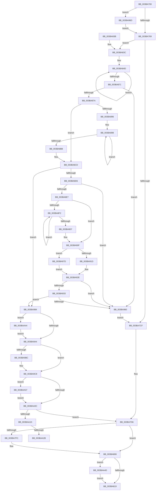

# MiRebuildLargePages

- RVA: `0x003BA700`–`0x003BAA5A` (길이 `858` bytes)
- VA: `0x00000001403BA700`
- 실행 섹션: `.text`
- PDB 이름 있음: `예`; PDB Function 태그: `예`
- unwind 정보 RVA: `0x0008CBA8`
- 디코드: `203`개 명령, `858/858` bytes 표시
- 미해석 바이트: `0` (있으면 어셈블리에 `.byte`로 보존)

> 이 문서는 커널 이미지의 기계어와 PDB 기호를 분석해 생성했습니다. 4번과 5번은 함수 원형과 자료형을 바이너리 사용 방식에서 추정한 C 해석이며 원본 소스 복구 결과는 아닙니다.

## 1. Dependencies

- 직접 호출 지점: **14**; 고유 호출 대상: **10**
- 직접 호출자로 확인된 함수: **0**
- RIP 상대 이미지 참조: **3**

### Outgoing calls
- `0x003BA770` → [ExAcquireSpinLockExclusiveAtDpcLevel](../24/ExAcquireSpinLockExclusiveAtDpcLevel_function_00248E80.md) (function, `0x00248E80`)
- `0x003BA7EE` → [ExReleaseSpinLockExclusiveFromDpcLevel](../24/ExReleaseSpinLockExclusiveFromDpcLevel_function_002497E0.md) (function, `0x002497E0`)
- `0x003BA803` → [KiLowerIrqlProcessIrqlFlags](../4F/KiLowerIrqlProcessIrqlFlags_function_004F5698.md) (function, `0x004F5698`)
- `0x003BA825` → [PsDereferencePartition](../34/PsDereferencePartition_function_00342E70.md) (function, `0x00342E70`)
- `0x003BA8A1` → [MiNodeFreeZeroPages](MiNodeFreeZeroPages_function_003BBF60.md) (function, `0x003BBF60`)
- `0x003BA8F7` → [MiGetNodeStandbyPageCount](MiGetNodeStandbyPageCount_function_003BC09C.md) (function, `0x003BC09C`)
- `0x003BA973` → [KiRaiseIrqlProcessIrqlFlags](../4F/KiRaiseIrqlProcessIrqlFlags_function_004F56FC.md) (function, `0x004F56FC`)
- `0x003BA993` → [KeAbPreAcquire](../21/KeAbPreAcquire_function_00210230.md) (function, `0x00210230`)
- `0x003BA9AE` → [ExReleaseSpinLockExclusiveFromDpcLevel](../24/ExReleaseSpinLockExclusiveFromDpcLevel_function_002497E0.md) (function, `0x002497E0`)
- `0x003BA9C3` → [KiLowerIrqlProcessIrqlFlags](../4F/KiLowerIrqlProcessIrqlFlags_function_004F5698.md) (function, `0x004F5698`)
- `0x003BA9F3` → [MiRebuildLargePage](MiRebuildLargePage_function_003BBAEC.md) (function, `0x003BBAEC`)
- `0x003BAA0F` → [ExAcquireSpinLockExclusiveAtDpcLevel](../24/ExAcquireSpinLockExclusiveAtDpcLevel_function_00248E80.md) (function, `0x00248E80`)
- `0x003BAA3D` → [KiRaiseIrqlProcessIrqlFlags](../4F/KiRaiseIrqlProcessIrqlFlags_function_004F56FC.md) (function, `0x004F56FC`)
- `0x003BAA50` → [KeAbPostRelease](../2E/KeAbPostRelease_function_002E1600.md) (function, `0x002E1600`)

### Direct callers
- 이 함수 시작 RVA로 연결되는 직접 call은 확인되지 않았습니다. 간접 호출은 완전히 역산할 수 없습니다.

### Static image references
- `0x003BA75C` → RVA `0x00FC6D20` (`ALMOSTRO`; read)
- `0x003BA83C` → RVA `0x00011C60` (`.rdata`; read)
- `0x003BA87A` → RVA `0x00FC5002` (`ALMOSTRO`; read)

## 2. Other-region calls and transfers

- 다른 실행 섹션으로 향하는 call: **0**
- call이 아닌 외부 분기/꼬리 이동: **2**
  - `0x003BAA25` → [sub_006E7B1A](../6E/Unknown_function_006E7B1A.md) (`tail-transfer`)
  - `0x003BAA32` → [sub_006E7B1A](../6E/Unknown_function_006E7B1A.md) (`tail-transfer`)

## 3. Assembly (complete function range)

```asm
003BA700  40 53                           push rbx
003BA702  55                              push rbp
003BA703  56                              push rsi
003BA704  57                              push rdi
003BA705  41 54                           push r12
003BA707  41 55                           push r13
003BA709  41 56                           push r14
003BA70B  41 57                           push r15
003BA70D  48 83 EC 48                     sub rsp, 0x48
003BA711  4C 8B A9 88 3A 00 00            mov r13, qword ptr [rcx + 0x3a88]
003BA718  45 33 FF                        xor r15d, r15d
003BA71B  48 8B F9                        mov rdi, rcx
003BA71E  4C 89 BC 24 A8 00 00 00         mov qword ptr [rsp + 0xa8], r15
003BA726  48 B8 3F EE A0 D9 7C 5A 1E F5   movabs rax, 0xf51e5a7cd9a0ee3f
003BA730  4C 89 AC 24 A0 00 00 00         mov qword ptr [rsp + 0xa0], r13
003BA738  48 8B D9                        mov rbx, rcx
003BA73B  49 2B 7D 10                     sub rdi, qword ptr [r13 + 0x10]
003BA73F  41 8D 6F 08                     lea ebp, [r15 + 8]
003BA743  48 C1 FF 07                     sar rdi, 7
003BA747  48 0F AF F8                     imul rdi, rax
003BA74B  44 0F 20 C6                     mov rsi, cr8
003BA74F  48 89 74 24 30                  mov qword ptr [rsp + 0x30], rsi
003BA754  45 8D 77 02                     lea r14d, [r15 + 2]
003BA758  45 0F 22 C6                     mov cr8, r14
003BA75C  44 39 3D BD C5 C0 00            cmp dword ptr [rip + 0xc0c5bd], r15d
003BA763  0F 85 04 02 00 00               jne 0x1403ba96d
003BA769  48 8D 8B 7C 3B 00 00            lea rcx, [rbx + 0x3b7c]
003BA770  E8 0B E7 E8 FF                  call 0x140248e80
003BA775  44 8A 83 43 14 00 00            mov r8b, byte ptr [rbx + 0x1443]
003BA77C  48 B8 15 AE 47 E1 7A 14 AE 47   movabs rax, 0x47ae147ae147ae15
003BA786  44 88 B3 41 14 00 00            mov byte ptr [rbx + 0x1441], r14b
003BA78D  48 8B 8B 80 3A 00 00            mov rcx, qword ptr [rbx + 0x3a80]
003BA794  48 F7 E1                        mul rcx
003BA797  4C 8B F1                        mov r14, rcx
003BA79A  48 89 4C 24 38                  mov qword ptr [rsp + 0x38], rcx
003BA79F  4C 2B F2                        sub r14, rdx
003BA7A2  44 88 84 24 90 00 00 00         mov byte ptr [rsp + 0x90], r8b
003BA7AA  49 D1 EE                        shr r14, 1
003BA7AD  41 8A C0                        mov al, r8b
003BA7B0  4C 03 F2                        add r14, rdx
003BA7B3  49 C1 EE 07                     shr r14, 7
003BA7B7  F6 D8                           neg al
003BA7B9  48 1B C9                        sbb rcx, rcx
003BA7BC  48 81 E1 00 E1 FF FF            and rcx, 0xffffffffffffe100
003BA7C3  48 81 C1 00 20 00 00            add rcx, 0x2000
003BA7CA  4C 3B F1                        cmp r14, rcx
003BA7CD  73 6D                           jae 0x1403ba83c
003BA7CF  4C 8D B3 7C 3B 00 00            lea r14, [rbx + 0x3b7c]
003BA7D6  49 8B CE                        mov rcx, r14
003BA7D9  40 88 AB 42 14 00 00            mov byte ptr [rbx + 0x1442], bpl
003BA7E0  40 88 AB 40 14 00 00            mov byte ptr [rbx + 0x1440], bpl
003BA7E7  C6 83 41 14 00 00 00            mov byte ptr [rbx + 0x1441], 0
003BA7EE  E8 ED EF E8 FF                  call 0x1402497e0
003BA7F3  83 3D 26 C5 C0 00 00            cmp dword ptr [rip + 0xc0c526], 0
003BA7FA  74 0C                           je 0x1403ba808
003BA7FC  44 0F 20 C1                     mov rcx, cr8
003BA800  40 8A D6                        mov dl, sil
003BA803  E8 90 AE 13 00                  call 0x1404f5698
003BA808  40 0F B6 C6                     movzx eax, sil
003BA80C  44 0F 22 C0                     mov cr8, rax
003BA810  4D 85 FF                        test r15, r15
003BA813  0F 85 34 02 00 00               jne 0x1403baa4d
003BA819  49 8B 8D B8 00 00 00            mov rcx, qword ptr [r13 + 0xb8]
003BA820  BA 4D 6D 4C 70                  mov edx, 0x704c6d4d
003BA825  E8 46 86 F8 FF                  call 0x140342e70
003BA82A  48 83 C4 48                     add rsp, 0x48
003BA82E  41 5F                           pop r15
003BA830  41 5E                           pop r14
003BA832  41 5D                           pop r13
003BA834  41 5C                           pop r12
003BA836  5F                              pop rdi
003BA837  5E                              pop rsi
003BA838  5D                              pop rbp
003BA839  5B                              pop rbx
003BA83A  C3                              ret
003BA83B  CC                              int3
003BA83C  4C 8D 0D 1D 74 C5 FF            lea r9, [rip - 0x3a8be3]
003BA843  41 BA 03 00 00 00               mov r10d, 3
003BA849  4C 8D 43 10                     lea r8, [rbx + 0x10]
003BA84D  49 8B 48 F8                     mov rcx, qword ptr [r8 - 8]
003BA851  49 8B 00                        mov rax, qword ptr [r8]
003BA854  4D 8D 80 00 05 00 00            lea r8, [r8 + 0x500]
003BA85B  49 8B 11                        mov rdx, qword ptr [r9]
003BA85E  48 03 C8                        add rcx, rax
003BA861  48 0F AF D1                     imul rdx, rcx
003BA865  4C 03 CD                        add r9, rbp
003BA868  4C 03 FA                        add r15, rdx
003BA86B  49 83 EA 01                     sub r10, 1
003BA86F  75 DC                           jne 0x1403ba84d
003BA871  4D 3B FE                        cmp r15, r14
003BA874  0F 83 E6 00 00 00               jae 0x1403ba960
003BA87A  44 8A 25 81 A7 C0 00            mov r12b, byte ptr [rip + 0xc0a781]
003BA881  33 C9                           xor ecx, ecx
003BA883  4D 2B F7                        sub r14, r15
003BA886  48 89 8C 24 98 00 00 00         mov qword ptr [rsp + 0x98], rcx
003BA88E  45 32 ED                        xor r13b, r13b
003BA891  45 84 E4                        test r12b, r12b
003BA894  74 37                           je 0x1403ba8cd
003BA896  8B F1                           mov esi, ecx
003BA898  45 33 C0                        xor r8d, r8d
003BA89B  41 8A D5                        mov dl, r13b
003BA89E  48 8B CB                        mov rcx, rbx
003BA8A1  E8 BA 16 00 00                  call 0x1403bbf60
003BA8A6  44 8A 25 55 A7 C0 00            mov r12b, byte ptr [rip + 0xc0a755]
003BA8AD  48 03 F0                        add rsi, rax
003BA8B0  41 FE C5                        inc r13b
003BA8B3  45 3A EC                        cmp r13b, r12b
003BA8B6  72 E0                           jb 0x1403ba898
003BA8B8  48 89 B4 24 98 00 00 00         mov qword ptr [rsp + 0x98], rsi
003BA8C0  48 8B 8C 24 98 00 00 00         mov rcx, qword ptr [rsp + 0x98]
003BA8C8  48 8B 74 24 30                  mov rsi, qword ptr [rsp + 0x30]
003BA8CD  49 3B CE                        cmp rcx, r14
003BA8D0  0F 83 AE 00 00 00               jae 0x1403ba984
003BA8D6  4C 8B AC 24 A0 00 00 00         mov r13, qword ptr [rsp + 0xa0]
003BA8DE  49 81 FF 00 04 00 00            cmp r15, 0x400
003BA8E5  73 79                           jae 0x1403ba960
003BA8E7  45 33 DB                        xor r11d, r11d
003BA8EA  45 32 C0                        xor r8b, r8b
003BA8ED  45 84 E4                        test r12b, r12b
003BA8F0  74 1D                           je 0x1403ba90f
003BA8F2  8B D7                           mov edx, edi
003BA8F4  49 8B CD                        mov rcx, r13
003BA8F7  E8 A0 17 00 00                  call 0x1403bc09c
003BA8FC  4C 03 D8                        add r11, rax
003BA8FF  41 FE C0                        inc r8b
003BA902  45 3A C4                        cmp r8b, r12b
003BA905  72 EB                           jb 0x1403ba8f2
003BA907  48 8B 8C 24 98 00 00 00         mov rcx, qword ptr [rsp + 0x98]
003BA90F  48 8B 54 24 38                  mov rdx, qword ptr [rsp + 0x38]
003BA914  48 81 FA 0A 00 05 00            cmp rdx, 0x5000a
003BA91B  72 60                           jb 0x1403ba97d
003BA91D  48 B8 CD CC CC CC CC CC CC CC   movabs rax, 0xcccccccccccccccd
003BA927  48 F7 E2                        mul rdx
003BA92A  48 C1 EA 03                     shr rdx, 3
003BA92E  4C 3B DA                        cmp r11, rdx
003BA931  76 2D                           jbe 0x1403ba960
003BA933  4C 2B DA                        sub r11, rdx
003BA936  48 B8 15 AE 47 E1 7A 14 AE 47   movabs rax, 0x47ae147ae147ae15
003BA940  49 F7 E3                        mul r11
003BA943  4C 2B DA                        sub r11, rdx
003BA946  49 D1 EB                        shr r11, 1
003BA949  4C 03 DA                        add r11, rdx
003BA94C  49 C1 EB 07                     shr r11, 7
003BA950  49 03 CB                        add rcx, r11
003BA953  48 89 8C 24 98 00 00 00         mov qword ptr [rsp + 0x98], rcx
003BA95B  49 3B CE                        cmp rcx, r14
003BA95E  73 24                           jae 0x1403ba984
003BA960  4C 8B BC 24 A8 00 00 00         mov r15, qword ptr [rsp + 0xa8]
003BA968  E9 62 FE FF FF                  jmp 0x1403ba7cf
003BA96D  41 8A D6                        mov dl, r14b
003BA970  40 8A CE                        mov cl, sil
003BA973  E8 84 AD 13 00                  call 0x1404f56fc
003BA978  E9 EC FD FF FF                  jmp 0x1403ba769
003BA97D  BA 00 80 00 00                  mov edx, 0x8000
003BA982  EB AA                           jmp 0x1403ba92e
003BA984  45 33 C0                        xor r8d, r8d
003BA987  C6 83 43 14 00 00 00            mov byte ptr [rbx + 0x1443], 0
003BA98E  33 D2                           xor edx, edx
003BA990  48 8B CB                        mov rcx, rbx
003BA993  E8 98 58 E5 FF                  call 0x140210230
003BA998  4C 8B F8                        mov r15, rax
003BA99B  48 85 C0                        test rax, rax
003BA99E  0F 85 A0 00 00 00               jne 0x1403baa44
003BA9A4  4C 8D B3 7C 3B 00 00            lea r14, [rbx + 0x3b7c]
003BA9AB  49 8B CE                        mov rcx, r14
003BA9AE  E8 2D EE E8 FF                  call 0x1402497e0
003BA9B3  83 3D 66 C3 C0 00 00            cmp dword ptr [rip + 0xc0c366], 0
003BA9BA  74 0C                           je 0x1403ba9c8
003BA9BC  44 0F 20 C1                     mov rcx, cr8
003BA9C0  40 8A D6                        mov dl, sil
003BA9C3  E8 D0 AC 13 00                  call 0x1404f5698
003BA9C8  40 0F B6 C6                     movzx eax, sil
003BA9CC  44 0F 22 C0                     mov cr8, rax
003BA9D0  4C 8B AC 24 A0 00 00 00         mov r13, qword ptr [rsp + 0xa0]
003BA9D8  41 BC 02 00 00 00               mov r12d, 2
003BA9DE  83 64 24 20 00                  and dword ptr [rsp + 0x20], 0
003BA9E3  45 8B C4                        mov r8d, r12d
003BA9E6  4C 8B 8C 24 98 00 00 00         mov r9, qword ptr [rsp + 0x98]
003BA9EE  49 8B CD                        mov rcx, r13
003BA9F1  8B D7                           mov edx, edi
003BA9F3  E8 F4 10 00 00                  call 0x1403bbaec
003BA9F8  48 8B F8                        mov rdi, rax
003BA9FB  44 0F 20 C6                     mov rsi, cr8
003BA9FF  45 0F 22 C4                     mov cr8, r12
003BAA03  83 3D 16 C3 C0 00 00            cmp dword ptr [rip + 0xc0c316], 0
003BAA0A  75 2B                           jne 0x1403baa37
003BAA0C  49 8B CE                        mov rcx, r14
003BAA0F  E8 6C E4 E8 FF                  call 0x140248e80
003BAA14  48 85 FF                        test rdi, rdi
003BAA17  0F 85 B9 FD FF FF               jne 0x1403ba7d6
003BAA1D  40 38 BC 24 90 00 00 00         cmp byte ptr [rsp + 0x90], dil
003BAA25  0F 84 EF D0 32 00               je 0x1406e7b1a
003BAA2B  C6 83 43 14 00 00 01            mov byte ptr [rbx + 0x1443], 1
003BAA32  E9 E3 D0 32 00                  jmp 0x1406e7b1a
003BAA37  41 8A D4                        mov dl, r12b
003BAA3A  40 8A CE                        mov cl, sil
003BAA3D  E8 BA AC 13 00                  call 0x1404f56fc
003BAA42  EB C8                           jmp 0x1403baa0c
003BAA44  C6 40 0A 01                     mov byte ptr [rax + 0xa], 1
003BAA48  E9 57 FF FF FF                  jmp 0x1403ba9a4
003BAA4D  48 8B CB                        mov rcx, rbx
003BAA50  E8 AB 6B F2 FF                  call 0x1402e1600
003BAA55  E9 BF FD FF FF                  jmp 0x1403ba819
```

## 4. C-style interpretation (structured pseudocode)

```c
__int64 __fastcall MiRebuildLargePages(__int64 a1, __int64 a2)
{
    __int64 result;
    __int64 v_r10;
    __int64 v_r11;
    __int64 v_r13;
    __int64 v_r14;
    __int64 v_r15;
    __int64 v_rdi;
    __int64 v_rsi;
    __int64 v_rsp;
    unsigned __int64 v_stack_m50;
    unsigned __int64 v_stack_m58;
    unsigned __int64 v_stack_p18;
    unsigned __int64 v_stack_p20;
    unsigned __int64 v_stack_p30;
    unsigned __int64 v_stack_p38;
    unsigned __int8 v_stack_p8;
    unsigned __int8 v_stack_p90;
    unsigned __int64 v_stack_p98;
    unsigned __int64 v_stack_pA0;
    unsigned __int64 v_stack_pA8;

    v_rsp = (v_rsp) - (72);
    v_r15 = 0;
    v_stack_p20 = 0;
    v_stack_p18 = *(unsigned __int64 *)(a1 + 14984);
    v_rdi = (a1) - (*(unsigned __int64 *)(*(unsigned __int64 *)(a1 + 14984) + 16));
    v_rdi = (v_rdi) >> (7);
    v_rdi = (v_rdi) * (result);
    v_stack_m58 = v_cr8;
    if ((*(unsigned int *)(v_rip + 12633533)) != 0) goto loc_003BA96D;
loc_003BA769:
    result = ExAcquireSpinLockExclusiveAtDpcLevel(a1 + 15228, a2, a3, a4);
    *(unsigned __int8 *)(a1 + 5185) = (unsigned __int8)(v_r15 + 2);
    v_stack_m50 = *(unsigned __int64 *)(a1 + 14976);
    v_r14 = (*(unsigned __int64 *)(a1 + 14976)) - (a2);
    v_stack_p8 = (unsigned __int8)(*(unsigned __int8 *)(a1 + 5187));
    v_r14 = (v_r14) >> (1);
    v_r14 = (v_r14) + (a2);
    v_r14 = (v_r14) >> (7);
    result = (unsigned __int8)(-((unsigned __int8)(*(unsigned __int8 *)(a1 + 5187))));
    a1 = (*(unsigned __int64 *)(a1 + 14976)) & (0xFFFFFFFFFFFFE100ULL);
    a1 = (a1) + (0x2000ULL);
    if (v_r14 >= a1) goto loc_003BA83C;
loc_003BA7CF:
loc_003BA7D6:
    *(unsigned __int8 *)(a1 + 5186) = (unsigned __int8)(v_r15 + 8);
    *(unsigned __int8 *)(a1 + 5184) = (unsigned __int8)(v_r15 + 8);
    *(unsigned __int8 *)(a1 + 5185) = 0;
    result = ExReleaseSpinLockExclusiveFromDpcLevel(a1 + 15228, a2, *(unsigned __int8 *)(a1 + 5187), a4);
    if ((*(unsigned int *)(v_rip + 12633382)) != 0) {
        a1 = v_r15 + 2;
        a2 = (unsigned __int8)(v_cr8);
        result = KiLowerIrqlProcessIrqlFlags(a1, a2, *(unsigned __int8 *)(a1 + 5187), a4);
    }
    if (0 != 0) goto loc_003BAA4D;
loc_003BA819:
    result = PsDereferencePartition(*(unsigned __int64 *)(*(unsigned __int64 *)(a1 + 14984) + 184), (unsigned int)(0x704C6D4DULL), *(unsigned __int8 *)(a1 + 5187), a4);
    v_rsp = (v_rsp) + (72);
    return result;
loc_003BA83C:
loc_003BA84D:
    a1 = (*(unsigned __int64 *)(a1 + 16 - 8)) + (*(unsigned __int64 *)(a1 + 16));
    a2 = (*(unsigned __int64 *)(v_rip - 3836899)) * (a1);
    a4 = (v_rip - 3836899) + (v_r15 + 8);
    v_r15 = (v_r15) + (a2);
    v_r10 = (3) - (1);
    if (condition_is_not_equal) goto loc_003BA84D;
    if (v_r15 >= (a1 + 15228)) goto loc_003BA960;
    a1 = 0;
    v_r14 = (a1 + 15228) - (v_r15);
    v_stack_p98 = 0;
    v_r13 = 0;
    if ((unsigned __int8)(*(unsigned __int8 *)(v_rip + 12625793)) == 0) goto loc_003BA8CD;
loc_003BA898:
    a3 = 0;
    result = MiNodeFreeZeroPages(0, 0, a3, a4);
    v_rsi = (0) + (result);
    v_r13 = (unsigned __int8)((v_r13) + 1);
    if (((unsigned __int8)(v_r13)) < ((unsigned __int8)(*(unsigned __int8 *)(v_rip + 12625749)))) goto loc_003BA898;
    v_stack_p98 = v_rsi;
loc_003BA8CD:
    if (v_stack_p98 >= v_r14) goto loc_003BA984;
    if (v_r15 >= 0x400ULL) goto loc_003BA960;
    v_r11 = 0;
    a3 = 0;
    if ((unsigned __int8)(*(unsigned __int8 *)(v_rip + 12625749)) == 0) goto loc_003BA90F;
loc_003BA8F2:
    result = MiGetNodeStandbyPageCount(v_stack_pA0, (unsigned int)((unsigned int)(v_rdi)), a3, a4);
    v_r11 = (v_r11) + (result);
    a3 = (unsigned __int8)((a3) + 1);
    if (((unsigned __int8)(a3)) < ((unsigned __int8)(*(unsigned __int8 *)(v_rip + 12625749)))) goto loc_003BA8F2;
loc_003BA90F:
    if (v_stack_p38 < 0x5000AULL) goto loc_003BA97D;
    a2 = (v_stack_p38) >> (3);
loc_003BA92E:
    if (v_r11 <= a2) goto loc_003BA960;
    v_r11 = (v_r11) - (a2);
    v_r11 = (v_r11) - (a2);
    v_r11 = (v_r11) >> (1);
    v_r11 = (v_r11) + (a2);
    v_r11 = (v_r11) >> (7);
    a1 = (v_stack_p98) + (v_r11);
    v_stack_p98 = a1;
    if (a1 >= v_r14) goto loc_003BA984;
loc_003BA960:
    goto loc_003BA7CF;
loc_003BA96D:
    result = KiRaiseIrqlProcessIrqlFlags((unsigned __int8)(v_stack_p30), (unsigned __int8)(v_r14), a3, a4);
    goto loc_003BA769;
loc_003BA97D:
    goto loc_003BA92E;
loc_003BA984:
    a3 = 0;
    *(unsigned __int8 *)(a1 + 5187) = 0;
    a2 = 0;
    result = KeAbPreAcquire(a1, a2, a3, a4);
    if (result != 0) goto loc_003BAA44;
loc_003BA9A4:
    result = ExReleaseSpinLockExclusiveFromDpcLevel(a1 + 15228, a2, a3, a4);
    if ((*(unsigned int *)(v_rip + 12632934)) != 0) {
        a1 = (unsigned __int8)(v_cr8);
        a2 = (unsigned __int8)(v_stack_p30);
        result = KiLowerIrqlProcessIrqlFlags(a1, a2, a3, a4);
    }
    result = MiRebuildLargePage(v_stack_pA0, (unsigned int)((unsigned int)(v_rdi)), 2, v_stack_p98);
    if ((*(unsigned int *)(v_rip + 12632854)) != 0) goto loc_003BAA37;
loc_003BAA0C:
    result = ExAcquireSpinLockExclusiveAtDpcLevel(a1 + 15228, (unsigned int)((unsigned int)(v_rdi)), 2, v_stack_p98);
    if (result != 0) goto loc_003BA7D6;
    *(unsigned __int8 *)(a1 + 5187) = 1;
loc_003BAA37:
    result = KiRaiseIrqlProcessIrqlFlags((unsigned __int8)((unsigned __int8)(v_stack_p30)), 2, 2, v_stack_p98);
    goto loc_003BAA0C;
loc_003BAA44:
    *(unsigned __int8 *)(result + 10) = 1;
    goto loc_003BA9A4;
loc_003BAA4D:
    result = KeAbPostRelease(a1, 2, 2, v_stack_p98);
    goto loc_003BA819;
}
```

## 5. (Beta) C Style

```c
int64_t MiRebuildLargePages(void *Arg1, int64_t Arg2)
{
    uint8_t *arg1 = (uint8_t *)Arg1;

    int64_t result;
    int64_t local_r10;
    int64_t local_r11;
    int64_t local_r13;
    int64_t local_r14;
    int64_t local_r15;
    int64_t local_rdi;
    int64_t local_rsi;
    int64_t local_rsp;
    uint64_t v_stack_m50;
    uint64_t v_stack_m58;
    uint64_t v_stack_p18;
    uint64_t v_stack_p20;
    uint64_t v_stack_p30;
    uint64_t v_stack_p38;
    uint8_t v_stack_p8;
    uint8_t v_stack_p90;
    uint64_t v_stack_p98;
    uint64_t v_stack_pA0;
    uint64_t v_stack_pA8;

    local_rsp = (local_rsp) - (72);
    local_r15 = 0;
    v_stack_p20 = 0;
    v_stack_p18 = *(uint64_t *)(arg1 + 0x3A88);
    local_rdi = (Arg1) - (*(uint64_t *)(*(uint64_t *)(arg1 + 0x3A88) + 0x10));
    local_rdi = (local_rdi) >> (7);
    local_rdi = (local_rdi) * (result);
    v_stack_m58 = v_cr8;
    if ((*(uint32_t *)(v_rip + 0xC0C5BD)) != 0) goto loc_003BA96D;
loc_003BA769:
    result = ExAcquireSpinLockExclusiveAtDpcLevel(Arg1 + 15228, Arg2, a3, a4);
    *(uint8_t *)(arg1 + 0x1441) = (uint8_t)(local_r15 + 2);
    v_stack_m50 = *(uint64_t *)(arg1 + 0x3A80);
    local_r14 = (*(uint64_t *)(arg1 + 0x3A80)) - (Arg2);
    v_stack_p8 = (uint8_t)(*(uint8_t *)(arg1 + 0x1443));
    local_r14 = (local_r14) >> (1);
    local_r14 = (local_r14) + (Arg2);
    local_r14 = (local_r14) >> (7);
    result = (uint8_t)(-((uint8_t)(*(uint8_t *)(arg1 + 0x1443))));
    Arg1 = (*(uint64_t *)(arg1 + 0x3A80)) & (0xFFFFFFFFFFFFE100ULL);
    Arg1 = (Arg1) + (0x2000ULL);
    if (local_r14 >= Arg1) goto loc_003BA83C;
loc_003BA7CF:
loc_003BA7D6:
    *(uint8_t *)(arg1 + 0x1442) = (uint8_t)(local_r15 + 8);
    *(uint8_t *)(arg1 + 0x1440) = (uint8_t)(local_r15 + 8);
    *(uint8_t *)(arg1 + 0x1441) = 0;
    result = ExReleaseSpinLockExclusiveFromDpcLevel(Arg1 + 15228, Arg2, *(uint8_t *)(arg1 + 0x1443), a4);
    if ((*(uint32_t *)(v_rip + 0xC0C526)) != 0) {
        Arg1 = local_r15 + 2;
        Arg2 = (uint8_t)(v_cr8);
        result = KiLowerIrqlProcessIrqlFlags(Arg1, Arg2, *(uint8_t *)(arg1 + 0x1443), a4);
    }
    if (0 != 0) goto loc_003BAA4D;
loc_003BA819:
    result = PsDereferencePartition(*(uint64_t *)(*(uint64_t *)(arg1 + 0x3A88) + 0xB8), (uint32_t)(0x704C6D4DULL), *(uint8_t *)(arg1 + 0x1443), a4);
    local_rsp = (local_rsp) + (72);
    return result;
loc_003BA83C:
loc_003BA84D:
    Arg1 = (*(uint64_t *)(arg1 + 0x10 - 0x8)) + (*(uint64_t *)(arg1 + 0x10));
    Arg2 = (*(uint64_t *)(v_rip - 0x3A8BE3)) * (Arg1);
    a4 = (v_rip - 3836899) + (local_r15 + 8);
    local_r15 = (local_r15) + (Arg2);
    local_r10 = (3) - (1);
    if (condition_is_not_equal) goto loc_003BA84D;
    if (local_r15 >= (Arg1 + 15228)) goto loc_003BA960;
    Arg1 = 0;
    local_r14 = (Arg1 + 15228) - (local_r15);
    v_stack_p98 = 0;
    local_r13 = 0;
    if ((uint8_t)(*(uint8_t *)(v_rip + 0xC0A781)) == 0) goto loc_003BA8CD;
loc_003BA898:
    a3 = 0;
    result = MiNodeFreeZeroPages(0, 0, a3, a4);
    local_rsi = (0) + (result);
    local_r13 = (uint8_t)((local_r13) + 1);
    if (((uint8_t)(local_r13)) < ((uint8_t)(*(uint8_t *)(v_rip + 0xC0A755)))) goto loc_003BA898;
    v_stack_p98 = local_rsi;
loc_003BA8CD:
    if (v_stack_p98 >= local_r14) goto loc_003BA984;
    if (local_r15 >= 0x400ULL) goto loc_003BA960;
    local_r11 = 0;
    a3 = 0;
    if ((uint8_t)(*(uint8_t *)(v_rip + 0xC0A755)) == 0) goto loc_003BA90F;
loc_003BA8F2:
    result = MiGetNodeStandbyPageCount(v_stack_pA0, (uint32_t)((uint32_t)(local_rdi)), a3, a4);
    local_r11 = (local_r11) + (result);
    a3 = (uint8_t)((a3) + 1);
    if (((uint8_t)(a3)) < ((uint8_t)(*(uint8_t *)(v_rip + 0xC0A755)))) goto loc_003BA8F2;
loc_003BA90F:
    if (v_stack_p38 < 0x5000AULL) goto loc_003BA97D;
    Arg2 = (v_stack_p38) >> (3);
loc_003BA92E:
    if (local_r11 <= Arg2) goto loc_003BA960;
    local_r11 = (local_r11) - (Arg2);
    local_r11 = (local_r11) - (Arg2);
    local_r11 = (local_r11) >> (1);
    local_r11 = (local_r11) + (Arg2);
    local_r11 = (local_r11) >> (7);
    Arg1 = (v_stack_p98) + (local_r11);
    v_stack_p98 = Arg1;
    if (Arg1 >= local_r14) goto loc_003BA984;
loc_003BA960:
    goto loc_003BA7CF;
loc_003BA96D:
    result = KiRaiseIrqlProcessIrqlFlags((uint8_t)(v_stack_p30), (uint8_t)(local_r14), a3, a4);
    goto loc_003BA769;
loc_003BA97D:
    goto loc_003BA92E;
loc_003BA984:
    a3 = 0;
    *(uint8_t *)(arg1 + 0x1443) = 0;
    Arg2 = 0;
    result = KeAbPreAcquire(Arg1, Arg2, a3, a4);
    if (result != 0) goto loc_003BAA44;
loc_003BA9A4:
    result = ExReleaseSpinLockExclusiveFromDpcLevel(Arg1 + 15228, Arg2, a3, a4);
    if ((*(uint32_t *)(v_rip + 0xC0C366)) != 0) {
        Arg1 = (uint8_t)(v_cr8);
        Arg2 = (uint8_t)(v_stack_p30);
        result = KiLowerIrqlProcessIrqlFlags(Arg1, Arg2, a3, a4);
    }
    result = MiRebuildLargePage(v_stack_pA0, (uint32_t)((uint32_t)(local_rdi)), 2, v_stack_p98);
    if ((*(uint32_t *)(v_rip + 0xC0C316)) != 0) goto loc_003BAA37;
loc_003BAA0C:
    result = ExAcquireSpinLockExclusiveAtDpcLevel(Arg1 + 15228, (uint32_t)((uint32_t)(local_rdi)), 2, v_stack_p98);
    if (result != 0) goto loc_003BA7D6;
    *(uint8_t *)(arg1 + 0x1443) = 1;
loc_003BAA37:
    result = KiRaiseIrqlProcessIrqlFlags((uint8_t)((uint8_t)(v_stack_p30)), 2, 2, v_stack_p98);
    goto loc_003BAA0C;
loc_003BAA44:
    *(uint8_t *)(result + 0xA) = 1;
    goto loc_003BA9A4;
loc_003BAA4D:
    result = KeAbPostRelease(Arg1, 2, 2, v_stack_p98);
    goto loc_003BA819;
}
```

### 관측된 메모리 오프셋

구조체 형식이 확인되지 않은 접근은 인자 기준의 오프셋으로만 기록했습니다.

| 기준 인자 | 오프셋 표현 | 폭 (bit) | 접근 |
|---|---:|---:|---|
| `Arg1` | `- 0x8` | `64` | `R` |
| `Arg1` | `+ 0x0` | `64` | `R` |
| `Arg1` | `+ 0x10` | `64` | `R` |
| `Arg1` | `+ 0x500` | `64` | `R` |
| `Arg1` | `+ 0x1440` | `8` | `W` |
| `Arg1` | `+ 0x1441` | `8` | `W` |
| `Arg1` | `+ 0x1442` | `8` | `W` |
| `Arg1` | `+ 0x1443` | `8` | `R` |
| `Arg1` | `+ 0x1443` | `8` | `W` |
| `Arg1` | `+ 0x3A80` | `64` | `R` |
| `Arg1` | `+ 0x3A88` | `64` | `R` |
| `Arg1` | `+ 0x3B7C` | `64` | `R` |

## 6. Execution-region graph

[열기: 2D/3D 그래프와 함수 탐색 컨트롤 패널](../../../control-panel.html?section=text&rva=0x003BA700&view=graph)

- 2D 그래프는 위에서 아래로 흐르고, 3D 그래프는 빈 공간을 드래그해 회전합니다. Shift+드래그는 이동, 휠은 확대·축소, 함수 노드 선택은 대상 보고서 이동입니다.

### Static fallback


