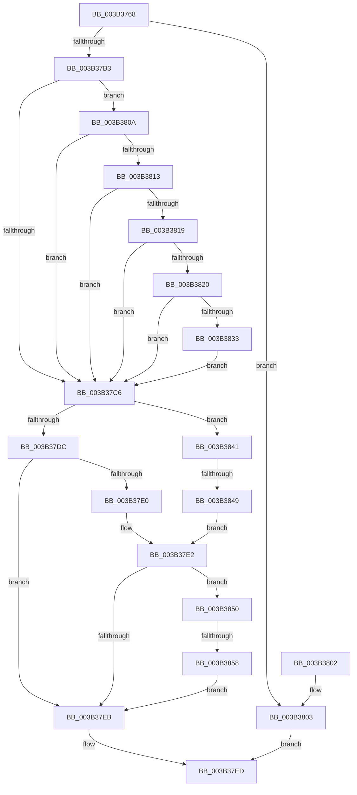

# MiReferenceDataSubsections

- RVA: `0x003B3768`–`0x003B3870` (길이 `264` bytes)
- VA: `0x00000001403B3768`
- 실행 섹션: `.text`
- PDB 이름 있음: `예`; PDB Function 태그: `예`
- unwind 정보 RVA: `0x0008C490`
- 디코드: `81`개 명령, `264/264` bytes 표시
- 미해석 바이트: `0` (있으면 어셈블리에 `.byte`로 보존)

> 이 문서는 커널 이미지의 기계어와 PDB 기호를 분석해 생성했습니다. 4번과 5번은 함수 원형과 자료형을 바이너리 사용 방식에서 추정한 C 해석이며 원본 소스 복구 결과는 아닙니다.

## 1. Dependencies

- 직접 호출 지점: **2**; 고유 호출 대상: **2**
- 직접 호출자로 확인된 함수: **1**
- RIP 상대 이미지 참조: **0**

### Outgoing calls
- `0x003B37A6` → [MiOffsetToProtos](../24/MiOffsetToProtos_function_0024D880.md) (function, `0x0024D880`)
- `0x003B37CF` → [MiAddViewsForSection](../32/MiAddViewsForSection_function_00324990.md) (function, `0x00324990`)

### Direct callers
- [MiInsertInSystemSpace](MiInsertInSystemSpace_function_003B2F5C.md) at `0x003B3301`

### Static image references
- 디코드된 RIP-relative 메모리 참조가 없습니다.

## 2. Other-region calls and transfers

- 다른 실행 섹션으로 향하는 call: **0**
- call이 아닌 외부 분기/꼬리 이동: **2**
  - `0x003B3843` → [sub_006E720A](../6E/Unknown_function_006E720A.md) (`tail-transfer`)
  - `0x003B3852` → [sub_006E720A + 0x19](../6E/Unknown_function_006E720A.md) (`tail-transfer`)

## 3. Assembly (complete function range)

```asm
003B3768  48 8B C4                        mov rax, rsp
003B376B  48 89 58 08                     mov qword ptr [rax + 8], rbx
003B376F  48 89 50 10                     mov qword ptr [rax + 0x10], rdx
003B3773  55                              push rbp
003B3774  56                              push rsi
003B3775  57                              push rdi
003B3776  41 54                           push r12
003B3778  41 55                           push r13
003B377A  41 56                           push r14
003B377C  41 57                           push r15
003B377E  48 83 EC 30                     sub rsp, 0x30
003B3782  48 8B 12                        mov rdx, qword ptr [rdx]
003B3785  4D 8B F0                        mov r14, r8
003B3788  33 DB                           xor ebx, ebx
003B378A  41 C7 01 03 00 00 00            mov dword ptr [r9], 3
003B3791  4C 8D 40 C0                     lea r8, [rax - 0x40]
003B3795  48 89 58 C0                     mov qword ptr [rax - 0x40], rbx
003B3799  89 9C 24 88 00 00 00            mov dword ptr [rsp + 0x88], ebx
003B37A0  4D 8B F9                        mov r15, r9
003B37A3  4C 8B E9                        mov r13, rcx
003B37A6  E8 D5 A0 E9 FF                  call 0x14024d880
003B37AB  48 8B E8                        mov rbp, rax
003B37AE  48 85 C0                        test rax, rax
003B37B1  74 50                           je 0x1403b3803
003B37B3  48 8B 44 24 28                  mov rax, qword ptr [rsp + 0x28]
003B37B8  BE 88 00 00 00                  mov esi, 0x88
003B37BD  4E 8D 24 30                     lea r12, [rax + r14]
003B37C1  48 85 C0                        test rax, rax
003B37C4  74 44                           je 0x1403b380a
003B37C6  44 8B C6                        mov r8d, esi
003B37C9  49 8B D4                        mov rdx, r12
003B37CC  48 8B CD                        mov rcx, rbp
003B37CF  E8 BC 11 F7 FF                  call 0x140324990
003B37D4  8B F8                           mov edi, eax
003B37D6  0F BA E6 09                     bt esi, 9
003B37DA  72 65                           jb 0x1403b3841
003B37DC  85 FF                           test edi, edi
003B37DE  78 0B                           js 0x1403b37eb
003B37E0  8B C3                           mov eax, ebx
003B37E2  39 9C 24 88 00 00 00            cmp dword ptr [rsp + 0x88], ebx
003B37E9  75 65                           jne 0x1403b3850
003B37EB  8B C7                           mov eax, edi
003B37ED  48 8B 5C 24 70                  mov rbx, qword ptr [rsp + 0x70]
003B37F2  48 83 C4 30                     add rsp, 0x30
003B37F6  41 5F                           pop r15
003B37F8  41 5E                           pop r14
003B37FA  41 5D                           pop r13
003B37FC  41 5C                           pop r12
003B37FE  5F                              pop rdi
003B37FF  5E                              pop rsi
003B3800  5D                              pop rbp
003B3801  C3                              ret
003B3802  CC                              int3
003B3803  B8 1F 00 00 C0                  mov eax, 0xc000001f
003B3808  EB E3                           jmp 0x1403b37ed
003B380A  49 F7 C6 FF 01 00 00            test r14, 0x1ff
003B3811  75 B3                           jne 0x1403b37c6
003B3813  49 39 5D 40                     cmp qword ptr [r13 + 0x40], rbx
003B3817  74 AD                           je 0x1403b37c6
003B3819  41 F6 45 3E 0C                  test byte ptr [r13 + 0x3e], 0xc
003B381E  74 A6                           je 0x1403b37c6
003B3820  8B 45 2C                        mov eax, dword ptr [rbp + 0x2c]
003B3823  C7 84 24 88 00 00 00 01 00 00 00  mov dword ptr [rsp + 0x88], 1
003B382E  4C 3B F0                        cmp r14, rax
003B3831  75 93                           jne 0x1403b37c6
003B3833  48 39 5D 08                     cmp qword ptr [rbp + 8], rbx
003B3837  B8 88 02 00 00                  mov eax, 0x288
003B383C  0F 44 F0                        cmove esi, eax
003B383F  EB 85                           jmp 0x1403b37c6
003B3841  85 C0                           test eax, eax
003B3843  0F 88 C1 39 33 00               js 0x1406e720a
003B3849  B8 01 00 00 00                  mov eax, 1
003B384E  EB 92                           jmp 0x1403b37e2
003B3850  85 C0                           test eax, eax
003B3852  0F 84 CB 39 33 00               je 0x1406e7223
003B3858  8B 45 30                        mov eax, dword ptr [rbp + 0x30]
003B385B  25 00 00 00 C0                  and eax, 0xc0000000
003B3860  3D 00 00 00 40                  cmp eax, 0x40000000
003B3865  0F 94 C3                        sete bl
003B3868  41 89 1F                        mov dword ptr [r15], ebx
003B386B  E9 7B FF FF FF                  jmp 0x1403b37eb
```

## 4. C-style interpretation (structured pseudocode)

```c
__int64 __fastcall MiReferenceDataSubsections(__int64 a1, __int64 a2, __int64 a3, __int64 a4)
{
    __int64 result;
    __int64 v_rbx;
    __int64 v_rsi;
    __int64 v_rsp;
    unsigned __int64 v_stack_m40;
    unsigned int v_stack_p20;
    unsigned __int64 v_stack_p8;
    unsigned int v_stack_p88;

    *(unsigned __int64 *)(v_rsp + 8) = v_rbx;
    *(unsigned __int64 *)(v_rsp + 16) = a2;
    v_rsp = (v_rsp) - (48);
    v_rbx = 0;
    *(unsigned int *)(a4) = 3;
    *(unsigned __int64 *)(v_rsp - 64) = 0;
    v_stack_p20 = 0;
    result = MiOffsetToProtos(a1, *(unsigned __int64 *)(a2), v_rsp - 64, a4);
    if (result == 0) goto loc_003B3803;
    if (v_stack_m40 == 0) goto loc_003B380A;
loc_003B37C6:
    result = MiAddViewsForSection(result, v_stack_m40 + a3 * 1, 136, a4);
    if (condition_is_below) goto loc_003B3841;
    if (sign_flag) goto loc_003B37EB;
loc_003B37E2:
    if (v_stack_p20 != 0) goto loc_003B3850;
loc_003B37EB:
loc_003B37ED:
    v_rsp = (v_rsp) + (48);
    return (unsigned int)((unsigned int)((unsigned int)((unsigned int)(result))));
loc_003B3803:
    goto loc_003B37ED;
loc_003B380A:
    if (((a3) & (511)) != 0) goto loc_003B37C6;
    if ((*(unsigned __int64 *)(a1 + 64)) == v_stack_p8) goto loc_003B37C6;
    if (((*(unsigned __int8 *)(a1 + 62)) & (12)) == 0) goto loc_003B37C6;
    v_stack_p88 = 1;
    if (a3 != ((unsigned int)(*(unsigned int *)(result + 44)))) goto loc_003B37C6;
    v_rsi = 136;
    if ((*(unsigned __int64 *)(result + 8)) == v_stack_p8) { v_rsi = 648; }
    goto loc_003B37C6;
loc_003B3841:
    goto loc_003B37E2;
loc_003B3850:
    result = (unsigned int)(((unsigned int)(*(unsigned int *)(result + 48))) & (0xC0000000ULL));
    v_rbx = (((unsigned int)(result)) == 0x40000000ULL) ? 1 : 0;
    *(unsigned int *)(a4) = (unsigned int)(v_rbx);
    goto loc_003B37EB;
}
```

## 5. (Beta) C Style

```c
int64_t MiReferenceDataSubsections(void *Arg1, void *Arg2, int64_t Arg3, void *Arg4)
{
    uint8_t *arg1 = (uint8_t *)Arg1;
    uint8_t *arg2 = (uint8_t *)Arg2;
    uint8_t *arg4 = (uint8_t *)Arg4;

    int64_t result;
    int64_t local_rbx;
    int64_t local_rsi;
    int64_t local_rsp;
    uint64_t v_stack_m40;
    uint32_t v_stack_p20;
    uint64_t v_stack_p8;
    uint32_t v_stack_p88;

    *(uint64_t *)(local_rsp + 0x8) = local_rbx;
    *(void **)(local_rsp + 0x10) = Arg2;
    local_rsp = (local_rsp) - (48);
    local_rbx = 0;
    *(uint32_t *)(arg4) = 3;
    *(uint64_t *)(local_rsp - 0x40) = 0;
    v_stack_p20 = 0;
    result = MiOffsetToProtos(Arg1, *(uint64_t *)(arg2), local_rsp - 64, Arg4);
    if (result == 0) goto loc_003B3803;
    if (v_stack_m40 == 0) goto loc_003B380A;
loc_003B37C6:
    result = MiAddViewsForSection(result, v_stack_m40 + Arg3 * 1, 136, Arg4);
    if (condition_is_below) goto loc_003B3841;
    if (sign_flag) goto loc_003B37EB;
loc_003B37E2:
    if (v_stack_p20 != 0) goto loc_003B3850;
loc_003B37EB:
loc_003B37ED:
    local_rsp = (local_rsp) + (48);
    return (uint32_t)((uint32_t)((uint32_t)((uint32_t)(result))));
loc_003B3803:
    goto loc_003B37ED;
loc_003B380A:
    if (((Arg3) & (511)) != 0) goto loc_003B37C6;
    if ((*(uint64_t *)(arg1 + 0x40)) == v_stack_p8) goto loc_003B37C6;
    if (((*(uint8_t *)(arg1 + 0x3E)) & (12)) == 0) goto loc_003B37C6;
    v_stack_p88 = 1;
    if (Arg3 != ((uint32_t)(*(uint32_t *)(result + 0x2C)))) goto loc_003B37C6;
    local_rsi = 136;
    if ((*(uint64_t *)(result + 0x8)) == v_stack_p8) { local_rsi = 648; }
    goto loc_003B37C6;
loc_003B3841:
    goto loc_003B37E2;
loc_003B3850:
    result = (uint32_t)(((uint32_t)(*(uint32_t *)(result + 0x30))) & (0xC0000000ULL));
    local_rbx = (((uint32_t)(result)) == 0x40000000ULL) ? 1 : 0;
    *(uint32_t *)(arg4) = (uint32_t)(local_rbx);
    goto loc_003B37EB;
}
```

### 관측된 메모리 오프셋

구조체 형식이 확인되지 않은 접근은 인자 기준의 오프셋으로만 기록했습니다.

| 기준 인자 | 오프셋 표현 | 폭 (bit) | 접근 |
|---|---:|---:|---|
| `Arg1` | `+ 0x3E` | `8` | `R` |
| `Arg1` | `+ 0x40` | `64` | `R` |
| `Arg2` | `+ 0x0` | `64` | `R` |
| `Arg4` | `+ 0x0` | `32` | `W` |

## 6. Execution-region graph

[열기: 2D/3D 그래프와 함수 탐색 컨트롤 패널](../../../control-panel.html?section=text&rva=0x003B3768&view=graph)

- 2D 그래프는 위에서 아래로 흐르고, 3D 그래프는 빈 공간을 드래그해 회전합니다. Shift+드래그는 이동, 휠은 확대·축소, 함수 노드 선택은 대상 보고서 이동입니다.

### Static fallback


