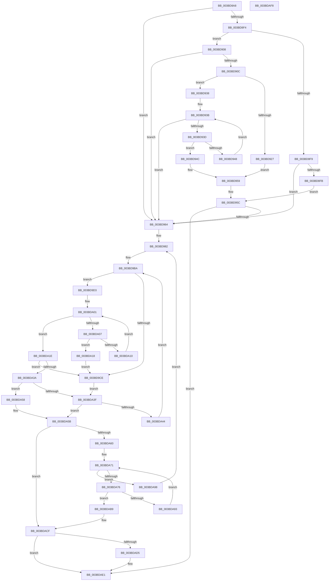

# MiReplenishSlabAllocatorByIdentity

- RVA: `0x003BD8A8`–`0x003BDAF9` (길이 `593` bytes)
- VA: `0x00000001403BD8A8`
- 실행 섹션: `.text`
- PDB 이름 있음: `예`; PDB Function 태그: `아니요`
- unwind 정보 RVA: `0x0008CF18`
- 디코드: `187`개 명령, `593/593` bytes 표시
- 미해석 바이트: `0` (있으면 어셈블리에 `.byte`로 보존)

> 이 문서는 커널 이미지의 기계어와 PDB 기호를 분석해 생성했습니다. 4번과 5번은 함수 원형과 자료형을 바이너리 사용 방식에서 추정한 C 해석이며 원본 소스 복구 결과는 아닙니다.

## 1. Dependencies

- 직접 호출 지점: **4**; 고유 호출 대상: **4**
- 직접 호출자로 확인된 함수: **1**
- RIP 상대 이미지 참조: **1**

### Outgoing calls
- `0x003BD96D` → [MiGetCurrentSlabIdentity](MiGetCurrentSlabIdentity_function_003BD020.md) (function, `0x003BD020`)
- `0x003BD97A` → [ExAcquireSpinLockExclusive](../24/ExAcquireSpinLockExclusive_function_00248690.md) (function, `0x00248690`)
- `0x003BDAC5` → [MiChangeSlabEntryIdentity](../68/MiChangeSlabEntryIdentity_function_0068CE30.md) (function, `0x0068CE30`)
- `0x003BDADC` → [MiReleaseSpinLockExclusive](../24/MiReleaseSpinLockExclusive_function_002482C0.md) (function, `0x002482C0`)

### Direct callers
- [MiReplenishSlabAllocator](../37/MiReplenishSlabAllocator_function_003788E4.md) at `0x00378A1C`

### Static image references
- `0x003BDA7C` → RVA `0x00011C60` (`.rdata`; read)

## 2. Other-region calls and transfers

- 다른 실행 섹션으로 향하는 call: **0**
- 별도 외부 분기/꼬리 이동을 확인하지 못했습니다.

## 3. Assembly (complete function range)

```asm
003BD8A8  48 89 5C 24 20                  mov qword ptr [rsp + 0x20], rbx
003BD8AD  55                              push rbp
003BD8AE  56                              push rsi
003BD8AF  57                              push rdi
003BD8B0  41 54                           push r12
003BD8B2  41 55                           push r13
003BD8B4  41 56                           push r14
003BD8B6  41 57                           push r15
003BD8B8  48 83 EC 20                     sub rsp, 0x20
003BD8BC  8B 81 84 00 00 00               mov eax, dword ptr [rcx + 0x84]
003BD8C2  33 DB                           xor ebx, ebx
003BD8C4  4C 69 C0 80 DF 00 00            imul r8, rax, 0xdf80
003BD8CB  48 8B 41 18                     mov rax, qword ptr [rcx + 0x18]
003BD8CF  41 83 CC FF                     or r12d, 0xffffffff
003BD8D3  48 8B F1                        mov rsi, rcx
003BD8D6  44 8B EB                        mov r13d, ebx
003BD8D9  48 8B 50 10                     mov rdx, qword ptr [rax + 0x10]
003BD8DD  49 8B BC 10 B0 DE 00 00         mov rdi, qword ptr [r8 + rdx + 0xdeb0]
003BD8E5  48 81 C7 D0 CA 04 00            add rdi, 0x4cad0
003BD8EC  8B 07                           mov eax, dword ptr [rdi]
003BD8EE  8B 17                           mov edx, dword ptr [rdi]
003BD8F0  85 C0                           test eax, eax
003BD8F2  74 70                           je 0x1403bd964
003BD8F4  83 FA 01                        cmp edx, 1
003BD8F7  77 0F                           ja 0x1403bd908
003BD8F9  75 69                           jne 0x1403bd964
003BD8FB  48 8B 47 08                     mov rax, qword ptr [rdi + 8]
003BD8FF  0F BA 20 00                     bt dword ptr [rax], 0
003BD903  0F 93 C0                        setae al
003BD906  EB 54                           jmp 0x1403bd95c
003BD908  3B C2                           cmp eax, edx
003BD90A  72 58                           jb 0x1403bd964
003BD90C  48 8B 4F 08                     mov rcx, qword ptr [rdi + 8]
003BD910  44 8D 42 FF                     lea r8d, [rdx - 1]
003BD914  41 8B C0                        mov eax, r8d
003BD917  48 C1 E8 05                     shr rax, 5
003BD91B  44 8B 09                        mov r9d, dword ptr [rcx]
003BD91E  4C 8D 14 81                     lea r10, [rcx + rax*4]
003BD922  49 3B CA                        cmp rcx, r10
003BD925  75 11                           jne 0x1403bd938
003BD927  B9 20 00 00 00                  mov ecx, 0x20
003BD92C  41 8B C4                        mov eax, r12d
003BD92F  2B CA                           sub ecx, edx
003BD931  D3 E8                           shr eax, cl
003BD933  44 85 C8                        test eax, r9d
003BD936  EB 21                           jmp 0x1403bd959
003BD938  45 85 C9                        test r9d, r9d
003BD93B  75 27                           jne 0x1403bd964
003BD93D  48 83 C1 04                     add rcx, 4
003BD941  8B 11                           mov edx, dword ptr [rcx]
003BD943  49 3B CA                        cmp rcx, r10
003BD946  74 04                           je 0x1403bd94c
003BD948  85 D2                           test edx, edx
003BD94A  EB EF                           jmp 0x1403bd93b
003BD94C  41 F7 D0                        not r8d
003BD94F  41 8B C4                        mov eax, r12d
003BD952  41 8A C8                        mov cl, r8b
003BD955  D3 E8                           shr eax, cl
003BD957  85 D0                           test eax, edx
003BD959  0F 94 C0                        sete al
003BD95C  84 C0                           test al, al
003BD95E  0F 85 7D 01 00 00               jne 0x1403bdae1
003BD964  65 48 8B 0C 25 88 01 00 00      mov rcx, qword ptr gs:[0x188]
003BD96D  E8 AE F6 FF FF                  call 0x1403bd020
003BD972  48 8D 4E 10                     lea rcx, [rsi + 0x10]
003BD976  88 44 24 60                     mov byte ptr [rsp + 0x60], al
003BD97A  E8 11 AD E8 FF                  call 0x140248690
003BD97F  44 8A F0                        mov r14b, al
003BD982  8B 2F                           mov ebp, dword ptr [rdi]
003BD984  4C 8B 47 08                     mov r8, qword ptr [rdi + 8]
003BD988  49 8B C8                        mov rcx, r8
003BD98B  4C 89 44 24 70                  mov qword ptr [rsp + 0x70], r8
003BD990  83 E1 04                        and ecx, 4
003BD993  4D 8B F8                        mov r15, r8
003BD996  8B C1                           mov eax, ecx
003BD998  8D 55 FF                        lea edx, [rbp - 1]
003BD99B  48 F7 D8                        neg rax
003BD99E  45 1B D2                        sbb r10d, r10d
003BD9A1  41 83 E2 20                     and r10d, 0x20
003BD9A5  44 3B ED                        cmp r13d, ebp
003BD9A8  45 1B C9                        sbb r9d, r9d
003BD9AB  45 23 CD                        and r9d, r13d
003BD9AE  48 F7 D9                        neg rcx
003BD9B1  48 1B C0                        sbb rax, rax
003BD9B4  83 E0 04                        and eax, 4
003BD9B7  4C 2B F8                        sub r15, rax
003BD9BA  45 8D 1C 12                     lea r11d, [r10 + rdx]
003BD9BE  41 8B C3                        mov eax, r11d
003BD9C1  43 8D 0C 0A                     lea ecx, [r10 + r9]
003BD9C5  2B C1                           sub eax, ecx
003BD9C7  FF C0                           inc eax
003BD9C9  83 F8 01                        cmp eax, 1
003BD9CC  73 05                           jae 0x1403bd9d3
003BD9CE  41 8B D4                        mov edx, r12d
003BD9D1  EB 6C                           jmp 0x1403bda3f
003BD9D3  41 8B C3                        mov eax, r11d
003BD9D6  41 B8 01 00 00 00               mov r8d, 1
003BD9DC  48 C1 E8 06                     shr rax, 6
003BD9E0  4D 8D 24 C7                     lea r12, [r15 + rax*8]
003BD9E4  48 8B C1                        mov rax, rcx
003BD9E7  48 C1 E8 06                     shr rax, 6
003BD9EB  80 E1 3F                        and cl, 0x3f
003BD9EE  49 D3 E0                        shl r8, cl
003BD9F1  49 FF C8                        dec r8
003BD9F4  49 8D 14 C7                     lea rdx, [r15 + rax*8]
003BD9F8  48 8B 02                        mov rax, qword ptr [rdx]
003BD9FB  48 F7 D0                        not rax
003BD9FE  4C 0B C0                        or r8, rax
003BDA01  49 83 F8 FF                     cmp r8, -1
003BDA05  75 17                           jne 0x1403bda1e
003BDA07  48 83 C2 08                     add rdx, 8
003BDA0B  49 3B D4                        cmp rdx, r12
003BDA0E  77 08                           ja 0x1403bda18
003BDA10  4C 8B 02                        mov r8, qword ptr [rdx]
003BDA13  49 F7 D0                        not r8
003BDA16  EB E9                           jmp 0x1403bda01
003BDA18  41 83 CC FF                     or r12d, 0xffffffff
003BDA1C  EB B0                           jmp 0x1403bd9ce
003BDA1E  49 2B D7                        sub rdx, r15
003BDA21  49 F7 D0                        not r8
003BDA24  48 C1 FA 03                     sar rdx, 3
003BDA28  41 83 CC FF                     or r12d, 0xffffffff
003BDA2C  49 0F BC C0                     bsf rax, r8
003BDA30  C1 E2 06                        shl edx, 6
003BDA33  03 D0                           add edx, eax
003BDA35  41 3B D3                        cmp edx, r11d
003BDA38  77 94                           ja 0x1403bd9ce
003BDA3A  41 3B D4                        cmp edx, r12d
003BDA3D  75 19                           jne 0x1403bda58
003BDA3F  45 85 C9                        test r9d, r9d
003BDA42  74 17                           je 0x1403bda5b
003BDA44  41 8D 55 01                     lea edx, [r13 + 1]
003BDA48  44 8B CB                        mov r9d, ebx
003BDA4B  3B D5                           cmp edx, ebp
003BDA4D  0F 47 D5                        cmova edx, ebp
003BDA50  41 03 D4                        add edx, r12d
003BDA53  E9 62 FF FF FF                  jmp 0x1403bd9ba
003BDA58  41 2B D2                        sub edx, r10d
003BDA5B  41 3B D4                        cmp edx, r12d
003BDA5E  74 6F                           je 0x1403bdacf
003BDA60  44 8B D2                        mov r10d, edx
003BDA63  49 C1 E2 04                     shl r10, 4
003BDA67  4C 03 56 58                     add r10, qword ptr [rsi + 0x58]
003BDA6B  44 8B C2                        mov r8d, edx
003BDA6E  49 8B 0A                        mov rcx, qword ptr [r10]
003BDA71  49 3B CA                        cmp rcx, r10
003BDA74  74 22                           je 0x1403bda98
003BDA76  8B 86 88 00 00 00               mov eax, dword ptr [rsi + 0x88]
003BDA7C  4C 8D 1D DD 41 C5 FF            lea r11, [rip - 0x3abe23]
003BDA83  48 C1 E8 04                     shr rax, 4
003BDA87  83 E0 03                        and eax, 3
003BDA8A  41 8B 04 C3                     mov eax, dword ptr [r11 + rax*8]
003BDA8E  39 41 3C                        cmp dword ptr [rcx + 0x3c], eax
003BDA91  74 26                           je 0x1403bdab9
003BDA93  48 8B 09                        mov rcx, qword ptr [rcx]
003BDA96  EB D9                           jmp 0x1403bda71
003BDA98  49 C1 E8 03                     shr r8, 3
003BDA9C  44 8D 6A 01                     lea r13d, [rdx + 1]
003BDAA0  4C 03 44 24 70                  add r8, qword ptr [rsp + 0x70]
003BDAA5  8B C2                           mov eax, edx
003BDAA7  83 E0 07                        and eax, 7
003BDAAA  41 0F BE 08                     movsx ecx, byte ptr [r8]
003BDAAE  0F B3 C1                        btr ecx, eax
003BDAB1  41 88 08                        mov byte ptr [r8], cl
003BDAB4  E9 C9 FE FF FF                  jmp 0x1403bd982
003BDAB9  44 8A 44 24 60                  mov r8b, byte ptr [rsp + 0x60]
003BDABE  48 8D 51 E8                     lea rdx, [rcx - 0x18]
003BDAC2  48 8B CE                        mov rcx, rsi
003BDAC5  E8 66 F3 2C 00                  call 0x14068ce30
003BDACA  BB 01 00 00 00                  mov ebx, 1
003BDACF  41 80 FE 11                     cmp r14b, 0x11
003BDAD3  74 0C                           je 0x1403bdae1
003BDAD5  41 8A D6                        mov dl, r14b
003BDAD8  48 8D 4E 10                     lea rcx, [rsi + 0x10]
003BDADC  E8 DF A7 E8 FF                  call 0x1402482c0
003BDAE1  8B C3                           mov eax, ebx
003BDAE3  48 8B 5C 24 78                  mov rbx, qword ptr [rsp + 0x78]
003BDAE8  48 83 C4 20                     add rsp, 0x20
003BDAEC  41 5F                           pop r15
003BDAEE  41 5E                           pop r14
003BDAF0  41 5D                           pop r13
003BDAF2  41 5C                           pop r12
003BDAF4  5F                              pop rdi
003BDAF5  5E                              pop rsi
003BDAF6  5D                              pop rbp
003BDAF7  C3                              ret
003BDAF8  CC                              int3
```

## 4. C-style interpretation (structured pseudocode)

```c
__int64 __fastcall MiReplenishSlabAllocatorByIdentity(__int64 a1)
{
    __int64 result;
    __int64 v_r10;
    __int64 v_r12;
    __int64 v_r15;
    __int64 v_rbx;
    __int64 v_rdi;
    __int64 v_rsp;
    unsigned __int64 v_stack_p18;
    unsigned __int64 v_stack_p20;
    unsigned __int8 v_stack_p8;

    v_stack_p20 = v_rbx;
    v_rsp = (v_rsp) - (32);
    v_rbx = 0;
    a3 = (a3) * ((unsigned int)(*(unsigned int *)(a1 + 132)));
    v_r12 = (unsigned int)((v_r12) | (0xFFFFFFFFULL));
    v_rdi = (*(unsigned __int64 *)(a3 + *(unsigned __int64 *)(*(unsigned __int64 *)(a1 + 24) + 16) * 1 + 57008)) + (0x4CAD0ULL);
    if ((unsigned int)((unsigned int)(*(unsigned int *)(v_rdi))) == 0) goto loc_003BD964;
    if (((unsigned int)((unsigned int)(*(unsigned int *)(v_rdi)))) > 1) goto loc_003BD908;
    if (((unsigned int)((unsigned int)(*(unsigned int *)(v_rdi)))) != 1) goto loc_003BD964;
    result = (((unsigned int)((unsigned int)(*(unsigned int *)(v_rdi)))) >= 1) ? 1 : 0;
    goto loc_003BD95C;
loc_003BD908:
    if (((unsigned int)(result)) < ((unsigned int)((unsigned int)(*(unsigned int *)(v_rdi))))) goto loc_003BD964;
    result = ((unsigned int)((unsigned int)((unsigned int)(*(unsigned int *)(v_rdi)) - 1))) >> (5);
    if ((*(unsigned __int64 *)(v_rdi + 8)) != (*(unsigned __int64 *)(v_rdi + 8) + result * 4)) goto loc_003BD938;
    a1 = (unsigned int)((32) - ((unsigned int)((unsigned int)(*(unsigned int *)(v_rdi)))));
    result = (unsigned int)(((unsigned int)((unsigned int)(v_r12))) >> ((unsigned __int8)(a1)));
    goto loc_003BD959;
loc_003BD938:
loc_003BD93B:
    if ((unsigned int)((unsigned int)(*(unsigned int *)(*(unsigned __int64 *)(v_rdi + 8)))) != 0) goto loc_003BD964;
    a1 = (a1) + (4);
    if (a1 == (*(unsigned __int64 *)(v_rdi + 8) + result * 4)) goto loc_003BD94C;
    goto loc_003BD93B;
loc_003BD94C:
    a3 = (unsigned int)(~((unsigned int)(*(unsigned int *)(v_rdi)) - 1));
    result = (unsigned int)(((unsigned int)((unsigned int)(v_r12))) >> ((unsigned __int8)((unsigned __int8)(a3))));
loc_003BD959:
    result = ((((unsigned int)(result)) & ((unsigned int)((unsigned int)(*(unsigned int *)(a1))))) == 0) ? 1 : 0;
loc_003BD95C:
    if ((unsigned __int8)(result) != 0) goto loc_003BDAE1;
loc_003BD964:
    result = MiGetCurrentSlabIdentity(*(unsigned __int64 *)(gs_base + (0 + 392)), (unsigned int)(*(unsigned int *)(a1)), a3, (unsigned int)(*(unsigned int *)(*(unsigned __int64 *)(v_rdi + 8))));
    v_stack_p8 = (unsigned __int8)(result);
    result = ExAcquireSpinLockExclusive(a1 + 16, (unsigned int)(*(unsigned int *)(a1)), a3, (unsigned int)(*(unsigned int *)(*(unsigned __int64 *)(v_rdi + 8))));
loc_003BD982:
    v_stack_p18 = *(unsigned __int64 *)(v_rdi + 8);
    a1 = (unsigned int)((*(unsigned __int64 *)(v_rdi + 8)) & (4));
    result = -((unsigned int)((unsigned int)(a1)));
    v_r10 = (unsigned int)((*(unsigned __int64 *)(v_rdi + 8) + result * 4) & (32));
    a4 = (unsigned int)(((unsigned int)(*(unsigned int *)(*(unsigned __int64 *)(v_rdi + 8)))) & (0));
    a1 = -(a1);
    result = (unsigned int)((result) & (4));
    v_r15 = (*(unsigned __int64 *)(v_rdi + 8)) - (result);
loc_003BD9BA:
    result = (unsigned int)(((unsigned int)((unsigned int)(v_r10 + (unsigned int)(*(unsigned int *)(v_rdi)) - 1 * 1))) - ((unsigned int)(v_r10 + a4 * 1)));
    result = (unsigned int)((result) + 1);
    if (((unsigned int)(result)) >= 1) goto loc_003BD9D3;
loc_003BD9CE:
    goto loc_003BDA3F;
loc_003BD9D3:
    result = ((unsigned int)((unsigned int)(v_r10 + (unsigned int)(*(unsigned int *)(v_rdi)) - 1 * 1))) >> (6);
    result = (v_r10 + a4 * 1) >> (6);
    a1 = (unsigned __int8)((v_r10 + a4 * 1) & (63));
    a3 = (1) << ((unsigned __int8)(a1));
    a3 = (a3) - 1;
    result = ~(*(unsigned __int64 *)(v_r15 + result * 8));
    a3 = (a3) | (result);
loc_003BDA01:
    if (a3 != -1) goto loc_003BDA1E;
    a2 = (v_r15 + result * 8) + (8);
    if (a2 > (v_r15 + result * 8)) goto loc_003BDA18;
    a3 = ~(*(unsigned __int64 *)(a2));
    goto loc_003BDA01;
loc_003BDA18:
    v_r12 = (unsigned int)((v_r15 + result * 8) | (0xFFFFFFFFULL));
    goto loc_003BD9CE;
loc_003BDA1E:
    a2 = (a2) - (v_r15);
    a3 = ~(a3);
    a2 = (a2) >> (3);
    v_r12 = (unsigned int)((v_r12) | (0xFFFFFFFFULL));
    a2 = (unsigned int)((a2) << (6));
    a2 = (unsigned int)((a2) + ((unsigned int)(result)));
    if (((unsigned int)(a2)) > ((unsigned int)(v_r10 + (unsigned int)(*(unsigned int *)(v_rdi)) - 1 * 1))) goto loc_003BD9CE;
    if (((unsigned int)(a2)) != ((unsigned int)(v_r12))) goto loc_003BDA58;
loc_003BDA3F:
    if ((unsigned int)(a4) == 0) goto loc_003BDA5B;
    a2 = 0 + 1;
    if (((unsigned int)(0 + 1)) > ((unsigned int)((unsigned int)(*(unsigned int *)(v_rdi))))) { a2 = (unsigned int)((unsigned int)(*(unsigned int *)(v_rdi))); }
    a2 = (unsigned int)((a2) + ((unsigned int)(v_r12)));
    goto loc_003BD9BA;
loc_003BDA58:
    a2 = (unsigned int)((a2) - ((unsigned int)(v_r10)));
loc_003BDA5B:
    if (((unsigned int)(a2)) == ((unsigned int)(v_r12))) goto loc_003BDACF;
    v_r10 = ((unsigned int)((unsigned int)(a2))) << (4);
    v_r10 = (v_r10) + (*(unsigned __int64 *)(a1 + 88));
loc_003BDA71:
    if ((*(unsigned __int64 *)(v_r10)) == v_r10) goto loc_003BDA98;
    result = ((unsigned int)(*(unsigned int *)(a1 + 136))) >> (4);
    result = (unsigned int)((result) & (3));
    if ((*(unsigned int *)(*(unsigned __int64 *)(v_r10) + 60)) == ((unsigned int)((unsigned int)(*(unsigned int *)(v_rip - 3849763 + result * 8))))) goto loc_003BDAB9;
    goto loc_003BDA71;
loc_003BDA98:
    a3 = ((unsigned int)((unsigned int)(a2))) >> (3);
    a3 = (a3) + (v_stack_p18);
    result = (unsigned int)(((unsigned int)((unsigned int)(a2))) & (7));
    *(unsigned __int8 *)(a3) = (unsigned __int8)((__int8)(*(unsigned __int8 *)(a3)));
    goto loc_003BD982;
loc_003BDAB9:
    result = MiChangeSlabEntryIdentity(a1, (__int8)(*(unsigned __int8 *)(a3)) - 24, v_stack_p8, 0);
loc_003BDACF:
    if (((unsigned __int8)((unsigned __int8)(result))) != 17) {
        a2 = (unsigned __int8)((unsigned __int8)(result));
        a1 = a1 + 16;
        result = MiReleaseSpinLockExclusive(a1, a2, v_stack_p8, 0);
    }
    v_rsp = (v_rsp) + (32);
    return 1;
}
```

## 5. (Beta) C Style

```c
int64_t MiReplenishSlabAllocatorByIdentity(void *Arg1)
{
    uint8_t *arg1 = (uint8_t *)Arg1;

    int64_t result;
    int64_t local_r10;
    int64_t local_r12;
    int64_t local_r15;
    int64_t local_rbx;
    int64_t local_rdi;
    int64_t local_rsp;
    uint64_t v_stack_p18;
    uint64_t v_stack_p20;
    uint8_t v_stack_p8;

    v_stack_p20 = local_rbx;
    local_rsp = (local_rsp) - (32);
    local_rbx = 0;
    a3 = (a3) * ((uint32_t)(*(uint32_t *)(arg1 + 0x84)));
    local_r12 = (uint32_t)((local_r12) | (0xFFFFFFFFULL));
    local_rdi = (*(uint64_t *)(a3 + *(uint64_t *)(*(uint64_t *)(arg1 + 0x18) + 0x10) * 1 + 0xDEB0)) + (0x4CAD0ULL);
    if ((uint32_t)((uint32_t)(*(uint32_t *)(local_rdi))) == 0) goto loc_003BD964;
    if (((uint32_t)((uint32_t)(*(uint32_t *)(local_rdi)))) > 1) goto loc_003BD908;
    if (((uint32_t)((uint32_t)(*(uint32_t *)(local_rdi)))) != 1) goto loc_003BD964;
    result = (((uint32_t)((uint32_t)(*(uint32_t *)(local_rdi)))) >= 1) ? 1 : 0;
    goto loc_003BD95C;
loc_003BD908:
    if (((uint32_t)(result)) < ((uint32_t)((uint32_t)(*(uint32_t *)(local_rdi))))) goto loc_003BD964;
    result = ((uint32_t)((uint32_t)((uint32_t)(*(uint32_t *)(local_rdi)) - 1))) >> (5);
    if ((*(uint64_t *)(local_rdi + 0x8)) != (*(uint64_t *)(local_rdi + 0x8) + result * 4)) goto loc_003BD938;
    Arg1 = (uint32_t)((32) - ((uint32_t)((uint32_t)(*(uint32_t *)(local_rdi)))));
    result = (uint32_t)(((uint32_t)((uint32_t)(local_r12))) >> ((uint8_t)(Arg1)));
    goto loc_003BD959;
loc_003BD938:
loc_003BD93B:
    if ((uint32_t)((uint32_t)(*(uint32_t *)(*(uint64_t *)(local_rdi + 0x8)))) != 0) goto loc_003BD964;
    Arg1 = (Arg1) + (4);
    if (Arg1 == (*(uint64_t *)(local_rdi + 0x8) + result * 4)) goto loc_003BD94C;
    goto loc_003BD93B;
loc_003BD94C:
    a3 = (uint32_t)(~((uint32_t)(*(uint32_t *)(local_rdi)) - 1));
    result = (uint32_t)(((uint32_t)((uint32_t)(local_r12))) >> ((uint8_t)((uint8_t)(a3))));
loc_003BD959:
    result = ((((uint32_t)(result)) & ((uint32_t)((uint32_t)(*(uint32_t *)(arg1))))) == 0) ? 1 : 0;
loc_003BD95C:
    if ((uint8_t)(result) != 0) goto loc_003BDAE1;
loc_003BD964:
    result = MiGetCurrentSlabIdentity(*(uint64_t *)(gs_base + (0 + 0x188)), (uint32_t)(*(uint32_t *)(arg1)), a3, (uint32_t)(*(uint32_t *)(*(uint64_t *)(local_rdi + 0x8))));
    v_stack_p8 = (uint8_t)(result);
    result = ExAcquireSpinLockExclusive(Arg1 + 16, (uint32_t)(*(uint32_t *)(arg1)), a3, (uint32_t)(*(uint32_t *)(*(uint64_t *)(local_rdi + 0x8))));
loc_003BD982:
    v_stack_p18 = *(uint64_t *)(local_rdi + 0x8);
    Arg1 = (uint32_t)((*(uint64_t *)(local_rdi + 0x8)) & (4));
    result = -((uint32_t)((uint32_t)(Arg1)));
    local_r10 = (uint32_t)((*(uint64_t *)(local_rdi + 0x8) + result * 4) & (32));
    a4 = (uint32_t)(((uint32_t)(*(uint32_t *)(*(uint64_t *)(local_rdi + 0x8)))) & (0));
    Arg1 = -(Arg1);
    result = (uint32_t)((result) & (4));
    local_r15 = (*(uint64_t *)(local_rdi + 0x8)) - (result);
loc_003BD9BA:
    result = (uint32_t)(((uint32_t)((uint32_t)(local_r10 + (uint32_t)(*(uint32_t *)(local_rdi)) - 1 * 1))) - ((uint32_t)(local_r10 + a4 * 1)));
    result = (uint32_t)((result) + 1);
    if (((uint32_t)(result)) >= 1) goto loc_003BD9D3;
loc_003BD9CE:
    goto loc_003BDA3F;
loc_003BD9D3:
    result = ((uint32_t)((uint32_t)(local_r10 + (uint32_t)(*(uint32_t *)(local_rdi)) - 1 * 1))) >> (6);
    result = (local_r10 + a4 * 1) >> (6);
    Arg1 = (uint8_t)((local_r10 + a4 * 1) & (63));
    a3 = (1) << ((uint8_t)(Arg1));
    a3 = (a3) - 1;
    result = ~(*(uint64_t *)(local_r15 + result * 8));
    a3 = (a3) | (result);
loc_003BDA01:
    if (a3 != -1) goto loc_003BDA1E;
    a2 = (local_r15 + result * 8) + (8);
    if (a2 > (local_r15 + result * 8)) goto loc_003BDA18;
    a3 = ~(*(uint64_t *)(a2));
    goto loc_003BDA01;
loc_003BDA18:
    local_r12 = (uint32_t)((local_r15 + result * 8) | (0xFFFFFFFFULL));
    goto loc_003BD9CE;
loc_003BDA1E:
    a2 = (a2) - (local_r15);
    a3 = ~(a3);
    a2 = (a2) >> (3);
    local_r12 = (uint32_t)((local_r12) | (0xFFFFFFFFULL));
    a2 = (uint32_t)((a2) << (6));
    a2 = (uint32_t)((a2) + ((uint32_t)(result)));
    if (((uint32_t)(a2)) > ((uint32_t)(local_r10 + (uint32_t)(*(uint32_t *)(local_rdi)) - 1 * 1))) goto loc_003BD9CE;
    if (((uint32_t)(a2)) != ((uint32_t)(local_r12))) goto loc_003BDA58;
loc_003BDA3F:
    if ((uint32_t)(a4) == 0) goto loc_003BDA5B;
    a2 = 0 + 1;
    if (((uint32_t)(0 + 1)) > ((uint32_t)((uint32_t)(*(uint32_t *)(local_rdi))))) { a2 = (uint32_t)((uint32_t)(*(uint32_t *)(local_rdi))); }
    a2 = (uint32_t)((a2) + ((uint32_t)(local_r12)));
    goto loc_003BD9BA;
loc_003BDA58:
    a2 = (uint32_t)((a2) - ((uint32_t)(local_r10)));
loc_003BDA5B:
    if (((uint32_t)(a2)) == ((uint32_t)(local_r12))) goto loc_003BDACF;
    local_r10 = ((uint32_t)((uint32_t)(a2))) << (4);
    local_r10 = (local_r10) + (*(uint64_t *)(arg1 + 0x58));
loc_003BDA71:
    if ((*(uint64_t *)(local_r10)) == local_r10) goto loc_003BDA98;
    result = ((uint32_t)(*(uint32_t *)(arg1 + 0x88))) >> (4);
    result = (uint32_t)((result) & (3));
    if ((*(uint32_t *)(*(uint64_t *)(local_r10) + 0x3C)) == ((uint32_t)((uint32_t)(*(uint32_t *)(v_rip - 0x3ABE23 + result * 8))))) goto loc_003BDAB9;
    goto loc_003BDA71;
loc_003BDA98:
    a3 = ((uint32_t)((uint32_t)(a2))) >> (3);
    a3 = (a3) + (v_stack_p18);
    result = (uint32_t)(((uint32_t)((uint32_t)(a2))) & (7));
    *(uint8_t *)(a3) = (uint8_t)((int8_t)(*(uint8_t *)(a3)));
    goto loc_003BD982;
loc_003BDAB9:
    result = MiChangeSlabEntryIdentity(Arg1, (int8_t)(*(uint8_t *)(a3)) - 24, v_stack_p8, 0);
loc_003BDACF:
    if (((uint8_t)((uint8_t)(result))) != 17) {
        a2 = (uint8_t)((uint8_t)(result));
        Arg1 = Arg1 + 16;
        result = MiReleaseSpinLockExclusive(Arg1, a2, v_stack_p8, 0);
    }
    local_rsp = (local_rsp) + (32);
    return 1;
}
```

### 관측된 메모리 오프셋

구조체 형식이 확인되지 않은 접근은 인자 기준의 오프셋으로만 기록했습니다.

| 기준 인자 | 오프셋 표현 | 폭 (bit) | 접근 |
|---|---:|---:|---|
| `Arg1` | `+ 0x10` | `64` | `R` |
| `Arg1` | `+ 0x18` | `64` | `R` |
| `Arg1` | `+ 0x58` | `64` | `R` |
| `Arg1` | `+ 0x84` | `32` | `R` |
| `Arg1` | `+ 0x88` | `32` | `R` |

## 6. Execution-region graph

[열기: 2D/3D 그래프와 함수 탐색 컨트롤 패널](../../../control-panel.html?section=text&rva=0x003BD8A8&view=graph)

- 2D 그래프는 위에서 아래로 흐르고, 3D 그래프는 빈 공간을 드래그해 회전합니다. Shift+드래그는 이동, 휠은 확대·축소, 함수 노드 선택은 대상 보고서 이동입니다.

### Static fallback


