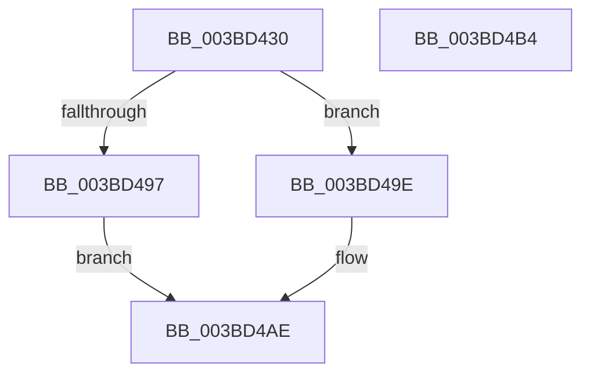

# MiReserveEnclavePages

- RVA: `0x003BD430`–`0x003BD4B5` (길이 `133` bytes)
- VA: `0x00000001403BD430`
- 실행 섹션: `.text`
- PDB 이름 있음: `예`; PDB Function 태그: `아니요`
- unwind 정보 RVA: `0x00071A74`
- 디코드: `32`개 명령, `133/133` bytes 표시
- 미해석 바이트: `0` (있으면 어셈블리에 `.byte`로 보존)

> 이 문서는 커널 이미지의 기계어와 PDB 기호를 분석해 생성했습니다. 4번과 5번은 함수 원형과 자료형을 바이너리 사용 방식에서 추정한 C 해석이며 원본 소스 복구 결과는 아닙니다.

## 1. Dependencies

- 직접 호출 지점: **2**; 고유 호출 대상: **2**
- 직접 호출자로 확인된 함수: **2**
- RIP 상대 이미지 참조: **1**

### Outgoing calls
- `0x003BD48A` → [MiAllocateEnclavePages](MiAllocateEnclavePages_function_003BC43C.md) (function, `0x003BC43C`)
- `0x003BD4A7` → [MiAppendPageChain](../45/MiAppendPageChain_function_004570F4.md) (function, `0x004570F4`)

### Direct callers
- [MiAddPagesToEnclave](../36/MiAddPagesToEnclave_function_00367EEC.md) at `0x003681EB`
- [MiCreateHardwareEnclave](../../page/80/MiCreateHardwareEnclave_function_00808500.md) at `0x00808699`

### Static image references
- `0x003BD440` → RVA `0x00FC8C40` (`ALMOSTRO`; read)

## 2. Other-region calls and transfers

- 다른 실행 섹션으로 향하는 call: **0**
- 별도 외부 분기/꼬리 이동을 확인하지 못했습니다.

## 3. Assembly (complete function range)

```asm
003BD430  40 53                           push rbx
003BD432  48 83 EC 50                     sub rsp, 0x50
003BD436  33 C0                           xor eax, eax
003BD438  48 8B D9                        mov rbx, rcx
003BD43B  48 89 44 24 40                  mov qword ptr [rsp + 0x40], rax
003BD440  48 8D 0D F9 B7 C0 00            lea rcx, [rip + 0xc0b7f9]
003BD447  65 48 8B 04 25 88 01 00 00      mov rax, qword ptr gs:[0x188]
003BD450  4C 8B D2                        mov r10, rdx
003BD453  0F 57 C0                        xorps xmm0, xmm0
003BD456  0F 11 44 24 30                  movups xmmword ptr [rsp + 0x30], xmm0
003BD45B  8B 80 4C 02 00 00               mov eax, dword ptr [rax + 0x24c]
003BD461  48 8B 04 C1                     mov rax, qword ptr [rcx + rax*8]
003BD465  49 8B CA                        mov rcx, r10
003BD468  4C 8B 88 C0 00 00 00            mov r9, qword ptr [rax + 0xc0]
003BD46F  48 8D 44 24 30                  lea rax, [rsp + 0x30]
003BD474  48 89 44 24 20                  mov qword ptr [rsp + 0x20], rax
003BD479  41 0F B7 91 8A 00 00 00         movzx edx, word ptr [r9 + 0x8a]
003BD481  4D 8B C8                        mov r9, r8
003BD484  41 B8 01 00 00 00               mov r8d, 1
003BD48A  E8 AD EF FF FF                  call 0x1403bc43c
003BD48F  48 83 7C 24 40 00               cmp qword ptr [rsp + 0x40], 0
003BD495  75 07                           jne 0x1403bd49e
003BD497  B8 17 00 00 C0                  mov eax, 0xc0000017
003BD49C  EB 10                           jmp 0x1403bd4ae
003BD49E  48 8D 4B 60                     lea rcx, [rbx + 0x60]
003BD4A2  48 8D 54 24 30                  lea rdx, [rsp + 0x30]
003BD4A7  E8 48 9C 09 00                  call 0x1404570f4
003BD4AC  33 C0                           xor eax, eax
003BD4AE  48 83 C4 50                     add rsp, 0x50
003BD4B2  5B                              pop rbx
003BD4B3  C3                              ret
003BD4B4  CC                              int3
```

## 4. C-style interpretation (structured pseudocode)

```c
__int64 __fastcall MiReserveEnclavePages(__int64 a1, __int64 a2, __int64 a3)
{
    __int64 result;
    __int64 v_rsp;
    unsigned __int64 v_stack_m18;
    unsigned __int64 v_stack_m28;
    unsigned __int64 v_stack_m38;

    v_rsp = (v_rsp) - (80);
    result = 0;
    v_stack_m18 = 0;
    v_stack_m28 = v_xmm0;
    v_stack_m38 = v_stack_m28;
    result = MiAllocateEnclavePages(a2, *(unsigned __int16 *)(*(unsigned __int64 *)(*(unsigned __int64 *)(v_rip + 12630009 + (unsigned int)(*(unsigned int *)(*(unsigned __int64 *)(gs_base + (0 + 392)) + 588)) * 8) + 192) + 138), 1, a3);
    if (v_stack_m18 != 0) goto loc_003BD49E;
    goto loc_003BD4AE;
loc_003BD49E:
    result = MiAppendPageChain(a1 + 96, v_stack_m28, 1, a3);
    result = 0;
loc_003BD4AE:
    v_rsp = (v_rsp) + (80);
    return result;
}
```

## 5. (Beta) C Style

```c
int64_t MiReserveEnclavePages(void *Arg1, int64_t Arg2, int64_t Arg3)
{
    uint8_t *arg1 = (uint8_t *)Arg1;

    int64_t result;
    int64_t local_rsp;
    uint64_t v_stack_m18;
    uint64_t v_stack_m28;
    uint64_t v_stack_m38;

    local_rsp = (local_rsp) - (80);
    result = 0;
    v_stack_m18 = 0;
    v_stack_m28 = v_xmm0;
    v_stack_m38 = v_stack_m28;
    result = MiAllocateEnclavePages(Arg2, *(uint16_t *)(*(uint64_t *)(*(uint64_t *)(v_rip + 0xC0B7F9 + (uint32_t)(*(uint32_t *)(*(uint64_t *)(gs_base + (0 + 0x188)) + 0x24C)) * 8) + 0xC0) + 0x8A), 1, Arg3);
    if (v_stack_m18 != 0) goto loc_003BD49E;
    goto loc_003BD4AE;
loc_003BD49E:
    result = MiAppendPageChain(Arg1 + 96, v_stack_m28, 1, Arg3);
    result = 0;
loc_003BD4AE:
    local_rsp = (local_rsp) + (80);
    return result;
}
```

### 관측된 메모리 오프셋

구조체 형식이 확인되지 않은 접근은 인자 기준의 오프셋으로만 기록했습니다.

| 기준 인자 | 오프셋 표현 | 폭 (bit) | 접근 |
|---|---:|---:|---|
| `Arg1` | `+ 0x60` | `64` | `R` |

## 6. Execution-region graph

[열기: 2D/3D 그래프와 함수 탐색 컨트롤 패널](../../../control-panel.html?section=text&rva=0x003BD430&view=graph)

- 2D 그래프는 위에서 아래로 흐르고, 3D 그래프는 빈 공간을 드래그해 회전합니다. Shift+드래그는 이동, 휠은 확대·축소, 함수 노드 선택은 대상 보고서 이동입니다.

### Static fallback


