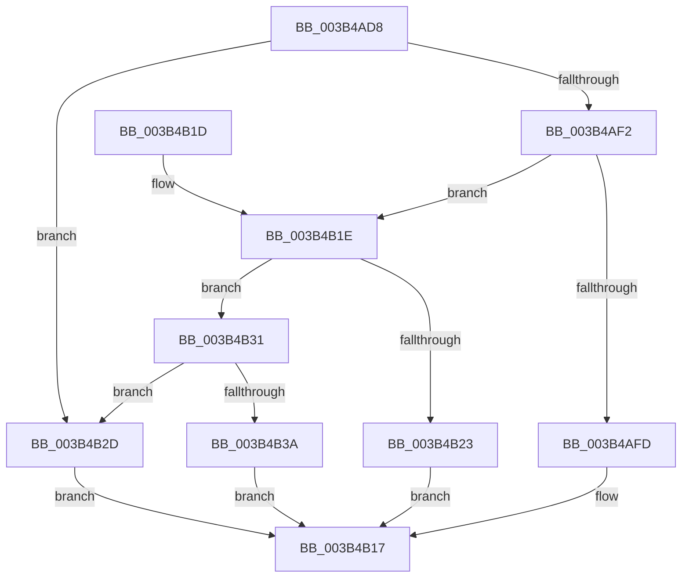

# MiReservePoolMemory

- RVA: `0x003B4AD8`–`0x003B4B70` (길이 `152` bytes)
- VA: `0x00000001403B4AD8`
- 실행 섹션: `.text`
- PDB 이름 있음: `예`; PDB Function 태그: `아니요`
- unwind 정보 RVA: `0x000606B4`
- 디코드: `44`개 명령, `152/152` bytes 표시
- 미해석 바이트: `0` (있으면 어셈블리에 `.byte`로 보존)

> 이 문서는 커널 이미지의 기계어와 PDB 기호를 분석해 생성했습니다. 4번과 5번은 함수 원형과 자료형을 바이너리 사용 방식에서 추정한 C 해석이며 원본 소스 복구 결과는 아닙니다.

## 1. Dependencies

- 직접 호출 지점: **3**; 고유 호출 대상: **3**
- 직접 호출자로 확인된 함수: **2**
- RIP 상대 이미지 참조: **1**

### Outgoing calls
- `0x003B4B12` → [MiObtainDynamicVa](MiObtainDynamicVa_function_003B501C.md) (function, `0x003B501C`)
- `0x003B4B26` → [MiObtainSystemVa](MiObtainSystemVa_function_003B4F44.md) (function, `0x003B4F44`)
- `0x003B4B61` → [MiMarkSystemVaAllocated](MiMarkSystemVaAllocated_function_003B3878.md) (function, `0x003B3878`)

### Direct callers
- [sub_00328FA3](../32/Unknown_function_00328FA3.md) at `0x00329256`
- [MmAllocateSecurePoolMemory](../68/MmAllocateSecurePoolMemory_function_00682CC8.md) at `0x00682D16`

### Static image references
- `0x003B4B0B` → RVA `0x00E2DBF8` (`.data`; read)

## 2. Other-region calls and transfers

- 다른 실행 섹션으로 향하는 call: **0**
- 별도 외부 분기/꼬리 이동을 확인하지 못했습니다.

## 3. Assembly (complete function range)

```asm
003B4AD8  40 53                           push rbx
003B4ADA  48 83 EC 30                     sub rsp, 0x30
003B4ADE  4D 8B D0                        mov r10, r8
003B4AE1  B8 FF FF FF FF                  mov eax, 0xffffffff
003B4AE6  49 C1 EA 15                     shr r10, 0x15
003B4AEA  48 8B D9                        mov rbx, rcx
003B4AED  4C 3B D0                        cmp r10, rax
003B4AF0  77 3B                           ja 0x1403b4b2d
003B4AF2  41 B8 04 00 00 00               mov r8d, 4
003B4AF8  41 3B D0                        cmp edx, r8d
003B4AFB  75 21                           jne 0x1403b4b1e
003B4AFD  41 8B C1                        mov eax, r9d
003B4B00  41 8B D2                        mov edx, r10d
003B4B03  48 8D 0C 40                     lea rcx, [rax + rax*2]
003B4B07  48 C1 E1 07                     shl rcx, 7
003B4B0B  48 03 0D E6 90 A7 00            add rcx, qword ptr [rip + 0xa790e6]
003B4B12  E8 05 05 00 00                  call 0x1403b501c
003B4B17  48 83 C4 30                     add rsp, 0x30
003B4B1B  5B                              pop rbx
003B4B1C  C3                              ret
003B4B1D  CC                              int3
003B4B1E  83 FA 05                        cmp edx, 5
003B4B21  75 0E                           jne 0x1403b4b31
003B4B23  41 8B CA                        mov ecx, r10d
003B4B26  E8 19 04 00 00                  call 0x1403b4f44
003B4B2B  EB EA                           jmp 0x1403b4b17
003B4B2D  33 C0                           xor eax, eax
003B4B2F  EB E6                           jmp 0x1403b4b17
003B4B31  B9 0E 00 00 00                  mov ecx, 0xe
003B4B36  3B D1                           cmp edx, ecx
003B4B38  75 F3                           jne 0x1403b4b2d
003B4B3A  48 8B D3                        mov rdx, rbx
003B4B3D  48 C1 EA 12                     shr rdx, 0x12
003B4B41  81 E2 F8 FF FF 3F               and edx, 0x3ffffff8
003B4B47  48 B8 00 00 00 40 FB F6 FF FF   movabs rax, 0xfffff6fb40000000
003B4B51  48 03 D0                        add rdx, rax
003B4B54  44 8D 49 F3                     lea r9d, [rcx - 0xd]
003B4B58  44 89 4C 24 20                  mov dword ptr [rsp + 0x20], r9d
003B4B5D  4E 8D 04 D2                     lea r8, [rdx + r10*8]
003B4B61  E8 12 ED FF FF                  call 0x1403b3878
003B4B66  F7 D8                           neg eax
003B4B68  48 1B C0                        sbb rax, rax
003B4B6B  48 23 C3                        and rax, rbx
003B4B6E  EB A7                           jmp 0x1403b4b17
```

## 4. C-style interpretation (structured pseudocode)

```c
__int64 __fastcall MiReservePoolMemory(__int64 a1, int a2, __int64 a3, int a4)
{
    __int64 result;
    __int64 v_r10;
    __int64 v_rsp;
    unsigned int v_stack_p20;

    v_rsp = (v_rsp) - (48);
    v_r10 = (a3) >> (21);
    if (v_r10 > ((unsigned int)(0xFFFFFFFFULL))) goto loc_003B4B2D;
    if (a2 != 4) goto loc_003B4B1E;
    a1 = ((unsigned int)(a4) + (unsigned int)(a4) * 2) << (7);
    a1 = (a1) + (*(unsigned __int64 *)(v_rip + 10981606));
    result = MiObtainDynamicVa(a1, (unsigned int)((unsigned int)(v_r10)), 4, a4);
loc_003B4B17:
    v_rsp = (v_rsp) + (48);
    return result;
loc_003B4B1E:
    if (((unsigned int)((unsigned int)((unsigned int)(v_r10)))) != 5) goto loc_003B4B31;
    result = MiObtainSystemVa((unsigned int)((unsigned int)(v_r10)), (unsigned int)((unsigned int)(v_r10)), 4, a4);
    goto loc_003B4B17;
loc_003B4B2D:
    result = 0;
    goto loc_003B4B17;
loc_003B4B31:
    if (((unsigned int)((unsigned int)((unsigned int)(v_r10)))) != 14) goto loc_003B4B2D;
    a2 = (a1) >> (18);
    a2 = (unsigned int)((a2) & (0x3FFFFFF8ULL));
    a2 = (a2) + (0);
    v_stack_p20 = (unsigned int)(14 - 13);
    result = MiMarkSystemVaAllocated(14, a2, a2 + v_r10 * 8, 14 - 13);
    result = (unsigned int)(-(result));
    result = (result) & (a1);
    goto loc_003B4B17;
}
```

## 5. (Beta) C Style

```c
int64_t MiReservePoolMemory(int64_t Arg1, int32_t Arg2, int64_t Arg3, void *Arg4)
{
    uint8_t *arg4 = (uint8_t *)Arg4;

    int64_t result;
    int64_t local_r10;
    int64_t local_rsp;
    uint32_t v_stack_p20;

    local_rsp = (local_rsp) - (48);
    local_r10 = (Arg3) >> (21);
    if (local_r10 > ((uint32_t)(0xFFFFFFFFULL))) goto loc_003B4B2D;
    if (Arg2 != 4) goto loc_003B4B1E;
    Arg1 = ((uint32_t)(Arg4) + (uint32_t)(Arg4) * 2) << (7);
    Arg1 = (Arg1) + (*(uint64_t *)(v_rip + 0xA790E6));
    result = MiObtainDynamicVa(Arg1, (uint32_t)((uint32_t)(local_r10)), 4, Arg4);
loc_003B4B17:
    local_rsp = (local_rsp) + (48);
    return result;
loc_003B4B1E:
    if (((uint32_t)((uint32_t)((uint32_t)(local_r10)))) != 5) goto loc_003B4B31;
    result = MiObtainSystemVa((uint32_t)((uint32_t)(local_r10)), (uint32_t)((uint32_t)(local_r10)), 4, Arg4);
    goto loc_003B4B17;
loc_003B4B2D:
    result = 0;
    goto loc_003B4B17;
loc_003B4B31:
    if (((uint32_t)((uint32_t)((uint32_t)(local_r10)))) != 14) goto loc_003B4B2D;
    Arg2 = (Arg1) >> (18);
    Arg2 = (uint32_t)((Arg2) & (0x3FFFFFF8ULL));
    Arg2 = (Arg2) + (0);
    v_stack_p20 = (uint32_t)(14 - 13);
    result = MiMarkSystemVaAllocated(14, Arg2, Arg2 + local_r10 * 8, 14 - 13);
    result = (uint32_t)(-(result));
    result = (result) & (Arg1);
    goto loc_003B4B17;
}
```

### 관측된 메모리 오프셋

구조체 형식이 확인되지 않은 접근은 인자 기준의 오프셋으로만 기록했습니다.

| 기준 인자 | 오프셋 표현 | 폭 (bit) | 접근 |
|---|---:|---:|---|
| `Arg4` | `+ 0x0 + rax*2` | `64` | `R` |

## 6. Execution-region graph

[열기: 2D/3D 그래프와 함수 탐색 컨트롤 패널](../../../control-panel.html?section=text&rva=0x003B4AD8&view=graph)

- 2D 그래프는 위에서 아래로 흐르고, 3D 그래프는 빈 공간을 드래그해 회전합니다. Shift+드래그는 이동, 휠은 확대·축소, 함수 노드 선택은 대상 보고서 이동입니다.

### Static fallback


