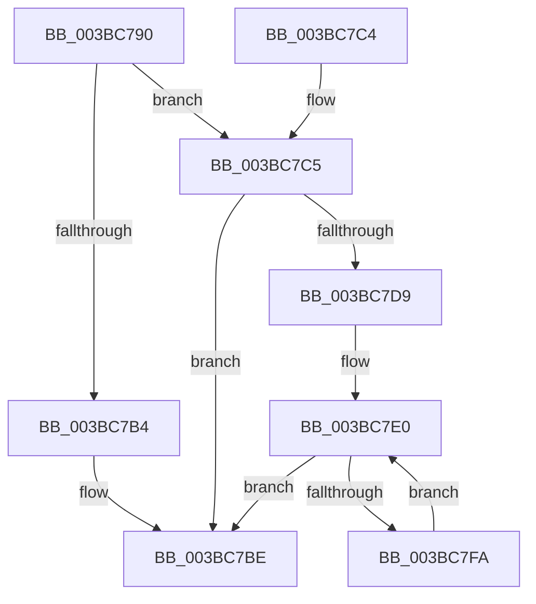

# MiSetPfnBlink

- RVA: `0x003BC790`–`0x003BC7FC` (길이 `108` bytes)
- VA: `0x00000001403BC790`
- 실행 섹션: `.text`
- PDB 이름 있음: `예`; PDB Function 태그: `아니요`
- unwind 정보 RVA: `0x0008CDB0`
- 디코드: `31`개 명령, `108/108` bytes 표시
- 미해석 바이트: `0` (있으면 어셈블리에 `.byte`로 보존)

> 이 문서는 커널 이미지의 기계어와 PDB 기호를 분석해 생성했습니다. 4번과 5번은 함수 원형과 자료형을 바이너리 사용 방식에서 추정한 C 해석이며 원본 소스 복구 결과는 아닙니다.

## 1. Dependencies

- 직접 호출 지점: **0**; 고유 호출 대상: **0**
- 직접 호출자로 확인된 함수: **4**
- RIP 상대 이미지 참조: **0**

### Outgoing calls
- 직접 디코드된 call 명령이 없습니다.

### Direct callers
- [MiSwapNumaStandbyPage](../38/MiSwapNumaStandbyPage_function_00385144.md) at `0x00385306`
- [MiReplenishPageSlist](MiReplenishPageSlist_function_003BADE0.md) at `0x003BAFBB`
- [MiAllocateEnclavePages](MiAllocateEnclavePages_function_003BC43C.md) at `0x003BC5DF`
- [MiUnlinkPageFromBadList](MiUnlinkPageFromBadList_function_003BD620.md) at `0x003BD730`

### Static image references
- 디코드된 RIP-relative 메모리 참조가 없습니다.

## 2. Other-region calls and transfers

- 다른 실행 섹션으로 향하는 call: **0**
- 별도 외부 분기/꼬리 이동을 확인하지 못했습니다.

## 3. Assembly (complete function range)

```asm
003BC790  48 89 5C 24 08                  mov qword ptr [rsp + 8], rbx
003BC795  4C 8B 49 18                     mov r9, qword ptr [rcx + 0x18]
003BC799  48 8B DA                        mov rbx, rdx
003BC79C  4D 8B D1                        mov r10, r9
003BC79F  4C 8B D9                        mov r11, rcx
003BC7A2  4C 33 D2                        xor r10, rdx
003BC7A5  45 85 C0                        test r8d, r8d
003BC7A8  49 B8 00 00 00 00 00 FF FF FF   movabs r8, 0xffffff0000000000
003BC7B2  74 11                           je 0x1403bc7c5
003BC7B4  4D 23 D0                        and r10, r8
003BC7B7  4C 33 D2                        xor r10, rdx
003BC7BA  4C 89 51 18                     mov qword ptr [rcx + 0x18], r10
003BC7BE  48 8B 5C 24 08                  mov rbx, qword ptr [rsp + 8]
003BC7C3  C3                              ret
003BC7C4  CC                              int3
003BC7C5  4D 23 D0                        and r10, r8
003BC7C8  49 8B C1                        mov rax, r9
003BC7CB  4C 33 D3                        xor r10, rbx
003BC7CE  F0 4C 0F B1 51 18               lock cmpxchg qword ptr [rcx + 0x18], r10
003BC7D4  4C 3B C8                        cmp r9, rax
003BC7D7  74 E5                           je 0x1403bc7be
003BC7D9  0F 1F 80 00 00 00 00            nop dword ptr [rax]
003BC7E0  48 8B D0                        mov rdx, rax
003BC7E3  48 8B C8                        mov rcx, rax
003BC7E6  48 33 D3                        xor rdx, rbx
003BC7E9  49 23 D0                        and rdx, r8
003BC7EC  48 33 D3                        xor rdx, rbx
003BC7EF  F0 49 0F B1 53 18               lock cmpxchg qword ptr [r11 + 0x18], rdx
003BC7F5  48 3B C8                        cmp rcx, rax
003BC7F8  74 C4                           je 0x1403bc7be
003BC7FA  EB E4                           jmp 0x1403bc7e0
```

## 4. C-style interpretation (structured pseudocode)

```c
__int64 __fastcall MiSetPfnBlink(__int64 a1, __int64 a2, int a3)
{
    __int64 v_r10;
    unsigned __int64 v_stack_p8;

    v_stack_p8 = v_rbx;
    v_r10 = (*(unsigned __int64 *)(a1 + 24)) ^ (a2);
    if (a3 == 0) goto loc_003BC7C5;
    v_r10 = (v_r10) & (a3);
    v_r10 = (v_r10) ^ (a2);
    *(unsigned __int64 *)(a1 + 24) = v_r10;
loc_003BC7BE:
    return result;
loc_003BC7C5:
    v_r10 = (v_r10) & (a3);
    v_r10 = (v_r10) ^ (v_stack_p8);
    if ((*(unsigned __int64 *)(a1 + 24)) == (*(unsigned __int64 *)(a1 + 24))) goto loc_003BC7BE;
loc_003BC7E0:
    a2 = (*(unsigned __int64 *)(a1 + 24)) ^ (v_stack_p8);
    a2 = (a2) & (a3);
    a2 = (a2) ^ (v_stack_p8);
    if ((*(unsigned __int64 *)(a1 + 24)) == (*(unsigned __int64 *)(a1 + 24))) goto loc_003BC7BE;
    goto loc_003BC7E0;
}
```

## 5. (Beta) C Style

```c
int64_t MiSetPfnBlink(void *Arg1, int64_t Arg2, int32_t Arg3)
{
    uint8_t *arg1 = (uint8_t *)Arg1;

    int64_t local_r10;
    uint64_t v_stack_p8;

    v_stack_p8 = local_rbx;
    local_r10 = (*(uint64_t *)(arg1 + 0x18)) ^ (Arg2);
    if (Arg3 == 0) goto loc_003BC7C5;
    local_r10 = (local_r10) & (Arg3);
    local_r10 = (local_r10) ^ (Arg2);
    *(uint64_t *)(arg1 + 0x18) = local_r10;
loc_003BC7BE:
    return result;
loc_003BC7C5:
    local_r10 = (local_r10) & (Arg3);
    local_r10 = (local_r10) ^ (v_stack_p8);
    if ((*(uint64_t *)(arg1 + 0x18)) == (*(uint64_t *)(arg1 + 0x18))) goto loc_003BC7BE;
loc_003BC7E0:
    Arg2 = (*(uint64_t *)(arg1 + 0x18)) ^ (v_stack_p8);
    Arg2 = (Arg2) & (Arg3);
    Arg2 = (Arg2) ^ (v_stack_p8);
    if ((*(uint64_t *)(arg1 + 0x18)) == (*(uint64_t *)(arg1 + 0x18))) goto loc_003BC7BE;
    goto loc_003BC7E0;
}
```

### 관측된 메모리 오프셋

구조체 형식이 확인되지 않은 접근은 인자 기준의 오프셋으로만 기록했습니다.

| 기준 인자 | 오프셋 표현 | 폭 (bit) | 접근 |
|---|---:|---:|---|
| `Arg1` | `+ 0x18` | `64` | `R` |
| `Arg1` | `+ 0x18` | `64` | `W` |

## 6. Execution-region graph

[열기: 2D/3D 그래프와 함수 탐색 컨트롤 패널](../../../control-panel.html?section=text&rva=0x003BC790&view=graph)

- 2D 그래프는 위에서 아래로 흐르고, 3D 그래프는 빈 공간을 드래그해 회전합니다. Shift+드래그는 이동, 휠은 확대·축소, 함수 노드 선택은 대상 보고서 이동입니다.

### Static fallback


