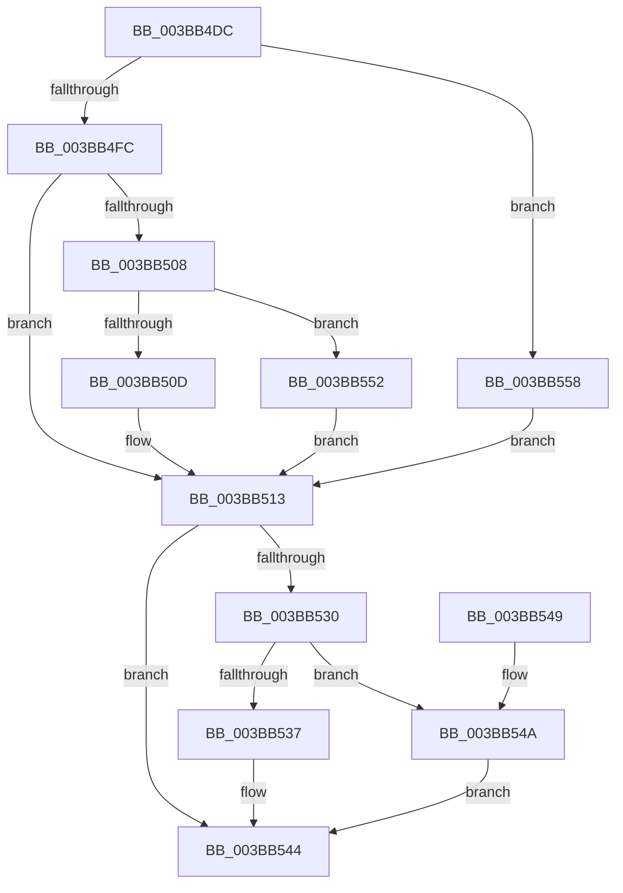

# MiSetPfnSlist

- RVA: `0x003BB4DC`–`0x003BB55C` (길이 `128` bytes)
- VA: `0x00000001403BB4DC`
- 실행 섹션: `.text`
- PDB 이름 있음: `예`; PDB Function 태그: `아니요`
- unwind 정보 RVA: `0x000DB714`
- 디코드: `38`개 명령, `128/128` bytes 표시
- 미해석 바이트: `0` (있으면 어셈블리에 `.byte`로 보존)

> 이 문서는 커널 이미지의 기계어와 PDB 기호를 분석해 생성했습니다. 4번과 5번은 함수 원형과 자료형을 바이너리 사용 방식에서 추정한 C 해석이며 원본 소스 복구 결과는 아닙니다.

## 1. Dependencies

- 직접 호출 지점: **0**; 고유 호출 대상: **0**
- 직접 호출자로 확인된 함수: **1**
- RIP 상대 이미지 참조: **1**

### Outgoing calls
- 직접 디코드된 call 명령이 없습니다.

### Direct callers
- [MiReplenishPageSlist](MiReplenishPageSlist_function_003BADE0.md) at `0x003BB29D`

### Static image references
- `0x003BB4FC` → RVA `0x00E2DC80` (`.data`; read)

## 2. Other-region calls and transfers

- 다른 실행 섹션으로 향하는 call: **0**
- 별도 외부 분기/꼬리 이동을 확인하지 못했습니다.

## 3. Assembly (complete function range)

```asm
003BB4DC  48 8B 41 10                     mov rax, qword ptr [rcx + 0x10]
003BB4E0  4C 8B C9                        mov r9, rcx
003BB4E3  4C 63 C2                        movsxd r8, edx
003BB4E6  49 C1 E0 0C                     shl r8, 0xc
003BB4EA  49 8B D0                        mov rdx, r8
003BB4ED  48 33 D0                        xor rdx, rax
003BB4F0  48 81 E2 FF 0F FF FF            and rdx, 0xffffffffffff0fff
003BB4F7  49 33 D0                        xor rdx, r8
003BB4FA  74 5C                           je 0x1403bb558
003BB4FC  48 8B 05 7D 27 A7 00            mov rax, qword ptr [rip + 0xa7277d]
003BB503  48 85 C0                        test rax, rax
003BB506  74 0B                           je 0x1403bb513
003BB508  F6 C2 10                        test dl, 0x10
003BB50B  75 45                           jne 0x1403bb552
003BB50D  48 F7 D0                        not rax
003BB510  48 23 D0                        and rdx, rax
003BB513  8B C2                           mov eax, edx
003BB515  49 B8 00 00 00 00 FE FF FF FF   movabs r8, 0xfffffffe00000000
003BB51F  8B CA                           mov ecx, edx
003BB521  49 0B C0                        or rax, r8
003BB524  48 8B 15 55 27 A7 00            mov rdx, qword ptr [rip + 0xa72755]
003BB52B  48 85 D2                        test rdx, rdx
003BB52E  74 14                           je 0x1403bb544
003BB530  48 85 D0                        test rax, rdx
003BB533  8B C1                           mov eax, ecx
003BB535  74 13                           je 0x1403bb54a
003BB537  48 BA 10 00 00 00 FE FF FF FF   movabs rdx, 0xfffffffe00000010
003BB541  48 0B C2                        or rax, rdx
003BB544  49 89 41 10                     mov qword ptr [r9 + 0x10], rax
003BB548  C3                              ret
003BB549  CC                              int3
003BB54A  48 0B C2                        or rax, rdx
003BB54D  49 0B C0                        or rax, r8
003BB550  EB F2                           jmp 0x1403bb544
003BB552  48 83 E2 EF                     and rdx, 0xffffffffffffffef
003BB556  EB BB                           jmp 0x1403bb513
003BB558  33 D2                           xor edx, edx
003BB55A  EB B7                           jmp 0x1403bb513
```

## 4. C-style interpretation (structured pseudocode)

```c
__int64 __fastcall MiSetPfnSlist(__int64 a1, int a2)
{
    __int64 result;

    a3 = ((int)(a2)) << (12);
    a2 = (a3) ^ (*(unsigned __int64 *)(a1 + 16));
    a2 = (a2) & (0xFFFFFFFFFFFF0FFFULL);
    a2 = (a2) ^ (a3);
    if (condition_is_equal) goto loc_003BB558;
    if (*(unsigned __int64 *)(v_rip + 10954621) == 0) goto loc_003BB513;
    if ((((unsigned __int8)(a2)) & (16)) != 0) goto loc_003BB552;
    result = ~(*(unsigned __int64 *)(v_rip + 10954621));
    a2 = (a2) & (result);
loc_003BB513:
    result = ((unsigned int)(a2)) | (a3);
    if (*(unsigned __int64 *)(v_rip + 10954581) == 0) goto loc_003BB544;
    if (((result) & (*(unsigned __int64 *)(v_rip + 10954581))) == 0) goto loc_003BB54A;
    result = ((unsigned int)((unsigned int)((unsigned int)(a2)))) | (*(unsigned __int64 *)(v_rip + 10954581));
loc_003BB544:
    *(unsigned __int64 *)(a1 + 16) = result;
    return result;
loc_003BB54A:
    result = (result) | (*(unsigned __int64 *)(v_rip + 10954581));
    result = (result) | (a3);
    goto loc_003BB544;
loc_003BB552:
    a2 = (*(unsigned __int64 *)(v_rip + 10954581)) & (-17);
    goto loc_003BB513;
loc_003BB558:
    a2 = 0;
    goto loc_003BB513;
}
```

## 5. (Beta) C Style

```c
int64_t MiSetPfnSlist(void *Arg1, int32_t Arg2)
{
    uint8_t *arg1 = (uint8_t *)Arg1;

    int64_t result;

    a3 = ((int32_t)(Arg2)) << (12);
    Arg2 = (a3) ^ (*(uint64_t *)(arg1 + 0x10));
    Arg2 = (Arg2) & (0xFFFFFFFFFFFF0FFFULL);
    Arg2 = (Arg2) ^ (a3);
    if (condition_is_equal) goto loc_003BB558;
    if (*(uint64_t *)(v_rip + 0xA7277D) == 0) goto loc_003BB513;
    if ((((uint8_t)(Arg2)) & (16)) != 0) goto loc_003BB552;
    result = ~(*(uint64_t *)(v_rip + 0xA7277D));
    Arg2 = (Arg2) & (result);
loc_003BB513:
    result = ((uint32_t)(Arg2)) | (a3);
    if (*(uint64_t *)(v_rip + 0xA72755) == 0) goto loc_003BB544;
    if (((result) & (*(uint64_t *)(v_rip + 0xA72755))) == 0) goto loc_003BB54A;
    result = ((uint32_t)((uint32_t)((uint32_t)(Arg2)))) | (*(uint64_t *)(v_rip + 0xA72755));
loc_003BB544:
    *(uint64_t *)(arg1 + 0x10) = result;
    return result;
loc_003BB54A:
    result = (result) | (*(uint64_t *)(v_rip + 0xA72755));
    result = (result) | (a3);
    goto loc_003BB544;
loc_003BB552:
    Arg2 = (*(uint64_t *)(v_rip + 0xA72755)) & (-17);
    goto loc_003BB513;
loc_003BB558:
    Arg2 = 0;
    goto loc_003BB513;
}
```

### 관측된 메모리 오프셋

구조체 형식이 확인되지 않은 접근은 인자 기준의 오프셋으로만 기록했습니다.

| 기준 인자 | 오프셋 표현 | 폭 (bit) | 접근 |
|---|---:|---:|---|
| `Arg1` | `+ 0x10` | `64` | `R` |
| `Arg1` | `+ 0x10` | `64` | `W` |

## 6. Execution-region graph

[열기: 2D/3D 그래프와 함수 탐색 컨트롤 패널](../../../control-panel.html?section=text&rva=0x003BB4DC&view=graph)

- 2D 그래프는 위에서 아래로 흐르고, 3D 그래프는 빈 공간을 드래그해 회전합니다. Shift+드래그는 이동, 휠은 확대·축소, 함수 노드 선택은 대상 보고서 이동입니다.

### Static fallback


