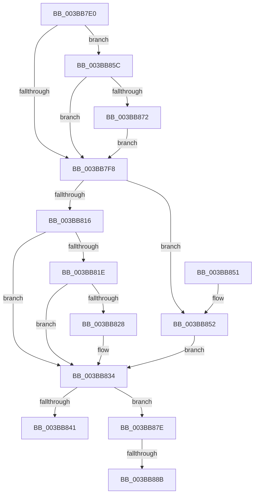

# MiSlabDemotionLowMemoryConditionUpdate

- RVA: `0x003BB7E0`–`0x003BB89C` (길이 `188` bytes)
- VA: `0x00000001403BB7E0`
- 실행 섹션: `.text`
- PDB 이름 있음: `예`; PDB Function 태그: `예`
- unwind 정보 RVA: `0x0008CCD8`
- 디코드: `47`개 명령, `188/188` bytes 표시
- 미해석 바이트: `0` (있으면 어셈블리에 `.byte`로 보존)

> 이 문서는 커널 이미지의 기계어와 PDB 기호를 분석해 생성했습니다. 4번과 5번은 함수 원형과 자료형을 바이너리 사용 방식에서 추정한 C 해석이며 원본 소스 복구 결과는 아닙니다.

## 1. Dependencies

- 직접 호출 지점: **5**; 고유 호출 대상: **5**
- 직접 호출자로 확인된 함수: **11**
- RIP 상대 이미지 참조: **1**

### Outgoing calls
- `0x003BB802` → [ExAcquireSpinLockExclusiveAtDpcLevel](../24/ExAcquireSpinLockExclusiveAtDpcLevel_function_00248E80.md) (function, `0x00248E80`)
- `0x003BB828` → [MiGetSlabCurrentTime](MiGetSlabCurrentTime_function_003BCBCC.md) (function, `0x003BCBCC`)
- `0x003BB837` → [ExReleaseSpinLockExclusiveFromDpcLevel](../24/ExReleaseSpinLockExclusiveFromDpcLevel_function_002497E0.md) (function, `0x002497E0`)
- `0x003BB874` → [KiRaiseIrqlProcessIrqlFlags](../4F/KiRaiseIrqlProcessIrqlFlags_function_004F56FC.md) (function, `0x004F56FC`)
- `0x003BB891` → [KiLowerIrqlProcessIrqlFlags](../4F/KiLowerIrqlProcessIrqlFlags_function_004F5698.md) (function, `0x004F5698`)

### Direct callers
- [sub_00287E84](../28/Unknown_function_00287E84.md) at `0x00287F34`
- [MiInsertPageInList](../2B/MiInsertPageInList_function_002BA000.md) at `0x002BA9B1`
- [MiFreeUnusedSlabPages](../2D/MiFreeUnusedSlabPages_function_002DAE48.md) at `0x002DAF7E`
- [sub_003354FB](../33/Unknown_function_003354FB.md) at `0x00335FEB`
- [sub_00336094](../33/Unknown_function_00336094.md) at `0x0033619B`
- [MiUnlinkFreeOrZeroedPage](../33/MiUnlinkFreeOrZeroedPage_function_00336C40.md) at `0x003375A4`
- [sub_0033DA89](../33/Unknown_function_0033DA89.md) at `0x0033DC3E`
- [sub_0033EABD](../33/Unknown_function_0033EABD.md) at `0x0033ECE4`
- [sub_0033EABD](../33/Unknown_function_0033EABD.md) at `0x0033EECF`
- [sub_003BB64A](Unknown_function_003BB64A.md) at `0x003BB68D`
- [MiIncreaseAvailablePages](MiIncreaseAvailablePages_function_003BCC10.md) at `0x003BCCEB`
- [sub_003BCD32](Unknown_function_003BCD32.md) at `0x003BCD64`

### Static image references
- `0x003BB869` → RVA `0x00FC6D20` (`ALMOSTRO`; read)

## 2. Other-region calls and transfers

- 다른 실행 섹션으로 향하는 call: **0**
- call이 아닌 외부 분기/꼬리 이동: **2**
  - `0x003BB885` → [sub_006E7C06](../6E/Unknown_function_006E7C06.md) (`tail-transfer`)
  - `0x003BB897` → [sub_006E7C06](../6E/Unknown_function_006E7C06.md) (`tail-transfer`)

## 3. Assembly (complete function range)

```asm
003BB7E0  48 89 5C 24 08                  mov qword ptr [rsp + 8], rbx
003BB7E5  48 89 74 24 10                  mov qword ptr [rsp + 0x10], rsi
003BB7EA  57                              push rdi
003BB7EB  48 83 EC 20                     sub rsp, 0x20
003BB7EF  48 8B F9                        mov rdi, rcx
003BB7F2  B3 11                           mov bl, 0x11
003BB7F4  85 D2                           test edx, edx
003BB7F6  74 64                           je 0x1403bb85c
003BB7F8  48 8D B7 40 3F 00 00            lea rsi, [rdi + 0x3f40]
003BB7FF  48 8B CE                        mov rcx, rsi
003BB802  E8 79 D6 E8 FF                  call 0x140248e80
003BB807  48 8B 87 00 49 00 00            mov rax, qword ptr [rdi + 0x4900]
003BB80E  48 3D 20 01 00 00               cmp rax, 0x120
003BB814  73 3C                           jae 0x1403bb852
003BB816  48 3D A0 00 00 00               cmp rax, 0xa0
003BB81C  73 16                           jae 0x1403bb834
003BB81E  48 83 BF D0 47 00 00 00         cmp qword ptr [rdi + 0x47d0], 0
003BB826  75 0C                           jne 0x1403bb834
003BB828  E8 9F 13 00 00                  call 0x1403bcbcc
003BB82D  48 89 87 D0 47 00 00            mov qword ptr [rdi + 0x47d0], rax
003BB834  48 8B CE                        mov rcx, rsi
003BB837  E8 A4 DF E8 FF                  call 0x1402497e0
003BB83C  80 FB 11                        cmp bl, 0x11
003BB83F  75 3D                           jne 0x1403bb87e
003BB841  48 8B 5C 24 30                  mov rbx, qword ptr [rsp + 0x30]
003BB846  48 8B 74 24 38                  mov rsi, qword ptr [rsp + 0x38]
003BB84B  48 83 C4 20                     add rsp, 0x20
003BB84F  5F                              pop rdi
003BB850  C3                              ret
003BB851  CC                              int3
003BB852  48 83 A7 D0 47 00 00 00         and qword ptr [rdi + 0x47d0], 0
003BB85A  EB D8                           jmp 0x1403bb834
003BB85C  44 0F 20 C3                     mov rbx, cr8
003BB860  BA 02 00 00 00                  mov edx, 2
003BB865  44 0F 22 C2                     mov cr8, rdx
003BB869  83 3D B0 B4 C0 00 00            cmp dword ptr [rip + 0xc0b4b0], 0
003BB870  74 86                           je 0x1403bb7f8
003BB872  8A CB                           mov cl, bl
003BB874  E8 83 9E 13 00                  call 0x1404f56fc
003BB879  E9 7A FF FF FF                  jmp 0x1403bb7f8
003BB87E  83 3D 9B B4 C0 00 00            cmp dword ptr [rip + 0xc0b49b], 0
003BB885  0F 84 7B C3 32 00               je 0x1406e7c06
003BB88B  44 0F 20 C1                     mov rcx, cr8
003BB88F  8A D3                           mov dl, bl
003BB891  E8 02 9E 13 00                  call 0x1404f5698
003BB896  90                              nop
003BB897  E9 6A C3 32 00                  jmp 0x1406e7c06
```

## 4. C-style interpretation (structured pseudocode)

```c
__int64 __fastcall MiSlabDemotionLowMemoryConditionUpdate(__int64 a1, int a2)
{
    __int64 result;
    __int64 v_rsp;
    unsigned __int64 v_stack_p10;
    unsigned __int64 v_stack_p8;

    v_stack_p8 = v_rbx;
    v_stack_p10 = v_rsi;
    v_rsp = (v_rsp) - (32);
    if (a2 == 0) goto loc_003BB85C;
loc_003BB7F8:
    result = ExAcquireSpinLockExclusiveAtDpcLevel(a1 + 16192, a2, a3, a4);
    if ((*(unsigned __int64 *)(a1 + 18688)) >= 288) goto loc_003BB852;
    if ((*(unsigned __int64 *)(a1 + 18688)) >= 160) goto loc_003BB834;
    result = *(unsigned __int64 *)(a1 + 18688);
    if ((*(unsigned __int64 *)(a1 + 18384)) == 0) {
        result = MiGetSlabCurrentTime(a1 + 16192, a2, a3, a4);
        *(unsigned __int64 *)(a1 + 18384) = result;
    }
    result = ExReleaseSpinLockExclusiveFromDpcLevel(a1 + 16192, a2, a3, a4);
    if (17 != 17) goto loc_003BB87E;
    v_rsp = (v_rsp) + (32);
    return result;
loc_003BB852:
    goto loc_003BB834;
loc_003BB85C:
    if ((*(unsigned int *)(v_rip + 12629168)) == 0) goto loc_003BB7F8;
    result = KiRaiseIrqlProcessIrqlFlags((unsigned __int8)(v_cr8), 2, a3, a4);
    goto loc_003BB7F8;
loc_003BB87E:
    result = KiLowerIrqlProcessIrqlFlags(2, (unsigned __int8)(v_cr8), a3, a4);
}
```

## 5. (Beta) C Style

```c
int64_t MiSlabDemotionLowMemoryConditionUpdate(void *Arg1, int32_t Arg2)
{
    uint8_t *arg1 = (uint8_t *)Arg1;

    int64_t result;
    int64_t local_rsp;
    uint64_t v_stack_p10;
    uint64_t v_stack_p8;

    v_stack_p8 = local_rbx;
    v_stack_p10 = local_rsi;
    local_rsp = (local_rsp) - (32);
    if (Arg2 == 0) goto loc_003BB85C;
loc_003BB7F8:
    result = ExAcquireSpinLockExclusiveAtDpcLevel(Arg1 + 16192, Arg2, a3, a4);
    if ((*(uint64_t *)(arg1 + 0x4900)) >= 288) goto loc_003BB852;
    if ((*(uint64_t *)(arg1 + 0x4900)) >= 160) goto loc_003BB834;
    result = *(uint64_t *)(arg1 + 0x4900);
    if ((*(uint64_t *)(arg1 + 0x47D0)) == 0) {
        result = MiGetSlabCurrentTime(Arg1 + 16192, Arg2, a3, a4);
        *(uint64_t *)(arg1 + 0x47D0) = result;
    }
    result = ExReleaseSpinLockExclusiveFromDpcLevel(Arg1 + 16192, Arg2, a3, a4);
    if (17 != 17) goto loc_003BB87E;
    local_rsp = (local_rsp) + (32);
    return result;
loc_003BB852:
    goto loc_003BB834;
loc_003BB85C:
    if ((*(uint32_t *)(v_rip + 0xC0B4B0)) == 0) goto loc_003BB7F8;
    result = KiRaiseIrqlProcessIrqlFlags((uint8_t)(v_cr8), 2, a3, a4);
    goto loc_003BB7F8;
loc_003BB87E:
    result = KiLowerIrqlProcessIrqlFlags(2, (uint8_t)(v_cr8), a3, a4);
}
```

### 관측된 메모리 오프셋

구조체 형식이 확인되지 않은 접근은 인자 기준의 오프셋으로만 기록했습니다.

| 기준 인자 | 오프셋 표현 | 폭 (bit) | 접근 |
|---|---:|---:|---|
| `Arg1` | `+ 0x3F40` | `64` | `R` |
| `Arg1` | `+ 0x47D0` | `64` | `R` |
| `Arg1` | `+ 0x47D0` | `64` | `R/W` |
| `Arg1` | `+ 0x47D0` | `64` | `W` |
| `Arg1` | `+ 0x4900` | `64` | `R` |

## 6. Execution-region graph

[열기: 2D/3D 그래프와 함수 탐색 컨트롤 패널](../../../control-panel.html?section=text&rva=0x003BB7E0&view=graph)

- 2D 그래프는 위에서 아래로 흐르고, 3D 그래프는 빈 공간을 드래그해 회전합니다. Shift+드래그는 이동, 휠은 확대·축소, 함수 노드 선택은 대상 보고서 이동입니다.

### Static fallback


