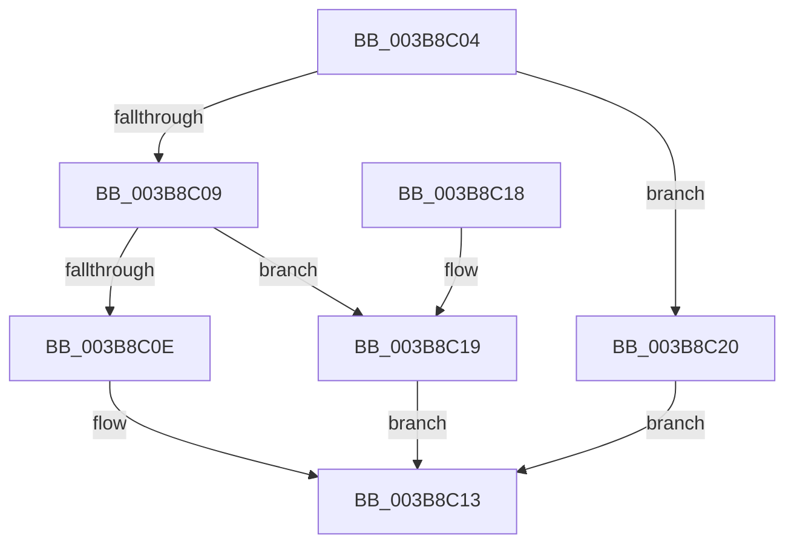

# MiSnapPageMoveInProgress

- RVA: `0x003B8C04`–`0x003B8C27` (길이 `35` bytes)
- VA: `0x00000001403B8C04`
- 실행 섹션: `.text`
- PDB 이름 있음: `예`; PDB Function 태그: `아니요`
- unwind 정보 RVA: `0x000DB714`
- 디코드: `12`개 명령, `35/35` bytes 표시
- 미해석 바이트: `0` (있으면 어셈블리에 `.byte`로 보존)

> 이 문서는 커널 이미지의 기계어와 PDB 기호를 분석해 생성했습니다. 4번과 5번은 함수 원형과 자료형을 바이너리 사용 방식에서 추정한 C 해석이며 원본 소스 복구 결과는 아닙니다.

## 1. Dependencies

- 직접 호출 지점: **0**; 고유 호출 대상: **0**
- 직접 호출자로 확인된 함수: **4**
- RIP 상대 이미지 참조: **0**

### Outgoing calls
- 직접 디코드된 call 명령이 없습니다.

### Direct callers
- [MiTradePage](../28/MiTradePage_function_0028D160.md) at `0x0028D7B0`
- [MiTradePage](../28/MiTradePage_function_0028D160.md) at `0x0028D7BF`
- [MiGetPartitionNodePageCounts](MiGetPartitionNodePageCounts_function_003B8B0C.md) at `0x003B8B4C`
- [MiGetHugeRange](../67/MiGetHugeRange_function_00675954.md) at `0x006759CE`
- [MiTryUnlinkNodeLargePages](../68/MiTryUnlinkNodeLargePages_function_0068ADA0.md) at `0x0068AE28`

### Static image references
- 디코드된 RIP-relative 메모리 참조가 없습니다.

## 2. Other-region calls and transfers

- 다른 실행 섹션으로 향하는 call: **0**
- 별도 외부 분기/꼬리 이동을 확인하지 못했습니다.

## 3. Assembly (complete function range)

```asm
003B8C04  F6 C2 04                        test dl, 4
003B8C07  75 17                           jne 0x1403b8c20
003B8C09  F6 C2 01                        test dl, 1
003B8C0C  74 0B                           je 0x1403b8c19
003B8C0E  B8 60 3B 00 00                  mov eax, 0x3b60
003B8C13  48 8B 04 08                     mov rax, qword ptr [rax + rcx]
003B8C17  C3                              ret
003B8C18  CC                              int3
003B8C19  B8 58 3B 00 00                  mov eax, 0x3b58
003B8C1E  EB F3                           jmp 0x1403b8c13
003B8C20  B8 68 3B 00 00                  mov eax, 0x3b68
003B8C25  EB EC                           jmp 0x1403b8c13
```

## 4. C-style interpretation (structured pseudocode)

```c
__int64 __fastcall MiSnapPageMoveInProgress(__int64 a1, unsigned __int8 a2)
{
    if (((a2) & (4)) != 0) goto loc_003B8C20;
    if (((a2) & (1)) == 0) goto loc_003B8C19;
loc_003B8C13:
    return *(unsigned __int64 *)((unsigned int)(0x3B60ULL) + a1 * 1);
loc_003B8C19:
    goto loc_003B8C13;
loc_003B8C20:
    goto loc_003B8C13;
}
```

## 5. (Beta) C Style

```c
int64_t MiSnapPageMoveInProgress(int64_t Arg1, uint8_t Arg2)
{
    if (((Arg2) & (4)) != 0) goto loc_003B8C20;
    if (((Arg2) & (1)) == 0) goto loc_003B8C19;
loc_003B8C13:
    return *(uint64_t *)((uint32_t)(0x3B60ULL) + Arg1 * 1);
loc_003B8C19:
    goto loc_003B8C13;
loc_003B8C20:
    goto loc_003B8C13;
}
```

## 6. Execution-region graph

[열기: 2D/3D 그래프와 함수 탐색 컨트롤 패널](../../../control-panel.html?section=text&rva=0x003B8C04&view=graph)

- 2D 그래프는 위에서 아래로 흐르고, 3D 그래프는 빈 공간을 드래그해 회전합니다. Shift+드래그는 이동, 휠은 확대·축소, 함수 노드 선택은 대상 보고서 이동입니다.

### Static fallback


