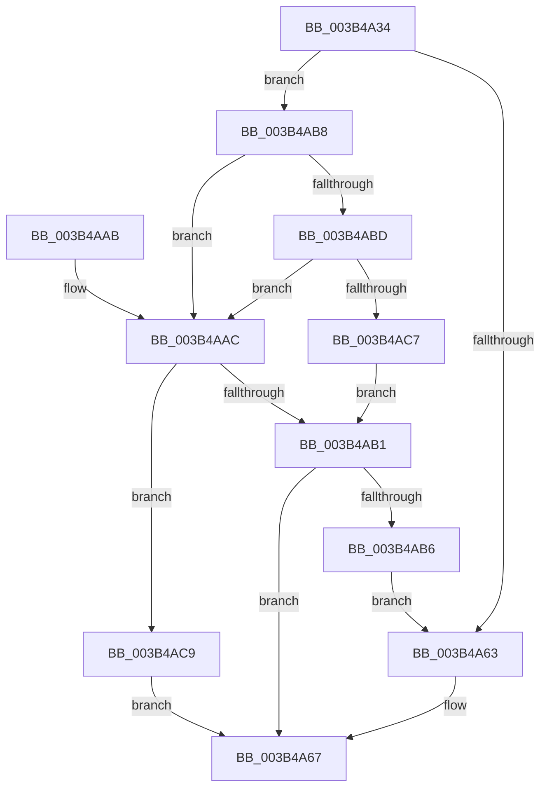

# MiSplitBitmapPages

- RVA: `0x003B4A34`–`0x003B4ACF` (길이 `155` bytes)
- VA: `0x00000001403B4A34`
- 실행 섹션: `.text`
- PDB 이름 있음: `예`; PDB Function 태그: `아니요`
- unwind 정보 RVA: `0x000841D0`
- 디코드: `43`개 명령, `155/155` bytes 표시
- 미해석 바이트: `0` (있으면 어셈블리에 `.byte`로 보존)

> 이 문서는 커널 이미지의 기계어와 PDB 기호를 분석해 생성했습니다. 4번과 5번은 함수 원형과 자료형을 바이너리 사용 방식에서 추정한 C 해석이며 원본 소스 복구 결과는 아닙니다.

## 1. Dependencies

- 직접 호출 지점: **2**; 고유 호출 대상: **2**
- 직접 호출자로 확인된 함수: **8**
- RIP 상대 이미지 참조: **0**

### Outgoing calls
- `0x003B4A3E` → [MiReduceSystemRegionType](MiReduceSystemRegionType_function_003B5FCC.md) (function, `0x003B5FCC`)
- `0x003B4AA1` → [MiMakeZeroedPageTables](MiMakeZeroedPageTables_function_003B4F6C.md) (function, `0x003B4F6C`)

### Direct callers
- [MiExpandPtes](MiExpandPtes_function_003B4B78.md) at `0x003B4D26`
- [MiExtendDynamicBitMap](MiExtendDynamicBitMap_function_003B6934.md) at `0x003B69D9`
- [sub_006E7378](../6E/Unknown_function_006E7378.md) at `0x006E73A1`
- [MiSplitMirrorBitMap](../../page/7F/MiSplitMirrorBitMap_function_007FCAE8.md) at `0x007FCB23`
- [MiSplitPfnBitMaps](../../page/80/MiSplitPfnBitMaps_function_0080C25C.md) at `0x0080C30A`
- [MiSplitPfnBitMaps](../../page/80/MiSplitPfnBitMaps_function_0080C25C.md) at `0x0080C36F`
- [MiSplitPfnBitMaps](../../page/80/MiSplitPfnBitMaps_function_0080C25C.md) at `0x0080C3B0`
- [MiSplitPfnBitMaps](../../page/80/MiSplitPfnBitMaps_function_0080C25C.md) at `0x0080C441`
- [MiSplitPfnBitMaps](../../page/80/MiSplitPfnBitMaps_function_0080C25C.md) at `0x0080C49B`
- [MiSplitPfnBitMaps](../../page/80/MiSplitPfnBitMaps_function_0080C25C.md) at `0x0080C4CD`
- [MiMarkRetpolineBits](../../page/AA/MiMarkRetpolineBits_function_00AA0394.md) at `0x00AA0434`
- [MiInitializeSystemImageRegion](../../init/C6/MiInitializeSystemImageRegion_function_00C6C05C.md) at `0x00C6C15B`
- [MxMarkActiveDriverBits](../../init/C6/MxMarkActiveDriverBits_function_00C6C998.md) at `0x00C6CA77`

### Static image references
- 디코드된 RIP-relative 메모리 참조가 없습니다.

## 2. Other-region calls and transfers

- 다른 실행 섹션으로 향하는 call: **0**
- 별도 외부 분기/꼬리 이동을 확인하지 못했습니다.

## 3. Assembly (complete function range)

```asm
003B4A34  48 83 EC 28                     sub rsp, 0x28
003B4A38  4D 8B D8                        mov r11, r8
003B4A3B  4C 8B D2                        mov r10, rdx
003B4A3E  E8 89 15 00 00                  call 0x1403b5fcc
003B4A43  41 F7 D9                        neg r9d
003B4A46  BA 00 10 00 00                  mov edx, 0x1000
003B4A4B  41 B9 08 00 00 00               mov r9d, 8
003B4A51  45 1B C0                        sbb r8d, r8d
003B4A54  44 23 C2                        and r8d, edx
003B4A57  41 81 C0 20 02 00 00            add r8d, 0x220
003B4A5E  41 3B C1                        cmp eax, r9d
003B4A61  75 55                           jne 0x1403b4ab8
003B4A63  41 83 C8 10                     or r8d, 0x10
003B4A67  49 8D 53 FF                     lea rdx, [r11 - 1]
003B4A6B  48 B9 00 00 00 00 80 F6 FF FF   movabs rcx, 0xfffff68000000000
003B4A75  48 C1 EA 03                     shr rdx, 3
003B4A79  49 BB F8 FF FF FF 7F 00 00 00   movabs r11, 0x7ffffffff8
003B4A83  49 03 D2                        add rdx, r10
003B4A86  48 C1 EA 09                     shr rdx, 9
003B4A8A  49 23 D3                        and rdx, r11
003B4A8D  48 8B C1                        mov rax, rcx
003B4A90  49 C1 EA 09                     shr r10, 9
003B4A94  48 03 D0                        add rdx, rax
003B4A97  4D 23 D3                        and r10, r11
003B4A9A  48 8B C1                        mov rax, rcx
003B4A9D  4A 8D 0C 10                     lea rcx, [rax + r10]
003B4AA1  E8 C6 04 00 00                  call 0x1403b4f6c
003B4AA6  48 83 C4 28                     add rsp, 0x28
003B4AAA  C3                              ret
003B4AAB  CC                              int3
003B4AAC  44 85 C2                        test edx, r8d
003B4AAF  74 18                           je 0x1403b4ac9
003B4AB1  83 F8 04                        cmp eax, 4
003B4AB4  75 B1                           jne 0x1403b4a67
003B4AB6  EB AB                           jmp 0x1403b4a63
003B4AB8  83 F8 0F                        cmp eax, 0xf
003B4ABB  77 EF                           ja 0x1403b4aac
003B4ABD  B9 D0 E0 00 00                  mov ecx, 0xe0d0
003B4AC2  0F A3 C1                        bt ecx, eax
003B4AC5  73 E5                           jae 0x1403b4aac
003B4AC7  EB E8                           jmp 0x1403b4ab1
003B4AC9  41 83 C8 01                     or r8d, 1
003B4ACD  EB 98                           jmp 0x1403b4a67
```

## 4. C-style interpretation (structured pseudocode)

```c
__int64 __fastcall MiSplitBitmapPages(__int64 a1, __int64 a2, __int64 a3, int a4)
{
    __int64 result;
    __int64 v_r10;
    __int64 v_rsp;

    v_rsp = (v_rsp) - (40);
    result = MiReduceSystemRegionType(a1, a2, a3, a4);
    a4 = (unsigned int)(-(a4));
    a3 = (unsigned int)((a3) & ((unsigned int)((unsigned int)(0x1000ULL))));
    a3 = (unsigned int)((a3) + (544));
    if (((unsigned int)(result)) != 8) goto loc_003B4AB8;
loc_003B4A63:
    a3 = (unsigned int)((a3) | (16));
loc_003B4A67:
    a2 = (a3 - 1) >> (3);
    a2 = (a2) + (a2);
    a2 = (a2) >> (9);
    a2 = (a2) & (a3);
    v_r10 = (a2) >> (9);
    a2 = (a2) + (a1);
    v_r10 = (v_r10) & (a3);
    result = MiMakeZeroedPageTables(a1 + v_r10 * 1, a2, a3, 8);
    v_rsp = (v_rsp) + (40);
    return result;
loc_003B4AAC:
    if ((((unsigned int)(a2)) & ((unsigned int)(a3))) == 0) goto loc_003B4AC9;
loc_003B4AB1:
    if (((unsigned int)(result)) != 4) goto loc_003B4A67;
    goto loc_003B4A63;
loc_003B4AB8:
    if (((unsigned int)(result)) > 15) goto loc_003B4AAC;
    if (((unsigned int)(result)) >= 15) goto loc_003B4AAC;
    goto loc_003B4AB1;
loc_003B4AC9:
    a3 = (unsigned int)((a3) | (1));
    goto loc_003B4A67;
}
```

## 5. (Beta) C Style

```c
int64_t MiSplitBitmapPages(int64_t Arg1, int64_t Arg2, int64_t Arg3, int32_t Arg4)
{
    int64_t result;
    int64_t local_r10;
    int64_t local_rsp;

    local_rsp = (local_rsp) - (40);
    result = MiReduceSystemRegionType(Arg1, Arg2, Arg3, Arg4);
    Arg4 = (uint32_t)(-(Arg4));
    Arg3 = (uint32_t)((Arg3) & ((uint32_t)((uint32_t)(0x1000ULL))));
    Arg3 = (uint32_t)((Arg3) + (544));
    if (((uint32_t)(result)) != 8) goto loc_003B4AB8;
loc_003B4A63:
    Arg3 = (uint32_t)((Arg3) | (16));
loc_003B4A67:
    Arg2 = (Arg3 - 1) >> (3);
    Arg2 = (Arg2) + (Arg2);
    Arg2 = (Arg2) >> (9);
    Arg2 = (Arg2) & (Arg3);
    local_r10 = (Arg2) >> (9);
    Arg2 = (Arg2) + (Arg1);
    local_r10 = (local_r10) & (Arg3);
    result = MiMakeZeroedPageTables(Arg1 + local_r10 * 1, Arg2, Arg3, 8);
    local_rsp = (local_rsp) + (40);
    return result;
loc_003B4AAC:
    if ((((uint32_t)(Arg2)) & ((uint32_t)(Arg3))) == 0) goto loc_003B4AC9;
loc_003B4AB1:
    if (((uint32_t)(result)) != 4) goto loc_003B4A67;
    goto loc_003B4A63;
loc_003B4AB8:
    if (((uint32_t)(result)) > 15) goto loc_003B4AAC;
    if (((uint32_t)(result)) >= 15) goto loc_003B4AAC;
    goto loc_003B4AB1;
loc_003B4AC9:
    Arg3 = (uint32_t)((Arg3) | (1));
    goto loc_003B4A67;
}
```

## 6. Execution-region graph

[열기: 2D/3D 그래프와 함수 탐색 컨트롤 패널](../../../control-panel.html?section=text&rva=0x003B4A34&view=graph)

- 2D 그래프는 위에서 아래로 흐르고, 3D 그래프는 빈 공간을 드래그해 회전합니다. Shift+드래그는 이동, 휠은 확대·축소, 함수 노드 선택은 대상 보고서 이동입니다.

### Static fallback


