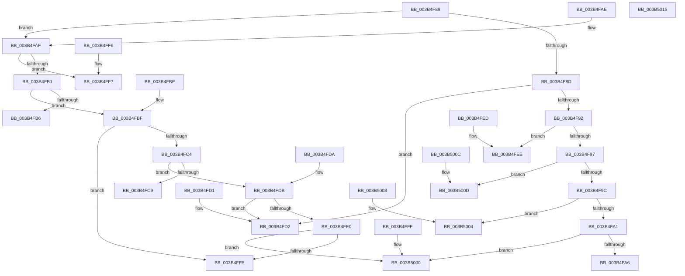

# MiSystemVaToDynamicBitmap

- RVA: `0x003B4F88`–`0x003B5016` (길이 `142` bytes)
- VA: `0x00000001403B4F88`
- 실행 섹션: `.text`
- PDB 이름 있음: `예`; PDB Function 태그: `아니요`
- unwind 정보 RVA: `0x000DB714`
- 디코드: `53`개 명령, `142/142` bytes 표시
- 미해석 바이트: `0` (있으면 어셈블리에 `.byte`로 보존)

> 이 문서는 커널 이미지의 기계어와 PDB 기호를 분석해 생성했습니다. 4번과 5번은 함수 원형과 자료형을 바이너리 사용 방식에서 추정한 C 해석이며 원본 소스 복구 결과는 아닙니다.

## 1. Dependencies

- 직접 호출 지점: **0**; 고유 호출 대상: **0**
- 직접 호출자로 확인된 함수: **5**
- RIP 상대 이미지 참조: **9**

### Outgoing calls
- 직접 디코드된 call 명령이 없습니다.

### Direct callers
- [MiMarkSystemVaAllocated](MiMarkSystemVaAllocated_function_003B3878.md) at `0x003B38D4`
- [MiObtainSystemVa](MiObtainSystemVa_function_003B4F44.md) at `0x003B4F4D`
- [MiMakeSystemRangeAvailable](../4E/MiMakeSystemRangeAvailable_function_004EE174.md) at `0x004EE1C7`
- [MiIsSystemVaAllocated](../67/MiIsSystemVaAllocated_function_0067F9FC.md) at `0x0067FA0B`
- [MiInitializeDynamicRegion](../../init/C6/MiInitializeDynamicRegion_function_00C65C2C.md) at `0x00C65C30`

### Static image references
- `0x003B4FA6` → RVA `0x00E2F0C8` (`.data`; read)
- `0x003B4FB6` → RVA `0x00E2F038` (`.data`; read)
- `0x003B4FC9` → RVA `0x00E2F080` (`.data`; read)
- `0x003B4FD2` → RVA `0x00E2EF60` (`.data`; read)
- `0x003B4FE5` → RVA `0x00E2EFA8` (`.data`; read)
- `0x003B4FEE` → RVA `0x00E2EED0` (`.data`; read)
- `0x003B4FF7` → RVA `0x00E2EFF0` (`.data`; read)
- `0x003B5004` → RVA `0x00E2EF18` (`.data`; read)
- `0x003B500D` → RVA `0x00E2F110` (`.data`; read)

## 2. Other-region calls and transfers

- 다른 실행 섹션으로 향하는 call: **0**
- 별도 외부 분기/꼬리 이동을 확인하지 못했습니다.

## 3. Assembly (complete function range)

```asm
003B4F88  83 F9 0B                        cmp ecx, 0xb
003B4F8B  7E 22                           jle 0x1403b4faf
003B4F8D  83 E9 0C                        sub ecx, 0xc
003B4F90  74 40                           je 0x1403b4fd2
003B4F92  83 E9 01                        sub ecx, 1
003B4F95  74 57                           je 0x1403b4fee
003B4F97  83 E9 01                        sub ecx, 1
003B4F9A  74 71                           je 0x1403b500d
003B4F9C  83 E9 01                        sub ecx, 1
003B4F9F  74 63                           je 0x1403b5004
003B4FA1  83 F9 02                        cmp ecx, 2
003B4FA4  75 5A                           jne 0x1403b5000
003B4FA6  48 8D 05 1B A1 A7 00            lea rax, [rip + 0xa7a11b]
003B4FAD  C3                              ret
003B4FAE  CC                              int3
003B4FAF  74 46                           je 0x1403b4ff7
003B4FB1  83 E9 05                        sub ecx, 5
003B4FB4  75 09                           jne 0x1403b4fbf
003B4FB6  48 8D 05 7B A0 A7 00            lea rax, [rip + 0xa7a07b]
003B4FBD  C3                              ret
003B4FBE  CC                              int3
003B4FBF  83 E9 01                        sub ecx, 1
003B4FC2  74 21                           je 0x1403b4fe5
003B4FC4  83 E9 01                        sub ecx, 1
003B4FC7  75 12                           jne 0x1403b4fdb
003B4FC9  48 8D 05 B0 A0 A7 00            lea rax, [rip + 0xa7a0b0]
003B4FD0  C3                              ret
003B4FD1  CC                              int3
003B4FD2  48 8D 05 87 9F A7 00            lea rax, [rip + 0xa79f87]
003B4FD9  C3                              ret
003B4FDA  CC                              int3
003B4FDB  83 E9 01                        sub ecx, 1
003B4FDE  74 F2                           je 0x1403b4fd2
003B4FE0  83 F9 02                        cmp ecx, 2
003B4FE3  75 1B                           jne 0x1403b5000
003B4FE5  48 8D 05 BC 9F A7 00            lea rax, [rip + 0xa79fbc]
003B4FEC  C3                              ret
003B4FED  CC                              int3
003B4FEE  48 8D 05 DB 9E A7 00            lea rax, [rip + 0xa79edb]
003B4FF5  C3                              ret
003B4FF6  CC                              int3
003B4FF7  48 8D 05 F2 9F A7 00            lea rax, [rip + 0xa79ff2]
003B4FFE  C3                              ret
003B4FFF  CC                              int3
003B5000  33 C0                           xor eax, eax
003B5002  C3                              ret
003B5003  CC                              int3
003B5004  48 8D 05 0D 9F A7 00            lea rax, [rip + 0xa79f0d]
003B500B  C3                              ret
003B500C  CC                              int3
003B500D  48 8D 05 FC A0 A7 00            lea rax, [rip + 0xa7a0fc]
003B5014  C3                              ret
003B5015  CC                              int3
```

## 4. C-style interpretation (structured pseudocode)

```c
__int64 __fastcall MiSystemVaToDynamicBitmap(int a1)
{
    __int64 result;

    if (a1 <= 11) goto loc_003B4FAF;
    a1 = (unsigned int)((a1) - (12));
    if (condition_is_equal) goto loc_003B4FD2;
    a1 = (unsigned int)((a1) - (1));
    if (condition_is_equal) goto loc_003B4FEE;
    a1 = (unsigned int)((a1) - (1));
    if (condition_is_equal) goto loc_003B500D;
    a1 = (unsigned int)((a1) - (1));
    if (condition_is_equal) goto loc_003B5004;
    if (a1 != 2) goto loc_003B5000;
    return v_rip + 10985755;
loc_003B4FAF:
    if (a1 == 2) goto loc_003B4FF7;
    a1 = (unsigned int)((a1) - (5));
    if (condition_is_not_equal) goto loc_003B4FBF;
    return v_rip + 10985595;
loc_003B4FBF:
    a1 = (unsigned int)((a1) - (1));
    if (condition_is_equal) goto loc_003B4FE5;
    a1 = (unsigned int)((a1) - (1));
    if (condition_is_not_equal) goto loc_003B4FDB;
    return v_rip + 10985648;
loc_003B4FD2:
    return v_rip + 10985351;
loc_003B4FDB:
    a1 = (unsigned int)((a1) - (1));
    if (condition_is_equal) goto loc_003B4FD2;
    if (a1 != 2) goto loc_003B5000;
loc_003B4FE5:
    return v_rip + 10985404;
loc_003B4FEE:
    return v_rip + 10985179;
loc_003B4FF7:
    return v_rip + 10985458;
loc_003B5000:
    result = 0;
    return result;
loc_003B5004:
    return v_rip + 10985229;
loc_003B500D:
    return v_rip + 10985724;
}
```

## 5. (Beta) C Style

```c
int64_t MiSystemVaToDynamicBitmap(int32_t Arg1)
{
    int64_t result;

    if (Arg1 <= 11) goto loc_003B4FAF;
    Arg1 = (uint32_t)((Arg1) - (12));
    if (condition_is_equal) goto loc_003B4FD2;
    Arg1 = (uint32_t)((Arg1) - (1));
    if (condition_is_equal) goto loc_003B4FEE;
    Arg1 = (uint32_t)((Arg1) - (1));
    if (condition_is_equal) goto loc_003B500D;
    Arg1 = (uint32_t)((Arg1) - (1));
    if (condition_is_equal) goto loc_003B5004;
    if (Arg1 != 2) goto loc_003B5000;
    return v_rip + 10985755;
loc_003B4FAF:
    if (Arg1 == 2) goto loc_003B4FF7;
    Arg1 = (uint32_t)((Arg1) - (5));
    if (condition_is_not_equal) goto loc_003B4FBF;
    return v_rip + 10985595;
loc_003B4FBF:
    Arg1 = (uint32_t)((Arg1) - (1));
    if (condition_is_equal) goto loc_003B4FE5;
    Arg1 = (uint32_t)((Arg1) - (1));
    if (condition_is_not_equal) goto loc_003B4FDB;
    return v_rip + 10985648;
loc_003B4FD2:
    return v_rip + 10985351;
loc_003B4FDB:
    Arg1 = (uint32_t)((Arg1) - (1));
    if (condition_is_equal) goto loc_003B4FD2;
    if (Arg1 != 2) goto loc_003B5000;
loc_003B4FE5:
    return v_rip + 10985404;
loc_003B4FEE:
    return v_rip + 10985179;
loc_003B4FF7:
    return v_rip + 10985458;
loc_003B5000:
    result = 0;
    return result;
loc_003B5004:
    return v_rip + 10985229;
loc_003B500D:
    return v_rip + 10985724;
}
```

## 6. Execution-region graph

[열기: 2D/3D 그래프와 함수 탐색 컨트롤 패널](../../../control-panel.html?section=text&rva=0x003B4F88&view=graph)

- 2D 그래프는 위에서 아래로 흐르고, 3D 그래프는 빈 공간을 드래그해 회전합니다. Shift+드래그는 이동, 휠은 확대·축소, 함수 노드 선택은 대상 보고서 이동입니다.

### Static fallback


