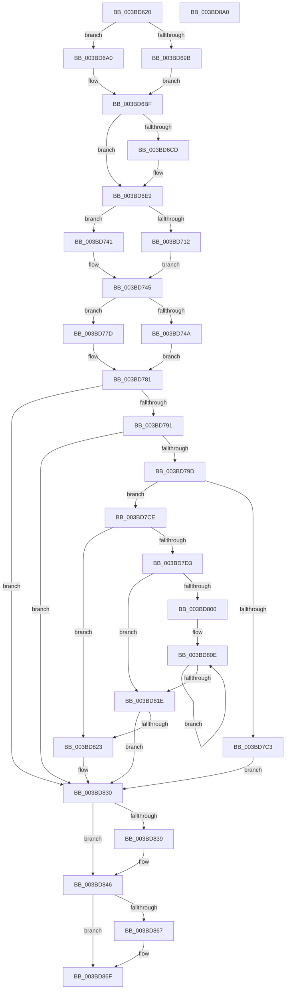

# MiUnlinkPageFromBadList

- RVA: `0x003BD620`–`0x003BD8A1` (길이 `641` bytes)
- VA: `0x00000001403BD620`
- 실행 섹션: `.text`
- PDB 이름 있음: `예`; PDB Function 태그: `아니요`
- unwind 정보 RVA: `0x0008CEEC`
- 디코드: `162`개 명령, `641/641` bytes 표시
- 미해석 바이트: `0` (있으면 어셈블리에 `.byte`로 보존)

> 이 문서는 커널 이미지의 기계어와 PDB 기호를 분석해 생성했습니다. 4번과 5번은 함수 원형과 자료형을 바이너리 사용 방식에서 추정한 C 해석이며 원본 소스 복구 결과는 아닙니다.

## 1. Dependencies

- 직접 호출 지점: **5**; 고유 호출 대상: **5**
- 직접 호출자로 확인된 함수: **6**
- RIP 상대 이미지 참조: **5**

### Outgoing calls
- `0x003BD687` → [memset](../6C/memset_function_006C6C40.md) (function, `0x006C6C40`)
- `0x003BD6E4` → [MiAcquirePageListLock](../27/MiAcquirePageListLock_function_0027C450.md) (function, `0x0027C450`)
- `0x003BD730` → [MiSetPfnBlink](MiSetPfnBlink_function_003BC790.md) (function, `0x003BC790`)
- `0x003BD841` → [MiReleasePageListLock](../2B/MiReleasePageListLock_function_002B1050.md) (function, `0x002B1050`)
- `0x003BD87A` → [_security_check_cookie](../6A/_security_check_cookie_function_006AC640.md) (function, `0x006AC640`)

### Direct callers
- [sub_00287E84](../28/Unknown_function_00287E84.md) at `0x00287FBC`
- [sub_00287E84](../28/Unknown_function_00287E84.md) at `0x00288066`
- [MiRemoveBadPages](../67/MiRemoveBadPages_function_00679F6C.md) at `0x0067A024`
- [MiUnlinkBadPages](../67/MiUnlinkBadPages_function_0067A6FC.md) at `0x0067A81D`
- [MiMarkFileOnlyPfnGood](../68/MiMarkFileOnlyPfnGood_function_0068178C.md) at `0x006817E2`
- [MiPurgeBadFileOnlyPages](../68/MiPurgeBadFileOnlyPages_function_00681ADC.md) at `0x00681B7A`
- [MiMoveBadPagePartition](../69/MiMoveBadPagePartition_function_00691924.md) at `0x00691946`

### Static image references
- `0x003BD63F` → RVA `0x00E0A740` (`.data`; read)
- `0x003BD692` → RVA `0x00E2D650` (`.data`; read)
- `0x003BD6A4` → RVA `0x00E30088` (`.data`; read)
- `0x003BD791` → RVA `0x00E3014C` (`.data`; read)
- `0x003BD79D` → RVA `0x00E301A8` (`.data`; read)

## 2. Other-region calls and transfers

- 다른 실행 섹션으로 향하는 call: **0**
- 별도 외부 분기/꼬리 이동을 확인하지 못했습니다.

## 3. Assembly (complete function range)

```asm
003BD620  48 89 5C 24 10                  mov qword ptr [rsp + 0x10], rbx
003BD625  48 89 6C 24 18                  mov qword ptr [rsp + 0x18], rbp
003BD62A  48 89 74 24 20                  mov qword ptr [rsp + 0x20], rsi
003BD62F  57                              push rdi
003BD630  41 54                           push r12
003BD632  41 55                           push r13
003BD634  41 56                           push r14
003BD636  41 57                           push r15
003BD638  48 81 EC B0 00 00 00            sub rsp, 0xb0
003BD63F  48 8B 05 FA D0 A4 00            mov rax, qword ptr [rip + 0xa4d0fa]
003BD646  48 33 C4                        xor rax, rsp
003BD649  48 89 84 24 A0 00 00 00         mov qword ptr [rsp + 0xa0], rax
003BD651  44 8B E2                        mov r12d, edx
003BD654  48 B8 00 00 00 00 00 DE FF FF   movabs rax, 0xffffde0000000000
003BD65E  48 8B F1                        mov rsi, rcx
003BD661  48 8B C0                        mov rax, rax
003BD664  48 8B E9                        mov rbp, rcx
003BD667  33 D2                           xor edx, edx
003BD669  48 2B E8                        sub rbp, rax
003BD66C  48 8D 4C 24 30                  lea rcx, [rsp + 0x30]
003BD671  48 B8 AB AA AA AA AA AA AA AA   movabs rax, 0xaaaaaaaaaaaaaaab
003BD67B  48 C1 FD 04                     sar rbp, 4
003BD67F  48 0F AF E8                     imul rbp, rax
003BD683  44 8D 42 68                     lea r8d, [rdx + 0x68]
003BD687  E8 B4 95 30 00                  call 0x1406c6c40
003BD68C  48 0F BA 66 28 35               bt qword ptr [rsi + 0x28], 0x35
003BD692  48 8D 15 B7 FF A6 00            lea rdx, [rip + 0xa6ffb7]
003BD699  73 05                           jae 0x1403bd6a0
003BD69B  48 8B DA                        mov rbx, rdx
003BD69E  EB 1F                           jmp 0x1403bd6bf
003BD6A0  48 8B 46 28                     mov rax, qword ptr [rsi + 0x28]
003BD6A4  48 8B 0D DD 29 A7 00            mov rcx, qword ptr [rip + 0xa729dd]
003BD6AB  48 C1 E8 2B                     shr rax, 0x2b
003BD6AF  25 FF 03 00 00                  and eax, 0x3ff
003BD6B4  48 8B 1C C1                     mov rbx, qword ptr [rcx + rax*8]
003BD6B8  48 81 C3 80 1B 00 00            add rbx, 0x1b80
003BD6BF  BF 01 00 00 00                  mov edi, 1
003BD6C4  41 81 E4 80 00 00 00            and r12d, 0x80
003BD6CB  75 1C                           jne 0x1403bd6e9
003BD6CD  48 8D 44 24 30                  lea rax, [rsp + 0x30]
003BD6D2  44 8B CF                        mov r9d, edi
003BD6D5  44 8D 47 08                     lea r8d, [rdi + 8]
003BD6D9  48 89 44 24 20                  mov qword ptr [rsp + 0x20], rax
003BD6DE  48 8B D6                        mov rdx, rsi
003BD6E1  48 8B CB                        mov rcx, rbx
003BD6E4  E8 67 ED EB FF                  call 0x14027c450
003BD6E9  4C 8B 2E                        mov r13, qword ptr [rsi]
003BD6EC  48 B8 FF FF FF FF FF 00 00 00   movabs rax, 0xffffffffff
003BD6F6  4C 8B 76 18                     mov r14, qword ptr [rsi + 0x18]
003BD6FA  4D 8B FD                        mov r15, r13
003BD6FD  4C 23 F8                        and r15, rax
003BD700  4C 23 F0                        and r14, rax
003BD703  48 B8 FF FF FF FF 3F 00 00 00   movabs rax, 0x3fffffffff
003BD70D  4C 3B F8                        cmp r15, rax
003BD710  74 2F                           je 0x1403bd741
003BD712  4B 8D 0C 7F                     lea rcx, [r15 + r15*2]
003BD716  48 B8 00 00 00 00 00 DE FF FF   movabs rax, 0xffffde0000000000
003BD720  48 C1 E1 04                     shl rcx, 4
003BD724  48 8B C0                        mov rax, rax
003BD727  48 03 C8                        add rcx, rax
003BD72A  45 33 C0                        xor r8d, r8d
003BD72D  49 8B D6                        mov rdx, r14
003BD730  E8 5B F0 FF FF                  call 0x1403bc790
003BD735  48 B8 FF FF FF FF 3F 00 00 00   movabs rax, 0x3fffffffff
003BD73F  EB 04                           jmp 0x1403bd745
003BD741  4C 89 73 18                     mov qword ptr [rbx + 0x18], r14
003BD745  4C 3B F0                        cmp r14, rax
003BD748  74 33                           je 0x1403bd77d
003BD74A  4B 8D 0C 76                     lea rcx, [r14 + r14*2]
003BD74E  48 B8 00 00 00 00 00 DE FF FF   movabs rax, 0xffffde0000000000
003BD758  48 C1 E1 04                     shl rcx, 4
003BD75C  48 8B C0                        mov rax, rax
003BD75F  48 03 C8                        add rcx, rax
003BD762  48 BA 00 00 00 00 00 FF FF FF   movabs rdx, 0xffffff0000000000
003BD76C  49 8B C5                        mov rax, r13
003BD76F  48 33 01                        xor rax, qword ptr [rcx]
003BD772  48 23 C2                        and rax, rdx
003BD775  49 33 C5                        xor rax, r13
003BD778  48 89 01                        mov qword ptr [rcx], rax
003BD77B  EB 04                           jmp 0x1403bd781
003BD77D  4C 89 7B 10                     mov qword ptr [rbx + 0x10], r15
003BD781  4C 8D 35 C8 FE A6 00            lea r14, [rip + 0xa6fec8]
003BD788  49 3B DE                        cmp rbx, r14
003BD78B  0F 84 9F 00 00 00               je 0x1403bd830
003BD791  39 3D B5 29 A7 00               cmp dword ptr [rip + 0xa729b5], edi
003BD797  0F 85 93 00 00 00               jne 0x1403bd830
003BD79D  48 8B 05 04 2A A7 00            mov rax, qword ptr [rip + 0xa72a04]
003BD7A4  4C 8B CD                        mov r9, rbp
003BD7A7  41 83 E1 1F                     and r9d, 0x1f
003BD7AB  48 8B CD                        mov rcx, rbp
003BD7AE  48 C1 E9 05                     shr rcx, 5
003BD7B2  48 8B D7                        mov rdx, rdi
003BD7B5  4C 8D 04 88                     lea r8, [rax + rcx*4]
003BD7B9  49 8D 41 01                     lea rax, [r9 + 1]
003BD7BD  48 83 F8 20                     cmp rax, 0x20
003BD7C1  77 0B                           ja 0x1403bd7ce
003BD7C3  41 8B C9                        mov ecx, r9d
003BD7C6  D3 E7                           shl edi, cl
003BD7C8  F0 41 09 38                     lock or dword ptr [r8], edi
003BD7CC  EB 62                           jmp 0x1403bd830
003BD7CE  4D 85 C9                        test r9, r9
003BD7D1  74 50                           je 0x1403bd823
003BD7D3  83 E5 1F                        and ebp, 0x1f
003BD7D6  BA 20 00 00 00                  mov edx, 0x20
003BD7DB  2B D5                           sub edx, ebp
003BD7DD  8B C7                           mov eax, edi
003BD7DF  8B CA                           mov ecx, edx
003BD7E1  D3 E0                           shl eax, cl
003BD7E3  49 8B C9                        mov rcx, r9
003BD7E6  2B C7                           sub eax, edi
003BD7E8  D3 E0                           shl eax, cl
003BD7EA  F0 41 09 00                     lock or dword ptr [r8], eax
003BD7EE  8B C2                           mov eax, edx
003BD7F0  49 83 C0 04                     add r8, 4
003BD7F4  48 8B D7                        mov rdx, rdi
003BD7F7  48 2B D0                        sub rdx, rax
003BD7FA  48 83 FA 20                     cmp rdx, 0x20
003BD7FE  72 1E                           jb 0x1403bd81e
003BD800  48 8B CA                        mov rcx, rdx
003BD803  48 C1 E9 05                     shr rcx, 5
003BD807  48 6B C1 E0                     imul rax, rcx, -0x20
003BD80B  48 03 D0                        add rdx, rax
003BD80E  41 C7 00 FF FF FF FF            mov dword ptr [r8], 0xffffffff
003BD815  49 83 C0 04                     add r8, 4
003BD819  48 2B CF                        sub rcx, rdi
003BD81C  75 F0                           jne 0x1403bd80e
003BD81E  48 85 D2                        test rdx, rdx
003BD821  74 0D                           je 0x1403bd830
003BD823  48 8B CA                        mov rcx, rdx
003BD826  8B C7                           mov eax, edi
003BD828  D3 E0                           shl eax, cl
003BD82A  2B C7                           sub eax, edi
003BD82C  F0 41 09 00                     lock or dword ptr [r8], eax
003BD830  F0 48 FF 0B                     lock dec qword ptr [rbx]
003BD834  45 85 E4                        test r12d, r12d
003BD837  75 0D                           jne 0x1403bd846
003BD839  48 8D 54 24 30                  lea rdx, [rsp + 0x30]
003BD83E  48 8B CB                        mov rcx, rbx
003BD841  E8 0A 38 EF FF                  call 0x1402b1050
003BD846  48 C7 06 00 00 00 00            mov qword ptr [rsi], 0
003BD84D  48 B9 00 00 00 00 00 00 00 C0   movabs rcx, 0xc000000000000000
003BD857  48 8B 46 18                     mov rax, qword ptr [rsi + 0x18]
003BD85B  48 23 C1                        and rax, rcx
003BD85E  48 89 46 18                     mov qword ptr [rsi + 0x18], rax
003BD862  49 3B DE                        cmp rbx, r14
003BD865  74 08                           je 0x1403bd86f
003BD867  48 C7 46 08 00 00 00 00         mov qword ptr [rsi + 8], 0
003BD86F  48 8B 8C 24 A0 00 00 00         mov rcx, qword ptr [rsp + 0xa0]
003BD877  48 33 CC                        xor rcx, rsp
003BD87A  E8 C1 ED 2E 00                  call 0x1406ac640
003BD87F  4C 8D 9C 24 B0 00 00 00         lea r11, [rsp + 0xb0]
003BD887  49 8B 5B 38                     mov rbx, qword ptr [r11 + 0x38]
003BD88B  49 8B 6B 40                     mov rbp, qword ptr [r11 + 0x40]
003BD88F  49 8B 73 48                     mov rsi, qword ptr [r11 + 0x48]
003BD893  49 8B E3                        mov rsp, r11
003BD896  41 5F                           pop r15
003BD898  41 5E                           pop r14
003BD89A  41 5D                           pop r13
003BD89C  41 5C                           pop r12
003BD89E  5F                              pop rdi
003BD89F  C3                              ret
003BD8A0  CC                              int3
```

## 4. C-style interpretation (structured pseudocode)

```c
__int64 __fastcall MiUnlinkPageFromBadList(__int64 a1, int a2)
{
    __int64 result;
    __int64 v_r12;
    __int64 v_r14;
    __int64 v_r15;
    __int64 v_rbp;
    __int64 v_rbx;
    __int64 v_rdi;
    __int64 v_rsp;
    unsigned __int64 v_stack_m28;
    unsigned __int64 v_stack_m38;
    unsigned __int64 v_stack_mA8;
    unsigned __int64 v_stack_mB8;
    unsigned __int64 v_stack_p10;
    unsigned __int64 v_stack_p18;
    unsigned __int64 v_stack_p20;

    v_stack_p10 = v_rbx;
    v_stack_p18 = v_rbp;
    v_stack_p20 = v_rsi;
    v_rsp = (v_rsp) - (176);
    result = (*(unsigned __int64 *)(v_rip + 10801402)) ^ (v_rsp);
    v_stack_m38 = result;
    a2 = 0;
    v_rbp = (a1) - (result);
    v_rbp = (v_rbp) >> (4);
    v_rbp = (v_rbp) * (result);
    result = memset(v_stack_mA8, a2, a2 + 104, a4);
    if (condition_is_above_or_equal) goto loc_003BD6A0;
    goto loc_003BD6BF;
loc_003BD6A0:
    result = (*(unsigned __int64 *)(a1 + 40)) >> (43);
    result = (unsigned int)((result) & (0x3FFULL));
    v_rbx = (*(unsigned __int64 *)(*(unsigned __int64 *)(v_rip + 10955229) + result * 8)) + (0x1B80ULL);
loc_003BD6BF:
    v_r12 = (unsigned int)(((unsigned int)(a2)) & (128));
    if (!(condition_is_not_equal)) {
        result = v_stack_mA8;
        a4 = 1;
        a3 = 1 + 8;
        v_stack_mB8 = result;
        a2 = a1;
        a1 = v_rbx;
        result = MiAcquirePageListLock(a1, a2, a3, a4);
    }
    v_r15 = (*(unsigned __int64 *)(a1)) & (result);
    v_r14 = (*(unsigned __int64 *)(a1 + 24)) & (result);
    if (v_r15 == result) goto loc_003BD741;
    a1 = (v_r15 + v_r15 * 2) << (4);
    a1 = (a1) + (result);
    a3 = 0;
    result = MiSetPfnBlink(a1, v_r14, a3, a4);
    goto loc_003BD745;
loc_003BD741:
    *(unsigned __int64 *)(v_rbx + 24) = v_r14;
loc_003BD745:
    if (v_r14 == result) goto loc_003BD77D;
    a1 = (v_r14 + v_r14 * 2) << (4);
    a1 = (a1) + (result);
    result = (*(unsigned __int64 *)(a1)) ^ (*(unsigned __int64 *)(a1));
    result = (result) & (v_r14);
    result = (result) ^ (*(unsigned __int64 *)(a1));
    *(unsigned __int64 *)(a1) = result;
    goto loc_003BD781;
loc_003BD77D:
    *(unsigned __int64 *)(v_rbx + 16) = v_r15;
loc_003BD781:
    if (v_rbx == (v_rip + 10944200)) goto loc_003BD830;
    if ((*(unsigned int *)(v_rip + 10955189)) != 1) goto loc_003BD830;
    a4 = (unsigned int)((v_rbp) & (31));
    a1 = (v_rbp) >> (5);
    if ((a4 + 1) > 32) goto loc_003BD7CE;
    v_rdi = (unsigned int)((1) << ((unsigned __int8)((unsigned int)((unsigned int)(a4)))));
    goto loc_003BD830;
loc_003BD7CE:
    if (a4 == 0) goto loc_003BD823;
    v_rbp = (unsigned int)((v_rbp) & (31));
    a2 = (unsigned int)((32) - ((unsigned int)(v_rbp)));
    result = (unsigned int)(((unsigned int)((unsigned int)(v_rdi))) << ((unsigned __int8)((unsigned int)(a2))));
    result = (unsigned int)((result) - ((unsigned int)(v_rdi)));
    result = (unsigned int)((result) << ((unsigned __int8)(a4)));
    a3 = (*(unsigned __int64 *)(v_rip + 10955268) + a1 * 4) + (4);
    a2 = (v_rdi) - ((unsigned int)(a2));
    if (a2 < 32) goto loc_003BD81E;
    a1 = (a2) >> (5);
    result = ((unsigned int)(a2)) * (a1);
    a2 = (a2) + (result);
loc_003BD80E:
    *(unsigned int *)(a3) = 0xFFFFFFFFULL;
    a3 = (a3) + (4);
    a1 = (a1) - (v_rdi);
    if (condition_is_not_equal) goto loc_003BD80E;
loc_003BD81E:
    if (a2 != 0) {
        a1 = a2;
        result = (unsigned int)(v_rdi);
        result = (unsigned int)((result) << ((unsigned __int8)(a1)));
        result = (unsigned int)((result) - ((unsigned int)(v_rdi)));
    }
    if ((unsigned int)(v_r12) == 0) {
        a2 = v_stack_mA8;
        a1 = v_rbx;
        result = MiReleasePageListLock(a1, a2, a3, a4);
    }
    *(unsigned __int64 *)(a1) = 0;
    result = (*(unsigned __int64 *)(a1 + 24)) & (a1);
    *(unsigned __int64 *)(a1 + 24) = result;
    if (v_rbx != (v_rip + 10944200)) {
        *(unsigned __int64 *)(a1 + 8) = 0;
    }
    a1 = (v_stack_m38) ^ (v_rsp);
    result = _security_check_cookie(a1, a2, a3, a4);
    return result;
}
```

## 5. (Beta) C Style

```c
int64_t MiUnlinkPageFromBadList(void *Arg1, int32_t Arg2)
{
    uint8_t *arg1 = (uint8_t *)Arg1;

    int64_t result;
    int64_t local_r12;
    int64_t local_r14;
    int64_t local_r15;
    int64_t local_rbp;
    int64_t local_rbx;
    int64_t local_rdi;
    int64_t local_rsp;
    uint64_t v_stack_m28;
    uint64_t v_stack_m38;
    uint64_t v_stack_mA8;
    uint64_t v_stack_mB8;
    uint64_t v_stack_p10;
    uint64_t v_stack_p18;
    uint64_t v_stack_p20;

    v_stack_p10 = local_rbx;
    v_stack_p18 = local_rbp;
    v_stack_p20 = local_rsi;
    local_rsp = (local_rsp) - (176);
    result = (*(uint64_t *)(v_rip + 0xA4D0FA)) ^ (local_rsp);
    v_stack_m38 = result;
    Arg2 = 0;
    local_rbp = (Arg1) - (result);
    local_rbp = (local_rbp) >> (4);
    local_rbp = (local_rbp) * (result);
    result = memset(v_stack_mA8, Arg2, Arg2 + 104, a4);
    if (condition_is_above_or_equal) goto loc_003BD6A0;
    goto loc_003BD6BF;
loc_003BD6A0:
    result = (*(uint64_t *)(arg1 + 0x28)) >> (43);
    result = (uint32_t)((result) & (0x3FFULL));
    local_rbx = (*(uint64_t *)(*(uint64_t *)(v_rip + 0xA729DD) + result * 8)) + (0x1B80ULL);
loc_003BD6BF:
    local_r12 = (uint32_t)(((uint32_t)(Arg2)) & (128));
    if (!(condition_is_not_equal)) {
        result = v_stack_mA8;
        a4 = 1;
        a3 = 1 + 8;
        v_stack_mB8 = result;
        Arg2 = Arg1;
        Arg1 = local_rbx;
        result = MiAcquirePageListLock(Arg1, Arg2, a3, a4);
    }
    local_r15 = (*(uint64_t *)(arg1)) & (result);
    local_r14 = (*(uint64_t *)(arg1 + 0x18)) & (result);
    if (local_r15 == result) goto loc_003BD741;
    Arg1 = (local_r15 + local_r15 * 2) << (4);
    Arg1 = (Arg1) + (result);
    a3 = 0;
    result = MiSetPfnBlink(Arg1, local_r14, a3, a4);
    goto loc_003BD745;
loc_003BD741:
    *(uint64_t *)(local_rbx + 0x18) = local_r14;
loc_003BD745:
    if (local_r14 == result) goto loc_003BD77D;
    Arg1 = (local_r14 + local_r14 * 2) << (4);
    Arg1 = (Arg1) + (result);
    result = (*(uint64_t *)(arg1)) ^ (*(uint64_t *)(arg1));
    result = (result) & (local_r14);
    result = (result) ^ (*(uint64_t *)(arg1));
    *(uint64_t *)(arg1) = result;
    goto loc_003BD781;
loc_003BD77D:
    *(uint64_t *)(local_rbx + 0x10) = local_r15;
loc_003BD781:
    if (local_rbx == (v_rip + 10944200)) goto loc_003BD830;
    if ((*(uint32_t *)(v_rip + 0xA729B5)) != 1) goto loc_003BD830;
    a4 = (uint32_t)((local_rbp) & (31));
    Arg1 = (local_rbp) >> (5);
    if ((a4 + 1) > 32) goto loc_003BD7CE;
    local_rdi = (uint32_t)((1) << ((uint8_t)((uint32_t)((uint32_t)(a4)))));
    goto loc_003BD830;
loc_003BD7CE:
    if (a4 == 0) goto loc_003BD823;
    local_rbp = (uint32_t)((local_rbp) & (31));
    Arg2 = (uint32_t)((32) - ((uint32_t)(local_rbp)));
    result = (uint32_t)(((uint32_t)((uint32_t)(local_rdi))) << ((uint8_t)((uint32_t)(Arg2))));
    result = (uint32_t)((result) - ((uint32_t)(local_rdi)));
    result = (uint32_t)((result) << ((uint8_t)(a4)));
    a3 = (*(uint64_t *)(v_rip + 0xA72A04) + Arg1 * 4) + (4);
    Arg2 = (local_rdi) - ((uint32_t)(Arg2));
    if (Arg2 < 32) goto loc_003BD81E;
    Arg1 = (Arg2) >> (5);
    result = ((uint32_t)(Arg2)) * (Arg1);
    Arg2 = (Arg2) + (result);
loc_003BD80E:
    *(uint32_t *)(a3) = 0xFFFFFFFFULL;
    a3 = (a3) + (4);
    Arg1 = (Arg1) - (local_rdi);
    if (condition_is_not_equal) goto loc_003BD80E;
loc_003BD81E:
    if (Arg2 != 0) {
        Arg1 = Arg2;
        result = (uint32_t)(local_rdi);
        result = (uint32_t)((result) << ((uint8_t)(Arg1)));
        result = (uint32_t)((result) - ((uint32_t)(local_rdi)));
    }
    if ((uint32_t)(local_r12) == 0) {
        Arg2 = v_stack_mA8;
        Arg1 = local_rbx;
        result = MiReleasePageListLock(Arg1, Arg2, a3, a4);
    }
    *(uint64_t *)(arg1) = 0;
    result = (*(uint64_t *)(arg1 + 0x18)) & (Arg1);
    *(uint64_t *)(arg1 + 0x18) = result;
    if (local_rbx != (v_rip + 10944200)) {
        *(uint64_t *)(arg1 + 0x8) = 0;
    }
    Arg1 = (v_stack_m38) ^ (local_rsp);
    result = _security_check_cookie(Arg1, Arg2, a3, a4);
    return result;
}
```

### 관측된 메모리 오프셋

구조체 형식이 확인되지 않은 접근은 인자 기준의 오프셋으로만 기록했습니다.

| 기준 인자 | 오프셋 표현 | 폭 (bit) | 접근 |
|---|---:|---:|---|
| `Arg1` | `+ 0x0` | `64` | `R` |
| `Arg1` | `+ 0x0` | `64` | `W` |
| `Arg1` | `+ 0x8` | `64` | `W` |
| `Arg1` | `+ 0x18` | `64` | `R` |
| `Arg1` | `+ 0x18` | `64` | `W` |
| `Arg1` | `+ 0x28` | `64` | `R` |

## 6. Execution-region graph

[열기: 2D/3D 그래프와 함수 탐색 컨트롤 패널](../../../control-panel.html?section=text&rva=0x003BD620&view=graph)

- 2D 그래프는 위에서 아래로 흐르고, 3D 그래프는 빈 공간을 드래그해 회전합니다. Shift+드래그는 이동, 휠은 확대·축소, 함수 노드 선택은 대상 보고서 이동입니다.

### Static fallback


