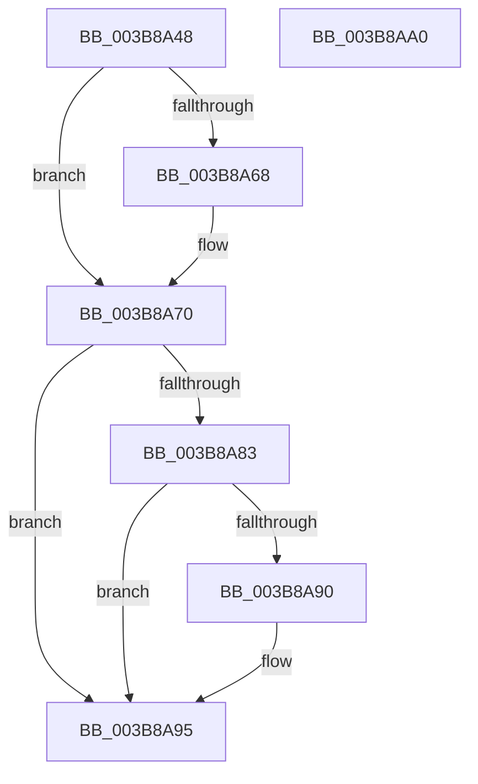

# MiUnlockDynamicMemoryShared

- RVA: `0x003B8A48`–`0x003B8AA1` (길이 `89` bytes)
- VA: `0x00000001403B8A48`
- 실행 섹션: `.text`
- PDB 이름 있음: `예`; PDB Function 태그: `아니요`
- unwind 정보 RVA: `0x00068D5C`
- 디코드: `26`개 명령, `89/89` bytes 표시
- 미해석 바이트: `0` (있으면 어셈블리에 `.byte`로 보존)

> 이 문서는 커널 이미지의 기계어와 PDB 기호를 분석해 생성했습니다. 4번과 5번은 함수 원형과 자료형을 바이너리 사용 방식에서 추정한 C 해석이며 원본 소스 복구 결과는 아닙니다.

## 1. Dependencies

- 직접 호출 지점: **3**; 고유 호출 대상: **3**
- 직접 호출자로 확인된 함수: **8**
- RIP 상대 이미지 참조: **0**

### Outgoing calls
- `0x003B8A6B` → [ExfReleasePushLockShared](../26/ExfReleasePushLockShared_function_00263440.md) (function, `0x00263440`)
- `0x003B8A73` → [KeAbPostRelease](../2E/KeAbPostRelease_function_002E1600.md) (function, `0x002E1600`)
- `0x003B8A90` → [KiCheckForKernelApcDelivery](../2E/KiCheckForKernelApcDelivery_function_002E2C80.md) (function, `0x002E2C80`)

### Direct callers
- [MiGetChannelInformation](MiGetChannelInformation_function_003B8738.md) at `0x003B8858`
- [MiIssuePageHeatList](../44/MiIssuePageHeatList_function_0044615C.md) at `0x004462E9`
- [MiAddPartitionHugeRange](../67/MiAddPartitionHugeRange_function_006750D8.md) at `0x006751B4`
- [MiAddPartitionHugeRange](../67/MiAddPartitionHugeRange_function_006750D8.md) at `0x0067535E`
- [MiMarkHugePfnBad](../67/MiMarkHugePfnBad_function_00676744.md) at `0x00676828`
- [MiMarkHugePfnBad](../67/MiMarkHugePfnBad_function_00676744.md) at `0x00676ACC`
- [MiAddPhysicalMemory](../../page/7F/MiAddPhysicalMemory_function_007F95FC.md) at `0x007F96FC`
- [MiAddPhysicalMemory](../../page/7F/MiAddPhysicalMemory_function_007F95FC.md) at `0x007F970A`
- [MiMapNewPfns](../../page/7F/MiMapNewPfns_function_007FA63C.md) at `0x007FA7C3`
- [MiMapNewPfns](../../page/7F/MiMapNewPfns_function_007FA63C.md) at `0x007FA816`
- [MiGetPhysicalMemoryRanges](../../page/AC/MiGetPhysicalMemoryRanges_function_00ACAE08.md) at `0x00ACAE6C`
- [MiGetPhysicalMemoryRanges](../../page/AC/MiGetPhysicalMemoryRanges_function_00ACAE08.md) at `0x00ACAF59`
- [MmDuplicateMemory](../../pagelk/B7/MmDuplicateMemory_function_00B74158.md) at `0x00B744F6`

### Static image references
- 디코드된 RIP-relative 메모리 참조가 없습니다.

## 2. Other-region calls and transfers

- 다른 실행 섹션으로 향하는 call: **0**
- 별도 외부 분기/꼬리 이동을 확인하지 못했습니다.

## 3. Assembly (complete function range)

```asm
003B8A48  48 89 5C 24 10                  mov qword ptr [rsp + 0x10], rbx
003B8A4D  57                              push rdi
003B8A4E  48 83 EC 20                     sub rsp, 0x20
003B8A52  48 8D 99 C0 00 00 00            lea rbx, [rcx + 0xc0]
003B8A59  48 8B FA                        mov rdi, rdx
003B8A5C  33 C9                           xor ecx, ecx
003B8A5E  8D 41 11                        lea eax, [rcx + 0x11]
003B8A61  F0 48 0F B1 0B                  lock cmpxchg qword ptr [rbx], rcx
003B8A66  74 08                           je 0x1403b8a70
003B8A68  48 8B CB                        mov rcx, rbx
003B8A6B  E8 D0 A9 EA FF                  call 0x140263440
003B8A70  48 8B CB                        mov rcx, rbx
003B8A73  E8 88 8B F2 FF                  call 0x1402e1600
003B8A78  90                              nop
003B8A79  66 83 87 E6 01 00 00 01         add word ptr [rdi + 0x1e6], 1
003B8A81  75 12                           jne 0x1403b8a95
003B8A83  48 8D 87 98 00 00 00            lea rax, [rdi + 0x98]
003B8A8A  90                              nop
003B8A8B  48 39 00                        cmp qword ptr [rax], rax
003B8A8E  74 05                           je 0x1403b8a95
003B8A90  E8 EB A1 F2 FF                  call 0x1402e2c80
003B8A95  48 8B 5C 24 38                  mov rbx, qword ptr [rsp + 0x38]
003B8A9A  48 83 C4 20                     add rsp, 0x20
003B8A9E  5F                              pop rdi
003B8A9F  C3                              ret
003B8AA0  CC                              int3
```

## 4. C-style interpretation (structured pseudocode)

```c
__int64 __fastcall MiUnlockDynamicMemoryShared(__int64 a1, __int64 a2)
{
    __int64 result;
    __int64 v_rsp;
    unsigned __int64 v_stack_p10;

    v_stack_p10 = v_rbx;
    v_rsp = (v_rsp) - (32);
    a1 = 0;
    result = a1 + 17;
    if (!(condition_is_equal)) {
        a1 = a1 + 192;
        result = ExfReleasePushLockShared(a1, a2, a3, a4);
    }
    result = KeAbPostRelease(a1 + 192, a2, a3, a4);
    if (condition_is_not_equal) goto loc_003B8A95;
    result = a2 + 152;
    if ((*(unsigned __int64 *)(a2 + 152)) != (a2 + 152)) {
        result = KiCheckForKernelApcDelivery(a1 + 192, a2, a3, a4);
    }
    v_rsp = (v_rsp) + (32);
    return result;
}
```

## 5. (Beta) C Style

```c
int64_t MiUnlockDynamicMemoryShared(void *Arg1, void *Arg2)
{
    uint8_t *arg1 = (uint8_t *)Arg1;
    uint8_t *arg2 = (uint8_t *)Arg2;

    int64_t result;
    int64_t local_rsp;
    uint64_t v_stack_p10;

    v_stack_p10 = local_rbx;
    local_rsp = (local_rsp) - (32);
    Arg1 = 0;
    result = Arg1 + 17;
    if (!(condition_is_equal)) {
        Arg1 = Arg1 + 192;
        result = ExfReleasePushLockShared(Arg1, Arg2, a3, a4);
    }
    result = KeAbPostRelease(Arg1 + 192, Arg2, a3, a4);
    if (condition_is_not_equal) goto loc_003B8A95;
    result = Arg2 + 152;
    if ((*(uint64_t *)(arg2 + 0x98)) != (Arg2 + 152)) {
        result = KiCheckForKernelApcDelivery(Arg1 + 192, Arg2, a3, a4);
    }
    local_rsp = (local_rsp) + (32);
    return result;
}
```

### 관측된 메모리 오프셋

구조체 형식이 확인되지 않은 접근은 인자 기준의 오프셋으로만 기록했습니다.

| 기준 인자 | 오프셋 표현 | 폭 (bit) | 접근 |
|---|---:|---:|---|
| `Arg1` | `+ 0x0` | `64` | `R` |
| `Arg1` | `+ 0xC0` | `64` | `R` |
| `Arg2` | `+ 0x0` | `64` | `R` |
| `Arg2` | `+ 0x98` | `64` | `R` |
| `Arg2` | `+ 0x1E6` | `16` | `R/W` |

## 6. Execution-region graph

[열기: 2D/3D 그래프와 함수 탐색 컨트롤 패널](../../../control-panel.html?section=text&rva=0x003B8A48&view=graph)

- 2D 그래프는 위에서 아래로 흐르고, 3D 그래프는 빈 공간을 드래그해 회전합니다. Shift+드래그는 이동, 휠은 확대·축소, 함수 노드 선택은 대상 보고서 이동입니다.

### Static fallback


