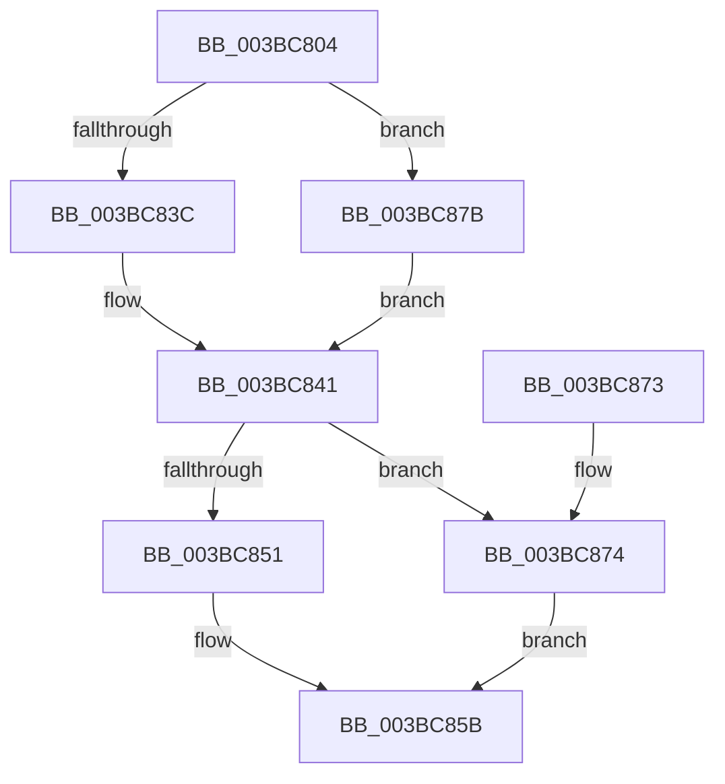

# MiUpdateAvailableEventsAtDpc

- RVA: `0x003BC804`–`0x003BC887` (길이 `131` bytes)
- VA: `0x00000001403BC804`
- 실행 섹션: `.text`
- PDB 이름 있음: `예`; PDB Function 태그: `아니요`
- unwind 정보 RVA: `0x0008CDBC`
- 디코드: `33`개 명령, `131/131` bytes 표시
- 미해석 바이트: `0` (있으면 어셈블리에 `.byte`로 보존)

> 이 문서는 커널 이미지의 기계어와 PDB 기호를 분석해 생성했습니다. 4번과 5번은 함수 원형과 자료형을 바이너리 사용 방식에서 추정한 C 해석이며 원본 소스 복구 결과는 아닙니다.

## 1. Dependencies

- 직접 호출 지점: **6**; 고유 호출 대상: **4**
- 직접 호출자로 확인된 함수: **13**
- RIP 상대 이미지 참조: **0**

### Outgoing calls
- `0x003BC820` → [ExAcquireSpinLockExclusiveAtDpcLevel](../24/ExAcquireSpinLockExclusiveAtDpcLevel_function_00248E80.md) (function, `0x00248E80`)
- `0x003BC83C` → [KeResetEvent](../24/KeResetEvent_function_00248350.md) (function, `0x00248350`)
- `0x003BC856` → [KeSetEvent](../33/KeSetEvent_function_0033F310.md) (function, `0x0033F310`)
- `0x003BC85E` → [ExReleaseSpinLockExclusiveFromDpcLevel](../24/ExReleaseSpinLockExclusiveFromDpcLevel_function_002497E0.md) (function, `0x002497E0`)
- `0x003BC874` → [KeResetEvent](../24/KeResetEvent_function_00248350.md) (function, `0x00248350`)
- `0x003BC880` → [KeSetEvent](../33/KeSetEvent_function_0033F310.md) (function, `0x0033F310`)

### Direct callers
- [sub_00287E84](../28/Unknown_function_00287E84.md) at `0x00287FCB`
- [MiInsertPageInList](../2B/MiInsertPageInList_function_002BA000.md) at `0x002BAA33`
- [sub_003354FB](../33/Unknown_function_003354FB.md) at `0x00335E37`
- [sub_00336094](../33/Unknown_function_00336094.md) at `0x003361F0`
- [MiUnlinkFreeOrZeroedPage](../33/MiUnlinkFreeOrZeroedPage_function_00336C40.md) at `0x00337505`
- [MiUnlinkFreeOrZeroedPage](../33/MiUnlinkFreeOrZeroedPage_function_00336C40.md) at `0x003377AB`
- [sub_0033DA89](../33/Unknown_function_0033DA89.md) at `0x0033DCF0`
- [sub_0033EABD](../33/Unknown_function_0033EABD.md) at `0x0033EB55`
- [sub_0033EABD](../33/Unknown_function_0033EABD.md) at `0x0033EF2A`
- [sub_003BB605](Unknown_function_003BB605.md) at `0x003BB637`
- [sub_003BB6FB](Unknown_function_003BB6FB.md) at `0x003BB6FB`
- [MiIncreaseAvailablePages](MiIncreaseAvailablePages_function_003BCC10.md) at `0x003BCCAC`
- [sub_003BCD6B](Unknown_function_003BCD6B.md) at `0x003BCDAC`
- [MiUpdatePageThresholdsDpc](MiUpdatePageThresholdsDpc_function_003BD050.md) at `0x003BD0BF`
- [MiUpdateAvailableEvents](../68/MiUpdateAvailableEvents_function_0068BF94.md) at `0x0068BFC1`

### Static image references
- 디코드된 RIP-relative 메모리 참조가 없습니다.

## 2. Other-region calls and transfers

- 다른 실행 섹션으로 향하는 call: **0**
- 별도 외부 분기/꼬리 이동을 확인하지 못했습니다.

## 3. Assembly (complete function range)

```asm
003BC804  48 89 5C 24 08                  mov qword ptr [rsp + 8], rbx
003BC809  48 89 74 24 10                  mov qword ptr [rsp + 0x10], rsi
003BC80E  57                              push rdi
003BC80F  48 83 EC 20                     sub rsp, 0x20
003BC813  48 8D B9 40 3F 00 00            lea rdi, [rcx + 0x3f40]
003BC81A  48 8B D9                        mov rbx, rcx
003BC81D  48 8B CF                        mov rcx, rdi
003BC820  E8 5B C6 E8 FF                  call 0x140248e80
003BC825  48 8B B3 00 49 00 00            mov rsi, qword ptr [rbx + 0x4900]
003BC82C  48 8B 8B 18 01 00 00            mov rcx, qword ptr [rbx + 0x118]
003BC833  48 3B B3 00 41 00 00            cmp rsi, qword ptr [rbx + 0x4100]
003BC83A  76 3F                           jbe 0x1403bc87b
003BC83C  E8 0F BB E8 FF                  call 0x140248350
003BC841  48 8B 8B 20 01 00 00            mov rcx, qword ptr [rbx + 0x120]
003BC848  48 3B B3 08 41 00 00            cmp rsi, qword ptr [rbx + 0x4108]
003BC84F  76 23                           jbe 0x1403bc874
003BC851  45 33 C0                        xor r8d, r8d
003BC854  33 D2                           xor edx, edx
003BC856  E8 B5 2A F8 FF                  call 0x14033f310
003BC85B  48 8B CF                        mov rcx, rdi
003BC85E  E8 7D CF E8 FF                  call 0x1402497e0
003BC863  48 8B 5C 24 30                  mov rbx, qword ptr [rsp + 0x30]
003BC868  48 8B 74 24 38                  mov rsi, qword ptr [rsp + 0x38]
003BC86D  48 83 C4 20                     add rsp, 0x20
003BC871  5F                              pop rdi
003BC872  C3                              ret
003BC873  CC                              int3
003BC874  E8 D7 BA E8 FF                  call 0x140248350
003BC879  EB E0                           jmp 0x1403bc85b
003BC87B  45 33 C0                        xor r8d, r8d
003BC87E  33 D2                           xor edx, edx
003BC880  E8 8B 2A F8 FF                  call 0x14033f310
003BC885  EB BA                           jmp 0x1403bc841
```

## 4. C-style interpretation (structured pseudocode)

```c
__int64 __fastcall MiUpdateAvailableEventsAtDpc(__int64 a1, int a2, int a3)
{
    __int64 result;
    __int64 v_rsp;
    unsigned __int64 v_stack_p10;
    unsigned __int64 v_stack_p8;

    v_stack_p8 = v_rbx;
    v_stack_p10 = v_rsi;
    v_rsp = (v_rsp) - (32);
    result = ExAcquireSpinLockExclusiveAtDpcLevel(a1 + 16192, a2, a3, a4);
    if ((*(unsigned __int64 *)(a1 + 18688)) <= (*(unsigned __int64 *)(a1 + 16640))) goto loc_003BC87B;
    result = KeResetEvent(*(unsigned __int64 *)(a1 + 280), a2, a3, a4);
loc_003BC841:
    if ((*(unsigned __int64 *)(a1 + 18688)) <= (*(unsigned __int64 *)(a1 + 16648))) goto loc_003BC874;
    a3 = 0;
    a2 = 0;
    result = KeSetEvent(*(unsigned __int64 *)(a1 + 288), a2, a3, a4);
loc_003BC85B:
    result = ExReleaseSpinLockExclusiveFromDpcLevel(a1 + 16192, a2, a3, a4);
    v_rsp = (v_rsp) + (32);
    return result;
loc_003BC874:
    result = KeResetEvent(a1 + 16192, a2, a3, a4);
    goto loc_003BC85B;
loc_003BC87B:
    a3 = 0;
    a2 = 0;
    result = KeSetEvent(a1 + 16192, a2, a3, a4);
    goto loc_003BC841;
}
```

## 5. (Beta) C Style

```c
int64_t MiUpdateAvailableEventsAtDpc(void *Arg1, int32_t Arg2, int32_t Arg3)
{
    uint8_t *arg1 = (uint8_t *)Arg1;

    int64_t result;
    int64_t local_rsp;
    uint64_t v_stack_p10;
    uint64_t v_stack_p8;

    v_stack_p8 = local_rbx;
    v_stack_p10 = local_rsi;
    local_rsp = (local_rsp) - (32);
    result = ExAcquireSpinLockExclusiveAtDpcLevel(Arg1 + 16192, Arg2, Arg3, a4);
    if ((*(uint64_t *)(arg1 + 0x4900)) <= (*(uint64_t *)(arg1 + 0x4100))) goto loc_003BC87B;
    result = KeResetEvent(*(uint64_t *)(arg1 + 0x118), Arg2, Arg3, a4);
loc_003BC841:
    if ((*(uint64_t *)(arg1 + 0x4900)) <= (*(uint64_t *)(arg1 + 0x4108))) goto loc_003BC874;
    Arg3 = 0;
    Arg2 = 0;
    result = KeSetEvent(*(uint64_t *)(arg1 + 0x120), Arg2, Arg3, a4);
loc_003BC85B:
    result = ExReleaseSpinLockExclusiveFromDpcLevel(Arg1 + 16192, Arg2, Arg3, a4);
    local_rsp = (local_rsp) + (32);
    return result;
loc_003BC874:
    result = KeResetEvent(Arg1 + 16192, Arg2, Arg3, a4);
    goto loc_003BC85B;
loc_003BC87B:
    Arg3 = 0;
    Arg2 = 0;
    result = KeSetEvent(Arg1 + 16192, Arg2, Arg3, a4);
    goto loc_003BC841;
}
```

### 관측된 메모리 오프셋

구조체 형식이 확인되지 않은 접근은 인자 기준의 오프셋으로만 기록했습니다.

| 기준 인자 | 오프셋 표현 | 폭 (bit) | 접근 |
|---|---:|---:|---|
| `Arg1` | `+ 0x118` | `64` | `R` |
| `Arg1` | `+ 0x120` | `64` | `R` |
| `Arg1` | `+ 0x3F40` | `64` | `R` |
| `Arg1` | `+ 0x4100` | `64` | `R` |
| `Arg1` | `+ 0x4108` | `64` | `R` |
| `Arg1` | `+ 0x4900` | `64` | `R` |

## 6. Execution-region graph

[열기: 2D/3D 그래프와 함수 탐색 컨트롤 패널](../../../control-panel.html?section=text&rva=0x003BC804&view=graph)

- 2D 그래프는 위에서 아래로 흐르고, 3D 그래프는 빈 공간을 드래그해 회전합니다. Shift+드래그는 이동, 휠은 확대·축소, 함수 노드 선택은 대상 보고서 이동입니다.

### Static fallback


