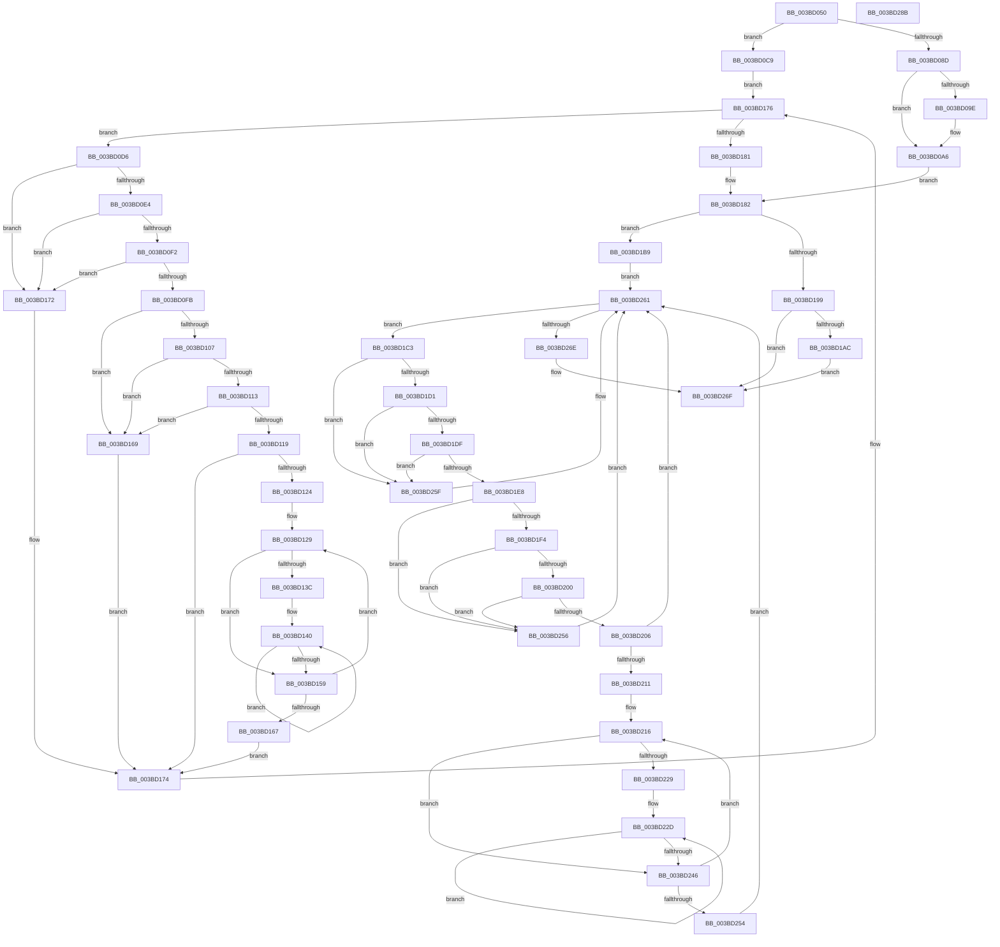

# MiUpdatePageThresholdsDpc

- RVA: `0x003BD050`–`0x003BD28C` (길이 `572` bytes)
- VA: `0x00000001403BD050`
- 실행 섹션: `.text`
- PDB 이름 있음: `예`; PDB Function 태그: `아니요`
- unwind 정보 RVA: `0x0008CE80`
- 디코드: `178`개 명령, `572/572` bytes 표시
- 미해석 바이트: `0` (있으면 어셈블리에 `.byte`로 보존)

> 이 문서는 커널 이미지의 기계어와 PDB 기호를 분석해 생성했습니다. 4번과 5번은 함수 원형과 자료형을 바이너리 사용 방식에서 추정한 C 해석이며 원본 소스 복구 결과는 아닙니다.

## 1. Dependencies

- 직접 호출 지점: **11**; 고유 호출 대상: **6**
- 직접 호출자로 확인된 함수: **0**
- RIP 상대 이미지 참조: **3**

### Outgoing calls
- `0x003BD0A1` → [KeWakeAddressAll](../21/KeWakeAddressAll_function_00217C20.md) (function, `0x00217C20`)
- `0x003BD0BF` → [MiUpdateAvailableEventsAtDpc](MiUpdateAvailableEventsAtDpc_function_003BC804.md) (function, `0x003BC804`)
- `0x003BD0F2` → [KiCheckVpBackingLongSpinWaitHypercall](../30/KiCheckVpBackingLongSpinWaitHypercall_function_0030F490.md) (function, `0x0030F490`)
- `0x003BD0FE` → [KeCanUseHaltOnAddress](../4F/KeCanUseHaltOnAddress_function_004FC22C.md) (function, `0x004FC22C`)
- `0x003BD14E` → [KiHaltOnAddress](../4F/KiHaltOnAddress_function_004FBA3C.md) (function, `0x004FBA3C`)
- `0x003BD16B` → [HvlNotifyLongSpinWait](../30/HvlNotifyLongSpinWait_function_0030F460.md) (function, `0x0030F460`)
- `0x003BD1AF` → [KeWakeAddressAll](../21/KeWakeAddressAll_function_00217C20.md) (function, `0x00217C20`)
- `0x003BD1DF` → [KiCheckVpBackingLongSpinWaitHypercall](../30/KiCheckVpBackingLongSpinWaitHypercall_function_0030F490.md) (function, `0x0030F490`)
- `0x003BD1EB` → [KeCanUseHaltOnAddress](../4F/KeCanUseHaltOnAddress_function_004FC22C.md) (function, `0x004FC22C`)
- `0x003BD23B` → [KiHaltOnAddress](../4F/KiHaltOnAddress_function_004FBA3C.md) (function, `0x004FBA3C`)
- `0x003BD258` → [HvlNotifyLongSpinWait](../30/HvlNotifyLongSpinWait_function_0030F460.md) (function, `0x0030F460`)

### Direct callers
- 이 함수 시작 RVA로 연결되는 직접 call은 확인되지 않았습니다. 간접 호출은 완전히 역산할 수 없습니다.

### Static image references
- `0x003BD0D8` → RVA `0x00FC52AC` (`ALMOSTRO`; reference)
- `0x003BD0E4` → RVA `0x00FC6AB8` (`ALMOSTRO`; read)
- `0x003BD107` → RVA `0x00FC6B38` (`ALMOSTRO`; read)

## 2. Other-region calls and transfers

- 다른 실행 섹션으로 향하는 call: **0**
- 별도 외부 분기/꼬리 이동을 확인하지 못했습니다.

## 3. Assembly (complete function range)

```asm
003BD050  48 89 5C 24 08                  mov qword ptr [rsp + 8], rbx
003BD055  48 89 6C 24 18                  mov qword ptr [rsp + 0x18], rbp
003BD05A  56                              push rsi
003BD05B  57                              push rdi
003BD05C  41 54                           push r12
003BD05E  41 55                           push r13
003BD060  41 56                           push r14
003BD062  48 83 EC 20                     sub rsp, 0x20
003BD066  49 8B D9                        mov rbx, r9
003BD069  4D 8B E0                        mov r12, r8
003BD06C  48 8B F2                        mov rsi, rdx
003BD06F  83 C8 FF                        or eax, 0xffffffff
003BD072  F0 41 0F C1 01                  lock xadd dword ptr [r9], eax
003BD077  FF C8                           dec eax
003BD079  41 BD 00 00 00 80               mov r13d, 0x80000000
003BD07F  8B F8                           mov edi, eax
003BD081  F7 D7                           not edi
003BD083  41 23 FD                        and edi, r13d
003BD086  A9 FF FF FF 3F                  test eax, 0x3fffffff
003BD08B  75 3C                           jne 0x1403bd0c9
003BD08D  41 0B 79 04                     or edi, dword ptr [r9 + 4]
003BD091  41 87 39                        xchg dword ptr [r9], edi
003BD094  89 7C 24 58                     mov dword ptr [rsp + 0x58], edi
003BD098  0F BA E7 1E                     bt edi, 0x1e
003BD09C  73 08                           jae 0x1403bd0a6
003BD09E  48 8B CB                        mov rcx, rbx
003BD0A1  E8 7A AB E5 FF                  call 0x140217c20
003BD0A6  48 8B 06                        mov rax, qword ptr [rsi]
003BD0A9  48 8B 4E 10                     mov rcx, qword ptr [rsi + 0x10]
003BD0AD  48 89 81 00 41 00 00            mov qword ptr [rcx + 0x4100], rax
003BD0B4  48 8B 46 08                     mov rax, qword ptr [rsi + 8]
003BD0B8  48 89 81 08 41 00 00            mov qword ptr [rcx + 0x4108], rax
003BD0BF  E8 40 F7 FF FF                  call 0x1403bc804
003BD0C4  E9 B9 00 00 00                  jmp 0x1403bd182
003BD0C9  41 8B 01                        mov eax, dword ptr [r9]
003BD0CC  33 ED                           xor ebp, ebp
003BD0CE  45 33 F6                        xor r14d, r14d
003BD0D1  E9 A0 00 00 00                  jmp 0x1403bd176
003BD0D6  FF C5                           inc ebp
003BD0D8  85 2D CE 81 C0 00               test dword ptr [rip + 0xc081ce], ebp
003BD0DE  0F 85 8E 00 00 00               jne 0x1403bd172
003BD0E4  8B 05 CE 99 C0 00               mov eax, dword ptr [rip + 0xc099ce]
003BD0EA  A8 40                           test al, 0x40
003BD0EC  0F 84 80 00 00 00               je 0x1403bd172
003BD0F2  E8 99 23 F5 FF                  call 0x14030f490
003BD0F7  84 C0                           test al, al
003BD0F9  74 77                           je 0x1403bd172
003BD0FB  41 FF C6                        inc r14d
003BD0FE  E8 29 F1 13 00                  call 0x1404fc22c
003BD103  84 C0                           test al, al
003BD105  74 62                           je 0x1403bd169
003BD107  F7 05 27 9A C0 00 00 00 02 00   test dword ptr [rip + 0xc09a27], 0x20000
003BD111  74 56                           je 0x1403bd169
003BD113  41 F6 C6 07                     test r14b, 7
003BD117  75 50                           jne 0x1403bd169
003BD119  8B 0B                           mov ecx, dword ptr [rbx]
003BD11B  8B C1                           mov eax, ecx
003BD11D  41 23 C5                        and eax, r13d
003BD120  3B C7                           cmp eax, edi
003BD122  74 50                           je 0x1403bd174
003BD124  8B D1                           mov edx, ecx
003BD126  44 8B C1                        mov r8d, ecx
003BD129  0F BA E9 1E                     bts ecx, 0x1e
003BD12D  8B C2                           mov eax, edx
003BD12F  8B F1                           mov esi, ecx
003BD131  F0 0F B1 33                     lock cmpxchg dword ptr [rbx], esi
003BD135  8B C8                           mov ecx, eax
003BD137  41 3B C0                        cmp eax, r8d
003BD13A  75 1D                           jne 0x1403bd159
003BD13C  89 74 24 58                     mov dword ptr [rsp + 0x58], esi
003BD140  41 B8 04 00 00 00               mov r8d, 4
003BD146  48 8D 54 24 58                  lea rdx, [rsp + 0x58]
003BD14B  48 8B CB                        mov rcx, rbx
003BD14E  E8 E9 E8 13 00                  call 0x1404fba3c
003BD153  8B 0B                           mov ecx, dword ptr [rbx]
003BD155  3B CE                           cmp ecx, esi
003BD157  74 E7                           je 0x1403bd140
003BD159  8B C1                           mov eax, ecx
003BD15B  8B D1                           mov edx, ecx
003BD15D  41 23 C5                        and eax, r13d
003BD160  44 8B C1                        mov r8d, ecx
003BD163  3B C7                           cmp eax, edi
003BD165  75 C2                           jne 0x1403bd129
003BD167  EB 0B                           jmp 0x1403bd174
003BD169  8B CD                           mov ecx, ebp
003BD16B  E8 F0 22 F5 FF                  call 0x14030f460
003BD170  EB 02                           jmp 0x1403bd174
003BD172  F3 90                           pause
003BD174  8B 03                           mov eax, dword ptr [rbx]
003BD176  41 23 C5                        and eax, r13d
003BD179  3B C7                           cmp eax, edi
003BD17B  0F 85 55 FF FF FF               jne 0x1403bd0d6
003BD181  90                              nop
003BD182  83 C8 FF                        or eax, 0xffffffff
003BD185  F0 0F C1 03                     lock xadd dword ptr [rbx], eax
003BD189  FF C8                           dec eax
003BD18B  8B F8                           mov edi, eax
003BD18D  F7 D7                           not edi
003BD18F  41 23 FD                        and edi, r13d
003BD192  A9 FF FF FF 3F                  test eax, 0x3fffffff
003BD197  75 20                           jne 0x1403bd1b9
003BD199  0B 7B 04                        or edi, dword ptr [rbx + 4]
003BD19C  87 3B                           xchg dword ptr [rbx], edi
003BD19E  89 7C 24 68                     mov dword ptr [rsp + 0x68], edi
003BD1A2  0F BA E7 1E                     bt edi, 0x1e
003BD1A6  0F 83 C3 00 00 00               jae 0x1403bd26f
003BD1AC  48 8B CB                        mov rcx, rbx
003BD1AF  E8 6C AA E5 FF                  call 0x140217c20
003BD1B4  E9 B6 00 00 00                  jmp 0x1403bd26f
003BD1B9  33 ED                           xor ebp, ebp
003BD1BB  45 33 F6                        xor r14d, r14d
003BD1BE  E9 9E 00 00 00                  jmp 0x1403bd261
003BD1C3  FF C5                           inc ebp
003BD1C5  85 2D E1 80 C0 00               test dword ptr [rip + 0xc080e1], ebp
003BD1CB  0F 85 8E 00 00 00               jne 0x1403bd25f
003BD1D1  8B 05 E1 98 C0 00               mov eax, dword ptr [rip + 0xc098e1]
003BD1D7  A8 40                           test al, 0x40
003BD1D9  0F 84 80 00 00 00               je 0x1403bd25f
003BD1DF  E8 AC 22 F5 FF                  call 0x14030f490
003BD1E4  84 C0                           test al, al
003BD1E6  74 77                           je 0x1403bd25f
003BD1E8  41 FF C6                        inc r14d
003BD1EB  E8 3C F0 13 00                  call 0x1404fc22c
003BD1F0  84 C0                           test al, al
003BD1F2  74 62                           je 0x1403bd256
003BD1F4  F7 05 3A 99 C0 00 00 00 02 00   test dword ptr [rip + 0xc0993a], 0x20000
003BD1FE  74 56                           je 0x1403bd256
003BD200  41 F6 C6 07                     test r14b, 7
003BD204  75 50                           jne 0x1403bd256
003BD206  8B 0B                           mov ecx, dword ptr [rbx]
003BD208  8B C1                           mov eax, ecx
003BD20A  41 23 C5                        and eax, r13d
003BD20D  3B C7                           cmp eax, edi
003BD20F  74 50                           je 0x1403bd261
003BD211  8B D1                           mov edx, ecx
003BD213  44 8B C1                        mov r8d, ecx
003BD216  0F BA E9 1E                     bts ecx, 0x1e
003BD21A  8B C2                           mov eax, edx
003BD21C  8B F1                           mov esi, ecx
003BD21E  F0 0F B1 33                     lock cmpxchg dword ptr [rbx], esi
003BD222  8B C8                           mov ecx, eax
003BD224  41 3B C0                        cmp eax, r8d
003BD227  75 1D                           jne 0x1403bd246
003BD229  89 74 24 68                     mov dword ptr [rsp + 0x68], esi
003BD22D  41 B8 04 00 00 00               mov r8d, 4
003BD233  48 8D 54 24 68                  lea rdx, [rsp + 0x68]
003BD238  48 8B CB                        mov rcx, rbx
003BD23B  E8 FC E7 13 00                  call 0x1404fba3c
003BD240  8B 0B                           mov ecx, dword ptr [rbx]
003BD242  3B CE                           cmp ecx, esi
003BD244  74 E7                           je 0x1403bd22d
003BD246  8B C1                           mov eax, ecx
003BD248  8B D1                           mov edx, ecx
003BD24A  41 23 C5                        and eax, r13d
003BD24D  44 8B C1                        mov r8d, ecx
003BD250  3B C7                           cmp eax, edi
003BD252  75 C2                           jne 0x1403bd216
003BD254  EB 0B                           jmp 0x1403bd261
003BD256  8B CD                           mov ecx, ebp
003BD258  E8 03 22 F5 FF                  call 0x14030f460
003BD25D  EB 02                           jmp 0x1403bd261
003BD25F  F3 90                           pause
003BD261  8B 03                           mov eax, dword ptr [rbx]
003BD263  41 23 C5                        and eax, r13d
003BD266  3B C7                           cmp eax, edi
003BD268  0F 85 55 FF FF FF               jne 0x1403bd1c3
003BD26E  90                              nop
003BD26F  F0 41 FF 0C 24                  lock dec dword ptr [r12]
003BD274  48 8B 5C 24 50                  mov rbx, qword ptr [rsp + 0x50]
003BD279  48 8B 6C 24 60                  mov rbp, qword ptr [rsp + 0x60]
003BD27E  48 83 C4 20                     add rsp, 0x20
003BD282  41 5E                           pop r14
003BD284  41 5D                           pop r13
003BD286  41 5C                           pop r12
003BD288  5F                              pop rdi
003BD289  5E                              pop rsi
003BD28A  C3                              ret
003BD28B  CC                              int3
```

## 4. C-style interpretation (structured pseudocode)

```c
__int64 __fastcall MiUpdatePageThresholdsDpc(__int64 a1, __int64 a2, __int64 a3, __int64 a4)
{
    __int64 result;
    __int64 v_r14;
    __int64 v_rbp;
    __int64 v_rdi;
    __int64 v_rsp;
    unsigned int v_stack_p10;
    unsigned __int64 v_stack_p18;
    unsigned int v_stack_p20;
    unsigned __int64 v_stack_p8;

    v_stack_p8 = v_rbx;
    v_stack_p18 = v_rbp;
    v_rsp = (v_rsp) - (32);
    result = (unsigned int)((result) | (0xFFFFFFFFULL));
    result = (unsigned int)((result) - 1);
    v_rdi = (unsigned int)(~((unsigned int)((unsigned int)(result))));
    v_rdi = (unsigned int)((v_rdi) & ((unsigned int)((unsigned int)(0x80000000ULL))));
    if ((((unsigned int)(result)) & (0x3FFFFFFFULL)) != 0) goto loc_003BD0C9;
    v_rdi = (unsigned int)((v_rdi) | (*(unsigned int *)(a4 + 4)));
    v_stack_p10 = (unsigned int)(v_rdi);
    if (!(condition_is_above_or_equal)) {
        a1 = a4;
        result = KeWakeAddressAll(a1, a2, a3, a4);
    }
    *(unsigned __int64 *)(*(unsigned __int64 *)(a2 + 16) + 16640) = *(unsigned __int64 *)(a2);
    *(unsigned __int64 *)(*(unsigned __int64 *)(a2 + 16) + 16648) = *(unsigned __int64 *)(a2 + 8);
    result = MiUpdateAvailableEventsAtDpc(*(unsigned __int64 *)(a2 + 16), a2, a3, a4);
    goto loc_003BD182;
loc_003BD0C9:
    v_rbp = 0;
    v_r14 = 0;
    goto loc_003BD176;
loc_003BD0D6:
    v_rbp = (unsigned int)((v_rbp) + 1);
    if (((*(unsigned int *)(v_rip + 12616142)) & ((unsigned int)(v_rbp))) != 0) goto loc_003BD172;
    if ((((unsigned __int8)((unsigned int)(*(unsigned int *)(v_rip + 12622286)))) & (64)) == 0) goto loc_003BD172;
    result = KiCheckVpBackingLongSpinWaitHypercall(*(unsigned __int64 *)(a2 + 16), a2, a3, a4);
    if ((unsigned __int8)(result) == 0) goto loc_003BD172;
    v_r14 = (unsigned int)((v_r14) + 1);
    result = KeCanUseHaltOnAddress(*(unsigned __int64 *)(a2 + 16), a2, a3, a4);
    if ((unsigned __int8)(result) == 0) goto loc_003BD169;
    if (((*(unsigned int *)(v_rip + 12622375)) & (0x20000ULL)) == 0) goto loc_003BD169;
    if ((((unsigned __int8)(v_r14)) & (7)) != 0) goto loc_003BD169;
    result = (unsigned int)(((unsigned int)((unsigned int)((unsigned int)(*(unsigned int *)(a4))))) & ((unsigned int)((unsigned int)(0x80000000ULL))));
    if (((unsigned int)(result)) == ((unsigned int)(v_rdi))) goto loc_003BD174;
loc_003BD129:
    if (((unsigned int)((unsigned int)((unsigned int)((unsigned int)((unsigned int)((unsigned int)(*(unsigned int *)(a4)))))))) != ((unsigned int)((unsigned int)((unsigned int)((unsigned int)(*(unsigned int *)(a4))))))) goto loc_003BD159;
    v_stack_p10 = (unsigned int)((unsigned int)((unsigned int)((unsigned int)(*(unsigned int *)(a4)))));
loc_003BD140:
    result = KiHaltOnAddress(a4, v_stack_p10, 4, a4);
    if (((unsigned int)((unsigned int)(*(unsigned int *)(a4)))) == ((unsigned int)((unsigned int)((unsigned int)((unsigned int)(*(unsigned int *)(a4))))))) goto loc_003BD140;
loc_003BD159:
    result = (unsigned int)(((unsigned int)((unsigned int)((unsigned int)(*(unsigned int *)(a4))))) & ((unsigned int)((unsigned int)(0x80000000ULL))));
    if (((unsigned int)(result)) != ((unsigned int)(v_rdi))) goto loc_003BD129;
    goto loc_003BD174;
loc_003BD169:
    result = HvlNotifyLongSpinWait((unsigned int)((unsigned int)(v_rbp)), (unsigned int)((unsigned int)((unsigned int)(*(unsigned int *)(a4)))), (unsigned int)((unsigned int)((unsigned int)(*(unsigned int *)(a4)))), a4);
    goto loc_003BD174;
loc_003BD172:
loc_003BD174:
loc_003BD176:
    result = (unsigned int)(((unsigned int)(*(unsigned int *)(a4))) & ((unsigned int)((unsigned int)(0x80000000ULL))));
    if (((unsigned int)(result)) != ((unsigned int)(v_rdi))) goto loc_003BD0D6;
loc_003BD182:
    result = (unsigned int)((result) | (0xFFFFFFFFULL));
    result = (unsigned int)((result) - 1);
    v_rdi = (unsigned int)(~((unsigned int)((unsigned int)(result))));
    v_rdi = (unsigned int)((v_rdi) & ((unsigned int)((unsigned int)(0x80000000ULL))));
    if ((((unsigned int)(result)) & (0x3FFFFFFFULL)) != 0) goto loc_003BD1B9;
    v_rdi = (unsigned int)((v_rdi) | (*(unsigned int *)(a4 + 4)));
    v_stack_p20 = (unsigned int)(v_rdi);
    if (condition_is_above_or_equal) goto loc_003BD26F;
    result = KeWakeAddressAll(a4, (unsigned int)((unsigned int)((unsigned int)(*(unsigned int *)(a4)))), (unsigned int)((unsigned int)((unsigned int)(*(unsigned int *)(a4)))), a4);
    goto loc_003BD26F;
loc_003BD1B9:
    v_rbp = 0;
    v_r14 = 0;
    goto loc_003BD261;
loc_003BD1C3:
    v_rbp = (unsigned int)((v_rbp) + 1);
    if (((*(unsigned int *)(v_rip + 12615905)) & ((unsigned int)(v_rbp))) != 0) goto loc_003BD25F;
    if ((((unsigned __int8)((unsigned int)(*(unsigned int *)(v_rip + 12622049)))) & (64)) == 0) goto loc_003BD25F;
    result = KiCheckVpBackingLongSpinWaitHypercall(a4, (unsigned int)((unsigned int)((unsigned int)(*(unsigned int *)(a4)))), (unsigned int)((unsigned int)((unsigned int)(*(unsigned int *)(a4)))), a4);
    if ((unsigned __int8)(result) == 0) goto loc_003BD25F;
    v_r14 = (unsigned int)((v_r14) + 1);
    result = KeCanUseHaltOnAddress(a4, (unsigned int)((unsigned int)((unsigned int)(*(unsigned int *)(a4)))), (unsigned int)((unsigned int)((unsigned int)(*(unsigned int *)(a4)))), a4);
    if ((unsigned __int8)(result) == 0) goto loc_003BD256;
    if (((*(unsigned int *)(v_rip + 12622138)) & (0x20000ULL)) == 0) goto loc_003BD256;
    if ((((unsigned __int8)(v_r14)) & (7)) != 0) goto loc_003BD256;
    result = (unsigned int)(((unsigned int)((unsigned int)((unsigned int)(*(unsigned int *)(a4))))) & ((unsigned int)((unsigned int)(0x80000000ULL))));
    if (((unsigned int)(result)) == ((unsigned int)(v_rdi))) goto loc_003BD261;
loc_003BD216:
    if (((unsigned int)((unsigned int)((unsigned int)((unsigned int)((unsigned int)((unsigned int)(*(unsigned int *)(a4)))))))) != ((unsigned int)((unsigned int)((unsigned int)((unsigned int)(*(unsigned int *)(a4))))))) goto loc_003BD246;
    v_stack_p20 = (unsigned int)((unsigned int)((unsigned int)((unsigned int)(*(unsigned int *)(a4)))));
loc_003BD22D:
    result = KiHaltOnAddress(a4, v_stack_p20, 4, a4);
    if (((unsigned int)((unsigned int)(*(unsigned int *)(a4)))) == ((unsigned int)((unsigned int)((unsigned int)((unsigned int)(*(unsigned int *)(a4))))))) goto loc_003BD22D;
loc_003BD246:
    result = (unsigned int)(((unsigned int)((unsigned int)((unsigned int)(*(unsigned int *)(a4))))) & ((unsigned int)((unsigned int)(0x80000000ULL))));
    if (((unsigned int)(result)) != ((unsigned int)(v_rdi))) goto loc_003BD216;
    goto loc_003BD261;
loc_003BD256:
    result = HvlNotifyLongSpinWait((unsigned int)((unsigned int)(v_rbp)), (unsigned int)((unsigned int)((unsigned int)(*(unsigned int *)(a4)))), (unsigned int)((unsigned int)((unsigned int)(*(unsigned int *)(a4)))), a4);
    goto loc_003BD261;
loc_003BD25F:
loc_003BD261:
    result = (unsigned int)(((unsigned int)(*(unsigned int *)(a4))) & ((unsigned int)((unsigned int)(0x80000000ULL))));
    if (((unsigned int)(result)) != ((unsigned int)(v_rdi))) goto loc_003BD1C3;
loc_003BD26F:
    v_rsp = (v_rsp) + (32);
    return result;
}
```

## 5. (Beta) C Style

```c
int64_t MiUpdatePageThresholdsDpc(int64_t Arg1, void *Arg2, void *Arg3, void *Arg4)
{
    uint8_t *arg2 = (uint8_t *)Arg2;
    uint8_t *arg3 = (uint8_t *)Arg3;
    uint8_t *arg4 = (uint8_t *)Arg4;

    int64_t result;
    int64_t local_r14;
    int64_t local_rbp;
    int64_t local_rdi;
    int64_t local_rsp;
    uint32_t v_stack_p10;
    uint64_t v_stack_p18;
    uint32_t v_stack_p20;
    uint64_t v_stack_p8;

    v_stack_p8 = local_rbx;
    v_stack_p18 = local_rbp;
    local_rsp = (local_rsp) - (32);
    result = (uint32_t)((result) | (0xFFFFFFFFULL));
    result = (uint32_t)((result) - 1);
    local_rdi = (uint32_t)(~((uint32_t)((uint32_t)(result))));
    local_rdi = (uint32_t)((local_rdi) & ((uint32_t)((uint32_t)(0x80000000ULL))));
    if ((((uint32_t)(result)) & (0x3FFFFFFFULL)) != 0) goto loc_003BD0C9;
    local_rdi = (uint32_t)((local_rdi) | (*(uint32_t *)(arg4 + 0x4)));
    v_stack_p10 = (uint32_t)(local_rdi);
    if (!(condition_is_above_or_equal)) {
        Arg1 = Arg4;
        result = KeWakeAddressAll(Arg1, Arg2, Arg3, Arg4);
    }
    *(uint64_t *)(*(uint64_t *)(arg2 + 0x10) + 0x4100) = *(uint64_t *)(arg2);
    *(uint64_t *)(*(uint64_t *)(arg2 + 0x10) + 0x4108) = *(uint64_t *)(arg2 + 0x8);
    result = MiUpdateAvailableEventsAtDpc(*(uint64_t *)(arg2 + 0x10), Arg2, Arg3, Arg4);
    goto loc_003BD182;
loc_003BD0C9:
    local_rbp = 0;
    local_r14 = 0;
    goto loc_003BD176;
loc_003BD0D6:
    local_rbp = (uint32_t)((local_rbp) + 1);
    if (((*(uint32_t *)(v_rip + 0xC081CE)) & ((uint32_t)(local_rbp))) != 0) goto loc_003BD172;
    if ((((uint8_t)((uint32_t)(*(uint32_t *)(v_rip + 0xC099CE)))) & (64)) == 0) goto loc_003BD172;
    result = KiCheckVpBackingLongSpinWaitHypercall(*(uint64_t *)(arg2 + 0x10), Arg2, Arg3, Arg4);
    if ((uint8_t)(result) == 0) goto loc_003BD172;
    local_r14 = (uint32_t)((local_r14) + 1);
    result = KeCanUseHaltOnAddress(*(uint64_t *)(arg2 + 0x10), Arg2, Arg3, Arg4);
    if ((uint8_t)(result) == 0) goto loc_003BD169;
    if (((*(uint32_t *)(v_rip + 0xC09A27)) & (0x20000ULL)) == 0) goto loc_003BD169;
    if ((((uint8_t)(local_r14)) & (7)) != 0) goto loc_003BD169;
    result = (uint32_t)(((uint32_t)((uint32_t)((uint32_t)(*(uint32_t *)(arg4))))) & ((uint32_t)((uint32_t)(0x80000000ULL))));
    if (((uint32_t)(result)) == ((uint32_t)(local_rdi))) goto loc_003BD174;
loc_003BD129:
    if (((uint32_t)((uint32_t)((uint32_t)((uint32_t)((uint32_t)((uint32_t)(*(uint32_t *)(arg4)))))))) != ((uint32_t)((uint32_t)((uint32_t)((uint32_t)(*(uint32_t *)(arg4))))))) goto loc_003BD159;
    v_stack_p10 = (uint32_t)((uint32_t)((uint32_t)((uint32_t)(*(uint32_t *)(arg4)))));
loc_003BD140:
    result = KiHaltOnAddress(Arg4, v_stack_p10, 4, Arg4);
    if (((uint32_t)((uint32_t)(*(uint32_t *)(arg4)))) == ((uint32_t)((uint32_t)((uint32_t)((uint32_t)(*(uint32_t *)(arg4))))))) goto loc_003BD140;
loc_003BD159:
    result = (uint32_t)(((uint32_t)((uint32_t)((uint32_t)(*(uint32_t *)(arg4))))) & ((uint32_t)((uint32_t)(0x80000000ULL))));
    if (((uint32_t)(result)) != ((uint32_t)(local_rdi))) goto loc_003BD129;
    goto loc_003BD174;
loc_003BD169:
    result = HvlNotifyLongSpinWait((uint32_t)((uint32_t)(local_rbp)), (uint32_t)((uint32_t)((uint32_t)(*(uint32_t *)(arg4)))), (uint32_t)((uint32_t)((uint32_t)(*(uint32_t *)(arg4)))), Arg4);
    goto loc_003BD174;
loc_003BD172:
loc_003BD174:
loc_003BD176:
    result = (uint32_t)(((uint32_t)(*(uint32_t *)(arg4))) & ((uint32_t)((uint32_t)(0x80000000ULL))));
    if (((uint32_t)(result)) != ((uint32_t)(local_rdi))) goto loc_003BD0D6;
loc_003BD182:
    result = (uint32_t)((result) | (0xFFFFFFFFULL));
    result = (uint32_t)((result) - 1);
    local_rdi = (uint32_t)(~((uint32_t)((uint32_t)(result))));
    local_rdi = (uint32_t)((local_rdi) & ((uint32_t)((uint32_t)(0x80000000ULL))));
    if ((((uint32_t)(result)) & (0x3FFFFFFFULL)) != 0) goto loc_003BD1B9;
    local_rdi = (uint32_t)((local_rdi) | (*(uint32_t *)(arg4 + 0x4)));
    v_stack_p20 = (uint32_t)(local_rdi);
    if (condition_is_above_or_equal) goto loc_003BD26F;
    result = KeWakeAddressAll(Arg4, (uint32_t)((uint32_t)((uint32_t)(*(uint32_t *)(arg4)))), (uint32_t)((uint32_t)((uint32_t)(*(uint32_t *)(arg4)))), Arg4);
    goto loc_003BD26F;
loc_003BD1B9:
    local_rbp = 0;
    local_r14 = 0;
    goto loc_003BD261;
loc_003BD1C3:
    local_rbp = (uint32_t)((local_rbp) + 1);
    if (((*(uint32_t *)(v_rip + 0xC080E1)) & ((uint32_t)(local_rbp))) != 0) goto loc_003BD25F;
    if ((((uint8_t)((uint32_t)(*(uint32_t *)(v_rip + 0xC098E1)))) & (64)) == 0) goto loc_003BD25F;
    result = KiCheckVpBackingLongSpinWaitHypercall(Arg4, (uint32_t)((uint32_t)((uint32_t)(*(uint32_t *)(arg4)))), (uint32_t)((uint32_t)((uint32_t)(*(uint32_t *)(arg4)))), Arg4);
    if ((uint8_t)(result) == 0) goto loc_003BD25F;
    local_r14 = (uint32_t)((local_r14) + 1);
    result = KeCanUseHaltOnAddress(Arg4, (uint32_t)((uint32_t)((uint32_t)(*(uint32_t *)(arg4)))), (uint32_t)((uint32_t)((uint32_t)(*(uint32_t *)(arg4)))), Arg4);
    if ((uint8_t)(result) == 0) goto loc_003BD256;
    if (((*(uint32_t *)(v_rip + 0xC0993A)) & (0x20000ULL)) == 0) goto loc_003BD256;
    if ((((uint8_t)(local_r14)) & (7)) != 0) goto loc_003BD256;
    result = (uint32_t)(((uint32_t)((uint32_t)((uint32_t)(*(uint32_t *)(arg4))))) & ((uint32_t)((uint32_t)(0x80000000ULL))));
    if (((uint32_t)(result)) == ((uint32_t)(local_rdi))) goto loc_003BD261;
loc_003BD216:
    if (((uint32_t)((uint32_t)((uint32_t)((uint32_t)((uint32_t)((uint32_t)(*(uint32_t *)(arg4)))))))) != ((uint32_t)((uint32_t)((uint32_t)((uint32_t)(*(uint32_t *)(arg4))))))) goto loc_003BD246;
    v_stack_p20 = (uint32_t)((uint32_t)((uint32_t)((uint32_t)(*(uint32_t *)(arg4)))));
loc_003BD22D:
    result = KiHaltOnAddress(Arg4, v_stack_p20, 4, Arg4);
    if (((uint32_t)((uint32_t)(*(uint32_t *)(arg4)))) == ((uint32_t)((uint32_t)((uint32_t)((uint32_t)(*(uint32_t *)(arg4))))))) goto loc_003BD22D;
loc_003BD246:
    result = (uint32_t)(((uint32_t)((uint32_t)((uint32_t)(*(uint32_t *)(arg4))))) & ((uint32_t)((uint32_t)(0x80000000ULL))));
    if (((uint32_t)(result)) != ((uint32_t)(local_rdi))) goto loc_003BD216;
    goto loc_003BD261;
loc_003BD256:
    result = HvlNotifyLongSpinWait((uint32_t)((uint32_t)(local_rbp)), (uint32_t)((uint32_t)((uint32_t)(*(uint32_t *)(arg4)))), (uint32_t)((uint32_t)((uint32_t)(*(uint32_t *)(arg4)))), Arg4);
    goto loc_003BD261;
loc_003BD25F:
loc_003BD261:
    result = (uint32_t)(((uint32_t)(*(uint32_t *)(arg4))) & ((uint32_t)((uint32_t)(0x80000000ULL))));
    if (((uint32_t)(result)) != ((uint32_t)(local_rdi))) goto loc_003BD1C3;
loc_003BD26F:
    local_rsp = (local_rsp) + (32);
    return result;
}
```

### 관측된 메모리 오프셋

구조체 형식이 확인되지 않은 접근은 인자 기준의 오프셋으로만 기록했습니다.

| 기준 인자 | 오프셋 표현 | 폭 (bit) | 접근 |
|---|---:|---:|---|
| `Arg2` | `+ 0x0` | `64` | `R` |
| `Arg2` | `+ 0x8` | `64` | `R` |
| `Arg2` | `+ 0x10` | `64` | `R` |
| `Arg3` | `+ 0x0` | `32` | `R/W` |
| `Arg4` | `+ 0x0` | `32` | `R` |
| `Arg4` | `+ 0x0` | `32` | `R/W` |
| `Arg4` | `+ 0x4` | `32` | `R` |

## 6. Execution-region graph

[열기: 2D/3D 그래프와 함수 탐색 컨트롤 패널](../../../control-panel.html?section=text&rva=0x003BD050&view=graph)

- 2D 그래프는 위에서 아래로 흐르고, 3D 그래프는 빈 공간을 드래그해 회전합니다. Shift+드래그는 이동, 휠은 확대·축소, 함수 노드 선택은 대상 보고서 이동입니다.

### Static fallback


