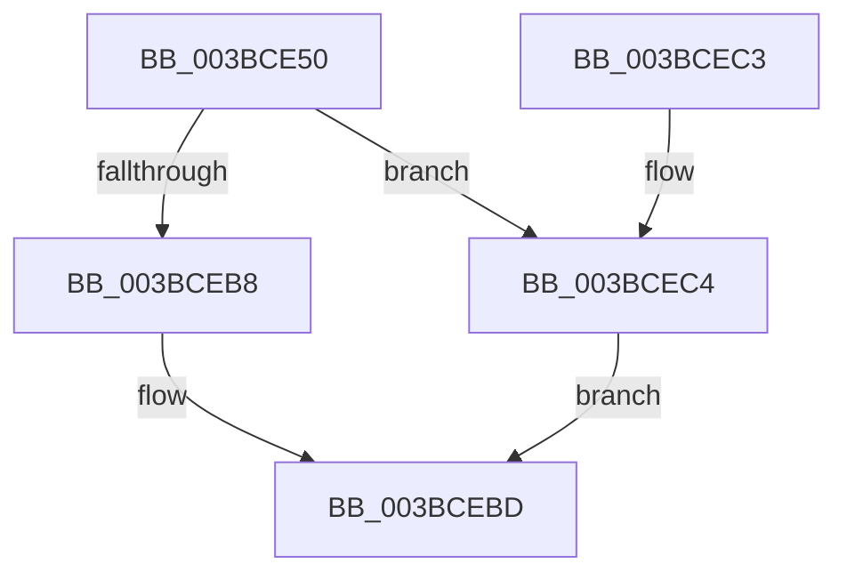

# MiUpdateZeroFreeBitmap

- RVA: `0x003BCE50`–`0x003BCECE` (길이 `126` bytes)
- VA: `0x00000001403BCE50`
- 실행 섹션: `.text`
- PDB 이름 있음: `예`; PDB Function 태그: `아니요`
- unwind 정보 RVA: `0x0008CE74`
- 디코드: `36`개 명령, `126/126` bytes 표시
- 미해석 바이트: `0` (있으면 어셈블리에 `.byte`로 보존)

> 이 문서는 커널 이미지의 기계어와 PDB 기호를 분석해 생성했습니다. 4번과 5번은 함수 원형과 자료형을 바이너리 사용 방식에서 추정한 C 해석이며 원본 소스 복구 결과는 아닙니다.

## 1. Dependencies

- 직접 호출 지점: **0**; 고유 호출 대상: **0**
- 직접 호출자로 확인된 함수: **1**
- RIP 상대 이미지 참조: **0**

### Outgoing calls
- 직접 디코드된 call 명령이 없습니다.

### Direct callers
- [MiReplenishPageSlist](MiReplenishPageSlist_function_003BADE0.md) at `0x003BB0A7`

### Static image references
- 디코드된 RIP-relative 메모리 참조가 없습니다.

## 2. Other-region calls and transfers

- 다른 실행 섹션으로 향하는 call: **0**
- 별도 외부 분기/꼬리 이동을 확인하지 못했습니다.

## 3. Assembly (complete function range)

```asm
003BCE50  48 89 5C 24 08                  mov qword ptr [rsp + 8], rbx
003BCE55  8B 42 08                        mov eax, dword ptr [rdx + 8]
003BCE58  4C 8B D9                        mov r11, rcx
003BCE5B  44 0F B6 D0                     movzx r10d, al
003BCE5F  44 8B C8                        mov r9d, eax
003BCE62  41 0F B6 CA                     movzx ecx, r10b
003BCE66  49 C1 E9 10                     shr r9, 0x10
003BCE6A  80 E1 3F                        and cl, 0x3f
003BCE6D  49 C1 EA 06                     shr r10, 6
003BCE71  41 83 E1 03                     and r9d, 3
003BCE75  41 8B D8                        mov ebx, r8d
003BCE78  BA 01 00 00 00                  mov edx, 1
003BCE7D  48 D3 E2                        shl rdx, cl
003BCE80  8B C8                           mov ecx, eax
003BCE82  48 C1 E9 0F                     shr rcx, 0xf
003BCE86  83 E1 01                        and ecx, 1
003BCE89  4F 8D 04 89                     lea r8, [r9 + r9*4]
003BCE8D  4E 8D 0C 41                     lea r9, [rcx + r8*2]
003BCE91  8B C8                           mov ecx, eax
003BCE93  48 C1 E8 14                     shr rax, 0x14
003BCE97  83 E0 01                        and eax, 1
003BCE9A  48 C1 E9 12                     shr rcx, 0x12
003BCE9E  83 E1 03                        and ecx, 3
003BCEA1  4E 8D 04 89                     lea r8, [rcx + r9*4]
003BCEA5  4A 8D 04 40                     lea rax, [rax + r8*2]
003BCEA9  48 03 C0                        add rax, rax
003BCEAC  49 8B 84 C3 88 00 00 00         mov rax, qword ptr [r11 + rax*8 + 0x88]
003BCEB4  85 DB                           test ebx, ebx
003BCEB6  74 0C                           je 0x1403bcec4
003BCEB8  F0 4A 09 14 D0                  lock or qword ptr [rax + r10*8], rdx
003BCEBD  48 8B 5C 24 08                  mov rbx, qword ptr [rsp + 8]
003BCEC2  C3                              ret
003BCEC3  CC                              int3
003BCEC4  48 F7 D2                        not rdx
003BCEC7  F0 4A 21 14 D0                  lock and qword ptr [rax + r10*8], rdx
003BCECC  EB EF                           jmp 0x1403bcebd
```

## 4. C-style interpretation (structured pseudocode)

```c
__int64 __fastcall MiUpdateZeroFreeBitmap(__int64 a1, __int64 a2, int a3)
{
    __int64 result;
    __int64 v_r10;
    unsigned __int64 v_stack_p8;

    v_stack_p8 = v_rbx;
    a4 = ((unsigned int)((unsigned int)((unsigned int)(*(unsigned int *)(a2 + 8))))) >> (16);
    a1 = (unsigned __int8)(((unsigned __int8)((unsigned __int8)((unsigned int)(*(unsigned int *)(a2 + 8))))) & (63));
    v_r10 = ((unsigned __int8)((unsigned int)(*(unsigned int *)(a2 + 8)))) >> (6);
    a4 = (unsigned int)((a4) & (3));
    a2 = (1) << ((unsigned __int8)(a1));
    a1 = ((unsigned int)((unsigned int)((unsigned int)(*(unsigned int *)(a2 + 8))))) >> (15);
    a1 = (unsigned int)((a1) & (1));
    result = ((unsigned int)(*(unsigned int *)(a2 + 8))) >> (20);
    result = (unsigned int)((result) & (1));
    a1 = ((unsigned int)((unsigned int)((unsigned int)(*(unsigned int *)(a2 + 8))))) >> (18);
    a1 = (unsigned int)((a1) & (3));
    result = (result + a1 + a1 + a4 + a4 * 4 * 2 * 4 * 2) + (result + a1 + a1 + a4 + a4 * 4 * 2 * 4 * 2);
    if ((unsigned int)((unsigned int)(a3)) == 0) goto loc_003BCEC4;
loc_003BCEBD:
    return *(unsigned __int64 *)(a1 + result * 8 + 136);
loc_003BCEC4:
    a2 = ~(a2);
    goto loc_003BCEBD;
}
```

## 5. (Beta) C Style

```c
int64_t MiUpdateZeroFreeBitmap(void *Arg1, void *Arg2, int32_t Arg3)
{
    uint8_t *arg1 = (uint8_t *)Arg1;
    uint8_t *arg2 = (uint8_t *)Arg2;

    int64_t result;
    int64_t local_r10;
    uint64_t v_stack_p8;

    v_stack_p8 = local_rbx;
    a4 = ((uint32_t)((uint32_t)((uint32_t)(*(uint32_t *)(arg2 + 0x8))))) >> (16);
    Arg1 = (uint8_t)(((uint8_t)((uint8_t)((uint32_t)(*(uint32_t *)(arg2 + 0x8))))) & (63));
    local_r10 = ((uint8_t)((uint32_t)(*(uint32_t *)(arg2 + 0x8)))) >> (6);
    a4 = (uint32_t)((a4) & (3));
    Arg2 = (1) << ((uint8_t)(Arg1));
    Arg1 = ((uint32_t)((uint32_t)((uint32_t)(*(uint32_t *)(arg2 + 0x8))))) >> (15);
    Arg1 = (uint32_t)((Arg1) & (1));
    result = ((uint32_t)(*(uint32_t *)(arg2 + 0x8))) >> (20);
    result = (uint32_t)((result) & (1));
    Arg1 = ((uint32_t)((uint32_t)((uint32_t)(*(uint32_t *)(arg2 + 0x8))))) >> (18);
    Arg1 = (uint32_t)((Arg1) & (3));
    result = (result + Arg1 + Arg1 + a4 + a4 * 4 * 2 * 4 * 2) + (result + Arg1 + Arg1 + a4 + a4 * 4 * 2 * 4 * 2);
    if ((uint32_t)((uint32_t)(Arg3)) == 0) goto loc_003BCEC4;
loc_003BCEBD:
    return *(uint64_t *)(arg1 + result * 8 + 0x88);
loc_003BCEC4:
    Arg2 = ~(Arg2);
    goto loc_003BCEBD;
}
```

### 관측된 메모리 오프셋

구조체 형식이 확인되지 않은 접근은 인자 기준의 오프셋으로만 기록했습니다.

| 기준 인자 | 오프셋 표현 | 폭 (bit) | 접근 |
|---|---:|---:|---|
| `Arg1` | `+ 0x88 + rax*8` | `64` | `R` |
| `Arg2` | `+ 0x8` | `32` | `R` |

## 6. Execution-region graph

[열기: 2D/3D 그래프와 함수 탐색 컨트롤 패널](../../../control-panel.html?section=text&rva=0x003BCE50&view=graph)

- 2D 그래프는 위에서 아래로 흐르고, 3D 그래프는 빈 공간을 드래그해 회전합니다. Shift+드래그는 이동, 휠은 확대·축소, 함수 노드 선택은 대상 보고서 이동입니다.

### Static fallback


