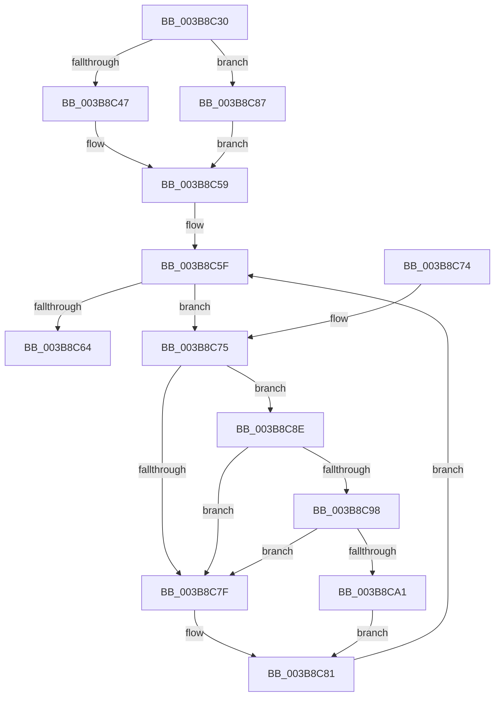

# MiWaitForPageMoveComplete

- RVA: `0x003B8C30`–`0x003B8CAA` (길이 `122` bytes)
- VA: `0x00000001403B8C30`
- 실행 섹션: `.text`
- PDB 이름 있음: `예`; PDB Function 태그: `아니요`
- unwind 정보 RVA: `0x00070298`
- 디코드: `39`개 명령, `122/122` bytes 표시
- 미해석 바이트: `0` (있으면 어셈블리에 `.byte`로 보존)

> 이 문서는 커널 이미지의 기계어와 PDB 기호를 분석해 생성했습니다. 4번과 5번은 함수 원형과 자료형을 바이너리 사용 방식에서 추정한 C 해석이며 원본 소스 복구 결과는 아닙니다.

## 1. Dependencies

- 직접 호출 지점: **2**; 고유 호출 대상: **2**
- 직접 호출자로 확인된 함수: **5**
- RIP 상대 이미지 참조: **2**

### Outgoing calls
- `0x003B8C98` → [KiCheckVpBackingLongSpinWaitHypercall](../30/KiCheckVpBackingLongSpinWaitHypercall_function_0030F490.md) (function, `0x0030F490`)
- `0x003B8CA3` → [HvlNotifyLongSpinWait](../30/HvlNotifyLongSpinWait_function_0030F460.md) (function, `0x0030F460`)

### Direct callers
- [MiTradePage](../28/MiTradePage_function_0028D160.md) at `0x0028D7F4`
- [MiGetLargePageDemoteAsNeeded](MiGetLargePageDemoteAsNeeded_function_003B8440.md) at `0x003B857D`
- [MiGetPartitionNodePageCounts](MiGetPartitionNodePageCounts_function_003B8B0C.md) at `0x003B8BBB`
- [MiGetHugeRange](../67/MiGetHugeRange_function_00675954.md) at `0x00675A2A`
- [MiTryUnlinkNodeLargePages](../68/MiTryUnlinkNodeLargePages_function_0068ADA0.md) at `0x0068AFC3`

### Static image references
- `0x003B8C77` → RVA `0x00FC52AC` (`ALMOSTRO`; reference)
- `0x003B8C8E` → RVA `0x00FC6AB8` (`ALMOSTRO`; read)

## 2. Other-region calls and transfers

- 다른 실행 섹션으로 향하는 call: **0**
- 별도 외부 분기/꼬리 이동을 확인하지 못했습니다.

## 3. Assembly (complete function range)

```asm
003B8C30  48 89 5C 24 08                  mov qword ptr [rsp + 8], rbx
003B8C35  48 89 74 24 10                  mov qword ptr [rsp + 0x10], rsi
003B8C3A  57                              push rdi
003B8C3B  48 83 EC 20                     sub rsp, 0x20
003B8C3F  48 8B F1                        mov rsi, rcx
003B8C42  F6 C2 04                        test dl, 4
003B8C45  75 40                           jne 0x1403b8c87
003B8C47  80 E2 01                        and dl, 1
003B8C4A  F6 DA                           neg dl
003B8C4C  48 1B DB                        sbb rbx, rbx
003B8C4F  83 E3 08                        and ebx, 8
003B8C52  48 81 C3 58 3B 00 00            add rbx, 0x3b58
003B8C59  48 8B 04 0B                     mov rax, qword ptr [rbx + rcx]
003B8C5D  33 FF                           xor edi, edi
003B8C5F  66 85 C0                        test ax, ax
003B8C62  75 11                           jne 0x1403b8c75
003B8C64  48 8B 5C 24 30                  mov rbx, qword ptr [rsp + 0x30]
003B8C69  48 8B 74 24 38                  mov rsi, qword ptr [rsp + 0x38]
003B8C6E  48 83 C4 20                     add rsp, 0x20
003B8C72  5F                              pop rdi
003B8C73  C3                              ret
003B8C74  CC                              int3
003B8C75  FF C7                           inc edi
003B8C77  85 3D 2F C6 C0 00               test dword ptr [rip + 0xc0c62f], edi
003B8C7D  74 0F                           je 0x1403b8c8e
003B8C7F  F3 90                           pause
003B8C81  48 8B 04 33                     mov rax, qword ptr [rbx + rsi]
003B8C85  EB D8                           jmp 0x1403b8c5f
003B8C87  BB 68 3B 00 00                  mov ebx, 0x3b68
003B8C8C  EB CB                           jmp 0x1403b8c59
003B8C8E  8B 05 24 DE C0 00               mov eax, dword ptr [rip + 0xc0de24]
003B8C94  A8 40                           test al, 0x40
003B8C96  74 E7                           je 0x1403b8c7f
003B8C98  E8 F3 67 F5 FF                  call 0x14030f490
003B8C9D  84 C0                           test al, al
003B8C9F  74 DE                           je 0x1403b8c7f
003B8CA1  8B CF                           mov ecx, edi
003B8CA3  E8 B8 67 F5 FF                  call 0x14030f460
003B8CA8  EB D7                           jmp 0x1403b8c81
```

## 4. C-style interpretation (structured pseudocode)

```c
__int64 __fastcall MiWaitForPageMoveComplete(__int64 a1, unsigned __int8 a2)
{
    __int64 result;
    __int64 v_rbx;
    __int64 v_rdi;
    __int64 v_rsp;
    unsigned __int64 v_stack_p10;
    unsigned __int64 v_stack_p8;

    v_stack_p8 = v_rbx;
    v_stack_p10 = v_rsi;
    v_rsp = (v_rsp) - (32);
    if (((a2) & (4)) != 0) goto loc_003B8C87;
    a2 = (unsigned __int8)((a2) & (1));
    a2 = (unsigned __int8)(-(a2));
    v_rbx = (unsigned int)((v_rbx) & (8));
    v_rbx = (v_rbx) + (0x3B58ULL);
loc_003B8C59:
    v_rdi = 0;
loc_003B8C5F:
    if ((unsigned __int16)(*(unsigned __int64 *)(v_rbx + a1 * 1)) != 0) goto loc_003B8C75;
    v_rsp = (v_rsp) + (32);
    return *(unsigned __int64 *)(v_rbx + a1 * 1);
loc_003B8C75:
    v_rdi = (unsigned int)((v_rdi) + 1);
    if (((*(unsigned int *)(v_rip + 12633647)) & ((unsigned int)(v_rdi))) == 0) goto loc_003B8C8E;
loc_003B8C7F:
loc_003B8C81:
    goto loc_003B8C5F;
loc_003B8C87:
    goto loc_003B8C59;
loc_003B8C8E:
    if ((((unsigned __int8)((unsigned int)(*(unsigned int *)(v_rip + 12639780)))) & (64)) == 0) goto loc_003B8C7F;
    result = KiCheckVpBackingLongSpinWaitHypercall(a1, a2, a3, a4);
    if ((unsigned __int8)(result) == 0) goto loc_003B8C7F;
    result = HvlNotifyLongSpinWait((unsigned int)((unsigned int)(v_rdi)), a2, a3, a4);
    goto loc_003B8C81;
}
```

## 5. (Beta) C Style

```c
int64_t MiWaitForPageMoveComplete(int64_t Arg1, uint8_t Arg2)
{
    int64_t result;
    int64_t local_rbx;
    int64_t local_rdi;
    int64_t local_rsp;
    uint64_t v_stack_p10;
    uint64_t v_stack_p8;

    v_stack_p8 = local_rbx;
    v_stack_p10 = local_rsi;
    local_rsp = (local_rsp) - (32);
    if (((Arg2) & (4)) != 0) goto loc_003B8C87;
    Arg2 = (uint8_t)((Arg2) & (1));
    Arg2 = (uint8_t)(-(Arg2));
    local_rbx = (uint32_t)((local_rbx) & (8));
    local_rbx = (local_rbx) + (0x3B58ULL);
loc_003B8C59:
    local_rdi = 0;
loc_003B8C5F:
    if ((uint16_t)(*(uint64_t *)(local_rbx + Arg1 * 1)) != 0) goto loc_003B8C75;
    local_rsp = (local_rsp) + (32);
    return *(uint64_t *)(local_rbx + Arg1 * 1);
loc_003B8C75:
    local_rdi = (uint32_t)((local_rdi) + 1);
    if (((*(uint32_t *)(v_rip + 0xC0C62F)) & ((uint32_t)(local_rdi))) == 0) goto loc_003B8C8E;
loc_003B8C7F:
loc_003B8C81:
    goto loc_003B8C5F;
loc_003B8C87:
    goto loc_003B8C59;
loc_003B8C8E:
    if ((((uint8_t)((uint32_t)(*(uint32_t *)(v_rip + 0xC0DE24)))) & (64)) == 0) goto loc_003B8C7F;
    result = KiCheckVpBackingLongSpinWaitHypercall(Arg1, Arg2, a3, a4);
    if ((uint8_t)(result) == 0) goto loc_003B8C7F;
    result = HvlNotifyLongSpinWait((uint32_t)((uint32_t)(local_rdi)), Arg2, a3, a4);
    goto loc_003B8C81;
}
```

## 6. Execution-region graph

[열기: 2D/3D 그래프와 함수 탐색 컨트롤 패널](../../../control-panel.html?section=text&rva=0x003B8C30&view=graph)

- 2D 그래프는 위에서 아래로 흐르고, 3D 그래프는 빈 공간을 드래그해 회전합니다. Shift+드래그는 이동, 휠은 확대·축소, 함수 노드 선택은 대상 보고서 이동입니다.

### Static fallback


