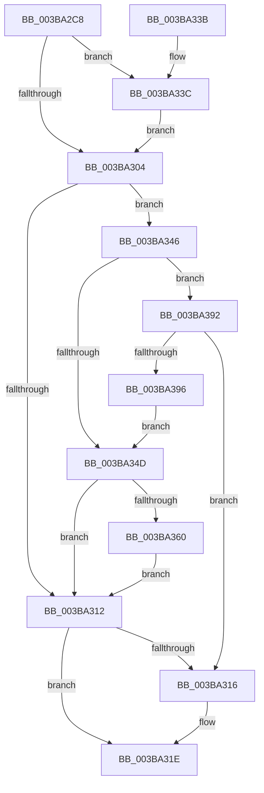

# MiWakeLargePageRebuild

- RVA: `0x003BA2C8`–`0x003BA398` (길이 `208` bytes)
- VA: `0x00000001403BA2C8`
- 실행 섹션: `.text`
- PDB 이름 있음: `예`; PDB Function 태그: `아니요`
- unwind 정보 RVA: `0x00083990`
- 디코드: `56`개 명령, `208/208` bytes 표시
- 미해석 바이트: `0` (있으면 어셈블리에 `.byte`로 보존)

> 이 문서는 커널 이미지의 기계어와 PDB 기호를 분석해 생성했습니다. 4번과 5번은 함수 원형과 자료형을 바이너리 사용 방식에서 추정한 C 해석이며 원본 소스 복구 결과는 아닙니다.

## 1. Dependencies

- 직접 호출 지점: **4**; 고유 호출 대상: **4**
- 직접 호출자로 확인된 함수: **2**
- RIP 상대 이미지 참조: **1**

### Outgoing calls
- `0x003BA319` → [ExReleaseSpinLockExclusiveFromDpcLevel](../24/ExReleaseSpinLockExclusiveFromDpcLevel_function_002497E0.md) (function, `0x002497E0`)
- `0x003BA33F` → [ExAcquireSpinLockExclusiveAtDpcLevel](../24/ExAcquireSpinLockExclusiveAtDpcLevel_function_00248E80.md) (function, `0x00248E80`)
- `0x003BA354` → [PsReferencePartitionSafe](PsReferencePartitionSafe_function_003BA6C0.md) (function, `0x003BA6C0`)
- `0x003BA38B` → [ExQueueWorkItemToPartition](../35/ExQueueWorkItemToPartition_function_00356E2C.md) (function, `0x00356E2C`)

### Direct callers
- [MiSignalLargePageRebuild](../2D/MiSignalLargePageRebuild_function_002DB4C8.md) at `0x002DB66D`
- [MiUnlinkFreeOrZeroedPage](../33/MiUnlinkFreeOrZeroedPage_function_00336C40.md) at `0x00337297`

### Static image references
- `0x003BA365` → RVA `0x003BA700` (`MiRebuildLargePages`; read)

## 2. Other-region calls and transfers

- 다른 실행 섹션으로 향하는 call: **0**
- 별도 외부 분기/꼬리 이동을 확인하지 못했습니다.

## 3. Assembly (complete function range)

```asm
003BA2C8  48 8B C4                        mov rax, rsp
003BA2CB  48 89 58 08                     mov qword ptr [rax + 8], rbx
003BA2CF  48 89 68 10                     mov qword ptr [rax + 0x10], rbp
003BA2D3  48 89 70 18                     mov qword ptr [rax + 0x18], rsi
003BA2D7  48 89 78 20                     mov qword ptr [rax + 0x20], rdi
003BA2DB  41 56                           push r14
003BA2DD  48 83 EC 20                     sub rsp, 0x20
003BA2E1  8B C2                           mov eax, edx
003BA2E3  41 8B D8                        mov ebx, r8d
003BA2E6  48 69 F0 80 DF 00 00            imul rsi, rax, 0xdf80
003BA2ED  BD 01 00 00 00                  mov ebp, 1
003BA2F2  4C 8B F1                        mov r14, rcx
003BA2F5  48 03 71 10                     add rsi, qword ptr [rcx + 0x10]
003BA2F9  48 8D BE 7C 3B 00 00            lea rdi, [rsi + 0x3b7c]
003BA300  23 DD                           and ebx, ebp
003BA302  74 38                           je 0x1403ba33c
003BA304  4C 8D 96 20 14 00 00            lea r10, [rsi + 0x1420]
003BA30B  41 80 7A 21 00                  cmp byte ptr [r10 + 0x21], 0
003BA310  74 34                           je 0x1403ba346
003BA312  85 DB                           test ebx, ebx
003BA314  75 08                           jne 0x1403ba31e
003BA316  48 8B CF                        mov rcx, rdi
003BA319  E8 C2 F4 E8 FF                  call 0x1402497e0
003BA31E  48 8B 5C 24 30                  mov rbx, qword ptr [rsp + 0x30]
003BA323  8B C5                           mov eax, ebp
003BA325  48 8B 6C 24 38                  mov rbp, qword ptr [rsp + 0x38]
003BA32A  48 8B 74 24 40                  mov rsi, qword ptr [rsp + 0x40]
003BA32F  48 8B 7C 24 48                  mov rdi, qword ptr [rsp + 0x48]
003BA334  48 83 C4 20                     add rsp, 0x20
003BA338  41 5E                           pop r14
003BA33A  C3                              ret
003BA33B  CC                              int3
003BA33C  48 8B CF                        mov rcx, rdi
003BA33F  E8 3C EB E8 FF                  call 0x140248e80
003BA344  EB BE                           jmp 0x1403ba304
003BA346  41 80 7A 22 08                  cmp byte ptr [r10 + 0x22], 8
003BA34B  75 45                           jne 0x1403ba392
003BA34D  49 8B 8E B8 00 00 00            mov rcx, qword ptr [r14 + 0xb8]
003BA354  E8 67 03 00 00                  call 0x1403ba6c0
003BA359  0F B6 E8                        movzx ebp, al
003BA35C  84 C0                           test al, al
003BA35E  74 B2                           je 0x1403ba312
003BA360  41 C6 42 21 01                  mov byte ptr [r10 + 0x21], 1
003BA365  48 8D 05 94 03 00 00            lea rax, [rip + 0x394]
003BA36C  49 83 22 00                     and qword ptr [r10], 0
003BA370  41 83 C8 FF                     or r8d, 0xffffffff
003BA374  49 89 42 10                     mov qword ptr [r10 + 0x10], rax
003BA378  BA 04 00 00 00                  mov edx, 4
003BA37D  49 89 72 18                     mov qword ptr [r10 + 0x18], rsi
003BA381  49 8B CA                        mov rcx, r10
003BA384  4D 8B 8E B8 00 00 00            mov r9, qword ptr [r14 + 0xb8]
003BA38B  E8 9C CA F9 FF                  call 0x140356e2c
003BA390  EB 80                           jmp 0x1403ba312
003BA392  85 DB                           test ebx, ebx
003BA394  74 80                           je 0x1403ba316
003BA396  EB B5                           jmp 0x1403ba34d
```

## 4. C-style interpretation (structured pseudocode)

```c
__int64 __fastcall MiWakeLargePageRebuild(__int64 a1, int a2, int a3)
{
    __int64 result;
    __int64 v_rbx;
    __int64 v_rsi;
    __int64 v_rsp;
    unsigned __int64 v_stack_p10;
    unsigned __int64 v_stack_p18;
    unsigned __int64 v_stack_p20;
    unsigned __int64 v_stack_p8;

    *(unsigned __int64 *)(v_rsp + 8) = v_rbx;
    *(unsigned __int64 *)(v_rsp + 16) = v_rbp;
    *(unsigned __int64 *)(v_rsp + 24) = v_rsi;
    *(unsigned __int64 *)(v_rsp + 32) = v_rdi;
    v_rsp = (v_rsp) - (32);
    v_rsi = (v_rsi) * ((unsigned int)(a2));
    v_rsi = (v_rsi) + (*(unsigned __int64 *)(a1 + 16));
    v_rbx = (unsigned int)(((unsigned int)(a3)) & (1));
    if (condition_is_equal) goto loc_003BA33C;
loc_003BA304:
    if ((*(unsigned __int8 *)(v_rsi + 5152 + 33)) == 0) goto loc_003BA346;
loc_003BA312:
    result = (unsigned int)(a2);
    if ((unsigned int)(v_rbx) == 0) {
        a1 = v_rsi + 15228;
        result = ExReleaseSpinLockExclusiveFromDpcLevel(a1, a2, a3, a4);
    }
    v_rsp = (v_rsp) + (32);
    return 1;
loc_003BA33C:
    result = ExAcquireSpinLockExclusiveAtDpcLevel(v_stack_p20, a2, a3, a4);
    goto loc_003BA304;
loc_003BA346:
    if ((*(unsigned __int8 *)(v_rsi + 5152 + 34)) != 8) goto loc_003BA392;
loc_003BA34D:
    result = PsReferencePartitionSafe(*(unsigned __int64 *)(a1 + 184), a2, a3, a4);
    if ((unsigned __int8)(result) == 0) goto loc_003BA312;
    *(unsigned __int8 *)(v_rsi + 5152 + 33) = 1;
    a3 = (unsigned int)((a3) | (0xFFFFFFFFULL));
    *(unsigned __int64 *)(v_rsi + 5152 + 16) = v_rip + 916;
    *(unsigned __int64 *)(v_rsi + 5152 + 24) = v_stack_p18;
    result = ExQueueWorkItemToPartition(v_rsi + 5152, 4, a3, *(unsigned __int64 *)(a1 + 184));
    goto loc_003BA312;
loc_003BA392:
    if ((unsigned int)(v_stack_p8) == 0) goto loc_003BA316;
    goto loc_003BA34D;
}
```

## 5. (Beta) C Style

```c
int64_t MiWakeLargePageRebuild(void *Arg1, int32_t Arg2, int32_t Arg3)
{
    uint8_t *arg1 = (uint8_t *)Arg1;

    int64_t result;
    int64_t local_rbx;
    int64_t local_rsi;
    int64_t local_rsp;
    uint64_t v_stack_p10;
    uint64_t v_stack_p18;
    uint64_t v_stack_p20;
    uint64_t v_stack_p8;

    *(uint64_t *)(local_rsp + 0x8) = local_rbx;
    *(uint64_t *)(local_rsp + 0x10) = local_rbp;
    *(uint64_t *)(local_rsp + 0x18) = local_rsi;
    *(uint64_t *)(local_rsp + 0x20) = local_rdi;
    local_rsp = (local_rsp) - (32);
    local_rsi = (local_rsi) * ((uint32_t)(Arg2));
    local_rsi = (local_rsi) + (*(uint64_t *)(arg1 + 0x10));
    local_rbx = (uint32_t)(((uint32_t)(Arg3)) & (1));
    if (condition_is_equal) goto loc_003BA33C;
loc_003BA304:
    if ((*(uint8_t *)(local_rsi + 0x1420 + 0x21)) == 0) goto loc_003BA346;
loc_003BA312:
    result = (uint32_t)(Arg2);
    if ((uint32_t)(local_rbx) == 0) {
        Arg1 = local_rsi + 15228;
        result = ExReleaseSpinLockExclusiveFromDpcLevel(Arg1, Arg2, Arg3, a4);
    }
    local_rsp = (local_rsp) + (32);
    return 1;
loc_003BA33C:
    result = ExAcquireSpinLockExclusiveAtDpcLevel(v_stack_p20, Arg2, Arg3, a4);
    goto loc_003BA304;
loc_003BA346:
    if ((*(uint8_t *)(local_rsi + 0x1420 + 0x22)) != 8) goto loc_003BA392;
loc_003BA34D:
    result = PsReferencePartitionSafe(*(uint64_t *)(arg1 + 0xB8), Arg2, Arg3, a4);
    if ((uint8_t)(result) == 0) goto loc_003BA312;
    *(uint8_t *)(local_rsi + 0x1420 + 0x21) = 1;
    Arg3 = (uint32_t)((Arg3) | (0xFFFFFFFFULL));
    *(uint64_t *)(local_rsi + 0x1420 + 0x10) = v_rip + 916;
    *(uint64_t *)(local_rsi + 0x1420 + 0x18) = v_stack_p18;
    result = ExQueueWorkItemToPartition(local_rsi + 5152, 4, Arg3, *(uint64_t *)(arg1 + 0xB8));
    goto loc_003BA312;
loc_003BA392:
    if ((uint32_t)(v_stack_p8) == 0) goto loc_003BA316;
    goto loc_003BA34D;
}
```

### 관측된 메모리 오프셋

구조체 형식이 확인되지 않은 접근은 인자 기준의 오프셋으로만 기록했습니다.

| 기준 인자 | 오프셋 표현 | 폭 (bit) | 접근 |
|---|---:|---:|---|
| `Arg1` | `+ 0x10` | `64` | `R` |
| `Arg1` | `+ 0xB8` | `64` | `R` |

## 6. Execution-region graph

[열기: 2D/3D 그래프와 함수 탐색 컨트롤 패널](../../../control-panel.html?section=text&rva=0x003BA2C8&view=graph)

- 2D 그래프는 위에서 아래로 흐르고, 3D 그래프는 빈 공간을 드래그해 회전합니다. Shift+드래그는 이동, 휠은 확대·축소, 함수 노드 선택은 대상 보고서 이동입니다.

### Static fallback


