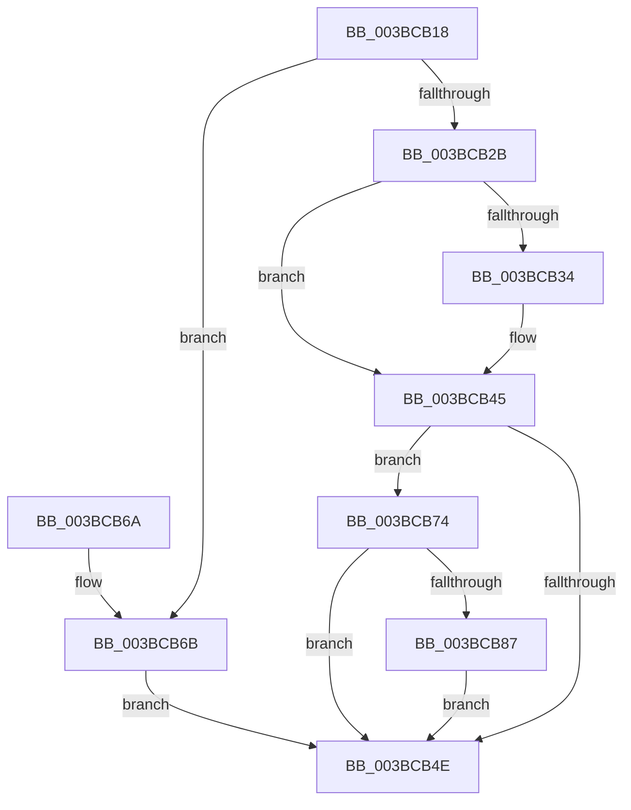

# MiWakeModifiedPageWriter

- RVA: `0x003BCB18`–`0x003BCBA2` (길이 `138` bytes)
- VA: `0x00000001403BCB18`
- 실행 섹션: `.text`
- PDB 이름 있음: `예`; PDB Function 태그: `아니요`
- unwind 정보 RVA: `0x00062E24`
- 디코드: `36`개 명령, `138/138` bytes 표시
- 미해석 바이트: `0` (있으면 어셈블리에 `.byte`로 보존)

> 이 문서는 커널 이미지의 기계어와 PDB 기호를 분석해 생성했습니다. 4번과 5번은 함수 원형과 자료형을 바이너리 사용 방식에서 추정한 C 해석이며 원본 소스 복구 결과는 아닙니다.

## 1. Dependencies

- 직접 호출 지점: **5**; 고유 호출 대상: **4**
- 직접 호출자로 확인된 함수: **6**
- RIP 상대 이미지 참조: **0**

### Outgoing calls
- `0x003BCB40` → [KeSetEvent](../33/KeSetEvent_function_0033F310.md) (function, `0x0033F310`)
- `0x003BCB5A` → [KeSetEvent](../33/KeSetEvent_function_0033F310.md) (function, `0x0033F310`)
- `0x003BCB7E` → [ExAcquireRundownProtection](../21/ExAcquireRundownProtection_function_00216620.md) (function, `0x00216620`)
- `0x003BCB93` → [KeSetActualBasePriorityThread](../3C/KeSetActualBasePriorityThread_function_003C4370.md) (function, `0x003C4370`)
- `0x003BCB9B` → [ExReleaseRundownProtection](../34/ExReleaseRundownProtection_function_00349E80.md) (function, `0x00349E80`)

### Direct callers
- [MiInsertPageInList](../2B/MiInsertPageInList_function_002BA000.md) at `0x002BA90A`
- [MiAdjustModifiedPageLoad](../2D/MiAdjustModifiedPageLoad_function_002DC07C.md) at `0x002DC2AF`
- [sub_0033EABD](../33/Unknown_function_0033EABD.md) at `0x0033EC18`
- [MiObtainFreePages](MiObtainFreePages_function_003BB724.md) at `0x003BB7AB`
- [MiFlushAllStoreSwapPages](MiFlushAllStoreSwapPages_function_003BC890.md) at `0x003BC929`
- [MiFlushAllPagesWorker](MiFlushAllPagesWorker_function_003BCED4.md) at `0x003BCF61`

### Static image references
- 디코드된 RIP-relative 메모리 참조가 없습니다.

## 2. Other-region calls and transfers

- 다른 실행 섹션으로 향하는 call: **0**
- 별도 외부 분기/꼬리 이동을 확인하지 못했습니다.

## 3. Assembly (complete function range)

```asm
003BCB18  48 89 5C 24 08                  mov qword ptr [rsp + 8], rbx
003BCB1D  57                              push rdi
003BCB1E  48 83 EC 20                     sub rsp, 0x20
003BCB22  48 8B D9                        mov rbx, rcx
003BCB25  48 83 FA FF                     cmp rdx, -1
003BCB29  75 40                           jne 0x1403bcb6b
003BCB2B  83 B9 E4 02 00 00 00            cmp dword ptr [rcx + 0x2e4], 0
003BCB32  74 11                           je 0x1403bcb45
003BCB34  48 81 C1 E8 02 00 00            add rcx, 0x2e8
003BCB3B  45 33 C0                        xor r8d, r8d
003BCB3E  33 D2                           xor edx, edx
003BCB40  E8 CB 27 F8 FF                  call 0x14033f310
003BCB45  83 BB 00 03 00 00 12            cmp dword ptr [rbx + 0x300], 0x12
003BCB4C  75 26                           jne 0x1403bcb74
003BCB4E  48 8D 8B 10 03 00 00            lea rcx, [rbx + 0x310]
003BCB55  45 33 C0                        xor r8d, r8d
003BCB58  33 D2                           xor edx, edx
003BCB5A  E8 B1 27 F8 FF                  call 0x14033f310
003BCB5F  48 8B 5C 24 30                  mov rbx, qword ptr [rsp + 0x30]
003BCB64  48 83 C4 20                     add rsp, 0x20
003BCB68  5F                              pop rdi
003BCB69  C3                              ret
003BCB6A  CC                              int3
003BCB6B  48 89 91 08 03 00 00            mov qword ptr [rcx + 0x308], rdx
003BCB72  EB DA                           jmp 0x1403bcb4e
003BCB74  48 8D BB E8 03 00 00            lea rdi, [rbx + 0x3e8]
003BCB7B  48 8B CF                        mov rcx, rdi
003BCB7E  E8 9D 9A E5 FF                  call 0x140216620
003BCB83  84 C0                           test al, al
003BCB85  74 C7                           je 0x1403bcb4e
003BCB87  48 8B 8B E0 03 00 00            mov rcx, qword ptr [rbx + 0x3e0]
003BCB8E  BA 12 00 00 00                  mov edx, 0x12
003BCB93  E8 D8 77 00 00                  call 0x1403c4370
003BCB98  48 8B CF                        mov rcx, rdi
003BCB9B  E8 E0 D2 F8 FF                  call 0x140349e80
003BCBA0  EB AC                           jmp 0x1403bcb4e
```

## 4. C-style interpretation (structured pseudocode)

```c
__int64 __fastcall MiWakeModifiedPageWriter(__int64 a1, __int64 a2, int a3)
{
    __int64 result;
    __int64 v_rsp;
    unsigned __int64 v_stack_p8;

    v_stack_p8 = v_rbx;
    v_rsp = (v_rsp) - (32);
    if (a2 != -1) goto loc_003BCB6B;
    if ((*(unsigned int *)(a1 + 740)) != 0) {
        a1 = (a1) + (744);
        a3 = 0;
        a2 = 0;
        result = KeSetEvent(a1, a2, a3, a4);
    }
    if ((*(unsigned int *)(a1 + 768)) != 18) goto loc_003BCB74;
loc_003BCB4E:
    a3 = 0;
    a2 = 0;
    result = KeSetEvent(a1 + 784, a2, a3, a4);
    v_rsp = (v_rsp) + (32);
    return result;
loc_003BCB6B:
    *(unsigned __int64 *)(a1 + 784 + 776) = 0;
    goto loc_003BCB4E;
loc_003BCB74:
    result = ExAcquireRundownProtection(v_stack_p8 + 1000, a2, a3, a4);
    if ((unsigned __int8)(result) == 0) goto loc_003BCB4E;
    result = KeSetActualBasePriorityThread(*(unsigned __int64 *)(v_stack_p8 + 992), 18, a3, a4);
    result = ExReleaseRundownProtection(v_stack_p8 + 1000, 18, a3, a4);
    goto loc_003BCB4E;
}
```

## 5. (Beta) C Style

```c
int64_t MiWakeModifiedPageWriter(void *Arg1, int64_t Arg2, int32_t Arg3)
{
    uint8_t *arg1 = (uint8_t *)Arg1;

    int64_t result;
    int64_t local_rsp;
    uint64_t v_stack_p8;

    v_stack_p8 = local_rbx;
    local_rsp = (local_rsp) - (32);
    if (Arg2 != -1) goto loc_003BCB6B;
    if ((*(uint32_t *)(arg1 + 0x2E4)) != 0) {
        Arg1 = (Arg1) + (744);
        Arg3 = 0;
        Arg2 = 0;
        result = KeSetEvent(Arg1, Arg2, Arg3, a4);
    }
    if ((*(uint32_t *)(arg1 + 0x300)) != 18) goto loc_003BCB74;
loc_003BCB4E:
    Arg3 = 0;
    Arg2 = 0;
    result = KeSetEvent(Arg1 + 784, Arg2, Arg3, a4);
    local_rsp = (local_rsp) + (32);
    return result;
loc_003BCB6B:
    *(uint64_t *)(arg1 + 0x310 + 0x308) = 0;
    goto loc_003BCB4E;
loc_003BCB74:
    result = ExAcquireRundownProtection(v_stack_p8 + 1000, Arg2, Arg3, a4);
    if ((uint8_t)(result) == 0) goto loc_003BCB4E;
    result = KeSetActualBasePriorityThread(*(uint64_t *)(v_stack_p8 + 0x3E0), 18, Arg3, a4);
    result = ExReleaseRundownProtection(v_stack_p8 + 1000, 18, Arg3, a4);
    goto loc_003BCB4E;
}
```

### 관측된 메모리 오프셋

구조체 형식이 확인되지 않은 접근은 인자 기준의 오프셋으로만 기록했습니다.

| 기준 인자 | 오프셋 표현 | 폭 (bit) | 접근 |
|---|---:|---:|---|
| `Arg1` | `+ 0x2E4` | `32` | `R` |
| `Arg1` | `+ 0x300` | `32` | `R` |
| `Arg1` | `+ 0x308` | `64` | `W` |
| `Arg1` | `+ 0x310` | `64` | `R` |
| `Arg1` | `+ 0x3E0` | `64` | `R` |
| `Arg1` | `+ 0x3E8` | `64` | `R` |

## 6. Execution-region graph

[열기: 2D/3D 그래프와 함수 탐색 컨트롤 패널](../../../control-panel.html?section=text&rva=0x003BCB18&view=graph)

- 2D 그래프는 위에서 아래로 흐르고, 3D 그래프는 빈 공간을 드래그해 회전합니다. Shift+드래그는 이동, 휠은 확대·축소, 함수 노드 선택은 대상 보고서 이동입니다.

### Static fallback


