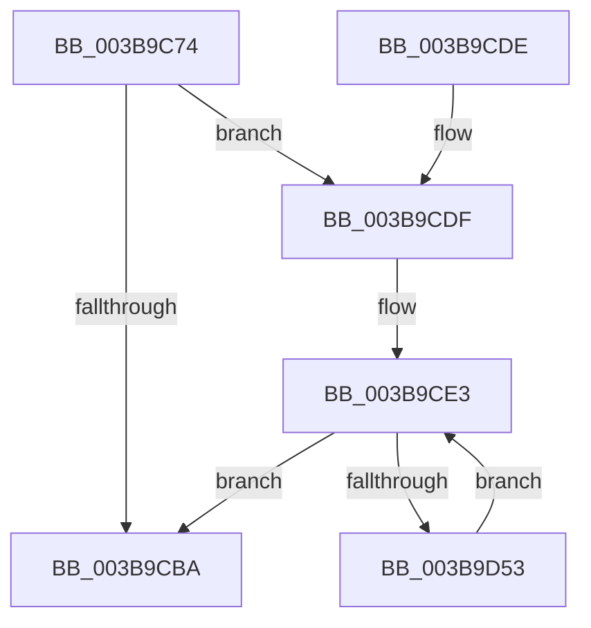

# MmFillEtwNodeInformation

- RVA: `0x003B9C74`–`0x003B9D55` (길이 `225` bytes)
- VA: `0x00000001403B9C74`
- 실행 섹션: `.text`
- PDB 이름 있음: `예`; PDB Function 태그: `아니요`
- unwind 정보 RVA: `0x0008CADC`
- 디코드: `62`개 명령, `225/225` bytes 표시
- 미해석 바이트: `0` (있으면 어셈블리에 `.byte`로 보존)

> 이 문서는 커널 이미지의 기계어와 PDB 기호를 분석해 생성했습니다. 4번과 5번은 함수 원형과 자료형을 바이너리 사용 방식에서 추정한 C 해석이며 원본 소스 복구 결과는 아닙니다.

## 1. Dependencies

- 직접 호출 지점: **2**; 고유 호출 대상: **2**
- 직접 호출자로 확인된 함수: **1**
- RIP 상대 이미지 참조: **1**

### Outgoing calls
- `0x003B9CA3` → [memset](../6C/memset_function_006C6C40.md) (function, `0x006C6C40`)
- `0x003B9CED` → [MiGetPartitionNodeInformation](MiGetPartitionNodeInformation_function_003B8D48.md) (function, `0x003B8D48`)

### Direct callers
- [EtwpLogMemNodeInfo](EtwpLogMemNodeInfo_function_003B991C.md) at `0x003B99D5`

### Static image references
- `0x003B9CA8` → RVA `0x00FC5000` (`ALMOSTRO`; read)

## 2. Other-region calls and transfers

- 다른 실행 섹션으로 향하는 call: **0**
- 별도 외부 분기/꼬리 이동을 확인하지 못했습니다.

## 3. Assembly (complete function range)

```asm
003B9C74  48 8B C4                        mov rax, rsp
003B9C77  48 89 58 08                     mov qword ptr [rax + 8], rbx
003B9C7B  48 89 68 10                     mov qword ptr [rax + 0x10], rbp
003B9C7F  48 89 70 18                     mov qword ptr [rax + 0x18], rsi
003B9C83  48 89 78 20                     mov qword ptr [rax + 0x20], rdi
003B9C87  41 56                           push r14
003B9C89  48 83 EC 70                     sub rsp, 0x70
003B9C8D  48 8B 29                        mov rbp, qword ptr [rcx]
003B9C90  48 8B FA                        mov rdi, rdx
003B9C93  33 D2                           xor edx, edx
003B9C95  48 8D 48 A8                     lea rcx, [rax - 0x58]
003B9C99  41 8B F0                        mov esi, r8d
003B9C9C  4D 8B F1                        mov r14, r9
003B9C9F  44 8D 42 48                     lea r8d, [rdx + 0x48]
003B9CA3  E8 98 CF 30 00                  call 0x1406c6c40
003B9CA8  0F B7 05 51 B3 C0 00            movzx eax, word ptr [rip + 0xc0b351]
003B9CAF  3B F0                           cmp esi, eax
003B9CB1  0F 47 F0                        cmova esi, eax
003B9CB4  33 DB                           xor ebx, ebx
003B9CB6  85 F6                           test esi, esi
003B9CB8  75 25                           jne 0x1403b9cdf
003B9CBA  0F B7 45 00                     movzx eax, word ptr [rbp]
003B9CBE  4C 8D 5C 24 70                  lea r11, [rsp + 0x70]
003B9CC3  49 8B 6B 18                     mov rbp, qword ptr [r11 + 0x18]
003B9CC7  49 8B 73 20                     mov rsi, qword ptr [r11 + 0x20]
003B9CCB  49 8B 7B 28                     mov rdi, qword ptr [r11 + 0x28]
003B9CCF  41 89 06                        mov dword ptr [r14], eax
003B9CD2  8B C3                           mov eax, ebx
003B9CD4  49 8B 5B 10                     mov rbx, qword ptr [r11 + 0x10]
003B9CD8  49 8B E3                        mov rsp, r11
003B9CDB  41 5E                           pop r14
003B9CDD  C3                              ret
003B9CDE  CC                              int3
003B9CDF  48 83 C7 14                     add rdi, 0x14
003B9CE3  4C 8D 44 24 20                  lea r8, [rsp + 0x20]
003B9CE8  8B D3                           mov edx, ebx
003B9CEA  48 8B CD                        mov rcx, rbp
003B9CED  E8 56 F0 FF FF                  call 0x1403b8d48
003B9CF2  48 8B 44 24 20                  mov rax, qword ptr [rsp + 0x20]
003B9CF7  FF C3                           inc ebx
003B9CF9  48 89 47 F0                     mov qword ptr [rdi - 0x10], rax
003B9CFD  48 8B 44 24 30                  mov rax, qword ptr [rsp + 0x30]
003B9D02  48 89 07                        mov qword ptr [rdi], rax
003B9D05  48 8B 44 24 28                  mov rax, qword ptr [rsp + 0x28]
003B9D0A  48 89 47 F8                     mov qword ptr [rdi - 8], rax
003B9D0E  48 8B 44 24 40                  mov rax, qword ptr [rsp + 0x40]
003B9D13  48 89 47 10                     mov qword ptr [rdi + 0x10], rax
003B9D17  48 8B 44 24 38                  mov rax, qword ptr [rsp + 0x38]
003B9D1C  48 89 47 08                     mov qword ptr [rdi + 8], rax
003B9D20  48 8B 44 24 50                  mov rax, qword ptr [rsp + 0x50]
003B9D25  48 89 47 20                     mov qword ptr [rdi + 0x20], rax
003B9D29  48 8B 44 24 48                  mov rax, qword ptr [rsp + 0x48]
003B9D2E  48 89 47 18                     mov qword ptr [rdi + 0x18], rax
003B9D32  48 8B 44 24 60                  mov rax, qword ptr [rsp + 0x60]
003B9D37  48 89 47 30                     mov qword ptr [rdi + 0x30], rax
003B9D3B  48 8B 44 24 58                  mov rax, qword ptr [rsp + 0x58]
003B9D40  48 89 47 28                     mov qword ptr [rdi + 0x28], rax
003B9D44  89 5F EC                        mov dword ptr [rdi - 0x14], ebx
003B9D47  48 8D 7F 4C                     lea rdi, [rdi + 0x4c]
003B9D4B  3B DE                           cmp ebx, esi
003B9D4D  0F 83 67 FF FF FF               jae 0x1403b9cba
003B9D53  EB 8E                           jmp 0x1403b9ce3
```

## 4. C-style interpretation (structured pseudocode)

```c
__int64 __fastcall MmFillEtwNodeInformation(__int64 a1, __int64 a2, int a3, __int64 a4)
{
    __int64 result;
    __int64 v_rbx;
    __int64 v_rdi;
    __int64 v_rsi;
    __int64 v_rsp;
    unsigned __int64 v_stack_m10;
    unsigned __int64 v_stack_m18;
    unsigned __int64 v_stack_m20;
    unsigned __int64 v_stack_m28;
    unsigned __int64 v_stack_m30;
    unsigned __int64 v_stack_m38;
    unsigned __int64 v_stack_m40;
    unsigned __int64 v_stack_m48;
    unsigned __int64 v_stack_m50;
    unsigned __int64 v_stack_m8;

    *(unsigned __int64 *)(v_rsp + 8) = v_rbx;
    *(unsigned __int64 *)(v_rsp + 16) = v_rbp;
    *(unsigned __int64 *)(v_rsp + 24) = v_rsi;
    *(unsigned __int64 *)(v_rsp + 32) = v_rdi;
    v_rsp = (v_rsp) - (112);
    a2 = 0;
    result = memset(v_rsp - 88, a2, a2 + 72, a4);
    v_rsi = (unsigned int)(a3);
    if (((unsigned int)((unsigned int)(a3))) > ((unsigned int)(*(unsigned __int16 *)(v_rip + 12628817)))) { v_rsi = (unsigned int)(*(unsigned __int16 *)(v_rip + 12628817)); }
    v_rbx = 0;
    if ((unsigned int)(v_rsi) != 0) goto loc_003B9CDF;
loc_003B9CBA:
    *(unsigned int *)(a4) = (unsigned int)(*(unsigned __int16 *)(*(unsigned __int64 *)(a1)));
    return 0;
loc_003B9CDF:
    v_rdi = (*(unsigned __int64 *)(v_stack_m8 + 40)) + (20);
loc_003B9CE3:
    result = MiGetPartitionNodeInformation(*(unsigned __int64 *)(v_stack_m8 + 24), (unsigned int)((unsigned int)(*(unsigned __int64 *)(v_stack_m8 + 16))), v_stack_m50, a4);
    v_rbx = (unsigned int)((*(unsigned __int64 *)(v_stack_m8 + 16)) + 1);
    *(unsigned __int64 *)(v_rdi - 16) = v_stack_m50;
    *(unsigned __int64 *)(v_rdi) = v_stack_m40;
    *(unsigned __int64 *)(v_rdi - 8) = v_stack_m48;
    *(unsigned __int64 *)(v_rdi + 16) = v_stack_m30;
    *(unsigned __int64 *)(v_rdi + 8) = v_stack_m38;
    *(unsigned __int64 *)(v_rdi + 32) = v_stack_m20;
    *(unsigned __int64 *)(v_rdi + 24) = v_stack_m28;
    *(unsigned __int64 *)(v_rdi + 48) = v_stack_m10;
    *(unsigned __int64 *)(v_rdi + 40) = v_stack_m18;
    *(unsigned int *)(v_rdi - 20) = (unsigned int)(v_rbx);
    if (((unsigned int)(v_rbx)) >= ((unsigned int)(*(unsigned __int64 *)(v_stack_m8 + 32)))) goto loc_003B9CBA;
    goto loc_003B9CE3;
}
```

## 5. (Beta) C Style

```c
int64_t MmFillEtwNodeInformation(void *Arg1, void *Arg2, int32_t Arg3, void *Arg4)
{
    uint8_t *arg1 = (uint8_t *)Arg1;
    uint8_t *arg2 = (uint8_t *)Arg2;
    uint8_t *arg4 = (uint8_t *)Arg4;

    int64_t result;
    int64_t local_rbx;
    int64_t local_rdi;
    int64_t local_rsi;
    int64_t local_rsp;
    uint64_t v_stack_m10;
    uint64_t v_stack_m18;
    uint64_t v_stack_m20;
    uint64_t v_stack_m28;
    uint64_t v_stack_m30;
    uint64_t v_stack_m38;
    uint64_t v_stack_m40;
    uint64_t v_stack_m48;
    uint64_t v_stack_m50;
    uint64_t v_stack_m8;

    *(uint64_t *)(local_rsp + 0x8) = local_rbx;
    *(uint64_t *)(local_rsp + 0x10) = local_rbp;
    *(uint64_t *)(local_rsp + 0x18) = local_rsi;
    *(uint64_t *)(local_rsp + 0x20) = local_rdi;
    local_rsp = (local_rsp) - (112);
    Arg2 = 0;
    result = memset(local_rsp - 88, Arg2, Arg2 + 72, Arg4);
    local_rsi = (uint32_t)(Arg3);
    if (((uint32_t)((uint32_t)(Arg3))) > ((uint32_t)(*(uint16_t *)(v_rip + 0xC0B351)))) { local_rsi = (uint32_t)(*(uint16_t *)(v_rip + 0xC0B351)); }
    local_rbx = 0;
    if ((uint32_t)(local_rsi) != 0) goto loc_003B9CDF;
loc_003B9CBA:
    *(uint32_t *)(arg4) = (uint32_t)(*(uint16_t *)(*(uint64_t *)(arg1)));
    return 0;
loc_003B9CDF:
    local_rdi = (*(uint64_t *)(v_stack_m8 + 0x28)) + (20);
loc_003B9CE3:
    result = MiGetPartitionNodeInformation(*(uint64_t *)(v_stack_m8 + 0x18), (uint32_t)((uint32_t)(*(uint64_t *)(v_stack_m8 + 0x10))), v_stack_m50, Arg4);
    local_rbx = (uint32_t)((*(uint64_t *)(v_stack_m8 + 0x10)) + 1);
    *(uint64_t *)(local_rdi - 0x10) = v_stack_m50;
    *(uint64_t *)(local_rdi) = v_stack_m40;
    *(uint64_t *)(local_rdi - 0x8) = v_stack_m48;
    *(uint64_t *)(local_rdi + 0x10) = v_stack_m30;
    *(uint64_t *)(local_rdi + 0x8) = v_stack_m38;
    *(uint64_t *)(local_rdi + 0x20) = v_stack_m20;
    *(uint64_t *)(local_rdi + 0x18) = v_stack_m28;
    *(uint64_t *)(local_rdi + 0x30) = v_stack_m10;
    *(uint64_t *)(local_rdi + 0x28) = v_stack_m18;
    *(uint32_t *)(local_rdi - 0x14) = (uint32_t)(local_rbx);
    if (((uint32_t)(local_rbx)) >= ((uint32_t)(*(uint64_t *)(v_stack_m8 + 0x20)))) goto loc_003B9CBA;
    goto loc_003B9CE3;
}
```

### 관측된 메모리 오프셋

구조체 형식이 확인되지 않은 접근은 인자 기준의 오프셋으로만 기록했습니다.

| 기준 인자 | 오프셋 표현 | 폭 (bit) | 접근 |
|---|---:|---:|---|
| `Arg1` | `+ 0x0` | `64` | `R` |
| `Arg2` | `- 0x14` | `32` | `W` |
| `Arg2` | `- 0x10` | `64` | `W` |
| `Arg2` | `- 0x8` | `64` | `W` |
| `Arg2` | `+ 0x0` | `64` | `W` |
| `Arg2` | `+ 0x8` | `64` | `W` |
| `Arg2` | `+ 0x10` | `64` | `W` |
| `Arg2` | `+ 0x18` | `64` | `W` |
| `Arg2` | `+ 0x20` | `64` | `W` |
| `Arg2` | `+ 0x28` | `64` | `W` |
| `Arg2` | `+ 0x30` | `64` | `W` |
| `Arg2` | `+ 0x4C` | `64` | `R` |
| `Arg4` | `+ 0x0` | `32` | `W` |

## 6. Execution-region graph

[열기: 2D/3D 그래프와 함수 탐색 컨트롤 패널](../../../control-panel.html?section=text&rva=0x003B9C74&view=graph)

- 2D 그래프는 위에서 아래로 흐르고, 3D 그래프는 빈 공간을 드래그해 회전합니다. Shift+드래그는 이동, 휠은 확대·축소, 함수 노드 선택은 대상 보고서 이동입니다.

### Static fallback


